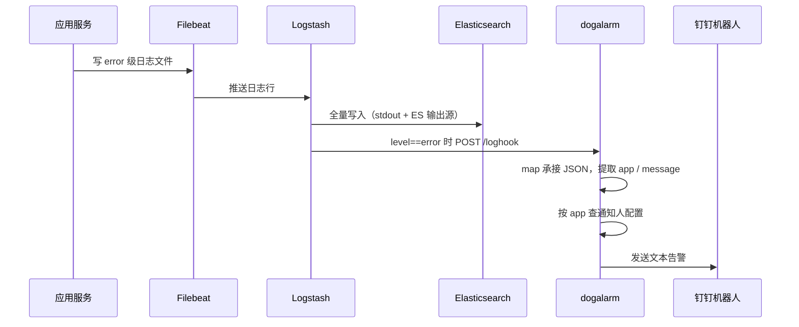

# 97. Go APM 监控系统实战: Logstash 错误日志告警接入与 Go 承接实现

## 纲要

- 告警通道回顾：Grafana 指标告警已接入，本节补齐**日志告警**链路。
- Logstash 侧改造：
 - 原有输出源为标准输出与 Elasticsearch；
 - 新增一个**条件 HTTP 输出源**，仅当日志等级为 `error` 时触发。
 - 容器网络下必须使用**宿主机内网 IP**，端口 `8084`，路由 `/loghook`。
- dogalarm（自研告警服务）侧改造：
 - 用 `map[string]interface{}` 承接 Logstash 推送的松散 JSON，避免定义死板结构体；
 - 从 `app` 字段取服务名、从 `message` 字段取告警正文；
 - 统一复用钉钉通道下发。
- 验证方式：杀掉 user-service，用 order-service 触发调用链错误，断点观察 Logstash 推送的报文格式。

## 日志告警在整个告警体系中的位置

前几节实现的指标告警解决的是"数值越界"问题：CPU、内存、QPS、错误率这类**可聚合**的信号，由 Prometheus 计算、Grafana 判定、webhook 回调到 dogalarm。

但指标有一个先天缺陷——它只告诉你"出事了"，不告诉你"哪一条日志出事了"。线上排查时最想要的信息往往是具体的错误堆栈、SQL 报错、下游超时详情，这些内容只存在于日志里。因此日志告警是指标告警的必要补充：

| 维度 | 指标告警 | 日志告警 |
| --- | --- | --- |
| 数据来源 | Prometheus 聚合结果 | Logstash 采集的原始日志行 |
| 触发条件 | 表达式越界（如 `rate(...) > 10`） | 日志等级匹配（如 `level == error`） |
| 告警内容 | 指标名 + 数值 + 规则名 | 服务名 + 原始错误文本 |
| 适用场景 | 趋势异常、容量预警 | 单次致命错误、堆栈定位 |

## Logstash 输出源改造

Logstash 的 `output` 段落支持多输出源并行，并且每个输出源都可以用条件表达式包裹。原始配置里有 `stdout` 与 `elasticsearch` 两个输出源，本节追加第三个：

```
# 根据讲稿逻辑补充：Logstash output 段落配置
output {
  stdout {
    codec => json_lines
  }

  elasticsearch {
    hosts => ["http://elasticsearch:9200"]
    index => "apm-log-%{+YYYY.MM.dd}"
  }

  # 仅当日志等级为 error 时，才推送给自研告警服务
  if [level] == "error" {
    http {
      # 容器网络注意：Logstash 运行在容器内，
      # 这里不能写 localhost，必须写宿主机内网 IP
      url          => "http://192.168.1.20:8084/loghook"
      http_method  => "post"
      format       => "json"
      content_type => "application/json"
    }
  }
}
```

三个容易踩的坑：

- **内网 IP 而不是 localhost**。Logstash 跑在自己的容器里，`localhost` 指向容器自身，永远连不上宿主机上的 dogalarm。要把 `url` 写成宿主机在 Docker 网桥上的内网地址。
- **端口与路由对齐**。dogalarm 监听 `8084`，对外暴露 `/loghook` 路由，两者必须完全一致。
- **条件判断写在 output 内部**。Logstash 的条件语句可以作用于 plugin 级别，把 `if` 写在 `http` 外层即可实现"只有 error 才发"，避免把全量 INFO 日志灌进告警通道。

改完配置后重启 Logstash 容器，等待其重新加载 pipeline。

## 观察 Logstash 推送的报文格式

在改 Go 代码之前，先搞清楚对端到底发来什么。做法很朴素：把 dogalarm 以调试模式启动，在 `/loghook` 的处理函数里打个断点，然后人为制造一个错误。

制造错误的手法：order-service 依赖 user-service，直接 `kill` 掉 user-service 进程，再通过 order-service 发几次请求，调用必然失败，业务代码里已有的错误处理会打出 error 级日志，Logstash 采集后就会推送到断点处。

断点的 `data` 里可以看到报文是一个扁平 JSON，核心字段只有两个：

```json
{
  "app": "order-service",
  "message": "call user-service failed: dial tcp 172.18.0.5:8081: connect: connection refused",
  "level": "error",
  "@timestamp": "2024-05-11T09:23:11.482Z"
}
```

- `app`：服务名。用来决定"这条告警该发给哪个服务的通知人"。
- `message`：原始错误文本。这是开发者真正要看的内容。

## 用 map 承接而非定义结构体

Logstash 的 HTTP output 输出字段会随 pipeline 配置、codec 插件变化，字段集合并不稳定。如果定义一个固定结构体，一旦 Logstash 侧加了字段或改了类型，反序列化就可能出错，导致告警丢失——而告警系统最不能接受的就是"静默丢失"。

用 `map[string]interface{}` 承接是更务实的选择：只要 `app` 和 `message` 两个字段存在就能工作，其余字段忽略。

```go
// 根据讲稿逻辑补充：承接 Logstash 推送的 error 级日志
package main

import (
	"encoding/json"
	"io"
	"log"
	"net/http"
)

// LogstashLogBody Logstash 推送过来的日志报文。
// 字段集合不固定，这里只关心 app 与 message。
type LogstashLogBody struct {
	App     string
	Message string
}

// parseLogstashBody 从松散 JSON 中提取服务名与告警正文。
func parseLogstashBody(raw []byte) (*LogstashLogBody, error) {
	var payload map[string]interface{}
	if err := json.Unmarshal(raw, &payload); err != nil {
		return nil, err
	}

	body := &LogstashLogBody{}
	if v, ok := payload["app"].(string); ok {
		body.App = v
	}
	if v, ok := payload["message"].(string); ok {
		body.Message = v
	}
	return body, nil
}

// LogHook 处理 Logstash 的 /loghook 回调。
func LogHook(w http.ResponseWriter, r *http.Request) {
	raw, err := io.ReadAll(r.Body)
	if err != nil {
		log.Printf("loghook: read body failed: %v", err)
		w.WriteHeader(http.StatusBadRequest)
		return
	}
	defer r.Body.Close()

	body, err := parseLogstashBody(raw)
	if err != nil {
		// 解析失败也要记录原始报文，方便事后追溯
		log.Printf("loghook: unmarshal failed: %v, raw: %s", err, string(raw))
		w.WriteHeader(http.StatusBadRequest)
		return
	}

	log.Printf("loghook: app=%s message=%s", body.App, body.Message)

	// 按服务名取出该服务配置的通知人，统一走钉钉通道下发
	notifier := LookupNotifier(body.App)
	if notifier == nil || notifier.DingTalkWebhook == "" {
		log.Printf("loghook: no notifier configured for app=%s", body.App)
		w.WriteHeader(http.StatusOK)
		return
	}

	content := "[日志告警] " + body.App + "\n" + body.Message
	if err := SendDingTalk(notifier.DingTalkWebhook, content); err != nil {
		log.Printf("loghook: send dingtalk failed: %v", err)
	}

	w.WriteHeader(http.StatusOK)
}

func main() {
	http.HandleFunc("/loghook", LogHook)
	log.Println("dogalarm listening on :8084")
	log.Fatal(http.ListenAndServe(":8084", nil))
}
```

代码里有两处值得强调的设计：

- **解析失败仍然落日志**。反序列化失败时不静默丢弃，而是把原始报文打印出来。告警链路上的任何一环"悄悄失败"都是灾难。
- **取不到通知人时返回 200**。Logstash 的 HTTP output 在收到非 2xx 时会重试，如果因为"该服务没配钉钉机器人"而返回 500，会造成无意义的重试风暴。配置缺失属于业务决策，不是错误。

## 数据流向



## 本节留下的两个缺口

当前的日志告警能跑通，但还非常"原始"，存在两个明显问题：

- **没有限流**。钉钉机器人官方限制 20 条/分钟，一次故障雪崩可能瞬间打出几百条 error 日志，直接把机器人限流，后续真正的告警反而发不出去。
- **没有排重**。同一条错误在循环里重复打印，会被原样推送几十遍，开发者被刷屏，真正的信号被淹没。

下面先补齐电话告警通道，随后专门处理限流与排重。

## API 速览

| API / 配置 | 说明 |
| --- | --- |
| Logstash `output { if [level] == "error" { http { ... } } }` | 条件化 HTTP 输出源 |
| `http.url` | 目标地址，容器内需写宿主机内网 IP |
| `http.http_method` | 通常为 `post` |
| `http.format` | `json` / `form` / `message` |
| `json.Unmarshal([]byte,*map[string]interface{})` | 松散 JSON 承接，避免字段耦合 |
| `io.ReadAll(r.Body)` | 读取 HTTP 请求体 |

## Demo 示例

**运行说明**：`go run main.go` 启动 dogalarm 监听 `8084`；Logstash 侧按上文配置 `http` 输出源；用 `curl -X POST http://127.0.0.1:8084/loghook -d '{"app":"order-service","message":"boom"}'` 即可本地验证。

**代码说明**：示例为标准库实现，不依赖任何 web 框架，可直接编译运行。`LookupNotifier` 与 `SendDingTalk` 为占位函数，实际项目中分别对应"按服务名查 depper_info 表"与"调用钉钉 webhook"（后续实现）。

**技术点总结**：

- Logstash 条件输出源把"是否告警"的判断前移到采集层，Go 侧只负责下发。
- 容器网络下 localhost 不可达宿主机服务，必须写内网 IP。
- 告警链路上的反序列化失败不能静默，必须留痕。
- 配置缺失返回 200 而非 500，避免触发上游无意义重试。

