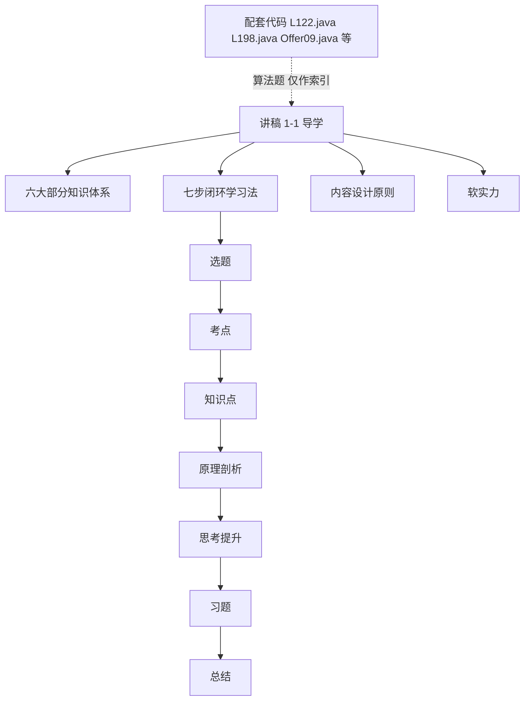
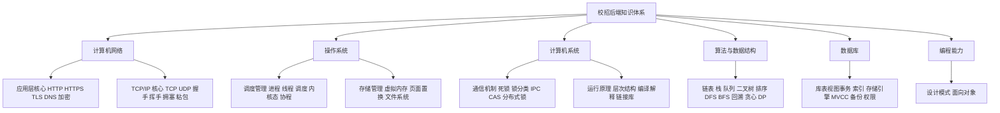

# 后端校招面试直通车: 知识体系全景与闭环学习路线

## 纲要

- 校招面试的考察特点：知识点细碎、广度大、跳跃大、贴近工业环境
- 六大部分：计算机网络、操作系统、计算机系统、算法与数据结构、数据库、编程能力
- 每部分的细分专题与高频考点
- 七步闭环学习法：选题、考点、知识点、原理剖析、思考提升、习题、总结
- 内容纵深设计与"面铺开、点深入"的学习顺序
- 软实力：简历准备、表达技巧、校招信息、平台与发展选择

## 素材索引

- 讲稿：`work/source/8.mksz540-后端校招面试直通车，提前锁定大厂offer[完结]/{1}--第1章2021后端校招面试直通车，提前锁定大厂offer-导学/1-1 导学`
- 关联代码：本篇为导学与路线说明，不涉及代码实现。

## 校招面试的考察特点

互联网行业的竞争逐年加剧，压力来自多个维度：海外留学生与国内高校毕业生的竞争、科班与非科班的竞争、本科到博士的学历竞争。反映到面试里，考察呈现出四个特点：

- 知识点细碎、零散，容易学了后面忘了前面
- 考察广度非常大，边界不明确
- 知识点之间跳跃大，一个问题可能横跨网络与操作系统
- 面试官有工业开发背景，部分考察点贴近真实生产环境

因此备考策略不是"多背几道题"，而是先把零散知识点体系化，再在重点上做纵深。

## 六大部分知识体系

| 部分 | 专题 | 高频考点 |
| --- | --- | --- |
| 计算机网络 | 应用层核心、TCP/IP 核心 | HTTP 状态码与请求方法、HTTPS 握手、DNS 流程、三次握手与四次挥手、滑动窗口、拥塞控制、粘包 |
| 操作系统 | 调度管理、存储管理 | 进程与线程、进程状态、内核态、协程、虚拟内存、缺页中断、LRU、软硬链接、RAID |
| 计算机系统 | 通信机制、运行原理 | 死锁必要条件、三大同步问题、锁的分类、进程间通信、CAS、分布式锁、编译与解释、动静态链接 |
| 算法与数据结构 | 线性结构、树、经典算法 | 链表、栈与队列、二叉树遍历、排序、搜索、回溯、贪心、动态规划 |
| 数据库 | 应用层面、底层原理 | 表设计、字段类型、事务与 ACID、隔离级别、B+ 树索引、聚簇与联合索引、MVCC、日志与恢复、权限 |
| 编程能力 | 设计模式、面向对象 | 单例、建造者、适配器、装饰器、代理，七大设计原则，接口与抽象类，继承与组合 |

前三部分（计算机网络、操作系统、计算机系统）常被称为"计算机基础"，是区分度最高的部分；后三部分更偏可训练性，靠刷题与项目积累即可稳步提升。

## 七步闭环学习法

每节课、每个知识点都按闭环推进，避免"看过就忘"：

| 步骤 | 做什么 | 产出 |
| --- | --- | --- |
| 选题 | 精选一道热门面试题作为引入 | 一个具体的考点入口 |
| 考点 | 思考这道题背后要考察什么 | 出题人的意图清单 |
| 知识点 | 罗列相关的知识点细节 | 一棵知识树 |
| 原理剖析 | 逐个学习并剖析原理 | 可复述的原理说明 |
| 思考提升 | 深入思考与拔高 | 与工程场景的连接 |
| 习题 | 做配套练习 | 可迁移的解题能力 |
| 总结 | 归纳与升华 | 一份自己的答题模板 |

闭环的关键在于最后两步：没有习题与总结，前面五步的留存率会大幅下降。每一章末尾还应有一份自测卷，用于查漏补缺。

## 内容设计原则

### 轻重分明，贴近生产

笔试面试的重点就是复习的重点。针对知识点细碎、广度大的特点，需要：

- 系统整理内容体系，把零散知识点串成结构
- 结合真题理解考察方式，而不是背孤立结论
- 用生产环境中的真实问题反推知识点的价值

### 纵深设计：面铺开，再深入一点

学习顺序是先把一个面的知识铺开，建立全景；再选取其中重点与难点，深入剖析。这样既能应对广度考察，也能扛住追问。

### 图示优先

网络握手、DNS 查询、缺页中断、B+ 树结构这类内容，用图示理解的效率远高于文字。自己动手画一遍流程图，是检验是否真正理解的最快方式。

## 适合谁

- 马上要参加秋招或春招的准毕业生，科班与非科班都可以用它快速补齐笔试面试的重点
- 未来要参加校招的在读学生，可以把这份大纲当成系统入口，针对性补充
- 希望系统梳理计算机体系知识的工程师，用它建立知识地图

## 软实力同样要准备

硬知识之外，还有几项直接影响结果的能力：

- 简历准备：项目经历要能落到技术点，避免只有业务描述
- 表达技巧：回答要结构化，先给结论再展开原理
- 校招信息：提前关注招聘节奏与批次，避免错过时间窗口
- 平台与发展选择：结合业务方向、技术栈与成长路径做判断

## 落地建议

- 先建地图：按六大部分列出自己的掌握程度，标出薄弱块
- 再定优先级：计算机基础优先于可训练部分，高频考点优先于冷门考点
- 用真题驱动：每道题都走一遍七步闭环
- 留出复盘时间：每周回看错题与模糊点，更新知识地图

相关度：86%。是否需要继续：[否]。代码是否可运行：[否]。
