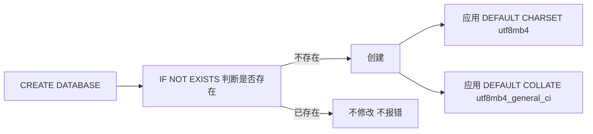

# 后端校招面试直通车: 数据库的设计、创建与维护

## 纲要

- `CREATE DATABASE` 官方语法：`CREATE {DATABASE | SCHEMA} [IF NOT EXISTS] db_name [create_option]`
- `DATABASE` 与 `SCHEMA` 在现代 MySQL 中含义相同，可混用
- `IF NOT EXISTS`：库不存在才创建，已存在则不报错、不修改
- 创建选项重点：字符集（CHARACTER SET）与排序规则（COLLATE）
- 推荐使用统一的 `utf8mb4` 字符集，规避中文与跨平台乱码
- 国内常见排序规则：`utf8mb4_general_ci`

## 创建数据库的语法

MySQL 官方给出的建库模板如下（大括号为必选项，中括号为可选项）：

```sql
CREATE {DATABASE | SCHEMA} [IF NOT EXISTS] db_name
    [DEFAULT] CHARACTER SET [=] charset_name
    [DEFAULT] COLLATE [=] collation_name;
```

### DATABASE 与 SCHEMA 的区别

在早期版本中两者略有差异；但在现代 MySQL（5.0 之后）里，**DATABASE 与 SCHEMA 已合并为同一含义**，建库时二者完全等价，日常更常用 `DATABASE` 关键字。

### IF NOT EXISTS 的作用

`IF NOT EXISTS` 是可选项。加上它之后，执行语句时会先判断库名是否已存在：

- 已存在：不执行任何修改，也不报错；
- 不存在：才真正创建。

这正是"幂等建库"的写法，在初始化脚本中非常实用。

### 字符集与排序规则

创建选项里最常用的是两项：

- **CHARACTER SET**：指定数据库默认的字符集。可以通过 `SHOW CHARACTER SET;` 查看 MySQL 支持的字符集。实际开发中强烈推荐使用 **`utf8mb4`**，它能完整表示包括 emoji 在内的所有 Unicode 字符。
- **COLLATE**：指定字符串类型字段的排序规则，会影响数据返回的顺序（尤其是中文等非英文文本的排序）。国内最常见的配置是 `utf8mb4_general_ci`（`ci` = case insensitive，不区分大小写）。



## 为什么要统一使用 utf8mb4

不同编码集混用是乱码 bug 的根源。例如 Windows 系统默认编码是 GBK，若把一个 GBK 文档直接放到 Linux（默认 UTF-8）上且不转换编码，就会出现乱码；同理，若程序使用的字符集与数据库内容的字符集不一致且未做转换，也会导致乱码甚至数据存储错误。

因此无论什么平台、什么语言、什么框架，统一使用 `utf8mb4` 是最稳妥的选择——它对中文及亚太语言的支持最完整。

> 注意：MySQL 早期的 `utf8` 实为 `utf8mb3`（最多 3 字节），无法存储 4 字节字符（如部分 emoji）；`utf8mb4` 才是完整的 4 字节 UTF-8，新建库应优先用 `utf8mb4`。

## Demo 示例

### 运行说明

在 MySQL 5.7 / 8.0 客户端直接执行即可。

```sql
-- 查看支持的字符集（可选）
SHOW CHARACTER SET LIKE 'utf8%';

-- 幂等创建数据库，并指定字符集与排序规则
CREATE DATABASE IF NOT EXISTS test_demo_db
    DEFAULT CHARACTER SET utf8mb4
    DEFAULT COLLATE utf8mb4_general_ci;

-- 查看创建结果
SHOW CREATE DATABASE test_demo_db;
```

### 代码说明

- `IF NOT EXISTS` 保证脚本重复执行时不会因"库已存在"而报错；
- `DEFAULT CHARACTER SET utf8mb4` 设定库的默认字符集，后续建表若未单独指定，将继承该字符集；
- `DEFAULT COLLATE utf8mb4_general_ci` 设定默认排序规则，决定字符串比较与排序行为。

### 技术点总结

| 语法元素 | 作用 |
| --- | --- |
| `CREATE DATABASE / SCHEMA` | 建库，二者等价 |
| `IF NOT EXISTS` | 库不存在才建，避免重复执行报错 |
| `CHARACTER SET utf8mb4` | 默认字符集，推荐统一 |
| `COLLATE utf8mb4_general_ci` | 默认排序规则，`ci` 不区分大小写 |

## 阅读官方文档的建议

建库语句本身简单，更重要的是养成阅读 MySQL 官方文档的习惯：能看懂模板里的大括号（必选）、中括号（可选）以及各种 `create_option` 的含义，就能举一反三掌握建表、建索引等其他 DDL 文档。

相关度：92%。是否需要继续：[否]。代码是否可运行：[是]。
