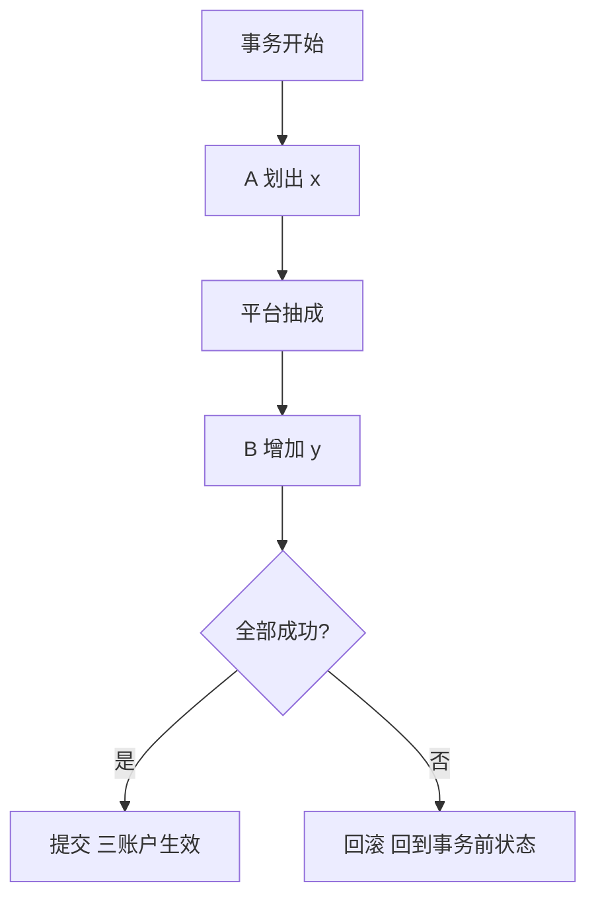
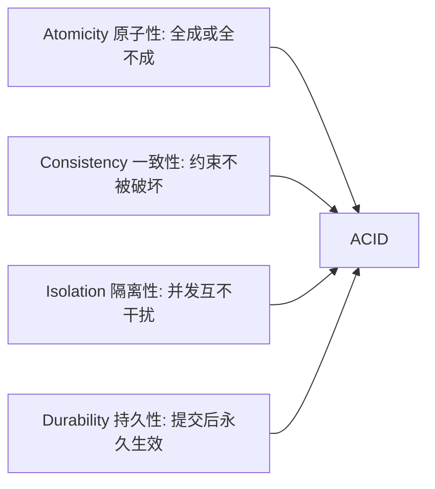

# 后端校招面试直通车: 数据库的 ACID 属性

## 纲要

- 事务（Transaction）：保证一批操作要么全部执行，要么全部不执行，以维护数据库完整性
- ACID = 原子性（Atomicity）、一致性（Consistency）、隔离性（Isolation）、持久性（Durability）
- 原子性：事务内操作要么全成、要么全不成，出错则整体回滚
- 一致性：事务前后，数据库完整性约束未被破坏，总额等业务逻辑保持成立
- 隔离性：并发事务互不干扰，防止交叉执行导致数据不一致（含四个隔离级别，下节展开）
- 持久性：事务提交后，修改永久生效，不因宕机、断电等故障丢失

## 什么是事务

数据库事务用于维护数据库的完整性：通过事务，可以保证成批的 SQL 操作**要么全部执行，要么全部不执行**。为了让事务正确可靠，支持事务的系统必须具备四个特性——原子性、一致性、隔离性、持久性，即 ACID。

## 原子性（Atomicity）

事务中的所有操作是一个不可分割的整体：要么全部完成，要么全部不完成，绝不会停在中间某个环节。若执行过程中发生错误，之前的所有操作都会**回滚**到事务开始前的状态，就像这个事务从未发生过。

以一笔转账为例：账户 A 划走 x 元，平台抽成 20%，同时账户 B 增加 y 元。这三个动作通常封装在同一个事务中。若任意一步出错，事务整体回滚，A、B 与平台账户的金额都不会发生变化——要么三个账户都变，要么都不变。

## 一致性（Consistency）

一致性指事务开始前与结束后，数据库的**完整性没有被破坏**：写入的数据必须满足所有预设约束、触发器、级联规则与回滚规则。

仍用上面的转账例子并具象化：假设 A 有 10000 元、平台有 100000 元、B 有 8000 元；从 A 划走 x=4000。操作后：A 剩 6000，平台得 10800（含 20% 抽成 800），B 得 11200。三个账户操作前后的**总额都是 118000 元**——前后总额不变，这就是一致性。它要求业务逻辑（前后总额不变）与数据库自身的约束（触发器、级联、回滚）共同成立。

## 隔离性（Isolation）

隔离性指数据库允许多个事务并发地对数据进行读写与修改，但能防止它们因交叉执行而导致数据不一致。

以两个并发事务为例：事务一涉及 A、B、平台三个账户；事务二涉及 C、A、平台三个账户。二者都操作账户 A。若执行顺序是：事务一读取 A=10000 → 事务二读取 A=10000 → 事务二写入 A=10000+k → 事务一写入 A=10000−x，最终结果变成 10000−x，而正确结果应为 10000−x+k——典型的读写冲突（读者-写者问题）。

隔离性正是要解决这类问题。MySQL 在设计隔离性时还需兼顾读写性能，并非简单用锁"一刀切"。隔离性进一步细分为四个级别（未提交读、提交读、可重复读、串行化），下一节专门展开。

## 持久性（Durability）

持久性最容易理解：事务处理结束后，对数据的修改是**永久的**，即使系统发生故障（服务器宕机、断电、网络中断等）也不会丢失、不会失效。

## 四个特性的关系

- **原子性**保证"不出半成品"；
- **一致性**是目标，靠原子性、隔离性、持久性共同支撑；
- **隔离性**保证并发下数据不乱；
- **持久性**保证结果不丢。

## 面试答题模板

问：请简述数据库的 ACID 是什么？

> ACID 是事务的四特性。原子性：事务内操作要么全成要么全不成，出错整体回滚；一致性：事务前后数据库完整性约束不被破坏，如转账前后总额不变；隔离性：并发事务互不干扰，防止交叉执行导致不一致，它有四个隔离级别；持久性：事务提交后修改永久生效，不因故障丢失。事务通过这四点保证一批操作可靠。

相关度：95%。是否需要继续：[否]。代码是否可运行：[否]。
