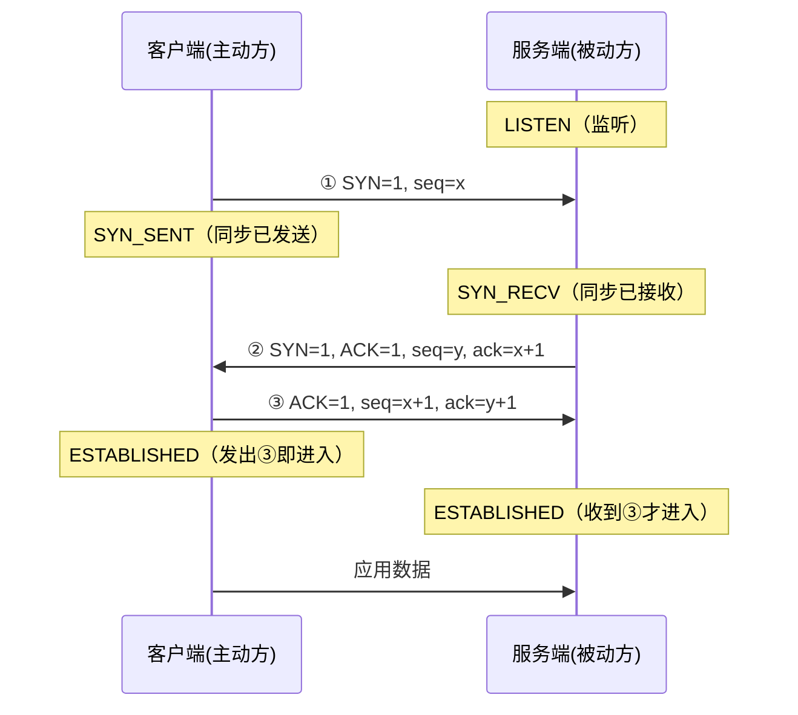
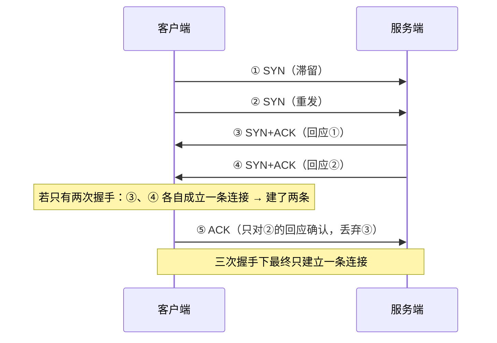

# 10. 后端校招面试直通车: TCP 为什么需要三次握手

## 纲要

- 三次握手的定位：保证连接被正确建立
- 三次报文各自的字段：SYN、seq、ACK、ack
- 双方在握手过程中的状态变迁：LISTEN、SYN_SENT、SYN_RECV、ESTABLISHED
- 关键细节：双方进入 ESTABLISHED 的时机并不相同
- 异常情况分析：第一次握手报文滞留导致重复建连
- 为什么两次握手不行

## 为什么需要握手

TCP 提供的是**可靠的、有连接的服务**。既然是"有连接"，通信双方在传数据之前就必须先把连接建立起来，而三次握手保证的就是"连接一定被正确建立"。

围绕三次握手，值得拆开问三个问题：

- 为什么是三次，两次行不行？
- 三次分别做了什么？
- 第三次是不是冗余的？

回答这三个问题前，先复习两个首部字段：

- **序号 seq**：本报文所携带数据中第一个字节的序号
- **确认号 ack**：期望收到对方下一个报文第一个数据字节的序号；若 ack = n，表示 n-1 及之前的数据都已收到

以及两个控制位：**SYN**（同步位，为 1 表示连接请求/接受报文）与 **ACK**（确认位，为 1 时确认号生效）。

## 三次握手的流程

TCP 建连是双方共同完成的过程，分为主动发起连接的一方与被动接受连接的一方。

逐个报文拆解：

- **第一次握手**：`SYN=1, seq=x`。SYN=1 表示请求同步，同时把自己的初始序列号 x 告诉对方。被动方在此之前处于监听（LISTEN）阶段。
- **第二次握手**：`SYN=1, ACK=1, seq=y, ack=x+1`。SYN=1 表示这仍是建连报文；ACK=1 表示确认号生效；`ack=x+1` 表示"x 号数据我已收到，下一次期望收到 x+1"；`seq=y` 则把自己的初始序列号告诉对方。主动方在发出第一次报文、收到第二次报文之前，处于**同步已发送（SYN_SENT）**状态；被动方发出第二次报文后处于**同步已接收（SYN_RECV）**状态。
- **第三次握手**：`ACK=1, seq=x+1, ack=y+1`。`seq=x+1` 与第二次报文的 `ack=x+1` 对应；`ack=y+1` 表示 y 及之前的数据都已收到，期望下一个是 y+1。

三次的含义可以压缩成一句话：

| 次序 | 含义 |
| --- | --- |
| 第一次 | 请求同步，并告诉对方自己的初始序列号 |
| 第二次 | 确认对方的数据，并告诉对方自己的初始序列号 |
| 第三次 | 确认对方的数据，连接正式建立，可以携带应用数据 |

前两次完成的是**双方初始序列号的交换**，第三次之后连接才真正建立。

### 一个容易忽略的细节

双方进入 ESTABLISHED 的**时间不一样**：

- 主动方发出第三次报文后，就进入了 ESTABLISHED 状态
- 被动方必须**收到**第三次报文后，才进入 ESTABLISHED 状态

因此存在一小段时间窗口：客户端认为连接已建立，服务端还在 SYN_RECV。这也是 SYN Flood 攻击能够生效的状态基础。

## 异常情况：第一次握手报文滞留

上述流程建立在通信正常的前提上。现在考虑真实的异常情况。

主动方发出第一次握手报文后，迟迟收不到第二次握手报文，就会认为报文丢失并重发一次第一次握手报文。但真相可能是：**第一个报文并没有丢，只是在网络中滞留了很久**，最终仍然会到达被动方。

于是被动方先后收到了两个第一次握手报文（报文 1 与报文 2），并且会**对每一个都回应**第二次握手报文（报文 3 与报文 4）。

**如果协议设计为两次握手**，那么只要有回应就意味着连接建立：① 与 ③ 成立一条连接，② 与 ④ 又成立一条连接——一次建连动作产生了两条 TCP 连接。后果有两层：

- 多出来的连接是不必要的，白白浪费服务端资源
- 更严重的是，如果程序逻辑不够严谨，分别对这两条连接进行通信，可能导致**程序错误与数据错误**，直接影响应用的正确性

**有了第三次握手**，主动方收到 ③ 和 ④ 之后，可以丢弃其中一个、只对另一个做回应（报文 ⑤），连接才算建立。即使出现报文滞留这样的异常，也不会重复建立连接。

## 为什么两次不行

综合上面的分析，结论很清楚：

- 两次握手在正常情况下也能建连，但**无法应对第一次握手报文滞留/重传**这类异常，会导致重复建连
- 重复建连不仅浪费资源，还可能引发应用层的程序错误与数据错误
- 三次 handshake 让主动方拥有最后一次确认权，可以主动丢弃过期回应，从而保证连接的唯一性与可靠性

所以第三次并不冗余——它是主动方对"究竟哪一条连接有效"的最终裁决。

## 面试答题要点

- 先讲流程并带上字段：① SYN=1, seq=x → ② SYN=1, ACK=1, seq=y, ack=x+1 → ③ ACK=1, seq=x+1, ack=y+1
- 讲状态变迁：LISTEN → SYN_SENT / SYN_RECV → ESTABLISHED
- 主动加分点：双方进入 ESTABLISHED 的时机不同，主动方发出第三次报文即进入，被动方收到才进入
- 讲清为什么不能简化成两次：报文滞留导致被动方重复回应，两次握手会建出多余连接，浪费资源甚至造成数据错误
- 总结三次的职责：前两次交换初始序列号，第三次确认并建立连接

