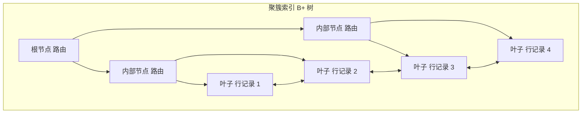
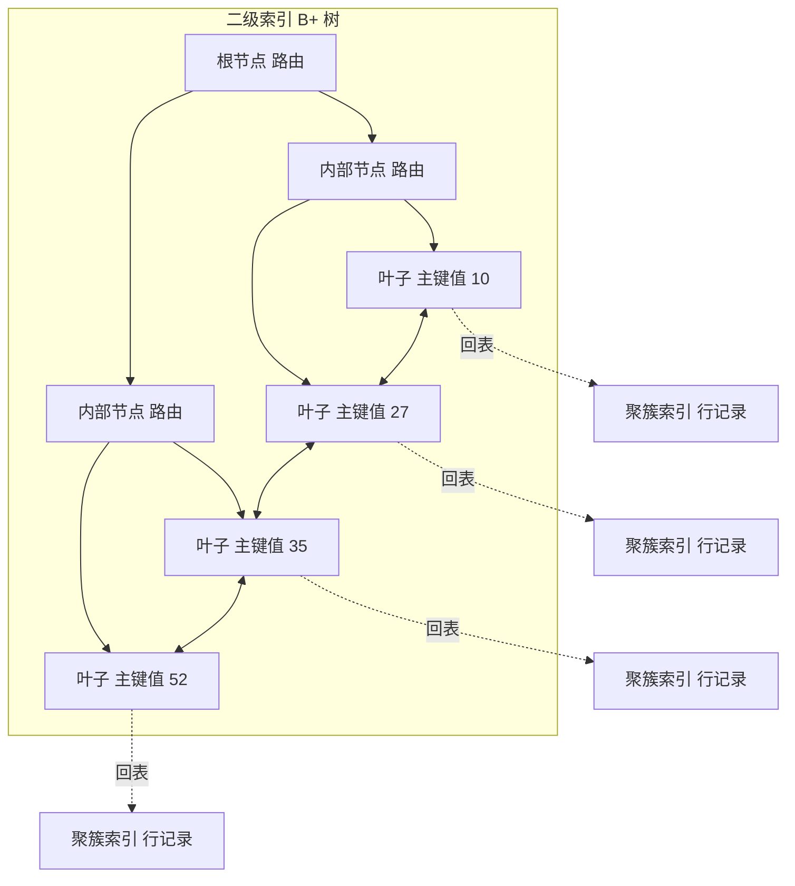

# 后端校招面试直通车: 聚簇索引、二级索引与回表

## 纲要

- 索引的本质：对值进行排序的存储结构，等价于图书目录
- 聚簇索引（Clustered Index）：数据存储与索引放在一起，找到索引即找到数据
- 非聚簇索引 / 二级索引（Secondary Index）：索引与数据分开存放，叶子节点只保存指向数据的指针
- 一张表只能有一个聚簇索引，但可以有多个二级索引
- "二级索引"名字的由来：一次查询需要两次索引检索，即回表
- 聚簇索引的优点、局限与建索引时的字段选择注意点

## 索引是什么

在关系数据库中，索引是一种**对列值进行排序的存储结构**。它就像图书的目录：先通过目录找到页码，再按页码翻到具体内容。数据库里则是先通过索引定位到数据的位置，再去取这一行记录。

上一节已经明确了索引的底层结构是 B+ 树，本文讨论的是另一个维度：**叶子节点里放的是数据本身，还是指向数据的指针**。

## 聚簇索引

定义：将**数据存储与索引放在一块**的索引方式。叶子节点保存的就是完整的行数据，因此找到索引的同时也就找到了数据。



InnoDB 的主键索引就是聚簇索引：主键被组织成一棵 B+ 树，行数据保存在叶子节点上。

几个关键结论：

- 一张表**只能有一个聚簇索引**
- 默认情况下主键就是聚簇索引，由于主键唯一，聚簇索引天然具备唯一性
- 聚簇索引是性能最好的索引路径

为什么只能有一个？因为**数据的物理存放方式只有一种**。既然行数据已经按照主键顺序堆叠在叶子节点上，就不可能再按另一种顺序堆一份。

## 非聚簇索引与二级索引

定义：数据存储与索引**分开存储**，索引的叶子节点只保存指向数据行位置的指针（InnoDB 中保存的是主键值）。



B+ 树的结构与聚簇索引完全一致，差别只在叶子节点保存的内容：

| 索引类型 | 叶子节点内容 | 是否存完整行 |
| --- | --- | --- |
| 聚簇索引 | 整行数据 | 是 |
| 二级索引 | 索引列 + 主键值（或行指针） | 否 |

因为索引可以有多种组织方式，而数据的组织方式只有一种，所以一张表**可以有多个二级索引**。

### 为什么叫"二级索引"

用一个二级索引检索一行数据，需要两步：

1. 检索二级索引的 B+ 树，在叶子节点拿到对应的主键值
2. 拿着主键值回到聚簇索引的 B+ 树再检索一次，取出完整的行记录

第二步就是常说的**回表**。需要两次索引检索，所以非聚簇索引被称为二级索引。这也解释了为什么聚簇索引性能最好——它只需要一次检索。

## 聚簇索引的优点

- 行数据与叶子节点存储在一起，结合内存页的结构，可以显著减少逻辑 IO
- 数据按主键顺序物理相邻，对排序、范围查询极其友好，精确查询同样高效
- 维护成本低：变更叶子节点位置的同时就完成了数据变更，不需要额外的行数据管理

## 使用注意点

- **不要用长字符串做主键**。聚簇索引的叶子节点存的是整行数据，主键越长，二级索引的叶子节点里携带的主键值也越长，会挤压内存页、降低检索速度，UUID 这类字段不适合做主键
- **稀疏数据列不适合建索引**。区分度低的列（如性别）建索引选择性差，优化器往往直接全表扫描
- **频繁更新的列不适合建索引**。每次更新都要维护索引结构，写放大明显
- **只在真正用到的列上建索引**：出现在 `where`、`order by`、`group by`、连接条件中的列才值得建

## Demo 示例

### 运行说明

以下脚本可直接粘贴到 MySQL 客户端执行（建议 5.7 或 8.0），用于观察二级索引的回表现象。

```sql
-- 建表：id 为主键，即聚簇索引；name 上建二级索引
DROP TABLE IF EXISTS t_student;
CREATE TABLE t_student (
    id      BIGINT       NOT NULL AUTO_INCREMENT COMMENT '主键，聚簇索引',
    name    VARCHAR(64)  NOT NULL                COMMENT '姓名，二级索引',
    age     INT          NOT NULL                COMMENT '年龄',
    PRIMARY KEY (id),
    KEY idx_name (name)
) ENGINE = InnoDB DEFAULT CHARSET = utf8mb4;

INSERT INTO t_student (name, age) VALUES
    ('alice', 18), ('bob', 20), ('carol', 22), ('dave', 19), ('eric', 25);

-- 走二级索引 idx_name：先查 idx_name 拿到主键，再回表取 age
EXPLAIN SELECT * FROM t_student WHERE name = 'bob';

-- 只查索引列与主键：覆盖索引，Extra 出现 Using index，无需回表
EXPLAIN SELECT id, name FROM t_student WHERE name = 'bob';

-- 走聚簇索引：一次检索即可拿到整行
EXPLAIN SELECT * FROM t_student WHERE id = 2;
```

### 代码说明

- `PRIMARY KEY (id)` 在 InnoDB 中就是聚簇索引，行数据挂在它的叶子节点上
- `KEY idx_name (name)` 是二级索引，叶子节点保存 `(name, id)`
- 第一条 `SELECT *` 需要回表：先在 `idx_name` 定位 `bob` 得到 `id`，再回聚簇索引取 `age`
- 第二条只取 `id` 与 `name`，二级索引自身已覆盖所需列，形成**覆盖索引**，`EXPLAIN` 的 `Extra` 会出现 `Using index`，省掉回表
- 第三条按主键查询，走聚簇索引，单次检索返回整行

### 技术点总结

- 聚簇索引叶子存行数据，二级索引叶子存主键值
- 一次二级索引查询最多需要两次 B+ 树检索，第二次即回表
- 覆盖索引是消除回表的主要手段，也是 SQL 优化的常用手法
- 主键长度会被所有二级索引继承，主键选型直接影响全表索引体积

## API 速览

| 语法 | 作用 |
| --- | --- |
| `PRIMARY KEY (col)` | 定义主键，InnoDB 下即聚簇索引 |
| `KEY idx_name (col)` | 创建普通二级索引 |
| `UNIQUE KEY uk_name (col)` | 创建唯一二级索引 |
| `EXPLAIN SELECT ...` | 查看执行计划，`key` 显示实际使用的索引，`Extra` 中的 `Using index` 表示覆盖索引 |
| `SHOW INDEX FROM tbl` | 查看表上的全部索引定义 |

相关度：93%。是否需要继续：[否]。代码是否可运行：[是]。
