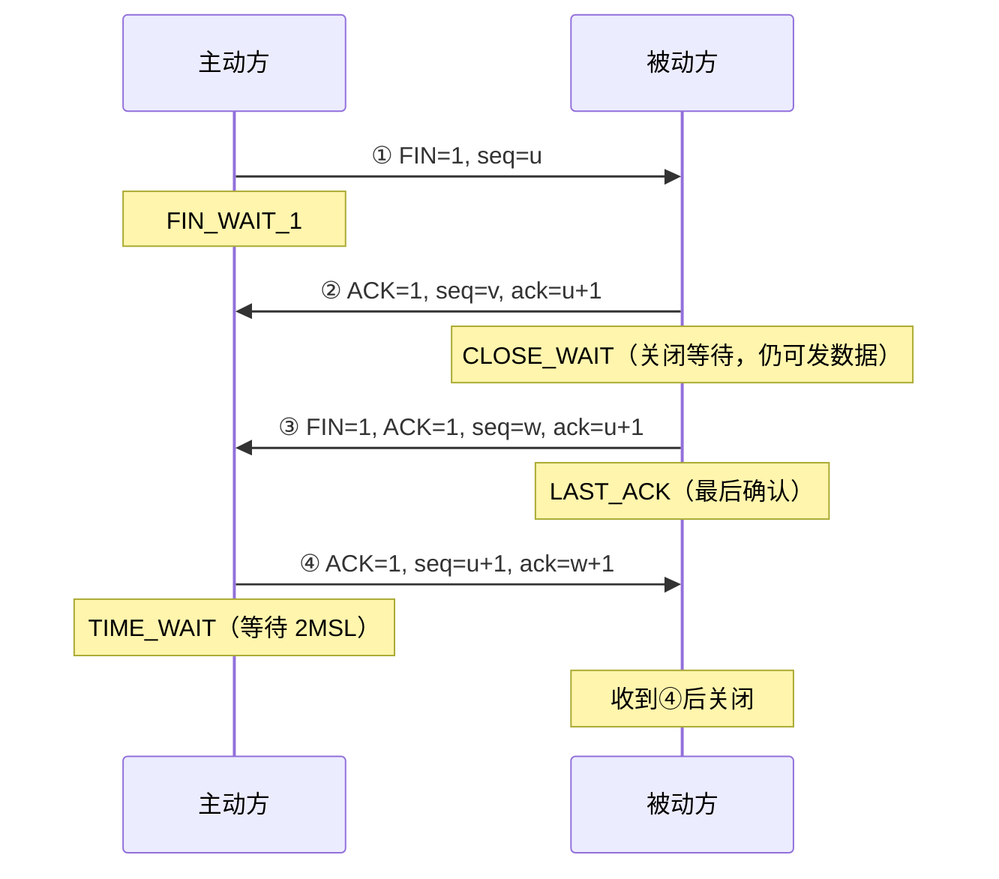

# 11. 后端校招面试直通车: TCP 四次挥手与 TIME_WAIT 状态

## 纲要

- 四次挥手的四个报文与 FIN、ACK 字段
- 为什么第二次与第三次挥手都由被动方发出：关闭等待阶段
- 关键状态：FIN_WAIT_1、CLOSE_WAIT、LAST_ACK、TIME_WAIT
- TIME_WAIT 的定义与端口不可复用特性
- MSL 与 2MSL：为什么是两倍最长报文段寿命
- 等待 2MSL 的两个目的

## 四次挥手的流程

TCP 连接的释放同样由双方共同完成，分为主动中断连接的一方与被动中断连接的一方。先复习一个控制位：**FIN（终止位）**，为 1 时表示该报文是释放连接的报文。

逐段拆解：

- **第一次挥手**：`FIN=1, seq=u`，由主动中断连接的一方发出，表示请求终止连接。发出后到收到第二次报文之前，主动方处于 **FIN_WAIT_1** 状态。
- **第二次挥手**：`ACK=1, seq=v, ack=u+1`。注意这个报文**没有把 FIN 置为 1**，它不是一个终止报文，而只是一个普通的确认报文。原因是：主动方想断开，但被动方收到第一次挥手时，可能还有数据尚未发送完毕。从第二次到第三次挥手之间，被动方处于 **CLOSE_WAIT（关闭等待）** 状态，可以继续发送剩余数据。
- **第三次挥手**：`FIN=1, ACK=1, seq=w, ack=u+1`。被动方数据发完后，发出自己的终止报文。发出后到收到第四次报文之前，被动方处于 **LAST_ACK（最后确认）** 状态。
- **第四次挥手**：`ACK=1, seq=u+1, ack=w+1`，由主动方发出，确认被动方的终止报文已收到。

### 两个易错点

- **第二次与第三次挥手都由被动方发出**。这正是四次挥手比三次握手多一次的根源：握手时 SYN 与 ACK 可以合并在一个报文里，而挥手时被动方的 ACK 与 FIN 之间可能夹着未发送完的数据，无法合并。
- 第四次报文本身很普通，只是一个数据确认报文，但**不可或缺**——它是对第三次挥手的最终确认。

## TIME_WAIT 状态

TIME_WAIT 是**主动方发出第四次挥手报文之后**所处的状态。这是面试中的高频考点，有两个必须说清的点：

- 处于 TIME_WAIT 的主动方**尚未完全关闭 TCP 连接**
- 因此该状态下的**端口不可复用**

也就是说，谁主动断开连接，谁就要承担 TIME_WAIT 的代价。在高并发短连接的场景下（例如压测客户端、频繁建连的抓取程序），主动方会迅速堆积大量 TIME_WAIT，表现为端口耗尽。

### MSL 与 2MSL

- **MSL**（Maximum Segment Lifetime，最长报文段寿命）：报文在网络中能够存活的最长时间，工程上通常取 2 分钟
- TIME_WAIT 的默认持续时间是 **2MSL**，即约 4 分钟

## 为什么要等待 2MSL

这是本题的核心，原因有两个。

### 确保最后一个 ACK 能到达对方

主动方发出的第四次挥手报文**本身是没有确认的**——被动方收到就关闭，不会再回一个"我收到了你的确认"。

如果这个 ACK 在网络中丢失了，被动方迟迟收不到第四次报文，就会超时重发第三次挥手（FIN）。主动方此时如果已经彻底关闭，就无法再回应这个重发的 FIN，被动方将无法正常释放连接。

等待 2MSL 的意义就在于：**给"ACK 到达对方"和"对方重发 FIN 回到我这里"这一来一回留出时间**。1 个 MSL 用于 ACK 到达，另 1 个 MSL 用于重发的 FIN 返回，因此是两倍。只要在 2MSL 内收到对方重发的 FIN，主动方就重发第四次报文并重新计时，从而保证连接一定能够正常释放。

### 确保本次连接的所有报文都已过期

第四次挥手报文是本次连接的最后一个报文。如果连它都已经过期（存活时间超过 MSL），那么它之前的所有报文必然也已过期。

等待 2MSL 可以确保当前连接产生的全部报文都已在网络上失效。这样即使有报文在网络中滞留很久，也不会与后续新建的连接发生混淆——避免旧连接的迟到报文被新连接误收，造成数据错乱。

## 状态速查表

| 状态 | 所在方 | 含义 |
| --- | --- | --- |
| FIN_WAIT_1 | 主动方 | 已发出 FIN，等待对方的确认 |
| CLOSE_WAIT | 被动方 | 收到对方 FIN，等待本端剩余数据发送完毕 |
| LAST_ACK | 被动方 | 已发出自己的 FIN，等待最后一个 ACK |
| TIME_WAIT | 主动方 | 已发出最后的 ACK，等待 2MSL 后彻底关闭 |

## 面试答题要点

- 流程：① FIN=1, seq=u → ② ACK=1, seq=v, ack=u+1 → ③ FIN=1, ACK=1, seq=w, ack=u+1 → ④ ACK=1, seq=u+1, ack=w+1
- 解释为什么是四次：被动方收到 FIN 时可能还有数据没发完，ACK 与 FIN 分开发送，中间夹着 CLOSE_WAIT 阶段
- TIME_WAIT 的定义：主动方发出第四次挥手报文后所处的状态，此时连接未完全关闭、端口不可复用
- 持续 2MSL（MSL 通常 2 分钟，即约 4 分钟）
- 等待的原因两条：保证最后一个 ACK 能到达对方（让对方有机会重发 FIN）；保证本次连接的所有报文都已过期，不污染后续连接

