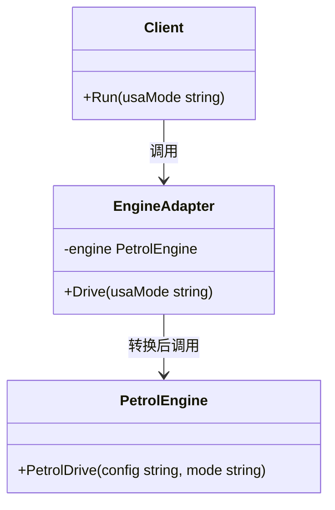

# 后端校招面试直通车: 适配器模式与接口兼容

## 纲要

- 适配器模式的定义：把一个类的接口转换成客户端期望的另一种接口
- 适用场景：现存组件功能满足需求，但接口规范不兼容，且重复开发成本过高
- 实现要点：适配器承上启下，接收客户端参数并做协议转换，再调用被适配者的原接口
- 生活类比：手机充电器、显示器转接头
- 优点：复用现存类、对客户端透明、目标类与适配者解耦、几乎不改原代码
- 缺点：新增类、调用链从两方变成三方、系统复杂度与阅读成本上升

## 为什么需要适配器模式

定义是这样的：**将一个类的接口转换成客户端希望的另外一种接口，使得原本由于接口不兼容而不能一起工作的类可以一起工作**。

实际开发中经常遇到这种局面：需要某个业务功能，现成的组件库里已经有了，但它的接口规范和当前系统不兼容，不能直接拿来用；而重新实现一套的成本又很高。这时候适配器模式就是成本最低的解法——**不改原有代码，只新增一层转换**。

## 场景举例：发动机的接口不兼容

假设组件库里有一个汽油发动机类型：

```go
// 已有组件：接口需要两个参数
type PetrolEngine struct{}

func (e *PetrolEngine) PetrolDrive(config string, mode string) { ... }
```

而客户端这边的调用约定只有一个 `usaMode` 字符串参数。参数不匹配，客户端无法直接使用 `PetrolEngine`。

解决方式是在两者之间插入一个适配器：



适配器的职责是"承上启下"：

- 向上暴露客户端能理解的接口：`Drive(usaMode string)`
- 向下完成协议转换：从 `usaMode` 中解析出 `config` 与 `mode`
- 最后调用 `PetrolEngine.PetrolDrive(config, mode)`

客户端不再直接调用 `PetrolDrive`，而是初始化适配器后通过适配器调用。

## 生活中的适配器

- 手机充电器：不同品牌的充电头与线缆通过各种转接头互相兼容
- 显示器接口：HDMI、DP、VGA、Type-C 之间靠转接线/转换器对接

它们与代码里的适配器思想完全一致：不改变两端本身，只在中间加一层兼容。

## 优缺点

| 维度 | 说明 |
| --- | --- |
| 优点 | 客户端不需要理解底层类的实现，通过适配器透明调用目标接口 |
| 优点 | 复用现存的类，最小程度修改原有代码，只需新增代码 |
| 优点 | 目标类与适配者解耦，解决接口不一致问题 |
| 缺点 | 新增一个适配器类，增加系统复杂性与类数量 |
| 缺点 | 代码阅读难度上升，调用链从"主调—被调"两方变成三方关系，链路更长 |

## Demo 示例

> 以下代码根据讲稿逻辑用 Go 语言补充，单文件可直接运行。

### 运行说明

```bash
mkdir adapter-demo && cd adapter-demo
go mod init adapter-demo
# 将下方代码保存为 main.go
go run main.go
```

```go
package main

import (
	"fmt"
	"strings"
)

// PetrolEngine 已有的汽油发动机组件，接口需要两个参数
type PetrolEngine struct{}

// PetrolDrive 既有实现，不修改其签名
func (e *PetrolEngine) PetrolDrive(config string, mode string) {
	fmt.Printf("petrol engine running, config=%s, mode=%s\n", config, mode)
}

// EngineAdapter 发动机适配器：把单参数接口转换成双参数接口
type EngineAdapter struct {
	engine *PetrolEngine
}

// NewEngineAdapter 构造适配器，持有被适配对象
func NewEngineAdapter(engine *PetrolEngine) *EngineAdapter {
	return &EngineAdapter{engine: engine}
}

// Drive 客户端期望的接口：只接收 usaMode 一个参数
func (a *EngineAdapter) Drive(usaMode string) error {
	// 协议转换：从单一参数中解析出 config 与 mode
	parts := strings.SplitN(usaMode, ":", 2)
	if len(parts) != 2 {
		return fmt.Errorf("invalid usa mode: %s", usaMode)
	}
	config, mode := parts[0], parts[1]
	a.engine.PetrolDrive(config, mode)
	return nil
}

func main() {
	engine := &PetrolEngine{}
	adapter := NewEngineAdapter(engine)

	// 客户端只认识单参数接口
	if err := adapter.Drive("sport:eco"); err != nil {
		fmt.Println("drive failed:", err)
		return
	}

	// 非法输入在适配器层被拦截
	fmt.Println(adapter.Drive("bad-mode"))
}
```

预期输出：

```text
petrol engine running, config=sport, mode=eco
invalid usa mode: bad-mode
```

### 代码说明

- `PetrolEngine` 模拟已有的、开发成本很高的组件，签名保持不变，完全没有被修改
- `EngineAdapter` 持有被适配对象，向上提供客户端期望的 `Drive(usaMode string)`，内部完成参数拆分（协议转换）后再调用原接口
- 参数不合法时在适配器层直接返回错误，这正是适配器"承上启下"的价值：把校验与转换收拢在一处
- 客户端只依赖适配器，不感知 `PetrolDrive` 的存在，两端彻底解耦

### 技术点总结

- 适配器解决的是"接口不匹配但功能可用"的问题，核心动作是**转换**而非重写
- 实现上通常采用组合（持有被适配对象）而非继承，Go 里天然就是组合
- 代价是多一层调用链与一个新类型，是否引入要看复用收益是否大于复杂度成本
- 与代理模式的区别：适配器**改变接口**，代理**保持接口不变**而增加控制逻辑

## API 速览

| API | 签名 | 说明 |
| --- | --- | --- |
| `NewEngineAdapter` | `func NewEngineAdapter(engine *PetrolEngine) *EngineAdapter` | 创建适配器并注入被适配对象 |
| `(*EngineAdapter).Drive` | `func (a *EngineAdapter) Drive(usaMode string) error` | 客户端侧接口，内部完成协议转换 |
| `(*PetrolEngine).PetrolDrive` | `func (e *PetrolEngine) PetrolDrive(config, mode string)` | 被适配者的原接口，保持不动 |
| `strings.SplitN` | `func SplitN(s, sep string, n int) []string` | 按分隔符拆分字符串，用于解析复合参数 |

相关度：90%。是否需要继续：[否]。代码是否可运行：[是]。
