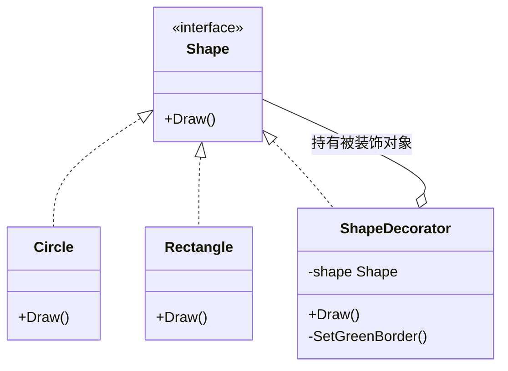

# 后端校招面试直通车: 装饰器模式与功能动态扩展

## 纲要

- 装饰器模式的定义：不改变原有对象结构，动态地为对象增加职责
- 适用场景：复用现存组件时，需要在不改动其核心结构的前提下扩展非核心功能
- 实现要点：装饰器与被装饰对象实现同一接口，内部持有被装饰对象，先调用原方法再叠加自己的逻辑
- 与继承的对比：装饰器更灵活，可即插即用、可排列组合
- 缺点：装饰器子类数量膨胀，过度使用会提高程序复杂度

## 为什么需要装饰器模式

定义是：**在不改变原有对象结构的情况下，动态地给对象增加一些职责、一些额外功能**。

软件开发中经常遇到这种情况：手上有现成的组件，它把某项核心功能做完了，但使用时还要求在不改动其结构的前提下动态扩展一些功能。比如画图形，`draw` 是核心能力，而"给图形设置绿色边框"是相对次要、且可能变化的附加能力。

装饰器模式的核心价值就在这里：**核心功能保持独立，附加功能按需叠加**。

## 实现结构



关键设计点：

- 定义统一的 `Shape` 接口，声明 `Draw()`
- `Circle` 与 `Rectangle` 是具体形状，各自的 `Draw` 实现不同
- `ShapeDecorator` **自己也实现 `Shape` 接口**，同时内部持有一个 `Shape` 类型的属性（被装饰对象）

因为装饰器自身也是 `Shape`，所以：

- 具体形状可以向上转型为 `Shape` 交给装饰器
- 装饰器又可以再被另一个装饰器包装，形成层层叠加

调用时的执行顺序是：先调用被装饰对象的 `Draw()`，再执行装饰器自己的附加逻辑（如打印绿色边框）。

## 与继承的对比

| 维度 | 继承 | 装饰器 |
| --- | --- | --- |
| 扩展方式 | 编译期静态确定 | 运行期动态组合 |
| 对基类的要求 | 需要了解并覆盖基类的方法与属性 | 只需实现一个装饰器类 |
| 灵活性 | 每增加一种组合就要加一个子类 | 即插即用，可排列组合 |
| 原有对象 | 行为被子类覆盖 | 原有对象不受影响 |

装饰器比继承灵活的地方在于：不需要关注基类的任何属性或函数，只要实现一个装饰器类并写好扩展方法即可。不需要绿色边框时，直接用原始的 `Rectangle`；需要时再套一层装饰器，属于典型的即插即用。多个装饰器排列组合，还能得到更丰富的效果。

## 优缺点

- 优点：不改变原有对象即可动态扩展功能；装饰器之间可自由组合；比继承灵活
- 缺点：会引入大量装饰器子类，过度使用会显著增加程序复杂度

## Demo 示例

> 以下代码根据讲稿逻辑用 Go 语言补充，单文件可直接运行。

### 运行说明

```bash
mkdir decorator-demo && cd decorator-demo
go mod init decorator-demo
# 将下方代码保存为 main.go
go run main.go
```

```go
package main

import "fmt"

// Shape 形状接口：核心能力是把自己画出来
type Shape interface {
	Draw()
}

// Circle 圆形
type Circle struct{}

func (c Circle) Draw() {
	fmt.Println("this is a circle shape")
}

// Rectangle 矩形
type Rectangle struct{}

func (r Rectangle) Draw() {
	fmt.Println("this is a rectangle shape")
}

// ShapeDecorator 形状装饰器：自身也是 Shape，内部持有被装饰对象
type ShapeDecorator struct {
	shape Shape
}

// NewShapeDecorator 包装一个被装饰对象
func NewShapeDecorator(shape Shape) *ShapeDecorator {
	return &ShapeDecorator{shape: shape}
}

// Draw 先调用被装饰对象的绘制，再叠加装饰逻辑
func (d *ShapeDecorator) Draw() {
	d.shape.Draw()
	d.SetGreenBorder()
}

// SetGreenBorder 附加的非核心能力
func (d *ShapeDecorator) SetGreenBorder() {
	fmt.Println("set green border")
}

// ShadowDecorator 第二个装饰器，演示排列组合
type ShadowDecorator struct {
	shape Shape
}

func NewShadowDecorator(shape Shape) *ShadowDecorator {
	return &ShadowDecorator{shape: shape}
}

func (d *ShadowDecorator) Draw() {
	d.shape.Draw()
	fmt.Println("set drop shadow")
}

func main() {
	// 原始对象：不使用任何装饰
	var rectangle Shape = Rectangle{}
	fmt.Println("-- plain rectangle --")
	rectangle.Draw()

	// 单个装饰器：矩形 + 绿色边框
	fmt.Println("-- rectangle with green border --")
	NewShapeDecorator(rectangle).Draw()

	// 排列组合：矩形 + 阴影 + 绿色边框
	fmt.Println("-- rectangle with shadow and green border --")
	NewShapeDecorator(NewShadowDecorator(rectangle)).Draw()
}
```

预期输出：

```text
-- plain rectangle --
this is a rectangle shape
-- rectangle with green border --
this is a rectangle shape
set green border
-- rectangle with shadow and green border --
this is a rectangle shape
set drop shadow
set green border
```

### 代码说明

- `Shape` 接口是装饰器能够成立的前提：被装饰对象与装饰器实现同一接口，才能互相嵌套
- `ShapeDecorator.Draw` 先执行 `d.shape.Draw()` 再调用 `SetGreenBorder()`，既保留了原功能，又叠加了新职责
- `NewShapeDecorator(NewShadowDecorator(rectangle))` 展示了装饰器的排列组合能力，输出顺序由嵌套顺序决定
- 原始的 `Rectangle` 始终没有被修改，不需要装饰时它依然可以独立使用

### 技术点总结

- 装饰器通过"实现同一接口 + 持有被装饰对象"实现功能叠加
- 相比继承，装饰器是运行期的动态组合，扩展更灵活、组合更自由
- 装饰顺序影响最终行为的执行顺序
- Go 中函数是一等公民，很多轻量扩展场景用中间件函数（`func(next Handler) Handler`）表达更简洁，语义上与装饰器一致

## API 速览

| API | 签名 | 说明 |
| --- | --- | --- |
| `Shape.Draw` | `Draw()` | 形状接口的核心方法，装饰器与被装饰对象共用 |
| `NewShapeDecorator` | `func NewShapeDecorator(shape Shape) *ShapeDecorator` | 用装饰器包装一个 `Shape` |
| `(*ShapeDecorator).Draw` | `func (d *ShapeDecorator) Draw()` | 先执行被装饰对象，再叠加装饰逻辑 |
| `NewShadowDecorator` | `func NewShadowDecorator(shape Shape) *ShadowDecorator` | 另一个装饰器，用于演示组合 |

相关度：91%。是否需要继续：[否]。代码是否可运行：[是]。
