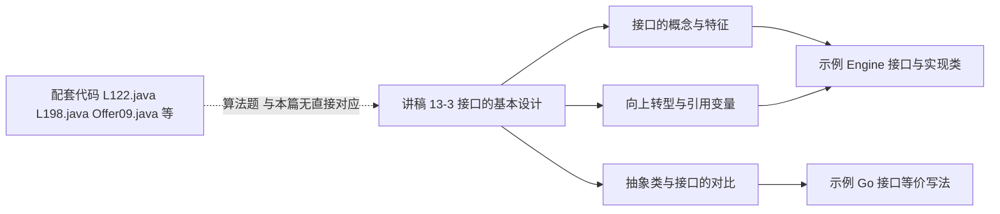

# 后端校招面试直通车: 接口的基本设计

## 纲要

- 接口的概念：系统对外提供的所有服务的抽象，可被外部访问的方法集合构成类的接口
- 接口的特征：成员变量默认 `public static final`，方法默认 `public abstract`，没有构造方法、不能实例化
- 接口可以 `extends` 多个接口，但不能 `implements` 另一个接口
- 实现类必须实现全部抽象方法，否则只能声明为抽象类
- 向上转型：不能创建接口实例，但可以定义接口类型的引用变量
- 抽象类与接口的联系和区别：同处继承树上层，抽象类更灵活，接口更符合抽象定义
- 接口是系统与外界交互的窗口，一旦确定不应随意变更

## 素材索引



- 讲稿：`work/source/8.mksz540-后端校招面试直通车，提前锁定大厂offer[完结]/第13章 程序设计之设计模式详解/13-3 面向对象编程——接口的基本设计`
- 关联代码：本篇示例根据讲稿逻辑补充（原课程算法题代码未随本课程体系分发）。

## 接口的概念

接口是系统对外提供的所有服务的抽象。一个类能被外部使用者访问的所有方法，构成这个类的接口。

站在不同角色上看接口，含义不同：

- 站在外部使用者的角度：接口是系统承诺"能提供哪些服务"的清单
- 站在系统设计者的角度：接口是规定"系统必须实现哪些服务"的契约

接口是系统中最高层次的抽象模型，通常被用作系统与外界交互的窗口。由于外部使用者依赖的是接口而不是实现，接口一旦确定，一般不允许随意更改，否则对系统内部和外部调用方都会造成严重影响。

## 接口的特征

| 特征 | 说明 | 为什么 |
| --- | --- | --- |
| 成员变量默认 `public static final` 且必须显式初始化 | 不能是 `private`，也不能是实例变量 | 接口没有实现，私有变量无法被使用；接口不能被实例化，变量只能是类级常量 |
| 方法默认 `public abstract` | 只有声明，没有方法体 | 接口是虚的函数定义，需要被具体类实现 |
| 没有构造方法，不能被实例化 | 强行 `new` 一个接口无法通过编译 | 接口没有状态，也没有构造过程 |
| 不能 `implements` 另一个接口，但可以 `extends` 多个接口 | 接口之间只存在继承关系 | 实现意味着提供方法体，接口不具备这个能力 |
| 实现类必须实现全部抽象方法 | 未实现完全部方法，类只能声明为 `abstract` | 否则对象无法对外提供完整服务 |

用 Java 语法表达就是：接口不能 `implements` 另一个接口，但可以 `extends` 多个接口；类 `implements` 接口，类只能 `extends` 一个父类。

## 向上转型

接口不允许创建实例，但可以定义接口类型的引用变量指向实现类对象，这就是向上转型。

```java
Engine engine = new Engine();             // 编译不通过：接口不能实例化
Engine engine = new BYDPetrolEngine();    // 正确：接口类型引用指向实现类对象
```

向上转型的价值在于解耦：调用方只依赖 `Engine` 这个抽象，运行期可以替换成任意实现类。这也是"继承树最上层应该是抽象层"这一原则在编码层面的落点。

## 抽象类与接口

抽象类和接口都位于继承树的上层，都代表系统的抽象层，都不能被实例化，都可以包含抽象方法，也都可以作为引用变量的类型。二者的差异是面试高频点：

| 对比项 | 接口 | 抽象类 |
| --- | --- | --- |
| 定义关键字 | `interface` | `abstract class` |
| 成员变量 | 只能是 `public static final` | 可以有各种类型的实例变量与静态变量，更灵活 |
| 方法 | 默认 `public abstract`，JDK 8 后可有 `default` 方法 | 可以有抽象方法，也可以有已实现的具体方法 |
| 构造方法 | 无 | 有（供子类调用） |
| 继承关系 | 一个类可以实现多个接口 | 一个类只能继承一个直接父类 |
| 定位 | 系统与外界交互的窗口，最高层抽象 | 接口与实现类之间的中间层 |

抽象类作为中间类，既保有接口的规范性，又实现了接口无法提供的部分功能，可以把若干共性实现下沉到抽象类中，让子类少写重复代码，从而提高系统的可重用性。设计上的常见形态是：

```text
接口（定义契约）
  └── 抽象类（实现共性部分）
        └── 具体实现类（补齐差异部分）
```

## Demo 示例

### 运行说明

讲稿以 Java 语义展开，下面是对应的可运行示例：

```bash
mkdir -p iface-demo && cd iface-demo
# 将代码保存为 Main.java
javac Main.java && java Main
```

### 代码

```java
// 接口：系统对外提供的服务契约
interface Engine {
    // 成员变量默认 public static final，必须显式初始化
    int MAX_CYLINDER = 8;

    // 方法默认 public abstract
    void start();

    void stop();
}

// 抽象类：接口与实现类之间的中间层，下沉共性实现
abstract class PetrolEngine implements Engine {
    protected String name;

    protected PetrolEngine(String name) {
        this.name = name;
    }

    // 共性实现放在抽象类，子类不必重复实现
    @Override
    public void stop() {
        System.out.println(name + " 熄火");
    }
}

// 具体实现类：补齐抽象类未实现的接口方法
class BYDPetrolEngine extends PetrolEngine {

    BYDPetrolEngine() {
        super("BYD 骁云发动机");
    }

    @Override
    public void start() {
        System.out.println(name + " 点火，缸数上限 " + MAX_CYLINDER);
    }
}

public class Main {
    public static void main(String[] args) {
        // 接口不能实例化，但可以定义接口类型的引用变量：向上转型
        Engine engine = new BYDPetrolEngine();
        engine.start();
        engine.stop();

        System.out.println("接口常量 MAX_CYLINDER = " + Engine.MAX_CYLINDER);
    }
}
```

预期输出：

```text
BYD 骁云发动机 点火，缸数上限 8
BYD 骁云发动机 熄火
接口常量 MAX_CYLINDER = 8
```

### 代码说明

- `Engine` 中的 `MAX_CYLINDER` 没有写修饰符，编译器自动补成 `public static final`，因此可以直接用 `Engine.MAX_CYLINDER` 访问。
- `start` / `stop` 没有方法体，默认就是 `public abstract`，实现类是 `public` 修饰，覆盖时不能缩小访问权限。
- `PetrolEngine` 实现了 `stop`，把共性逻辑下沉；`start` 留给具体子类实现。这正是抽象类作为中间层的意义。
- `Engine engine = new BYDPetrolEngine()` 是向上转型：变量类型是接口，运行期行为由实现类决定。

### Go 中的对应写法

Go 没有 `implements` 关键字，接口是隐式满足的，这把"契约与实现分离"做得更彻底：

```go
package main

import "fmt"

// Engine 等价于接口：只定义服务契约
type Engine interface {
	Start()
	Stop()
}

// PetrolEngine 承担抽象类的角色，承载共性字段与共性实现
type PetrolEngine struct {
	Name string
}

func (p PetrolEngine) Stop() {
	fmt.Println(p.Name, "熄火")
}

// BYDPetrolEngine 组合 PetrolEngine，只需补齐差异方法
type BYDPetrolEngine struct {
	PetrolEngine
}

func (b BYDPetrolEngine) Start() {
	fmt.Println(b.Name, "点火，缸数上限", 8)
}

func main() {
	var engine Engine = BYDPetrolEngine{PetrolEngine{Name: "BYD 骁云发动机"}}
	engine.Start()
	engine.Stop()
}
```

Go 用嵌入（组合）代替继承来完成"共性下沉"，既保留了抽象类的复用能力，又避免了继承带来的强耦合。

## 面试要点速记

| 问题 | 答题要点 |
| --- | --- |
| 接口成员为什么是 `public static final` | 接口无实现、不可实例化，变量只能是供实现类与外部使用的类级常量 |
| 接口能实现接口吗 | 不能 `implements`，可以 `extends` 多个接口 |
| 实现类没实现全部方法怎么办 | 该类必须声明为抽象类 |
| 接口与抽象类的区别 | 接口是最高层契约、无构造方法、可多实现；抽象类有构造方法和成员变量、可放共性实现、单继承 |
| 向上转型的价值 | 调用方依赖抽象而非实现，运行期可替换实现，降低耦合 |

相关度：90%。是否需要继续：[否]。代码是否可运行：[是]。
