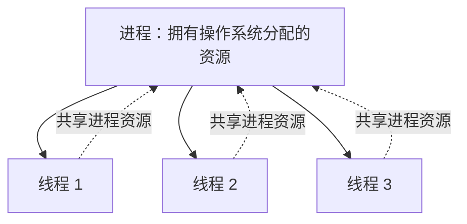
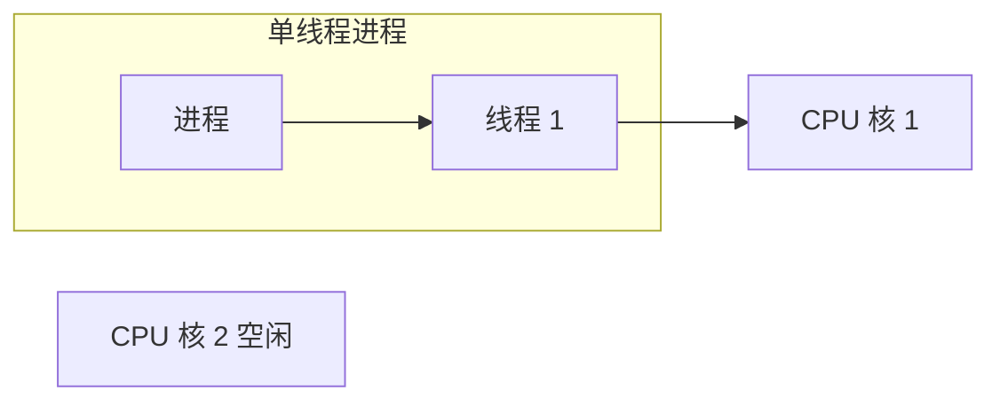
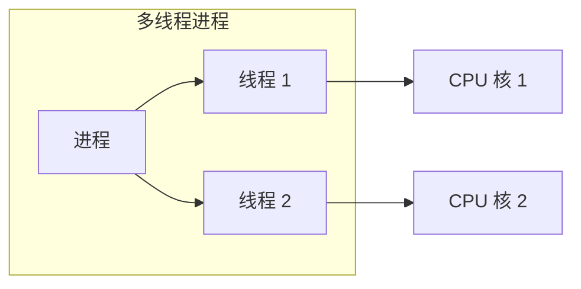

# 19. 后端校招面试直通车: 进程与线程的区别

## 纲要

- 进程回顾：资源分配与调度的基本单位
- 线程出现的背景：多处理机普及与并发度需求
- 两者的设计动机差异：管理便利 vs 吞吐提升
- 从属关系与资源共享模型
- 资源、调度、系统开销、并发性四个维度的对比
- 多线程如何把 CPU 利用率从 50% 提升到 100%

## 回顾：进程是什么

在操作系统中，进程有三重身份：

- 系统进行**资源分配和调度的基本单位**；
- 程序独立运行的载体，保障程序正常运行；
- 进程的存在让操作系统的资源利用率大幅提升。

操作系统以进程为单位分配资源，进程与进程之间的资源相互隔离。每个进程拥有自己的地址空间、文件描述符、信号处理等一整套资源，进程实体可以形象地理解为一个"资源框"。

## 线程为什么会出现

进程的概念早在 20 世纪 60 年代就随批处理系统一起诞生，此后很长一段时间里，进程一直是"拥有资源并独立运行"的基本单位。

到了 80、90 年代，多处理机系统迅速发展，人们提出了比进程更小、能够独立运行的基本单位——**线程**。引入线程的目的很明确：

- 减少进程并发执行时所付出的时空开销；
- 提升系统内程序并发执行的程度，进而提高系统吞吐量；
- 更充分地发挥多核 CPU 的优势。

因此，现代多处理机操作系统几乎都引入了线程。

两类概念的提出动机可以这样区分：

| 概念 | 提出动机 |
| --- | --- |
| 进程 | 方便操作系统管理程序，使多个程序可以并发执行 |
| 线程 | 降低并发执行的开销，提升程序并发度与系统吞吐量 |

## 线程的定位与特点

### 从属关系

一个进程可以拥有多个线程，线程从属于进程，是进程中实际执行工作的单位。合理设计下，进程可以把自己的任务委派给多个线程并行处理，从而提升运行效率、充分利用多核。

### 轻量

线程比进程更轻，很多教材把线程称为**轻量级进程**。无论是创建、调度还是切换，线程的代价都小于进程。

### 调度的最小单位

线程是操作系统进行**运行调度的最小单位**，可以被独立调度到某个核上运行；而进程强调的是**资源的分配**。一句话概括：进程管资源，线程管运行。

与进程对应 PCB（进程控制块）一样，线程也有自己的控制块 **TCB**（Thread Control Block），保存线程的运行上下文。

### 资源共享

这是最容易答错的一点：**线程本身不拥有资源**。操作系统分配资源时以进程为单位，进程内的所有线程共享这份资源。

## 进程与线程的对比

| 对比维度 | 进程 | 线程 |
| --- | --- | --- |
| 资源分配 | 操作系统资源分配的基本单位，拥有独立资源 | 不拥有资源，共享所属进程的资源 |
| 调度 | 调度开销大，需要切换页表等进程级资源 | 调度开销小，切换只需保存寄存器与栈 |
| 系统开销 | 创建、销毁、切换开销大 | 开销显著更小 |
| 并发性 | 进程之间的并发 | 既可以是进程间并发，也可以是进程内多线程并发 |

关于并发性这一点值得展开：假设 CPU 有两个核，两个核上运行的都是线程。如果这两个线程属于同一个进程，就是**进程内多线程并发**；如果它们分属不同进程，就是**进程间线程并发**。

## 多线程如何提升吞吐量

假设一个进程只有一个线程，而 CPU 有两个核：

此时进程只能占用一个核，CPU 利用率上限是 50%。把进程改造成多线程后：

每个线程都可以被操作系统独立调度到不同的核上，CPU 利用率可以从 50% 提升到 100%。这正是线程提升程序吞吐量的直观来源：既充分利用了硬件资源，也提升了整个系统的吞吐量。

## 面试回答模板

问：请简述进程和线程的区别。

> 可以从四个维度回答。资源上，进程是操作系统资源分配的基本单位，拥有独立资源，线程不拥有资源，共享所属进程的资源；调度上，线程是操作系统运行调度的最小单位，进程调度开销大，线程调度开销小；系统开销上，线程的创建、销毁与切换代价都低于进程；并发性上，进程之间是并发，线程既支持进程间并发，也支持进程内多线程并发。
>
> 补充一点动机差异：引入进程是为了让操作系统更方便地管理并发执行的程序，引入线程是为了降低并发开销、提升系统并发度与吞吐量，充分发挥多核优势。

