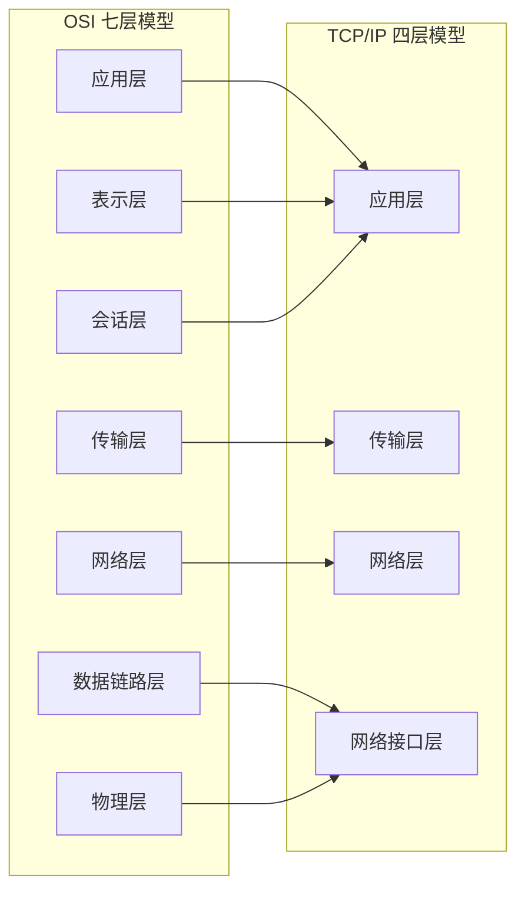

# 后端校招面试直通车: TCP、UDP、IP 的所属层级与 OSI 七层模型

## 纲要

- 计算机网络为什么必须分层：解耦、单一职责、层间透明
- OSI 七层模型的分层与各层职责
- OSI 七层与 TCP/IP 四层模型的映射关系
- 常见协议的层级归属：HTTP、FTP、DNS、TCP、UDP、IP、ICMP、以太网、ARP、RARP
- 报文的封装结构：帧、数据报、报文段如何层层嵌套
- 网络层、传输层、应用层各自解决什么问题

## 计算机网络为什么需要分层

两台相隔万里的主机要通信，需要解决的问题远比"把数据发出去"复杂：链路是否通畅、目标主机在哪里、数据是否出错、出错后如何恢复、不同应用的数据格式如何统一。

早期设计者把这些复杂问题按类型切分成不同的层，核心目标有两条：

- **不同层实现不同的功能**，职责单一，便于独立演进
- **层与层之间透明**：上层不需要关心下层的具体实现，只需使用下层提供的接口

这与编程中的函数拆分是同一套思路——一个函数体过长说明它承担了过多职责，应当拆成多个单一职责的小函数。分层就是网络领域的"解耦"。

从数据的角度看，分层也能直观体现：最上层是网络应用数据（视频、文件、游戏流量）；中间层负责可靠的数据通信（差错处理、连接保持与恢复）；最底层是网线、路由器、交换机等物理设备与光电特性。

## OSI 七层模型

| 层级 | 名称 | 主要职责 | 典型协议 |
| --- | --- | --- | --- |
| 第 7 层 | 应用层 | 为计算机用户提供接口与服务 | HTTP、FTP、SMTP、DNS |
| 第 6 层 | 表示层 | 数据处理：编码解码、加解密、压缩 | - |
| 第 5 层 | 会话层 | 管理通信会话：建立、维护、重连 | - |
| 第 4 层 | 传输层 | 管理端到端的通信连接 | TCP、UDP |
| 第 3 层 | 网络层 | 数据路由，决定数据走哪条路径 | IP、ICMP |
| 第 2 层 | 数据链路层 | 管理相邻两个节点之间的数据传输 | 以太网、ARP、RARP |
| 第 1 层 | 物理层 | 数据通信的物理特性（光电信号） | - |

OSI 七层模型是理论参考模型，工程实践中使用更多的是 **TCP/IP 四层模型**。

## OSI 七层与 TCP/IP 四层的映射



映射规律很清楚：OSI 的应用层、表示层、会话层合并为 TCP/IP 的应用层；数据链路层与物理层合并为网络接口层；传输层与网络层保持不变。

四层模型中各层的典型协议：

| 层级 | 典型协议 |
| --- | --- |
| 应用层 | HTTP、FTP、DNS、SMTP |
| 传输层 | TCP、UDP |
| 网络层 | IP、ICMP |
| 网络接口层 | 以太网、ARP、RARP |

由此可以直接回答开篇的面试题：**TCP 与 UDP 属于传输层（OSI 第 4 层 / TCP/IP 第 3 层），IP 属于网络层（OSI 第 3 层 / TCP/IP 第 2 层）**。无论在哪种模型下，这个归属都不变。

## 报文的封装结构

分层不是抽象概念，它体现在每一个数据包的字节布局里。以 TCP/IP 四层模型为例：

```dir
网络接口层：帧（Frame）
├── 帧首部
├── 帧数据  ←── 网络层数据报
│   ├── 网络层协议首部（IP 头）
│   └── 网络层协议数据 ←── 传输层报文段
│       ├── 传输层协议首部（TCP/UDP 头）
│       └── 传输层协议数据 ←── 应用层数据
│           ├── 应用层协议首部（如 HTTP Header）
│           └── 应用层数据（如 HTTP Body）
└── 帧尾部
```

可以看到两层关系：

- **层次关系**：每一层只关心自己的首部与数据，不解析上层内容
- **嵌套关系**：上层完整的首部 + 数据，作为一个整体被塞进下层的数据部分

这就是"封装"。发送方自上而下逐层加头，接收方自下而上逐层去头。

## 网络层的特点

网络层属于 OSI 第 3 层、TCP/IP 第 2 层，核心协议是 IP 与 ICMP，负责**主机与主机之间的通信**。它的服务模型可以概括为"无连接、尽最大努力交付的数据报服务"，具体有六个特点：

- 不需要提前建立连接
- 每个数据报独立路由，各自选择路径
- 每个数据报都携带完整的目标地址（IP 地址）
- 不提供可靠传输的承诺
- 到达终点的顺序可能与发送顺序不一致
- 差错检测由终点完成，网络层自身不保证服务质量

一句话概括：网络层只负责"想办法送到"，不负责"一定送到、按顺序送到"。

## 传输层的特点

传输层属于 OSI 第 4 层、TCP/IP 第 3 层，核心协议是 TCP 与 UDP，负责**主机间不同进程之间的通信**。网络层通过 IP 地址定位主机，传输层则通过**端口**定位主机上的具体网络进程。

- 传输层向上层提供通信服务，并屏蔽下方网络的复杂细节
- 面向传输层编程，感觉就像两个主机进程之间有一条端到端的逻辑通信信道
- 当传输层使用 TCP 时，这条逻辑信道是**可靠信道**——无差错、不丢失、不重复、按序到达
- 这句话的重点在于：**尽管下层网络是不可靠的，可靠性由传输层补齐**

## 应用层的特点

应用层最接近用户，协议数量也最多：HTTP、FTP、邮件协议、DNS 等。它定义的是运行在不同端系统上的应用程序进程之间**如何传递报文**——报文类型、语法、字段语义、发送与响应的时序。

例如即时通信软件会自定义自己的消息结构，这个结构就定义在应用层；而它下面依然复用 TCP/UDP + IP + 以太网。

## 三层职责速记

| 层 | 通信对象 | 寻址依据 | 是否保证可靠 |
| --- | --- | --- | --- |
| 网络层 | 主机 ↔ 主机 | IP 地址 | 否，尽最大努力交付 |
| 传输层 | 进程 ↔ 进程 | 端口号 | TCP 保证，UDP 不保证 |
| 应用层 | 应用 ↔ 应用 | 应用自定义标识 | 由应用自行约定 |

## 面试答题要点

- 先回答分层的原因：解耦，不同层实现不同功能，层间透明
- 再给出模型：OSI 七层与 TCP/IP 四层的映射关系
- 直接结论：TCP、UDP 属于传输层，IP 属于网络层
- 顺带列举其他常见协议：HTTP、FTP 在应用层；ICMP 在网络层；以太网、ARP、RARP 在网络接口层
- 若能补充封装结构与网络层/传输层的特点，是明显的加分项

相关度：95%。是否需要继续：[否]。代码是否可运行：[否]。
