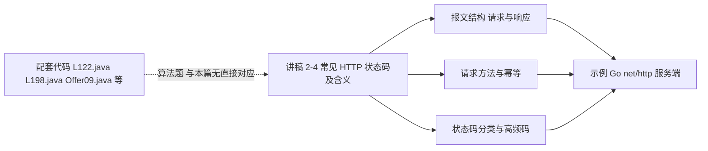
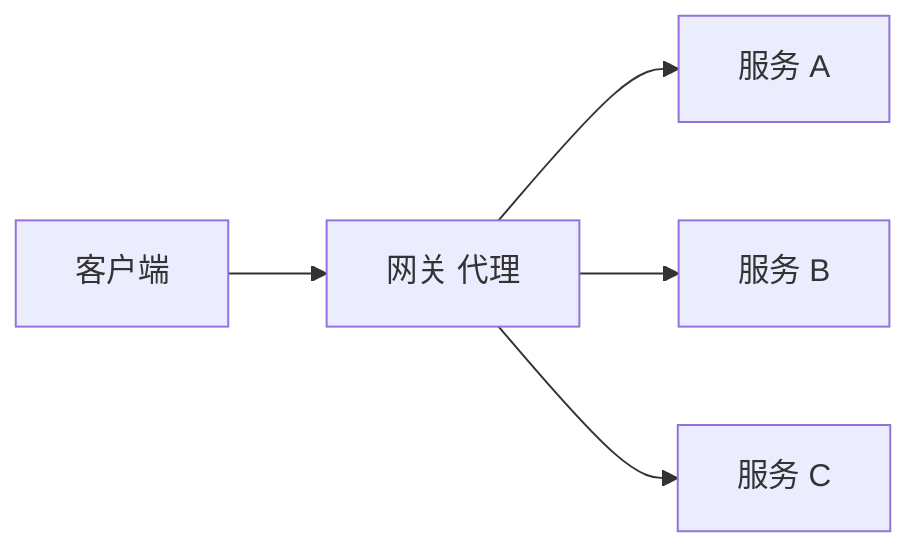

# 后端校招面试直通车: HTTP 报文结构、请求方法与常见状态码

## 纲要

- 请求报文与响应报文的三段式结构：起始行、头部、主体
- 常见请求方法：GET、HEAD、POST、PUT、DELETE、TRACE、OPTIONS 及使用场景
- 幂等的概念：任意多次执行所产生的影响均与一次执行相同
- 状态码的四类划分：2xx 成功、3xx 重定向、4xx 客户端错误、5xx 服务端错误
- 高频状态码：200、204、304、400、401、403、404、500、502、503、504
- 排查思路：4xx 从客户端入手，5xx 从服务端与网关入手
- Go `net/http` 中复现这些状态码的可运行示例

## 素材索引



- 讲稿：`work/source/8.mksz540-后端校招面试直通车，提前锁定大厂offer[完结]/{2}--第2章网络协议面试核心之HTTP、HTTPS、DNS协议/2-4 请简述常见HTTP状态码及含义`
- 关联代码：本篇示例根据讲稿逻辑用 Go 补充（原课程算法题代码未随本课程体系分发）。

## 报文结构

请求报文与响应报文都主要由三个部分组成。

### 请求报文

```text
POST /api/course HTTP/1.1              <- 起始行：请求方法 请求地址 协议版本
Host: coding.example.com                <- 请求头：key: value 形式
Connection: keep-alive
Accept: application/json
Accept-Language: zh-CN
Content-Type: application/json

{"page":1,"size":20,"keyword":"go"}     <- 请求体
```

- 起始行包含请求方法、请求地址、HTTP 版本，三者之间以空格分隔
- 请求头以 `key: value` 形式存在，`Connection: keep-alive` 也是请求头字段
- 请求体可以是明文 JSON、表单，也可以是二进制

### 响应报文

```text
HTTP/1.1 200 OK                         <- 起始行：协议版本 状态码 状态解释
Content-Type: application/json          <- 响应头
Content-Length: 128
Age: 3
Connection: keep-alive

{"code":0,"data":{...}}                 <- 响应体
```

响应报文的起始行由版本、状态码、状态码的简短英文解释组成。浏览器开发者工具里看到的 `Request URL`、`Status Code`、`Response Headers` 正是这三部分的展开。

## 请求方法

请求方法本质上是对服务器资源执行操作的方式，通过定义不同的方法，可以清晰地区分"要做什么"。

| 方法 | 作用 | 使用场景 |
| --- | --- | --- |
| GET | 请求服务器发送某个资源 | 查询数据、获取页面，HTTP 0.9 起就支持 |
| HEAD | 与 GET 类似，但服务端只返回响应头，不返回响应体 | 在不获取资源的前提下检查资源状态、查看响应头判断资源是否变化 |
| POST | 向服务器写入数据 | 提交账号密码、创建订单等写操作 |
| PUT | 向服务器写入资源，强调资源本身（文件、多媒体等） | 整体替换资源、上传文件 |
| DELETE | 请求服务器删除 URL 所指定的资源 | 删除某个 JS、CSS、图片或数据资源 |
| TRACE | 观察请求报文最终到达服务器时的样子 | 排查经过防火墙、代理、转发后的请求被改写的情况 |
| OPTIONS | 询问服务器针对某个资源支持哪些方法 | 代理、网关等中间服务的能力探测，响应中的 `Allow` 字段列出支持的方法 |

## 幂等

幂等操作指的是任意多次执行所产生的影响均与一次执行的影响相同；幂等函数指可以使用相同参数重复执行并获得相同结果的函数。

一个对照例子：某个接口每请求一次就把变量加一，请求五次之后变量变成五，每次执行都改变了结果，这不是幂等操作。把实现改成"接收请求携带的值并把变量设为该值"，请求多少次变量都是五，这就是幂等。

| 方法 | 是否幂等 | 说明 |
| --- | --- | --- |
| GET | 是 | 只读，不改变资源状态 |
| HEAD | 是 | 与 GET 一致，只是不返回 body |
| PUT | 通常视为是 | 多次写入同一份资源，结果相同，最终仍取决于后端实现 |
| DELETE | 通常视为是 | 多次删除同一资源，结果相同，最终取决于后端实现 |
| OPTIONS / TRACE | 是 | 探测性质，不改变资源 |
| POST | 不确定 | 取决于后端实现，创建类接口通常非幂等 |

面试时更重要的是给出判断标准：是否幂等取决于后端实现，方法本身只是语义约定；设计写接口时应显式保证幂等（幂等键、唯一索引、状态机校验）。

## 状态码

状态码是由三位数字组成的标识，按百分位分为四类：

| 区间 | 类别 | 含义 |
| --- | --- | --- |
| 200–299 | 成功 | 请求被服务端正常接收并处理 |
| 300–399 | 重定向 | 需要进一步操作，或资源改从其他位置获取 |
| 400–499 | 客户端错误 | 请求本身有问题 |
| 500–599 | 服务端错误 | 服务端或中间节点处理失败 |

### 高频状态码

| 状态码 | 英文解释 | 含义 | 排查方向 |
| --- | --- | --- | --- |
| 200 | OK | 请求正常，响应体包含所请求的资源 | 正常路径 |
| 204 | No Content | 请求正常，但响应没有内容 | 删除等无需返回体的操作 |
| 304 | Not Modified | 资源未被修改，服务端不返回资源，客户端继续使用本地缓存 | 缓存协商：`If-None-Match` / `ETag`、`If-Modified-Since` |
| 400 | Bad Request | 请求语法错误，服务端无法理解 | 检查请求报文构建、参数格式 |
| 401 | Unauthorized | 请求资源之前未通过身份认证 | 检查鉴权信息与登录态 |
| 403 | Forbidden | 客户端没有权限请求该资源，被服务端拒绝 | 检查权限与鉴权策略 |
| 404 | Not Found | 服务端找不到 URL 所指定的资源 | 检查路径、路由与资源是否存在 |
| 500 | Internal Server Error | 服务端内部错误 | 看服务端日志与异常栈 |
| 502 | Bad Gateway | 复杂 Web 结构中的网关或代理出现问题 | 看网关与上游服务的连通性 |
| 503 | Service Unavailable | 服务当前无法对外提供服务 | 常见于服务宕机或过载，看实例健康与容量 |
| 504 | Gateway Timeout | 网关或代理未能在规定时间内拿到响应 | 看上游耗时与网关超时配置 |

### 为什么会有 502 与 504

常见的 Web 后端结构里，客户端请求先到达代理或网关，再由网关转发到不同的后端服务。网关处在客户端与真实服务之间，因此会产生两类专属错误：



- 502：网关本身或它与上游服务的交互出了问题，请求没能被正确转发或响应不合法
- 504：请求转发成功了，但上游在超时时间内没有返回结果

## 排查思路

状态码本身就直接给出了排查方向：

- 出现 4xx（400、401、403、404）时，主要从客户端角度排查：请求构建、鉴权信息、权限、路径
- 出现 5xx（500、502、503、504）时，主要从服务端角度排查：应用异常、网关与代理、服务容量与上游耗时

## API 速览

| API | 说明 |
| --- | --- |
| `http.HandleFunc(pattern string, handler func(http.ResponseWriter, *http.Request))` | 在默认路由上注册处理函数 |
| `http.NewServeMux() *http.ServeMux` | 创建独立路由，便于测试与隔离 |
| `http.ResponseWriter.WriteHeader(statusCode int)` | 显式写入状态码，必须在写响应体之前调用，且只能调用一次 |
| `http.Error(w ResponseWriter, error string, code int)` | 写入错误文本并设置 `Content-Type: text/plain`，同时写入状态码 |
| `http.StatusText(code int) string` | 返回状态码对应的英文解释 |
| `http.StatusOK` 等常量 | `200`、`204`、`304`、`400`、`401`、`403`、`404`、`500`、`502`、`503`、`504` 均有对应常量 |
| `httptest.NewServer(handler http.Handler) *httptest.Server` | 起一个本地临时服务，用于演示与测试，配合 `defer srv.Close()` |
| `http.NewRequest(method, url string, body io.Reader) (*http.Request, error)` | 构造指定方法的请求 |

## Demo 示例

### 运行说明

示例演示中，`httptest.NewServer` 会在本地随机端口启动服务，程序自行发起各类请求并打印状态码，无需额外的 curl。

```bash
mkdir -p http-status-demo && cd http-status-demo
go mod init http-status-demo
# 将代码保存为 main.go
go run main.go
```

### 代码

```go
package main

import (
	"crypto/sha256"
	"fmt"
	"io"
	"net/http"
	"net/http/httptest"
	"strconv"
	"sync/atomic"
)

var (
	counter int64 // 非幂等资源：每次请求 +1
	value   int64 // 幂等资源：直接被设置为请求参数
)

func main() {
	mux := http.NewServeMux()

	// 200：请求成功，响应体包含所请求的资源
	mux.HandleFunc("/resource", func(w http.ResponseWriter, r *http.Request) {
		w.WriteHeader(http.StatusOK)
		fmt.Fprintln(w, `{"id":1,"name":"course"}`)
	})

	// 204：请求成功但没有响应体
	mux.HandleFunc("/delete", func(w http.ResponseWriter, r *http.Request) {
		w.WriteHeader(http.StatusNoContent)
	})

	// 304：资源未修改，客户端继续使用本地缓存
	mux.HandleFunc("/static", func(w http.ResponseWriter, r *http.Request) {
		body := "static content"
		sum := sha256.Sum256([]byte(body))
		etag := fmt.Sprintf("%x", sum)
		w.Header().Set("ETag", etag)
		if r.Header.Get("If-None-Match") == etag {
			w.WriteHeader(http.StatusNotModified)
			return
		}
		w.WriteHeader(http.StatusOK)
		fmt.Fprintln(w, body)
	})

	// 400：请求语法错误，服务端无法理解
	mux.HandleFunc("/bad-request", func(w http.ResponseWriter, r *http.Request) {
		http.Error(w, "missing required param", http.StatusBadRequest)
	})

	// 401：请求资源之前未通过身份认证
	mux.HandleFunc("/secret", func(w http.ResponseWriter, r *http.Request) {
		w.Header().Set("WWW-Authenticate", `Basic realm="restricted"`)
		http.Error(w, "unauthorized", http.StatusUnauthorized)
	})

	// 403：身份已知但没有权限
	mux.HandleFunc("/admin", func(w http.ResponseWriter, r *http.Request) {
		http.Error(w, "forbidden", http.StatusForbidden)
	})

	// 500：服务端内部错误
	mux.HandleFunc("/boom", func(w http.ResponseWriter, r *http.Request) {
		http.Error(w, "internal server error", http.StatusInternalServerError)
	})

	// 503：服务当前无法对外提供服务
	mux.HandleFunc("/unavailable", func(w http.ResponseWriter, r *http.Request) {
		http.Error(w, "service unavailable", http.StatusServiceUnavailable)
	})

	// 非幂等：每请求一次 counter 加一
	mux.HandleFunc("/counter", func(w http.ResponseWriter, r *http.Request) {
		fmt.Fprintf(w, "counter=%d\n", atomic.AddInt64(&counter, 1))
	})

	// 幂等：无论请求多少次，最终值都等于请求参数
	mux.HandleFunc("/value", func(w http.ResponseWriter, r *http.Request) {
		n, _ := strconv.ParseInt(r.URL.Query().Get("n"), 10, 64)
		atomic.StoreInt64(&value, n)
		fmt.Fprintf(w, "value=%d\n", atomic.LoadInt64(&value))
	})

	srv := httptest.NewServer(mux)
	defer srv.Close()
	client := srv.Client()

	show := func(method, path string, header http.Header) {
		req, err := http.NewRequest(method, srv.URL+path, nil)
		if err != nil {
			fmt.Println(method, path, "构造请求失败:", err)
			return
		}
		if header != nil {
			req.Header = header
		}
		resp, err := client.Do(req)
		if err != nil {
			fmt.Println(method, path, "请求失败:", err)
			return
		}
		defer resp.Body.Close()
		body, _ := io.ReadAll(resp.Body)
		fmt.Printf("%-6s %-16s -> %d %s | body=%q\n",
			method, path, resp.StatusCode, http.StatusText(resp.StatusCode), string(body))
	}

	show(http.MethodGet, "/resource", nil)
	show(http.MethodHead, "/resource", nil) // 只返回响应头，没有响应体
	show(http.MethodDelete, "/delete", nil)

	// 先用一次请求拿到 ETag，再带上 If-None-Match 请求第二次
	resp, _ := client.Get(srv.URL + "/static")
	etag := resp.Header.Get("ETag")
	resp.Body.Close()
	show(http.MethodGet, "/static", nil)
	h := http.Header{}
	h.Set("If-None-Match", etag)
	show(http.MethodGet, "/static", h)

	show(http.MethodGet, "/bad-request", nil)
	show(http.MethodGet, "/secret", nil)
	show(http.MethodGet, "/admin", nil)
	show(http.MethodGet, "/not-found", nil) // 未注册的路由，由 mux 返回 404
	show(http.MethodGet, "/boom", nil)
	show(http.MethodGet, "/unavailable", nil)

	fmt.Println("--- 幂等性对比 ---")
	for i := 0; i < 3; i++ {
		show(http.MethodPost, "/counter", nil) // 每次结果都不同
	}
	for i := 0; i < 3; i++ {
		show(http.MethodPut, "/value?n=5", nil) // 每次结果都相同
	}
}
```

预期输出（节选）：

```text
GET    /resource        -> 200 OK | body="{\"id\":1,\"name\":\"course\"}\n"
HEAD   /resource        -> 200 OK | body=""
DELETE /delete          -> 204 No Content | body=""
GET    /static          -> 200 OK | body="static content\n"
GET    /static          -> 304 Not Modified | body=""
GET    /bad-request     -> 400 Bad Request | body="missing required param\n"
GET    /secret          -> 401 Unauthorized | body="unauthorized\n"
GET    /admin           -> 403 Forbidden | body="forbidden\n"
GET    /not-found       -> 404 Not Found | body="404 page not found\n"
GET    /boom            -> 500 Internal Server Error | body="internal server error\n"
GET    /unavailable     -> 503 Service Unavailable | body="service unavailable\n"
--- 幂等性对比 ---
POST   /counter         -> 200 OK | body="counter=1\n"
POST   /counter         -> 200 OK | body="counter=2\n"
POST   /counter         -> 200 OK | body="counter=3\n"
PUT    /value?n=5       -> 200 OK | body="value=5\n"
PUT    /value?n=5       -> 200 OK | body="value=5\n"
PUT    /value?n=5       -> 200 OK | body="value=5\n"
```

### 代码说明

- `WriteHeader` 必须在写响应体之前调用，且每个请求只能调用一次；不显式调用时，首次写响应体会自动补 `200`。
- `http.Error` 一次性完成"设置 `Content-Type` + 写状态码 + 写错误文本"，是返回 4xx/5xx 的简洁写法。
- 304 的实现走的是缓存协商：服务端给出 `ETag`，客户端下次请求带上 `If-None-Match`，内容未变则返回 304 且不返回响应体，客户端继续使用本地资源。
- `HEAD` 请求复用 `/resource` 的处理函数，响应码相同但没有 body，正对应 HEAD 的语义。
- 幂等对比里，`/counter` 每次自增（非幂等），`/value` 每次把值设为 5（幂等），与讲稿中的例子一一对应。
- 502 与 504 由网关产生，应用层无法直接"返回"，因此示例中只用 503 演示服务端不可用；理解上记住 502 是网关与上游交互失败、504 是上游超时即可。

### 技术点总结

- 报文结构：起始行 + 头部 + 主体，请求与响应都是三段式
- 方法语义：GET/HEAD 只读，POST 写数据，PUT 写资源，DELETE 删资源，OPTIONS/TRACE 用于探测
- 幂等：判断标准是"多次执行的影响是否等同一次执行"，最终取决于后端实现
- 状态码：2xx 成功、3xx 重定向、4xx 客户端问题、5xx 服务端与网关问题
- 排查顺序：先看百分位确定责任方，再看具体码定位模块

## 面试要点速记

| 问题 | 答题要点 |
| --- | --- |
| 常见请求方法及使用场景 | GET 取资源、HEAD 只取头、POST 写数据、PUT 写资源、DELETE 删资源、OPTIONS 探测支持的方法、TRACE 追踪请求 |
| 什么是幂等 | 任意多次执行的影响与一次执行相同；GET/HEAD/PUT/DELETE/OPTIONS/TRACE 通常幂等，POST 取决于实现 |
| 403 与 401 的区别 | 401 未通过身份认证，403 身份已知但权限不足 |
| 502 与 504 的区别 | 502 是网关与上游交互失败，504 是网关等待上游响应超时 |
| 304 的含义 | 资源未修改，服务端不返回内容，客户端沿用本地缓存 |

相关度：93%。是否需要继续：[否]。代码是否可运行：[是]。
