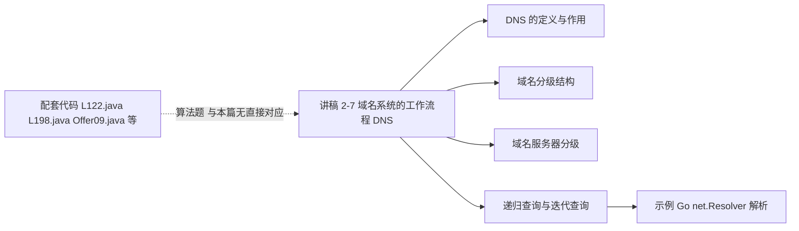
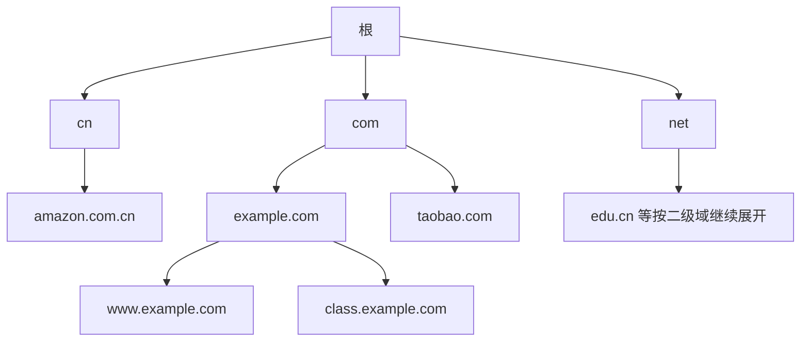
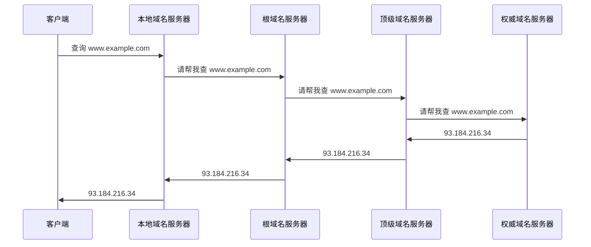
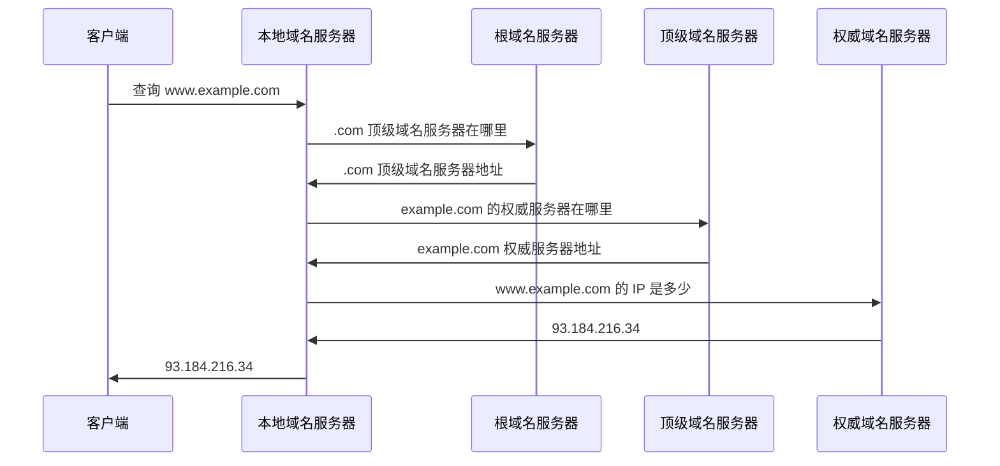

# 后端校招面试直通车: DNS 域名系统工作流程与两种查询方式

## 纲要

- DNS 是什么：把域名翻译成 IP 地址的互联网服务，本质是存储域名与 IP 映射关系的分布式数据库
- 为什么需要 DNS：对外提供服务的是 IP 加端口，而数字串难以记忆
- 域名结构：由点、字母、数字组成，点分割出顶级域、二级域、三级域
- 顶级域分类：国家顶级域（cn、us、uk）与通用顶级域（com、net、gov）
- 域名服务器分级：根域名服务器、顶级域名服务器、权威域名服务器
- 两种查询方式：递归查询与迭代查询，过程不同但结果相同
- 查询前置步骤：本地缓存与 hosts 文件优先

## 素材索引



- 讲稿：`work/source/8.mksz540-后端校招面试直通车，提前锁定大厂offer[完结]/{2}--第2章网络协议面试核心之HTTP、HTTPS、DNS协议/2-7 请简述域名系统的工作流程 DNS`
- 关联代码：`code/recruitment/src/main/java/com/imooc/dddq/code/` 下的 `L122.java`、`L198.java`、`Offer09.java` 等，均为配套算法题实现，与本篇无直接对应；本篇示例根据讲稿逻辑用 Go 补充。

## DNS 是什么

平时访问网页使用的是域名，例如 `www.example.com`。但真正对外提供服务的是进程服务，也就是 IP 加端口：IP 指定网络中的哪一台主机，端口指定主机上的哪一个进程。IP 加端口是一串由数字、点和冒号组成的字符串，既难理解也难记忆，于是用有意义的域名来帮助记忆。

把域名翻译成 IP 地址的这个过程，就是 DNS 提供的功能。DNS 全称 Domain Name System，即域名系统，它是一项互联网服务，本质上是一个存储域名与 IP 地址映射关系的分布式数据库，让使用者可以更方便地访问互联网：只需要记住域名，翻译工作交给 DNS。

## 域名的分级结构

域名由点、字母和数字组成，点用来分割不同的域：顶级域、二级域、三级域。以 `www.example.com` 为例：

```text
www      .   example    .   com
三级域       二级域        顶级域
```

- 顶级域：通常是国家域或通用域。国家顶级域如 `cn`、`us`、`uk`；通用顶级域如 `com`（公司）、`net`（互联网机构）、`gov`（政府机构）
- 二级域：`example`、`edu` 这类，是域名注册者自己申请的部分
- 三级域：`www`、`class`、`coding` 这类，一般由站点自己定义

把这些层级组织起来，整个域名系统是一棵树：最上面是根，往下依次是顶级域、二级域、三级域，越往下数量越多、越像枝叶。



一个完整的域名从三级域往上回溯可以得到不同的可访问地址，例如 `www.example.com`、`class.example.com` 都是完整的域名。

## 域名服务器的分级

既然域名是分级的，提供解析服务的域名服务器也是分级的：

| 类型 | 职责 | 例子 |
| --- | --- | --- |
| 根域名服务器 | 负责根域解析，返回顶级域名服务器的位置 | 查询 `.com` 顶级域名服务器在哪里 |
| 顶级域名服务器 | 按顶级域划分，返回对应权威域名服务器的位置 | `.com`、`.cn`、`.net` 各自的服务器 |
| 权威域名服务器 | 保存某个域下主机的真实解析记录，返回最终 IP | `example.com` 的权威服务器返回 `www` 的 IP |

这样分级的好处是把解析压力分散到各级服务器，让整个域名服务体系与域名的树形组织呼应起来，结构清晰且易扩展。

## 查询流程

首先要明确一点：DNS 解析过程发生在客户端，因为客户端需要通过域名拿到 IP 才能与服务端建立连接。

在任何查询开始之前，还有两个更靠前的步骤：

- 浏览器缓存与操作系统缓存：命中则直接返回，不再发出查询
- 本地 hosts 文件：命中则直接返回

缓存与 hosts 都没有命中时，才向本地域名服务器（Local DNS）发起查询。之后分为两种方式。

### 递归查询

递归查询的特点是"一层层转交、一层层返回"：客户端只发一次请求，本地域名服务器代替它把剩下的查询全部做完，最后把结果返回。



对客户端而言，递归查询只需要一次请求；对本地域名服务器而言，它需要承担全部中间查询。

### 迭代查询

迭代查询的特点是"每次都自己问、自己跑"：本地域名服务器依次向根、顶级、权威域名服务器查询，每一步拿到的不是最终答案，而是"下一步该问谁"的线索。



### 两种方式对比

| 对比项 | 递归查询 | 迭代查询 |
| --- | --- | --- |
| 查询主体 | 本地域名服务器代替客户端逐级转交 | 本地域名服务器自己逐级查询 |
| 客户端请求次数 | 一次 | 一次（后续查询由本地域名服务器发起） |
| 中间返回结果 | 每一级返回最终答案 | 每一级返回"下一级去哪查" |
| 本地域名服务器压力 | 较高 | 相对较低 |
| 最终结果 | 相同 | 相同 |

实际网络中，客户端到本地域名服务器这一段通常是递归（客户端只要结果），本地域名服务器到各级服务器这一段通常是迭代（自己跑完全程）。

## 常见记录类型

| 记录 | 作用 |
| --- | --- |
| A | 域名到 IPv4 地址 |
| AAAA | 域名到 IPv6 地址 |
| CNAME | 域名到另一个域名的别名 |
| MX | 邮件交换记录 |
| NS | 该域由哪台权威域名服务器解析 |
| TXT | 文本记录，常用于域名校验与 SPF |

## API 速览

| API | 说明 |
| --- | --- |
| `net.LookupHost(host string) ([]string, error)` | 用系统解析器查询主机对应的 IP 列表 |
| `net.LookupCNAME(host string) (string, error)` | 查询规范名（CNAME 链终点） |
| `net.LookupMX(name string) ([]*MX, error)` | 查询邮件交换记录，返回优先级与主机名 |
| `net.LookupNS(name string) ([]*NS, error)` | 查询权威域名服务器 |
| `net.Resolver{PreferGo: true, Dial: ...}` | 自定义解析器，可指定 DNS 服务器地址与超时 |
| `Resolver.LookupHost(ctx, host)` | 带上下文的版本，可设置超时 |

命令行工具：`dig www.example.com`、`dig +trace www.example.com`（可直观看到从根到权威的迭代过程）、`nslookup www.example.com`。

## Demo 示例

### 运行说明

示例分两部分：第一部分解析 `localhost`，走系统解析器与 hosts 文件，离线可用；第二部分向公共 DNS 服务器发起查询，需要外网。

```bash
mkdir -p dns-demo && cd dns-demo
go mod init dns-demo
# 将代码保存为 main.go
go run main.go
```

### 代码

```go
package main

import (
	"context"
	"fmt"
	"net"
	"time"
)

func main() {
	// 第一部分：使用系统解析器，会先查 hosts 文件与本地缓存
	ips, err := net.LookupHost("localhost")
	fmt.Println("系统解析器 localhost ->", ips, "err:", err)

	// 第二部分：自定义解析器，指定 DNS 服务器，模拟"本地域名服务器向权威服务器查询"
	resolver := &net.Resolver{
		PreferGo: true,
		Dial: func(ctx context.Context, network, address string) (net.Conn, error) {
			d := net.Dialer{Timeout: 3 * time.Second}
			// 这里的地址就是"要问的那台域名服务器"
			return d.DialContext(ctx, "udp", "223.5.5.5:53")
		},
	}

	ctx, cancel := context.WithTimeout(context.Background(), 5*time.Second)
	defer cancel()

	host := "www.example.com"
	if addrs, err := resolver.LookupHost(ctx, host); err == nil {
		fmt.Println(host, "A 记录 ->", addrs)
	} else {
		fmt.Println(host, "A 记录查询失败:", err)
	}

	if cname, err := resolver.LookupCNAME(ctx, host); err == nil {
		fmt.Println(host, "CNAME ->", cname)
	} else {
		fmt.Println(host, "CNAME 查询失败:", err)
	}

	if mxs, err := resolver.LookupMX(ctx, "example.com"); err == nil {
		for _, mx := range mxs {
			fmt.Printf("MX -> %s (优先级 %d)\n", mx.Host, mx.Pref)
		}
	} else {
		fmt.Println("MX 查询失败:", err)
	}

	if nss, err := net.LookupNS("example.com"); err == nil {
		for _, ns := range nss {
			fmt.Println("NS ->", ns.Host)
		}
	} else {
		fmt.Println("NS 查询失败:", err)
	}
}
```

预期输出（第二部分依赖网络，数值以实际为准）：

```text
系统解析器 localhost -> [127.0.0.1 ::1] err: <nil>
www.example.com A 记录 -> [93.184.216.34]
www.example.com CNAME -> www.example.com.
MX -> 0 example.com.
NS -> a.iana-servers.net.
NS -> b.iana-servers.net.
```

### 代码说明

- `net.LookupHost("localhost")` 走的是系统解析器，命中 hosts 文件，因此不需要网络，对应"先查本地缓存与 hosts"这一步。
- 自定义 `net.Resolver` 通过 `Dial` 指定了 DNS 服务器地址，相当于手动指定"向哪台域名服务器发问"，这正是迭代查询里每一步的动作。
- `LookupCNAME` 返回的是 CNAME 链的终点；没有 CNAME 记录时返回自身。
- `LookupMX` 返回带优先级的邮件交换记录，`Pref` 越小优先级越高。
- `LookupNS` 返回该域的权威域名服务器，对应"顶级域名服务器告诉本地域名服务器该问哪个权威服务器"这一步。
- 想直观看到完整迭代过程，可以在命令行执行 `dig +trace www.example.com`，输出会依次列出根、顶级域、权威服务器的应答。

### 技术点总结

- DNS 是域名到 IP 的分布式映射数据库，解决的是"IP 难记"的问题
- 域名与域名服务器都是分级的：顶级域、二级域、三级域对应根、顶级、权威三级服务器
- 查询前先走缓存与 hosts，未命中才请求本地域名服务器
- 递归查询是"别人替我跑完"，迭代查询是"我自己逐级问"，结果相同而过程不同
- 排障工具：`dig`、`dig +trace`、`nslookup`

## 面试要点速记

| 问题 | 答题要点 |
| --- | --- |
| DNS 是什么 | 把域名翻译成 IP 的互联网服务，分布式映射数据库 |
| 它解决了什么问题 | IP 加端口难记忆，用有意义的域名降低使用成本 |
| 简述查询流程 | 缓存与 hosts 优先 → 本地域名服务器 → 根域名服务器 → 顶级域名服务器 → 权威域名服务器 → 返回 IP |
| 递归与迭代的区别 | 递归由各级服务器代为查询并层层返回；迭代由本地域名服务器自己逐级询问，每级只返回下一级地址 |
| 为什么分级 | 分散解析压力，与域名的树形组织呼应，便于扩展 |

相关度：92%。是否需要继续：[否]。代码是否可运行：[是]。
