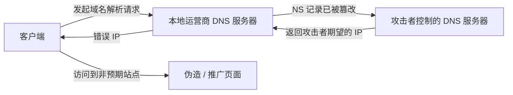

# 后端校招面试直通车: DNS 攻击的常见手段与防范思路

## 纲要

- DNS 被攻击之后的表层现象：域名解析到错误的 IP
- DNS 劫持：控制域名管理权限，把 NS 记录指向攻击者可控的 DNS 服务器
- DNS 欺骗：冒充权威域名服务器返回伪造应答
- DDoS 攻击：把 DNS 服务本身打垮，使其无法提供解析
- 防范手段：服务端加固 + 用户侧选用权威 DNS

## DNS 出问题时的现象

正常情况下，访问一个域名会经过 DNS 解析拿到对应的 IP 与端口，再发起业务请求。一旦这个解析环节被污染，用户输入的是 A 站点，打开的却是 B 站点的内容。

常见的现象有三类：

- 错误的域名被解析到纠错导航页（对用户无害，但从安全角度仍属于解析被篡改）
- 错误的域名被解析到非正常页面
- **正常的站点被解析到恶意页面**——危害最大，用户会在毫无察觉的情况下访问到钓鱼或推广页面

背后的利益驱动很直接：某些攻击者或违规运营商通过把正常流量导向特定推广页，赚取广告费与推广分成。理解这一点，就能理解为什么 DNS 攻击至今仍然常见。

## DNS 劫持

DNS 劫持的原理是攻击者**获取域名管理权限**，进而修改域名的解析记录。

具体路径：

- 攻击者出于盈利目的，控制域名的管理密码或域名管理邮箱
- 修改该域名的 NS 记录，将其指向攻击者自己可控的 DNS 服务器
- 客户端发起解析时，请求最终落到攻击者控制的服务器上
- 该服务器返回攻击者希望客户端看到的任意 IP

DNS 劫持的根源在于**本地网络运营商的 DNS 服务器被攻击或被违规利用**，单靠客户端几乎无法防御，主要责任在服务提供方。

用户侧能做的缓解措施：不要使用"自动获得 DNS 服务器地址"，而是手动指定权威的公共 DNS 服务地址，绕开被污染的本地递归服务器，从而大幅降低被劫持的概率。

## DNS 欺骗

DNS 欺骗（DNS Spoofing）是攻击者**冒充域名服务器**的一种欺骗行为：

- 攻击者并不真正攻破某台权威域名服务器，而是伪造应答报文抢先返回给客户端
- 一旦伪装成功，攻击者就能把待查询域名对应的 IP 替换成任意 IP
- 用户因此访问到攻击者指定的主机，打开的是攻击者准备的主页

两者对比：

| 对比项 | DNS 劫持 | DNS 欺骗 |
| --- | --- | --- |
| 手段 | 控制域名管理权限，篡改 NS 指向 | 冒充域名服务器，伪造应答报文 |
| 是否攻破真实服务器 | 需要控制域名与 DNS 服务器 | 不需要，属于冒名顶替 |
| 生效范围 | 该域名下的所有解析请求 | 能截获并伪造应答的那一段链路 |
| 共同点 | 最终都是返回一个错误的 IP 给客户端 | 最终都是返回一个错误的 IP 给客户端 |

一句话区分：劫持是"把服务器抢过来改数据"，欺骗是"不抢服务器，冒充它说话"。

## DDoS 攻击

DNS 本质上也是一个部署在物理设备上的服务程序，而物理设备的容量有承载极限。DDoS（Distributed Denial of Service，分布式拒绝服务攻击）正是利用这一点：

- **DoS**（Denial of Service）是拒绝服务攻击，让目标无法对正常用户提供服务
- **DDoS** 在 DoS 的基础上叠加"分布式"，通过大量分布式的攻击源同时发起请求，攻击量级与暴力程度都更高
- 目的是耗尽目标的网络带宽或系统资源，使服务暂时中断甚至宕机，正常用户无法访问

需要注意：DDoS 并不局限于 DNS，任何对外提供公共服务的系统都可能成为目标。只是当 DNS 服务被打垮时，用户拿不到域名对应的 IP，后续所有访问都将失败，因此 DNS 常被视为关键基础设施而被重点攻击。

## 防范手段

防范需要从服务提供方与用户两个角度分别入手。

| 角度 | 措施 |
| --- | --- |
| DNS 服务提供方 | 采购专业的防护服务；提升本地域名服务器自身的安全性；部署限流、缓存与高可用架构 |
| 个人 / 企业用户 | 手动指定权威的公共 DNS 服务地址，避免使用不可信的自动分配 DNS |
| 通用安全建设 | 流量监控与告警、异常流量识别与分流、接入云厂商的 DDoS 高防能力 |

## 面试答题要点

- 先描述现象：正常域名被解析到错误 IP，用户访问到非预期甚至恶意的站点
- 再讲原理：DNS 劫持（篡改 NS 指向，控制真实服务器）与 DNS 欺骗（冒充权威服务器，伪造应答）
- 补充 DDoS：分布式拒绝服务攻击耗尽资源，DNS 被打垮后整条访问链路失效
- 最后讲防范：服务端加固与采购防护服务，用户侧改用权威公共 DNS
- 加分点：指出 DNS 劫持与欺骗的本质相同——都是返回错误 IP，区别只在手段

相关度：94%。是否需要继续：[否]。代码是否可运行：[否]。
