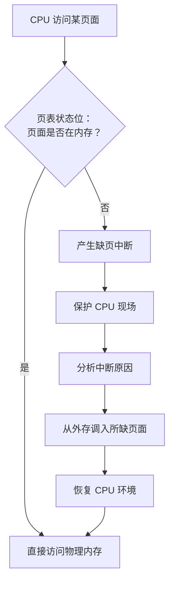

# 25. 后端校招面试直通车: 内存管理与缺页中断

## 纲要

- 操作系统为什么需要内存管理
- 页式存储管理：页面、物理块、页表
- 页面大小为什么不能太大也不能太小；Linux 默认 4KB
- 多级页表存在的意义与量化计算
- 段式存储管理：段表、段号与段内偏移
- 段页式存储管理：现代计算机的实际方案
- 缺页中断的产生、处理流程与两个特殊点

## 为什么需要内存管理

多道程序设计下，每个进程都有独立的进程空间。操作系统必须回答一个问题：如何管理多个进程的进程空间？这套管理机制就是内存管理。

早期及现在主流的管理方式有三种：**页式存储管理**、**段式存储管理**、**段页式存储管理**。理解它们，才能准确回答什么是内存页、什么是内存段，以及什么是缺页中断。

## 页式存储管理

页式管理把进程的**逻辑空间等分成若干大小相同的页面**，同时把物理内存空间也切成与页面大小相同的**物理块**，然后以页面为单位，把进程空间装进物理内存中分散的物理块里。

```mermaid
flowchart LR
    subgraph 进程逻辑空间（连续）
        P0[页面 0]
        P1[页面 1]
        P2[页面 2]
        P3[页面 3]
        P4[页面 4]
    end
    subgraph 物理内存（分散）
        B0[物理块]
        B1[物理块]
        B2[物理块]
        B3[物理块]
        B4[物理块]
    end
    P0 --> B0
    P1 --> B1
    P2 --> B2
    P3 --> B3
    P4 --> B4
```

逻辑上连续的进程空间，在物理上可以分散存放，这个映射关系由**页表**记录。页表本质上是一个 map：key 是逻辑页号，value 是物理块号。

### 页面大小怎么定

页面大小是一个典型的权衡：

- **过大**：连续空间难以满足，内存分配困难，容易产生内部碎片；
- **过小**：每个页面都要在页表中占一条映射记录，页面越多页表越大，页表本身的管理开销随之膨胀。

实际系统中页面大小通常在 512B ~ 8KB 之间，**Linux 默认是 4KB**。这个数字是面试常问点，记住结论也要记住理由。

### 为什么需要多级页表

以 32 位分页系统、页面大小 4KB 为例：

```
2^32 = 4GB
4GB / 4KB = 2^20 = 1M 个页表项
```

假设每个页表项占 1 字节，那么**每个进程仅页表就要占用 1MB 内存**。多道程序环境下系统可能同时运行上百上千个进程，仅页表就要吃掉上百 MB，这个系统开销无法接受。

解决办法是**多级页表**：只对实际使用到的地址空间建立下级页表，未使用的部分不分配，从而大幅削减页表的存储开销。

### 页式管理的缺点

如果一段连续的逻辑恰好横跨多个页面（例如一段连续执行的指令被切到不同页），由于物理上分散存放，执行效率会明显下降。这正是段式管理出现的动因。

## 段式存储管理

段式管理把进程的逻辑空间划分为若干个**段**，段的长度由逻辑上连续空间的长度决定，因此各段长度可以不同。例如主函数 main 是一个段，子函数 X、子函数 Y 各自是一个段。

段表记录每个段的定位信息：

| 段号 | 基址 | 段长 |
| --- | --- | --- |
| 1 | 10K | 30K |
| 2 | 40K | 10K |

于是段地址由两部分组成：**段号 + 段内偏移**。通过段号查段表得到基址，再加上段内偏移即可完成寻址，映射到主存中分散的物理空间。

相比页式，段式更灵活，它是站在用户和进程的角度来组织逻辑空间的。

## 段页式存储管理

现代计算机基本都采用**段页式存储管理**：


先把逻辑空间按段式管理分成若干段，再把段内空间按页式管理分成若干页。此时一个地址由**段号 + 段内页号 + 页内地址**三部分组成，既可以通过段号确定属于哪一段，又能通过页号与页内地址定位到具体内存单元。

它综合了两种方案的优点：**分页有效提高了内存利用率，分段让逻辑组织更加灵活**。

## 缺页中断

程序最初存放在磁盘上，运行时才加载到内存，再进入缓存供 CPU 读取。如果 CPU 需要访问的数据不在主存中，就会触发**缺页中断**。

在请求分页系统中，通过查询页表的状态位即可判断所访问的页面是否在内存中；若不在，则产生一次缺页中断，操作系统根据页表中记录的外存地址，在外存（磁盘）中找到所缺的那一页并调入内存。

处理流程如下：



处理过程中有两处需要特别注意：

- **磁盘是外设，读写必须走系统调用**，因此会陷入内核态。当页面不在主存时，进程会通过系统调用进入内核态完成调页；
- **保护现场与恢复环境本质上是进程切换**。当前进程进入阻塞状态并被切换出去，等数据准备就绪后重新进入就绪状态，等待下一次调度时再恢复 CPU 环境。

### 缺页中断的两个特殊点

这是面试中最容易被追问、也最容易答错的地方：

- 缺页中断是在**指令执行期间**产生和处理的。只有指令真正执行时，才能判断它需要的数据是否在主存中；
- 因此，**一条指令执行期间可能产生多次缺页中断**。这取决于指令的复杂度以及它所读写的数据量——指令越复杂、涉及的数据越多，涉及多个页面的可能性就越大，就可能连续触发多次缺页中断。

## 面试回答模板

问：请简述操作系统中的缺页中断。

> 程序最初存放在磁盘，运行时才加载到主存。在请求分页系统中，通过查询页表的状态位可以判断所访问页面是否在内存中；如果不在内存，就会产生一次缺页中断，操作系统根据页表中记录的外存地址，把所缺的页面从磁盘调入内存。处理时需要保护 CPU 现场、分析中断原因、调入页面、最后恢复 CPU 环境，这本质上是一次进程切换。另外两点很关键：缺页中断是在指令执行期间产生和处理的，所以一条指令执行期间可能产生多次缺页中断。

问：什么是内存页？Linux 的内存页一般多大？

> 内存页是页式存储管理中对进程逻辑空间等分后的每一片空间，物理内存也被切成同样大小的物理块，两者通过页表建立映射。Linux 的页面大小一般是 4KB。页面不能太大，否则连续空间不足、内存分配困难；也不能太小，否则页表项数量激增，页表本身的管理开销过大。

