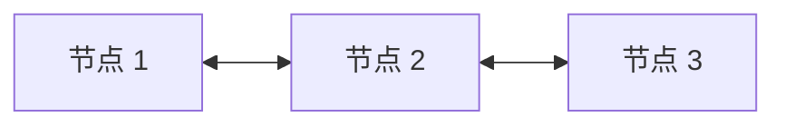
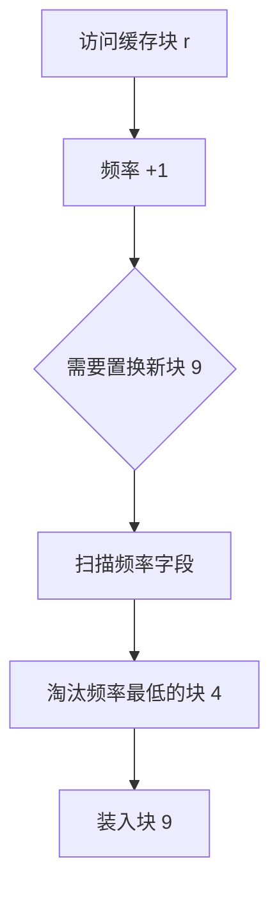

# 26. 后端校招面试直通车: 页面置换算法与 LRU 实现

## 纲要

- 页面置换发生的两个时机：Cache 替换、主存页面替换
- 支撑数据结构：单向链表与双向链表，双向链表为何是 O(1) 删除
- FIFO：先进先出置换
- LFU：最不经常使用置换，依赖频率字段
- LRU：最近最少使用置换，双向链表 + 哈希表
- 完整可运行的 Go 实现：双向链表、LRU、LFU、FIFO
- 三种算法的对比与工程落地（Redis、自研缓存）

## 页面置换发生的时机

置换发生在两个层次上：

- **高速缓存替换**：CPU 访问 Cache 未命中时，需要从主存载入数据，此时必须把 Cache 中某一块数据替换掉，再装入新数据；
- **主存页面替换**：主存中没有所需数据时触发缺页中断，通过系统调用从辅存载入数据，若主存已满则要先换出一页。

## 基础数据结构：双向链表

单向链表的节点由两部分组成：节点本身的数据，以及指向下一个节点的引用。通过这个引用，原本相互独立的节点被串联起来。

双向链表在此基础上为每个节点增加了**指向上一个节点的引用**：



双向链表的优势：

- 可以快速找到任意节点的下一个节点（单向链表也能做到）；
- 可以快速找到任意节点的上一个节点（单向链表做不到）；
- **可以快速删除链表中的任意节点**：由于同时持有前驱与后继的引用，摘除某个节点只需修改两个指针，复杂度是 O(1)。

代价只是每个节点多存一个引用的空间。在页面置换算法中，"把命中的节点移到头部"和"淘汰尾部节点"都是高频操作，因此双向链表是这些算法的天然底座。

## FIFO：先进先出

假设缓存中有 1~8 共 8 块数据，需要置换第 9 块进来，就淘汰队列最前面的第 1 块。

置换的本质是"淘汰一个、选入一个"，不同算法的差别只在于**淘汰谁**。FIFO 淘汰的是队列中最早进入的那一个，因此可以看作一个固定容量队列：从队尾加入，就从队头淘汰；从队头加入，就从队尾淘汰。

数据结构上，队列、栈都可以实现，双向链表也可以：用两个指针分别指向头部和尾部，每往队尾插入一个节点，就把队头指针前移一步。

## LFU：最不经常使用

LFU（Least Frequently Used）的淘汰策略是：优先淘汰**使用频率最低**的字块。为此需要额外的空间记录每个字块的访问频率。



例如某时刻各块的访问频率为：块 1 访问 7 次、某块 4 次、块 4 仅 1 次……需要装入新块 9 时，就淘汰频率最低的块 4。

## LRU：最近最少使用

LRU（Least Recently Used）的策略是：发生淘汰时，优先淘汰**一段时间内没有被使用**的字块或页面。

实现要点：

- 每次访问（命中或新装入）都把对应节点移到**链表头部**，头部代表最近使用；
- 链表**尾部**就是最近最少使用的，淘汰时直接从尾部摘除。

以容量 4 为例，访问序列 1、2、4、7 时不发生淘汰；访问 5 时容量已满，淘汰队尾的 1；之后再访问 4，则把 4 提到头部；访问 6 时淘汰队尾的 2；访问 1 时淘汰队尾的 7……以此类推。

```mermaid
flowchart LR
    subgraph 双向链表：头 = 最近使用，尾 = 最近最少
        H[最近使用] --> N1 --> N2 --> T[待淘汰]
    end
```

单靠双向链表，查找某个 key 是否命中需要 O(n)。工程实现上会再配一个哈希表做索引，形成 **哈希表 + 双向链表** 的经典组合：查找 O(1)，移动与淘汰 O(1)。

## API 速览

| API | 签名 | 说明 |
| --- | --- | --- |
| `NewLRUCache` | `func NewLRUCache(capacity int) *LRUCache` | 创建指定容量的 LRU 缓存 |
| `Get` | `func (c *LRUCache) Get(key int) (int, bool)` | 读取；命中则把节点移到链表头部 |
| `Put` | `func (c *LRUCache) Put(key, value int)` | 写入；已存在则更新并移到头部，不存在则插入头部，超容时淘汰尾部 |
| `Len` | `func (c *LRUCache) Len() int` | 当前缓存中的条目数 |
| `moveToHead` | `func (c *LRUCache) moveToHead(n *node)` | 内部方法：把节点摘下并插到头节点之后 |
| `removeTail` | `func (c *LRUCache) removeTail() *node` | 内部方法：摘除尾部节点 |
| `NewLFUCache` | `func NewLFUCache(capacity int) *LFUCache` | 创建指定容量的 LFU 缓存 |
| `NewFIFOCache` | `func NewFIFOCache(capacity int) *FIFOCache` | 创建指定容量的 FIFO 缓存 |

## Demo 示例

以下示例根据讲稿中描述的数据结构与算法逻辑补充实现，包含双向链表、LRU、LFU、FIFO 四部分。

### 运行说明

```bash
mkdir lru-demo && cd lru-demo
go mod init lru-demo
# 将下方代码保存为 main.go
go run main.go
```

无需任何第三方依赖，Go 1.18+ 即可运行。

### 完整代码

```go
package main

import (
	"container/list"
	"fmt"
)

// ============ 一、手写双向链表 ============

// node 双向链表节点，同时持有前驱与后继引用
type node struct {
	key   int
	value int
	prev  *node
	next  *node
}

// dList 带头尾哨兵节点的双向链表
type dList struct {
	head *node
	tail *node
	size int
}

func newDList() *dList {
	h, t := &node{}, &node{}
	h.next, t.prev = t, h
	return &dList{head: h, tail: t}
}

// pushFront 把节点插入头部（头节点之后）
func (l *dList) pushFront(n *node) {
	n.next = l.head.next
	n.prev = l.head
	l.head.next.prev = n
	l.head.next = n
	l.size++
}

// remove 摘除任意节点，O(1)
func (l *dList) remove(n *node) {
	n.prev.next = n.next
	n.next.prev = n.prev
	n.prev, n.next = nil, nil
	l.size--
}

// removeTail 摘除尾部节点
func (l *dList) removeTail() *node {
	if l.size == 0 {
		return nil
	}
	n := l.tail.prev
	l.remove(n)
	return n
}

// ============ 二、LRU：哈希表 + 双向链表 ============

type LRUCache struct {
	cap    int
	items  map[int]*node
	order  *dList
	misses int // 未命中次数，便于观察置换行为
}

func NewLRUCache(capacity int) *LRUCache {
	return &LRUCache{cap: capacity, items: make(map[int]*node), order: newDList()}
}

func (c *LRUCache) Get(key int) (int, bool) {
	n, ok := c.items[key]
	if !ok {
		c.misses++
		return 0, false
	}
	// 命中后移到链表头部，表示最近使用
	c.order.remove(n)
	c.order.pushFront(n)
	return n.value, true
}

func (c *LRUCache) Put(key, value int) {
	if n, ok := c.items[key]; ok {
		n.value = value
		c.order.remove(n)
		c.order.pushFront(n)
		return
	}
	if c.order.size == c.cap {
		tail := c.order.removeTail()
		delete(c.items, tail.key)
	}
	n := &node{key: key, value: value}
	c.items[key] = n
	c.order.pushFront(n)
}

func (c *LRUCache) Len() int { return c.order.size }

// ============ 三、LFU：频率字段 + 淘汰最低频 ============

type entry struct {
	key   int
	value int
	freq  int
}

type LFUCache struct {
	cap   int
	items map[int]*entry
}

func NewLFUCache(capacity int) *LFUCache {
	return &LFUCache{cap: capacity, items: make(map[int]*entry)}
}

func (c *LFUCache) Get(key int) (int, bool) {
	e, ok := c.items[key]
	if !ok {
		return 0, false
	}
	e.freq++
	return e.value, true
}

func (c *LFUCache) Put(key, value int) {
	if e, ok := c.items[key]; ok {
		e.value, e.freq = value, e.freq+1
		return
	}
	if len(c.items) == c.cap {
		// 扫描出访问频率最低的字块并淘汰（同频时取 key 最小者，保证结果确定）
		victimKey, minFreq := 0, 1<<31-1
		for k, e := range c.items {
			if e.freq < minFreq || (e.freq == minFreq && k < victimKey) {
				victimKey, minFreq = k, e.freq
			}
		}
		delete(c.items, victimKey)
	}
	c.items[key] = &entry{key: key, value: value, freq: 1}
}

// ============ 四、FIFO：先进先出 ============

type FIFOCache struct {
	cap   int
	items map[int]int
	queue *list.List // 记录进入顺序
}

func NewFIFOCache(capacity int) *FIFOCache {
	return &FIFOCache{cap: capacity, items: make(map[int]int), queue: list.New()}
}

func (c *FIFOCache) Put(key, value int) {
	if _, ok := c.items[key]; ok {
		c.items[key] = value
		return
	}
	if len(c.items) == c.cap {
		// 淘汰最早进入的元素
		front := c.queue.Front()
		c.queue.Remove(front)
		delete(c.items, front.Value.(int))
	}
	c.items[key] = value
	c.queue.PushBack(key)
}

func (c *FIFOCache) Get(key int) (int, bool) {
	v, ok := c.items[key]
	return v, ok
}

// ============ 五、演示 ============

func main() {
	// LRU：容量 4，访问 1 2 4 7 后访问 5，应淘汰最早未使用的 1
	lru := NewLRUCache(4)
	for _, k := range []int{1, 2, 4, 7} {
		lru.Put(k, k*10)
	}
	lru.Put(5, 50) // 淘汰尾部节点 1
	if _, ok := lru.Get(1); !ok {
		fmt.Println("LRU: key=1 已被淘汰")
	}
	if v, ok := lru.Get(4); ok {
		fmt.Printf("LRU: key=4 命中 value=%d\n", v)
	}
	fmt.Println("LRU 当前容量:", lru.Len(), "未命中次数:", lru.misses)

	// LFU：块 1 高频、块 4 低频，装入新块时淘汰块 4
	lfu := NewLFUCache(4)
	for _, k := range []int{1, 2, 3, 4} {
		lfu.Put(k, k)
	}
	for i := 0; i < 7; i++ {
		lfu.Get(1) // 块 1 频率升到 8
	}
	for i := 0; i < 3; i++ {
		lfu.Get(2) // 块 2 频率升到 4
	}
	for i := 0; i < 2; i++ {
		lfu.Get(3) // 块 3 频率升到 3
	}
	// 此时频率：块 1=8，块 2=4，块 3=3，块 4=1
	lfu.Put(9, 9) // 淘汰频率最低的块 4
	if _, ok := lfu.Get(4); !ok {
		fmt.Println("LFU: key=4 频率最低，已被淘汰")
	}

	// FIFO：容量 3，写入 1 2 3 后写入 4，应淘汰最早进入的 1
	fifo := NewFIFOCache(3)
	for _, k := range []int{1, 2, 3} {
		fifo.Put(k, k)
	}
	fifo.Put(4, 4)
	if _, ok := fifo.Get(1); !ok {
		fmt.Println("FIFO: key=1 最早进入，已被淘汰")
	}
}
```

预期输出：

```
LRU: key=1 已被淘汰
LRU: key=4 命中 value=40
LRU 当前容量: 4 未命中次数: 1
LFU: key=4 频率最低，已被淘汰
FIFO: key=1 最早进入，已被淘汰
```

### 代码说明

- 双向链表部分使用头尾哨兵节点，避免了在插入、删除时反复判断 `nil`，`pushFront`、`remove`、`removeTail` 全部是 O(1) 操作，这正是双向链表相比单向链表的核心价值；
- LRU 由 `map[int]*node` 提供 O(1) 查找，由双向链表维护"最近使用"的顺序：`Get` 命中后把节点移到头部，`Put` 超容时摘除尾部节点，两者都是 O(1)；
- LFU 在每个条目上增加了 `freq` 字段记录访问频率，淘汰时需要扫描一遍找出频率最低者，因此淘汰是 O(n)——这也是 LFU 在工程上常需要借助小顶堆或分桶来优化的原因；
- FIFO 用 `container/list` 记录进入顺序，容量满时摘掉队首，逻辑最简单，但它完全不考虑访问热度，命中率通常不如 LRU。

### 技术点总结

| 算法 | 核心数据结构 | 淘汰依据 | 时间复杂度 | 特点 |
| --- | --- | --- | --- | --- |
| FIFO | 队列 / 双向链表 | 进入顺序最早 | O(1) | 实现简单，不考虑访问热度 |
| LFU | 条目 + 频率字段 | 访问频率最低 | 查找 O(1)，淘汰 O(n) | 适合访问模式稳定的场景 |
| LRU | 哈希表 + 双向链表 | 最久未被访问 | 查找与淘汰均 O(1) | 最常用，契合局部性原理 |

## 面试回答模板

问：请编程实现 LRU 算法。

> 用哈希表加双向链表实现。哈希表负责 O(1) 定位节点，双向链表维护访问顺序：头部是最近使用的节点，尾部是最近最少使用的节点。Get 命中时把节点摘下并插到头部；Put 时若已存在则更新值并移到头部，若不存在则插入头部，容量超限就摘除尾部节点并从哈希表中删除。因为双向链表同时持有前驱和后继引用，摘除任意节点是 O(1) 的。

问：LRU 与 LFU 的区别是什么？

> LRU 淘汰的是一段时间内最久没有被访问的块，只关心"最近一次访问的时间"；LFU 淘汰的是访问频率最低的块，需要额外空间记录每个块的访问次数。LRU 更契合局部性原理、实现代价低，是最常见的缓存置换策略；LFU 适合访问模式长期稳定的场景，但淘汰时需要找最小值，实现上往往要借助堆或分桶优化。

