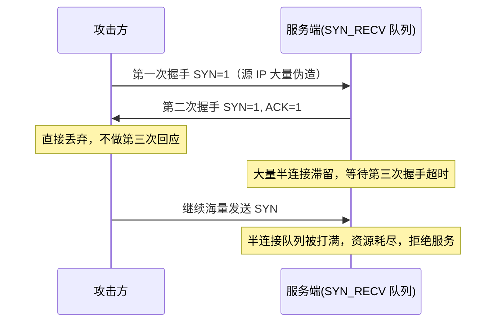

# 后端校招面试直通车: SYN Flood 攻击的原理与 TCP 层攻击面

## 纲要

- 回顾三次握手，定位 SYN Flood 利用的漏洞位置
- SYN Flood 原理：伪造源 IP 大量发送第一次握手报文，耗尽服务端半连接资源
- 资源耗尽类攻击：真实肉鸡完成握手后空占连接
- 协议特性漏洞攻击：利用 TCP 流控把窗口置零后断开
- 防范策略：异常流量识别与分流、内核参数调优、高可用部署、监控告警、防火墙与云防护

## 漏洞所在：三次握手的中间状态

先回顾三次握手的过程：

- 第一次：客户端发送 `SYN=1, seq=x`
- 第二次：服务端回应 `SYN=1, ACK=1, seq=y, ack=x+1`
- 第三次：客户端回应 `ACK=1, seq=x+1, ack=y+1`，连接正式建立

关键在于**第二次握手到第三次握手之间**的这段窗口期：被动连接方（服务端）已经发出 SYN+ACK，进入**同步已接收（SYN_RECV）**状态，并为这个尚未完成的连接分配了内存与控制块资源。它必须等到第三次握手报文到达（或超时），才能确认连接并释放这部分资源。

SYN Flood 攻击正是针对这个"付出资源但还没拿到结果"的窗口期下手。

## SYN Flood 的攻击原理

攻击过程：

- 攻击者短时间内海量发送第一次握手的 SYN 报文
- 服务端作为被动连接方，对每一个 SYN 都会回应第二次握手报文，并进入 SYN_RECV 状态
- 攻击者**直接忽略**这些回应，不发第三次握手报文
- 服务端大量连接滞留在同步已接收阶段，每个都占用资源、等待超时
- 最终资源耗尽，服务端产生拒绝服务甚至宕机

这里有一个必须强调的细节：**这些 SYN 报文不一定来自真实主机**。攻击者可以通过工具伪造 TCP 第一次握手报文，把源 IP 填成不存在的地址。服务端回应第二次握手后，那个"假 IP 主机"根本不存在，自然不会有第三次回应；即便该 IP 真实存在，它也没有主动发起过连接，收到 SYN+ACK 后会回应 RST。两种情况下，服务端的半连接都只能靠超时回收。

这也正是 SYN Flood 难以防御的原因：攻击方不需要控制大量真实机器，一台机器伪造报文就能制造出海量的半连接。

## 其他常见的 TCP 攻击手段

### 资源耗尽类攻击

- 前提是攻击者控制了**大量肉鸡**（可被黑客远程操控的计算机）
- 肉鸡与攻击目标完成正常的三次握手，建立连接后**保持连接但什么都不做**，持续占用 TCP 连接资源
- 或者连接建立后立刻断开，马上再发起新连接，让服务端不断重复建连与释放的开销
- 被动连接方对外提供服务，必须为所有来源的客户端服务，很难分辨谁是肉鸡、谁是真实用户
- 结果同样是服务端不堪重负，影响正常服务甚至宕机

### 协议特性漏洞攻击

- 同样以控制大量肉鸡为前提，但利用的是 TCP 协议自身的流控特性
- 肉鸡先与攻击目标建立正常连接
- 然后把 TCP 首部中的**窗口字段置为 0**，告诉对端"我接收不了数据，先别发"
- 紧接着立即断开连接
- 攻击目标仍在等待这个窗口重新打开，一直保持状态、占用资源
- 大量此类连接叠加后，服务端同样因资源耗尽而不可用

两者的区别：资源耗尽类攻击靠"数量"堆死目标；协议特性类攻击靠"协议语义"让目标陷入无意义的等待。

## 防范策略

没有任何单一手段能彻底根治，工程上通常是多层组合：

| 层次 | 措施 | 说明 |
| --- | --- | --- |
| 流量识别 | 通过策略识别异常用户与异常流量 | 防护的第一道前提 |
| 流量处置 | 将异常流量分流到特定环境，或直接拒绝服务 | 清洗 + 黑洞 |
| 系统参数 | 合理设置内核参数，缩短第二次握手后的等待时间与相关超时 | 缓解为主，不治本 |
| 架构部署 | 后台服务高可用部署，多实例 + 弹性扩容 | 保证单点被打时不整体不可用 |
| 监控告警 | 异常流量实时告警，及时通知负责人介入 | 缩短响应时间 |
| 边界防护 | 在服务器前部署防火墙，执行识别、分流与拒绝策略 | 经典且有效的第一道防线 |
| 云防护 | 采购云厂商的安全防护服务 | 以较低成本获得专业防护能力 |

需要客观看待"调整内核参数"这一类手段：它能降低等待带来的资源损耗，但由于攻击流量本身依然到达了主机，属于缓解而非根治。真正有效的做法是把异常流量挡在业务系统之前。

## 面试答题要点

- 一句话定性：SYN Flood 利用三次握手的过程漏洞，让服务端堆积大量 SYN_RECV 半连接，耗尽资源后拒绝服务
- 展开过程：海量 SYN → 服务端逐个回应 SYN+ACK 并分配资源 → 攻击者不回应第三次 → 半连接超时前持续占用资源
- 点出关键细节：报文可以伪造源 IP，不需要真实主机参与，这是它危害大的原因
- 补充同类攻击：资源耗尽类（肉鸡建连后空占）、协议特性类（窗口置 0 后断开）
- 最后讲防范：异常流量识别与分流、内核参数调优、高可用部署、监控告警、防火墙与云防护

相关度：95%。是否需要继续：[否]。代码是否可运行：[否]。
