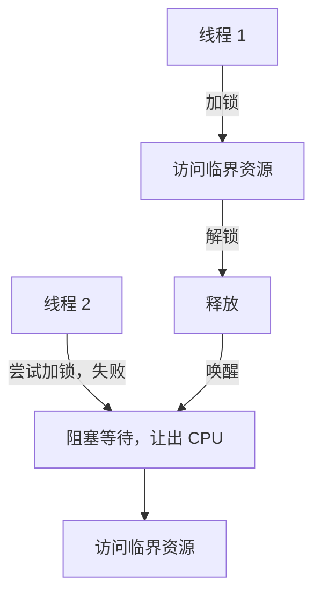
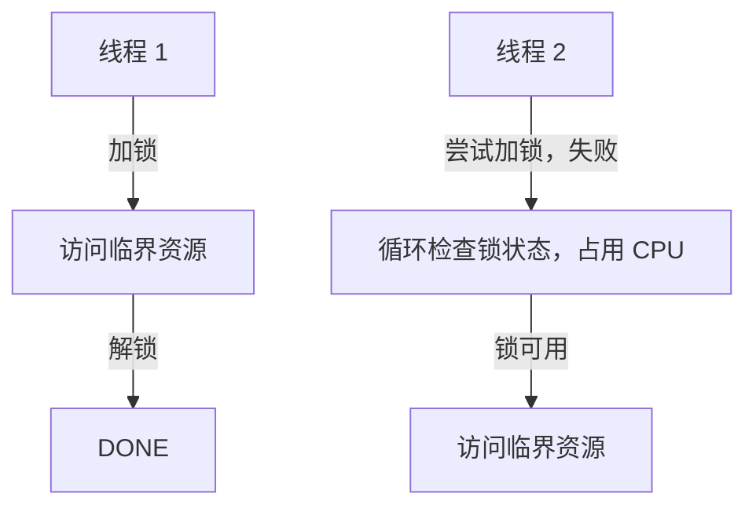
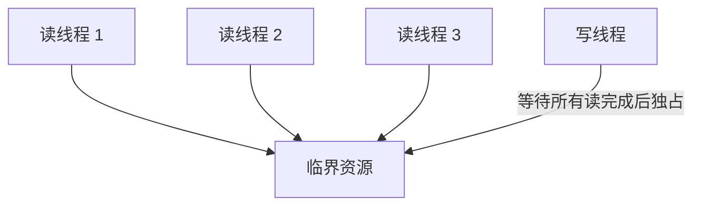
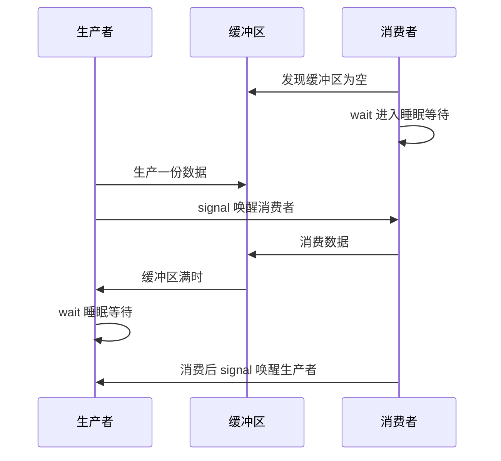

# 32. 后端校招面试直通车: 线程同步四件套与互斥锁、自旋锁的区别

## 纲要

- 临界资源与锁要解决的问题：保证多条指令的原子性
- 互斥锁：两态变量，等待时让出 CPU
- 自旋锁：忙等待，不让出 CPU，换掉上下文切换开销
- 两者的核心差异与各自适用场景
- 读写锁：多读少写场景下的特殊自旋锁
- 条件变量：wait / signal 与生产者消费者模型

## 锁要解决什么问题

临界资源是指一次只允许一个线程访问的资源。以前面的读者写者问题为例：多个线程对同一个 `count` 变量做"读取—修改—写回"三步操作，如果没有保护，指令交错执行就会导致结果出错。

加锁与解锁把这三步包起来，保证多个线程在临界资源上的访问是串行的，也就是**保证了这三个指令的原子性**。

## 互斥锁

互斥锁（Mutex）是最简单的线程间同步方法，本质是一个**处在两态之间的变量**：

- 解锁状态（unlocked）：临界资源可访问；
- 加锁状态（locked）：其他线程无法访问该锁保护的临界资源，只能等待解锁。

需要注意两点：

- 操作系统与各类高级语言都直接提供了互斥锁接口，日常编程可以直接使用；
- **互斥锁在等待解锁的过程中会让出 CPU**，即把 CPU 时间片交给其他线程执行，自身进入阻塞状态，直到锁被释放后被唤醒。

## 自旋锁

自旋锁（Spin Lock）与互斥锁要解决的问题相同，都是保护临界资源，状态也同为加锁 / 解锁两态，但**实现原理完全不同**。

使用自旋锁的线程会**反复检查锁是否可用**，它不会让出 CPU，而是处于**忙等待**（busy waiting）状态。

代价很直观：假设 CPU 有 4 个核，一个线程在自旋等待，就会占满一个核，即消耗 25% 的 CPU 资源。

### 自旋锁为什么这样设计

看起来是浪费，但它有明确的收益：**避免了进程或线程的上下文切换开销**。前面已经知道，上下文切换需要陷入内核、保存与恢复现场，成本在微秒级。如果锁的持有时间极短，等一等比切换一次更划算。

取舍的边界是：

- **等待时间很短**，且自旋消耗的 CPU 远小于上下文切换开销 → 适合自旋锁；
- **等待时间很长**，远超一次切换的开销 → 适合互斥锁。

这也是为什么操作系统内部大量使用自旋锁——内核中的很多锁持有时间只有几条指令，且内核临界区不允许睡眠。

补充一点：自旋锁**不适合在单核 CPU 上使用**。单核下自旋的线程占着唯一的 CPU，持有锁的线程根本得不到调度去释放锁，只能白白空转。

## 互斥锁与自旋锁的对比

| 对比项 | 互斥锁 | 自旋锁 |
| --- | --- | --- |
| 等待方式 | 阻塞，让出 CPU | 忙等待，不让出 CPU |
| 上下文切换 | 会发生 | 不会发生 |
| CPU 占用 | 等待期间不占用 | 等待期间持续占用一个核 |
| 加锁 / 解锁状态 | 两态 | 两态 |
| 适用场景 | 临界区执行时间长 | 临界区执行时间极短 |
| 单核 CPU | 可用 | 不适合 |
| 典型使用者 | 应用层代码 | 操作系统内核 |

一句话概括区别：**互斥锁等待时让出 CPU，自旋锁等待时不让出 CPU。**

## 读写锁

读写锁有特定的适用场景：**临界资源多读少写**。

普通的锁既保证写与写之间串行，也保证读与读之间串行。但读操作并不改变临界资源的值，让读操作并行起来是完全安全的，这能显著提升读性能。

读写锁是一种**特殊的自旋锁**：

- 允许多个读者同时访问资源，提升读性能；
- 写操作仍然互斥，必须等待所有读操作完成后才能进行。

## 条件变量

条件变量是相对复杂的一种线程同步方法：它允许线程**睡眠**，直到满足某种条件时再被**信号通知唤醒**。核心是两个操作：

- `wait`：条件不满足时进入睡眠等待；
- `signal`（或 `broadcast`）：条件满足时通知并唤醒等待方。

以生产者消费者模型为例，双方通过缓冲区产生同步关系：

- 缓冲区满时，生产者必须等待消费者消费；
- 缓冲区空时，消费者必须等待生产者生产；
- 生产者生产一份数据后，唤醒可能正在等待的消费者；消费者消费一份数据后，唤醒可能正在等待的生产者。

条件变量解决的正是这种"等待某个业务条件成立"的场景，这是单纯用互斥锁无法优雅表达的。

## 面试回答模板

问：请简述互斥锁与自旋锁的区别。

> 两者都是保护临界资源的同步手段，都有加锁与解锁两态，但实现原理不同。互斥锁在等待解锁时会让出 CPU，线程进入阻塞状态，等锁释放后被唤醒；自旋锁不会让出 CPU，而是处于忙等待状态，反复检查锁是否可用。互斥锁的代价是发生一次上下文切换，自旋锁的代价是白白占用一个核。因此临界区很短、等待时间远小于切换开销时适合用自旋锁，等待时间长时适合用互斥锁。另外自旋锁不适合在单核 CPU 上使用，而操作系统内核中因为临界区极短，大量使用了自旋锁。

问：线程间有哪些同步方式？

> 常见有四种：互斥锁，最简单的两态锁，等待时让出 CPU；自旋锁，忙等待不让出 CPU，避免上下文切换开销；读写锁，一种特殊的自旋锁，适合多读少写场景，允许多个读者并行、写者独占；条件变量，允许线程在条件不满足时睡眠，条件满足时由其他线程通过信号唤醒，典型应用是生产者消费者模型。

