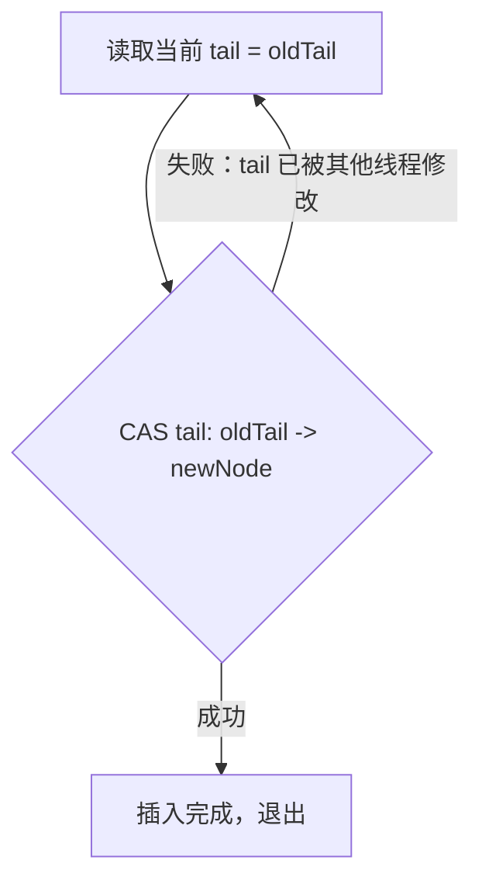
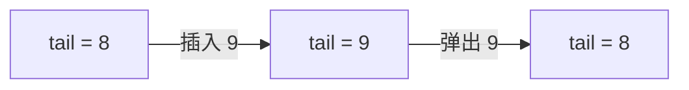

# 34. 后端校招面试直通车: CAS 与无锁数据结构的底层原理

## 纲要

- 大量使用锁的五大弊端：开发难度、死锁、优先级反转、性能损耗、锁粒度设计
- 原子性的定义
- CAS：CPU 提供的原子指令，Compare-And-Swap
- 同类原子指令：FAA（Fetch-And-Add）、TAS（Test-And-Set）
- 用 CAS 实现无锁队列的 push
- ABA 问题与版本号解法
- Go 可运行 Demo：CAS 计数器、无锁栈、ABA 复现

## 为什么需要无锁技术

前面花了大量篇幅讲锁，但大量使用锁的弊端非常明显：

| 弊端 | 说明 |
| --- | --- |
| 开发难度 | 并行系统访问临界资源必须考虑并发、必须加锁，保护不充分就会产生难以复现的 bug，严重时造成直接的经济损失 |
| 死锁 | 墨菲定律：只要锁存在，死锁就一定会在某个时刻发生。而且死锁定位非常困难——往往需要特定并发量才能复现，触发逻辑又极其复杂 |
| 优先级反转 | 有优先级时，低优先级线程持锁会导致高优先级线程无法执行，相当于给高优先级线程降了级 |
| 性能损耗 | 频繁加锁、释放锁、串行化访问本身就有开销 |
| 锁粒度设计 | 锁粒度太小，死锁概率上升；锁粒度太大，并发度下降。粒度怎么切需要反复权衡 |

无锁技术的基石就是 **CAS**。

## 原子性与 CAS

先回顾**原子性**：指一系列操作**不可被中断**的特性。这一系列操作要么全部执行完成，要么全部没有执行，不存在"部分执行、部分未执行"的中间状态。

CAS 的全称是 **Compare-And-Set / Compare-And-Swap**，几乎所有现代 CPU 指令集都支持它，所以 CAS 本质上是一条**原子性的 CPU 指令**。它接收三个参数：寄存器（内存位置）、旧值、新值。伪代码如下：

```
CAS(register, oldValue, newValue):
    if register == oldValue:        # 比较：当前值是否仍等于我读到的旧值
        register = newValue         # 交换：写入新值
        return oldValue             # 成功
    else:
        return register             # 失败，说明期间被其他线程改过
```

关键在于：**"比较旧值"和"交换新值"两步合起来是一个不可分的原子步骤**，要么都完成，要么都不执行。

同类原子操作还有：

- **FAA（Fetch-And-Add）**：对变量做加一的原子操作；
- **TAS（Test-And-Set）**：向某块内存写入值，并返回写入前的旧值。

## 用 CAS 实现无锁队列

队列是 FIFO 的先进先出结构。考虑并发场景下的入队：当前队列有 8 个元素，队尾元素是 8，现在要把 9 加到队尾，即把尾指针从 8 移到 9。但这是并发环境，可能同时有别的线程在插入 10、11、12……

**有锁做法**：先加锁 → 把尾指针从 8 改成 9 → 释放锁。通过锁把并发的插入强制串行化。

**无锁做法**：用一个循环，不断 CAS 重试：

```
push(q, newNode):
    loop:
        oldTail = q.tail              # 读出当前尾指针
        newNode.next = oldTail.next
        # 关键一步：把尾指针从 oldTail 改成 newNode
        if CAS(q.tail, oldTail, newNode):
            return                    # CAS 成功，插入完成
        # CAS 失败：说明别的线程已经改过 tail，继续重试
```



- CAS 操作**不锁队列**。只要判断"当前 tail 与我读到的 oldTail 不一致"，本次 CAS 就失败，说明别的线程正在插入，于是循环重试，直到成功为止；
- 整个循环保证了队列数据一定正确，同时没有加锁和释放锁的开销，性能上有所提升。

## ABA 问题

CAS 并不完美，最经典的问题就是 **ABA**：**数据在多次操作后恢复原值，而当前线程无法感知**。

还是队列的例子：



tail 经历了 8 → 9 → 8 的过程。问题在于 **CAS 判断成功与否的唯一依据是"旧值与当前取出的值是否相等"**：

- 当前线程读到的旧值 tail = 8；
- 期间别的线程把它改成 9，又改回 8；
- 当前线程执行 CAS 时看到 tail 仍然是 8，判断"没被改过"，于是 CAS 成功；
- 实际上 tail 已经被修改过两次，当前线程完全感知不到。

这就是典型的 ABA 问题。在考虑无锁数据结构时，ABA 是必须正面处理的问题。

**解法：加版本号。** 给指针或旧值附加一个版本号，每次修改后版本号递增。判断时同时比较**值**和**版本号**，两者都相同才算"真的没变过"。通过值与版本号的双重校验，即可避免 ABA。

| 方案 | 判断依据 | 能否识别 ABA |
| --- | --- | --- |
| 朴素 CAS | 仅比较值 | 不能 |
| 带版本号的 CAS | 比较值 + 版本号 | 能 |
| 双字 CAS（CAS2） | 一次原子比较相邻两个字（值 + 版本） | 能（硬件支持时） |

## API 速览

| API | 签名 | 语义与返回值 |
| --- | --- | --- |
| `atomic.CompareAndSwapInt32` | `func CompareAndSwapInt32(addr *int32, old, new int32) (swapped bool)` | 相等则写入 new 并返回 true，否则返回 false |
| `atomic.CompareAndSwapPointer` | `func CompareAndSwapPointer(addr *unsafe.Pointer, old, new unsafe.Pointer) (swapped bool)` | 指针版本的 CAS，实现无锁数据结构的核心 |
| `atomic.AddInt64` | `func AddInt64(addr *int64, delta int64) (new int64)` | FAA 语义的原子加，返回新值 |
| `atomic.Value` | `type Value struct` | 原子地读写任意类型的值，配合 CAS 思想做配置热更新 |

## Demo 示例

下面用 Go 演示三件事：CAS 自旋计数器、无锁栈、以及 ABA 的复现（根据讲稿逻辑补充）。

```go
package main

import (
	"fmt"
	"runtime"
	"sync"
	"sync/atomic"
	"unsafe"
)

// ---------- 1. CAS 自旋计数器：无锁版本的 count++ ----------

type CASCounter struct {
	v int64
}

// Inc 读取旧值 -> 计算新值 -> CAS 写入，失败则重试
func (c *CASCounter) Inc() {
	for {
		old := atomic.LoadInt64(&c.v)
		if atomic.CompareAndSwapInt64(&c.v, old, old+1) {
			return
		}
	}
}

func (c *CASCounter) Value() int64 { return atomic.LoadInt64(&c.v) }

// ---------- 2. 无锁栈（存在 ABA 风险） ----------

type node struct {
	value interface{}
	next  unsafe.Pointer // *node
}

type LockFreeStack struct {
	head unsafe.Pointer // *node
	size int64
}

func (s *LockFreeStack) Push(v interface{}) {
	n := &node{value: v}
	for {
		old := atomic.LoadPointer(&s.head)
		n.next = old
		if atomic.CompareAndSwapPointer(&s.head, old, unsafe.Pointer(n)) {
			atomic.AddInt64(&s.size, 1)
			return
		}
	}
}

func (s *LockFreeStack) Pop() (interface{}, bool) {
	for {
		old := atomic.LoadPointer(&s.head)
		if old == nil {
			return nil, false
		}
		next := (*node)(old).next
		if atomic.CompareAndSwapPointer(&s.head, old, next) {
			atomic.AddInt64(&s.size, -1)
			return (*node)(old).value, true
		}
	}
}

// ---------- 3. 复现 ABA：值回到原样，但 CAS 无法感知 ----------

func demoABA() {
	var v int32 = 8
	fmt.Println("初始 tail =", v)

	// 线程 B：8 -> 9 -> 8
	fmt.Println("模拟中间操作: 8 -> 9 -> 8")
	atomic.StoreInt32(&v, 9)
	atomic.StoreInt32(&v, 8)

	// 线程 A：以为值没变过，CAS 依然"成功"
	ok := atomic.CompareAndSwapInt32(&v, 8, 100)
	fmt.Printf("朴素 CAS(8 -> 100) 结果 = %v，最终值 = %d（A 无法感知中间的修改）\n", ok, v)
}

func main() {
	// 1. CAS 计数器 vs 无保护自增
	var wg sync.WaitGroup
	counter := &CASCounter{}
	var plain int64
	const N = 10000
	for i := 0; i < N; i++ {
		wg.Add(1)
		go func() {
			defer wg.Done()
			counter.Inc()
			plain++ // 无保护，结果会少于 N
		}()
	}
	wg.Wait()
	fmt.Printf("并发 %d 次自增：CAS = %d，无保护 = %d\n", N, counter.Value(), plain)

	// 2. 无锁栈
	st := &LockFreeStack{}
	var wg2 sync.WaitGroup
	for i := 0; i < 100; i++ {
		wg2.Add(1)
		go func(i int) {
			defer wg2.Done()
			st.Push(i)
		}(i)
	}
	wg2.Wait()
	fmt.Println("无锁栈元素个数 =", atomic.LoadInt64(&st.size))

	// 3. ABA
	demoABA()
	_ = runtime.NumCPU()
}
```

### 运行说明

```bash
go mod init casdemo
go run main.go          # 可用 GOMAXPROCS=4 go run main.go 放大并发效果
```

### 代码说明

- `CASCounter.Inc` 就是"读旧值 → 算新值 → CAS 写回 → 失败重试"的标准自旋循环，与讲稿中无锁队列 push 的伪代码完全同构；
- `LockFreeStack` 用 `unsafe.Pointer` 存储栈顶，Push / Pop 都用 CAS 循环实现，全程不加锁；
- `demoABA` 把值从 8 改成 9 再改回 8，此时针对旧值 8 的 CAS **依然返回成功**——这正是 ABA 问题的直观复现；
- Go 的 `atomic` 包没有内置版本号机制，工程上要么把"值 + 版本"打包成一个 64 位字做 CAS，要么直接用 `sync.Mutex` 或 `container/list` 这类已封装好的结构。

### 技术点总结

- 无锁不是"不需要同步"，而是**把同步从操作系统/运行时的锁下沉到 CPU 的一条原子指令**；
- CAS 的正确性来自"比较 + 交换"的原子性，工程上通过**自旋重试**把并发写串行化到"一个成功、其余重试"；
- CAS 的三大经典问题：**ABA**（加版本号解决）、**自旋开销大**（冲突严重时反而不如锁）、**只能保护一个变量**（多变量需要用事务内存或退化为锁）。

## 面试回答模板

问：请简述无锁数据结构的原理，以及你对 CAS 的理解。

> CAS 全称 Compare-And-Swap，是一条 CPU 提供的原子指令，它比较某个内存位置的当前值是否等于我读到的旧值，相等就写入新值，不相等就什么都不做。因为"比较"和"交换"是一个不可分的原子步骤，所以可以在不加锁的前提下实现线程安全的修改。无锁数据结构的原理就是：对共享结构做修改时，先读出旧值，再用 CAS 尝试提交，失败说明期间被其他线程改过，就在循环里重试，直到成功为止，比如无锁队列的 push 就是在循环里反复 CAS 尾指针。用 CAS 要注意 ABA 问题——值被改成别的又改回原值，CAS 判断不出来，解决办法是给值附加一个版本号，比较时同时校验值和版本号。

