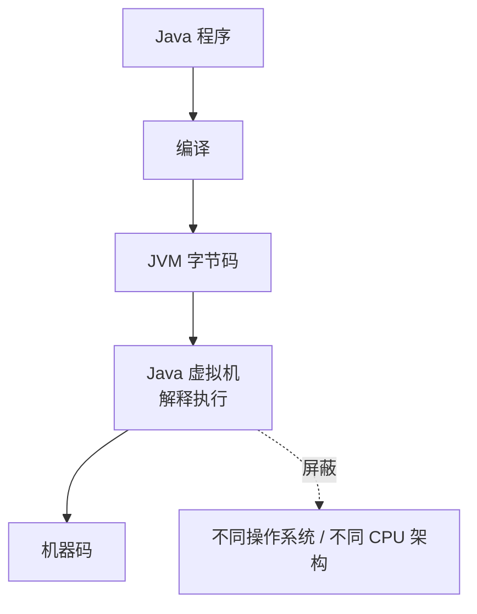

# 37. 后端校招面试直通车: 字节码与编译解释的区别

## 纲要

- 从程序语言到机器语言：由编译器或解释器完成，是程序员之外"计算机自己"的工作
- 两种语言层次：L1 高级语言（C/C++、Python 等）与 L0 底层语言（汇编）
- 编译：用编译器把 L1 程序**完整**翻译成等价的 L0 程序，带有全局优化
- 解释：用解释器把 L1 程序**逐行**翻译成 L0 指令，无全局优化
- 编译型语言（C/C++、Objective-C 等）与解释型语言（Python、JavaScript 等）
- Java 是"编译 + 解释"：Java 程序先编译成 JVM 字节码，再由虚拟机解释成机器码
- 字节码：与具体机器无关的中间代码，需经解释器转换才能成为机器码
- 虚拟机屏蔽平台差异，实现"一次编译，到处运行"

## 📎 文本↔代码关联

- 讲稿：`work/source/8.mksz540-后端校招面试直通车，提前锁定大厂offer[完结]/{7}--第7章计算机系统之编程语言与运行原理/[7.2]--7-3什么是字节码？编译和解释有什么区别？`
- 关联代码：清单 `code_refs` 指向 `code/recruitment/...` 下的 `L122.java`、`L198.java`、`Offer09.java`、`L55.java`、`L142.java`、`L206.java`、`L860.java`、`L141.java`，均为配套算法题解，与"字节码/编译/解释"主题无直接关联，本篇为概念解析，不嵌入代码。

## 从程序语言到机器语言

应用由多个层次构成。编程的本质，是把人类语言描述的需求，先转成程序语言（由软件工程师完成），再转成机器语言（由编译器或解释器完成）。本节课关注的就是"程序语言 → 机器语言"这一步。

为了理解编译与解释，引入两个概念：

- **L1（抽象的高级语言）**：如 C、C++、Python
- **L0（抽象的底层语言）**：如汇编语言

## 编译与解释

### 编译

用 L1 编写程序后，在运行之前需要经过一次"等价转换"：通过编译器生成一份逻辑完全一致的、由 L0 实现的新程序，再到操作系统上运行。编译器生成的是一份**完整、等价**的低级语言程序。

### 解释

解释阶段仍用 L1 描述程序逻辑，但多了一个角色——**解释器**（它本身也是用 L1 或 L0 实现的程序）。解释器把 L1 程序"一行一行"作为输入，逐行输出偏底层的 L0 指令。它并不生成一个完整的等价程序，而是边输入边翻译、边执行。

### 二者的核心差异

| 维度 | 编译 | 解释 |
| --- | --- | --- |
| 产出 | 完整的等价 L0 程序 | 无完整程序，逐行翻译 |
| 优化视角 | 全局语法优化 | 局部逐行，无全局优化 |
| 输入方式 | 整体输入 | 一行一行输入 |

可以这样类比：解释像把中文**逐字逐句**翻译成英文，缺乏整体润色，译文往往更冗长；编译则站在全局角度做语法优化，把意思用更简洁的另一种语言重新表达。

## 编译型语言与解释型语言

- **编译型语言**：C、C++、Objective-C 等，先编译成机器码再运行
- **解释型语言**：Python、JavaScript 等，由解释器逐行执行

## Java：编译加解释的复合型语言

Java 既不是纯编译型，也不是纯解释型，而是"编译 + 解释"。原因在于 Java 在高级语言与操作系统之间多了一层**虚拟机（JVM）**，并引入了**字节码**。

为什么需要虚拟机？不同平台拥有不同的指令集，一段在 Windows 上编译出的二进制无法在 Linux 上直接运行，跨平台部署必须重新编译。Java 引入虚拟机后，向下屏蔽了操作系统与 CPU 架构的差异，实现了"一次编译，到处运行"。

Java 的编译与解释分别发生在两个阶段：

1. Java 程序先被编译成 **JVM 字节码**
2. 虚拟机再把字节码**解释**成对应的机器码运行

### 字节码是什么

字节码是由 Java 程序编译而来、与特定机器代码无关、需要经解释器转换才能成为机器码的一种**中间代码**。它由数值常量、引用、指令等构成，不像源码那样可直接阅读。理解字节码及编译器如何生成它，对想深入 Java 的开发者意义重大（IBM 工程师曾有类似论断：理解 Java 字节码对 Java 程序员的提升，等同于理解汇编知识对 C++ 程序员的提升）。

## 小结

- **Java 字节码**：因 Java"一次编译、到处运行"与虚拟机设计而产生的中间形态代码
- **编译 vs 解释**：编译站在全局角度，生成一份逻辑等价的低级语言程序；解释只是局部地、逐行地进行等价翻译
- **Java 的定位**：编译 + 解释，靠 JVM 字节码与虚拟机屏蔽底层平台差异

