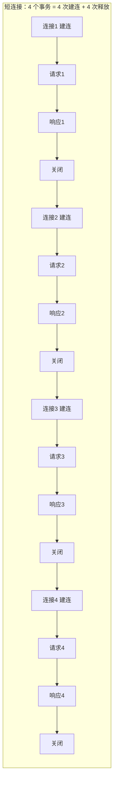
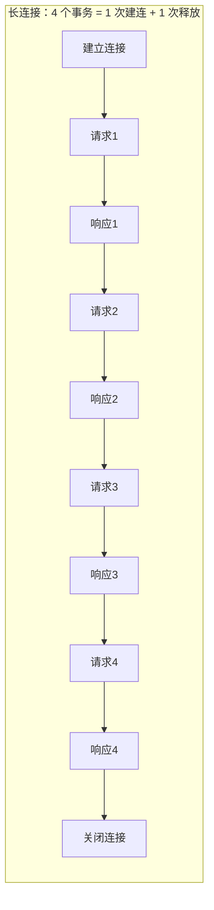
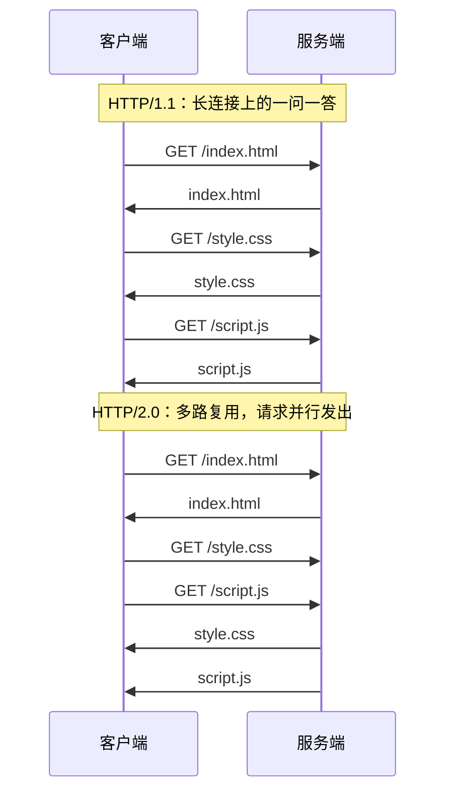

# 3. 后端校招面试直通车: HTTP/1.0、1.1、2.0 的主要区别

## 纲要

- HTTP 的版本演进脉络：0.9 → 1.0 → 1.1 → 2.0，以及各自的驱动因素
- HTTP/1.1 的关键改进：长连接、流水线、缓存、断点续传
- Keep-Alive 长连接解决了什么问题：省掉重复的 TCP 建连与释放成本
- HTTP/2.0 的三大特性：多路复用、头部压缩、服务端推送
- 二进制分帧为何是多路复用的基础

## HTTP 的版本演进

| 版本 | 时间 | 定位与改进 |
| --- | --- | --- |
| HTTP/0.9 | 1991 | 协议雏形，只解决文字与排版；仅支持 GET 方法，无多媒体内容 |
| HTTP/1.0 | 1996 | 支持图片等多媒体对象；增加 POST、PUT、DELETE 等方法 |
| HTTP/1.1 | 1997 | 长连接、流水线、缓存、断点续传，围绕性能与带宽做优化 |
| HTTP/2.0 | 2015 | 多路复用、头部压缩、服务端推送，极致追求性能 |

版本演进背后是互联网内容形态的变化：早期只有文字，随后出现图文，再到移动互联网时代的图片、短视频与强交互页面。承载内容的复杂度上升，倒逼协议在性能上持续迭代。

早期版本的设计缺陷也很明显：0.9 只能与当时的老客户端交互、只支持 GET（意味着只能读取不能提交）、不支持多媒体、连颜色都很单调。1.0 之后逐步补齐了方法与内容类型，但性能问题直到 1.1 才被系统性解决。

## HTTP/1.1 的关键改进

HTTP 是应用层协议，底层由传输层的 TCP 提供服务。每次 HTTP 通信之前都要建立 TCP 连接（三次握手），结束时又要释放连接（四次挥手）。频繁建连与释放带来的时间成本与计算成本非常可观。

HTTP/1.1 引入的改进包括：

- **长连接（Keep-Alive）**：一次 TCP 连接上承载多次请求与响应
- **流水线（Pipelining）**：允许连续发出多个请求而不必等待前一个响应
- **缓存处理**：更完善的 Cache-Control、ETag 等缓存协商机制
- **断点续传**：通过 Range 请求实现大文件的分片续传

### Keep-Alive 长连接

短连接模式下，每个事务（请求 + 响应）都要走一遍"建连 → 请求 → 响应 → 断连"：

长连接模式下，建立一次连接后在其上连续完成多个事务，最后才释放：

对比结论很直观：长连接显著减少了 TCP 建连与释放的次数，用户打开页面时能更快得到反馈。这就是面试中"Connection: Keep-Alive 是什么意思、解决了什么问题"的标准答案。

需要注意：长连接解决的是**连接复用**，并不解决请求之间必须串行等待的问题——1.1 仍然是"一问一答"，前一个响应没回来，下一个请求通常就被阻塞（队头阻塞）。这个问题留给了 HTTP/2.0。

## HTTP/2.0 的核心特性

从 2015 年提出后，HTTP/2.0 被主流互联网公司广泛跟进。同样渲染一张页面，1.1 需要 14.7 秒的场景，2.0 只需 1.61 秒——差距来自下面几个特性。

### 多路复用

多路复用指**在一个信道上同时传输多路信号或数据流**。用通信方式打个比方：写信交流是一来一回的串行过程；而打电话时，双方可以在同一条通话链路上连续说话、互相打断，彼此的发言并行不冲突。

HTTP/2.0 的多路复用有三个关键点：

- **二进制分帧是基础**：通信单位不再是文本报文，而是二进制的帧
- **多请求并行**：不再依赖建立多条 TCP 连接来提升并发
- **单连接上混合传输**：一个 TCP 连接里可以并行交互多种类型的信息

对比一下 1.1 与 2.0 加载同一页面的过程：

并行化的代价在底层：发送端要为每个帧打上流标识，接收端要区分某个帧属于哪个请求，并把同一条流的帧重组为完整数据。这些实现细节都被协议栈屏蔽了，但答题时提一句能体现理解深度。

### 头部压缩

HTTP 头部是明文数据，在请求频繁的场景下占用大量带宽。HTTP/2.0 的头部压缩有两个要点：

- **静态字典**：客户端与服务端各自维护一份相同的静态字典，把常见的头部名称、请求方法、常用键值组合映射为短索引。例如用 `:method: GET` 对应的索引来替代整串明文
- **哈夫曼编码**：头部字符以英文为主，用哈夫曼编码做进一步压缩，接收端解码还原

二者结合，头部体积可以被压缩到很小，长尾请求尤其受益。

### 服务端推送

传统模式下资源获取完全由客户端驱动：客户端请求，服务端响应。HTTP/2.0 的服务端推送改变了这一点——服务端可以"未卜先知"，在客户端尚未发起请求时就主动推送相关资源。

仍以上面的页面为例：服务端返回 `index.html` 后，判断客户端渲染还需要 `style.css` 与 `script.js`，于是不等客户端请求就直接把这两个资源推下去，又一次省掉了两轮请求的时间，页面渲染更快。

## 面试答题要点

- 演进脉络：0.9 只有 GET 和文字 → 1.0 支持多媒体与多种方法 → 1.1 引入长连接与缓存 → 2.0 追求极致性能
- Keep-Alive：复用 TCP 连接，省去重复的三次握手与四次挥手开销，加快页面响应
- HTTP/2.0 三板斧：多路复用（二进制分帧为基础、单连接并行）、头部压缩（静态字典 + 哈夫曼编码）、服务端推送
- 加分点：指出 1.1 的长连接仍存在队头阻塞，2.0 的多路复用才真正做到了单连接上的并行

