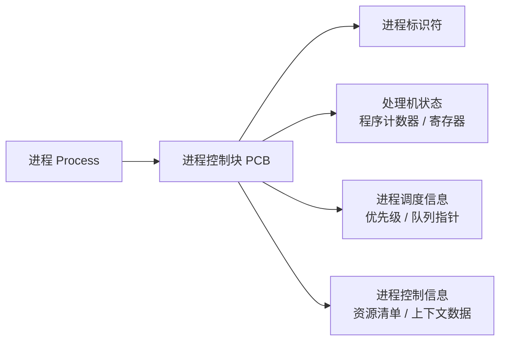

# 后端校招面试直通车: 为什么操作系统需要进程

## 纲要

- 操作系统的演进：无操作系统时代 → 批处理系统 → 分时系统，历时约 40~50 年
- 关键转折点：**多道程序设计**，它让内存可同时存放多个程序并在管理下穿插运行
- 多道程序设计带来的三个难题：资源隔离、调度单位、资源利用率
- 进程的定义：系统进行**资源分配和调度的基本单位**，是程序独立运行的载体
- 进程的实体形态：进程控制块 PCB 及其四类字段

## 操作系统的演进历史

理解进程，最好的方式是回到历史中看它为什么被发明出来。操作系统大致经历了三个阶段：

| 时代 | 特征 | 局限 / 提升 |
| --- | --- | --- |
| 无操作系统 | 人工操作开关与接线，机器体积庞大（如 ENIAC）；用户独占整机；CPU 等待人工操作 | 资源利用率极低 |
| 批处理系统 | 可批量输入任务，CPU 不再等待人工操作；出现多道程序设计 | 资源利用率提升 |
| 分时系统 | 人机可直接交互；多用户共享（也可指多软件、多进程、多系统共享）；可及时调试程序 | 资源利用率进一步提升 |

从 20 世纪 80~90 年代至今，我们一直处在分时系统的时代。

## 多道程序设计的意义

早期的批处理系统一次只能处理一个任务。多道程序设计改变了这一点：

- 计算机的内存可以**同时存放多个程序**
- 这些程序在操作系统的管理之下**穿插运行**（宏观并行、微观串行交替）
- 对多道程序的管理，成为现代操作系统的重要功能

由此带来一个重要的形态变化：**用户不再直接面向硬件编程**，而是由操作系统对硬件资源做管理与抽象。例如：

- IO 设备管理软件提供读写接口，上层通过接口读写文件
- 文件管理软件提供接口，上层通过接口操作文件

也就是说，现代操作系统实现了对计算机硬件资源的**管理与抽象**，这正是多道程序设计的产物。

### 多道程序设计带来的三个问题

从实现角度看，多道程序设计必须回答三个问题：

- 如何隔离不同程序所使用的计算机资源（CPU、存储器、文件等）
- 操作系统以什么为单位进行调度
- 如何提升计算机资源的利用率与复用率

**进程，就是为了解决这三个问题而提出的概念。**

## 为什么需要进程

进程的必要性可以概括成三条：

- 进程是系统进行**资源分配和调度的基本单位**
- 进程是**程序独立运行的载体**，保障程序正常运行
- 进程的存在使操作系统的资源利用率大幅提升

前两条最重要。有了进程：

- 多道程序之间互不干扰——每个程序被装进独立的"容器"里
- 进程可以作为一个独立载体，被操作系统调度、管理、记账

所以一个很到位的总结是：**进程是操作系统为了方便管理程序而设计的一个概念。**

## 进程的实体形态：进程控制块 PCB

进程在计算机中的具体形态，就是一组字段的集合，包括标识符、状态、优先级、程序计数器、内存指针、上下文数据、IO 状态信息、记账信息等。这些字段统一保存在**进程控制块 PCB（Process Control Block）** 中——它是操作系统为管理进程而设计的数据结构。

PCB 中的信息可分为四类：

| 类别 | 内容 |
| --- | --- |
| 进程标识符 | 用于分辨进程身份的唯一标识（PID） |
| 处理机状态 | 进程当前运行到什么位置、处于什么状态，以及相关的寄存器/程序计数器数据 |
| 进程调度信息 | 供操作系统调度使用的信息，如优先级、调度队列指针 |
| 进程控制信息 | 资源清单、同步与通信机制、链接指针等 |

其中"上下文数据"这个字段尤其关键：进程被换出 CPU 后，下次再被调度进来时，CPU 必须知道从哪里继续执行——这些数据就保存在上下文数据中，也是后文讨论上下文切换成本的基础。

## 面试回答思路

面对"什么是进程 / 为什么操作系统需要进程"：

- 先讲操作系统演进：批处理 → 多道程序设计 → 分时系统
- 点出多道程序设计制造了资源隔离、调度单位、利用率三个问题
- 给出进程的两条核心定义：资源分配与调度的基本单位 + 程序独立运行的载体
- 补充进程的实体形态 PCB，说明它是操作系统管理进程的数据结构
- 收尾一句：进程是操作系统为方便管理程序而设计的概念

相关度：93%。是否需要继续：[否]。代码是否可运行：[否]。
