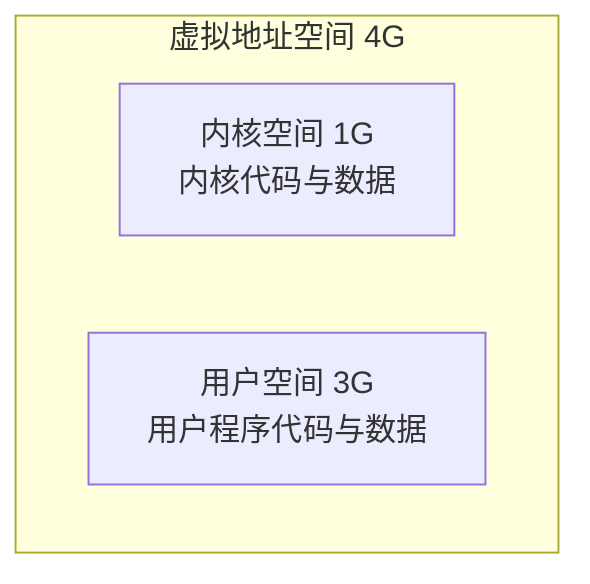
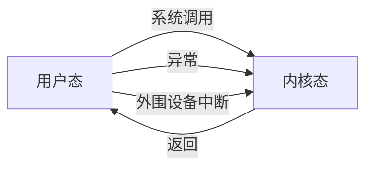

# 后端校招面试直通车: 操作系统的内核态与用户态

## 纲要

- 为什么要划分两种状态：硬件资源管理的风险与特权级设计
- Linux 的 0~3 特权级，实际只使用 0 级（内核态）与 3 级（用户态）
- 内核空间与用户空间的划分：4G 内存下的 1:3 比例
- 用户态切换到内核态的三条路径：系统调用、异常、外围设备中断
- 三种切换方式的差异对比
- 延伸：Intel 熔断漏洞与越权访问内核态

## 为什么需要两种运行态

操作系统最重要的职责之一是统一管理硬件资源：处理器、存储设备、外设、文件系统等。这些资源用户程序接触不到，只能通过操作系统暴露的接口来操作。

直接让用户程序参与资源管理风险极高：

| 资源 | 管理不当的后果 |
| --- | --- |
| 处理器资源 | 资源枯竭、系统宕机、执行顺序错乱 |
| 存储器资源 | 数据错乱、磁盘损坏 |
| 文件资源 | 文件损坏、内容丢失 |

可以说，即使发展数十年的成熟操作系统，仍会出现蓝屏、死机等状况，足见其复杂度。如果普通开发者的代码可以直接操作硬件，任何一处逻辑纰漏都可能给计算机造成不可逆的损失。

因此操作系统的设计者把运行状态一分为二：**关键程序运行在内核态**，用户编写的程序默认运行在**用户态**。这是一道隔离墙——把可能造成破坏的能力收拢到受信任的代码里。

## 特权级与两种状态

Linux 的设计哲学之一，是为不同操作赋予不同的执行等级：与系统强相关的关键操作必须由最高特权级程序完成。

x86 体系定义了 0 ~ 3 四个特权级，Linux 实际只使用其中两级：

| 特权级 | 状态 | 说明 |
| --- | --- | --- |
| 0 级 | 内核态 | 运行内核代码，可访问全部内存与外设 |
| 3 级 | 用户态 | 运行用户程序，访问受限，禁止访问外设 |

### 内核态

内核态指进程在执行**操作系统内核代码**时所处的状态。内核空间是存放内核代码和数据的内存区域。处于内核态时，CPU 可以访问内存中的全部数据，也可以访问所有外围设备，拥有最高执行权限。

### 用户态

用户态对应的是用户空间——存放用户程序代码与数据的虚拟地址空间。进程执行自己编写的代码（不包含系统调用）时处于用户态，CPU 运行在特权最低的 3 级：

- 只能访问操作系统分配给自己的那部分内存，不能触碰其他进程的资源；
- 不允许访问外围设备，包括磁盘、网卡、键盘、显示器等。

以 4G 内存为例，典型划分是内核空间占 1G、用户空间占 3G，比例为 1:3：

## 用户态如何进入内核态

只有三条路径可以让一个进程从用户态切换到内核态：

### 系统调用

操作系统把对资源的操作封装成一批接口，这些接口就是系统调用。用户程序全部运行在用户态，但当它需要完成只有内核才能做的事——从磁盘读文件、从网卡收发数据、创建新进程——就必须通过系统调用把工作交给操作系统。

调用发生时进程陷入内核态，内核完成工作后返回数据，进程再回到用户态继续执行。**这是用户程序主动发起的切换**，也是日常开发中最常见的一种：写文件、`malloc` 申请大块内存、网络读写背后都是系统调用。

### 异常

CPU 执行用户态程序时遇到不可预知的异常事件，例如访问了不存在的内存页（缺页中断）、除零、非法指令。这些事件只能由操作系统修复或接管处理，于是进程被动切换到内核态。**这是意料之外的被动切换**。

### 外围设备中断

外围设备完成工作后会主动向 CPU 发出中断信号，CPU 暂停当前指令流，转去执行对应的中断处理程序。如果被暂停的正是用户态程序，处理中断时就自然转入了内核态。**这是由外设主动发起的切换**。

三者的区别可以归纳为：

| 触发方式 | 发起方 | 性质 | 典型例子 |
| --- | --- | --- | --- |
| 系统调用 | 用户程序 | 主动请求 | `read`、`write`、`fork` |
| 异常 | CPU 执行过程中发现 | 被动、意料之外 | 缺页、除零、非法访问 |
| 外围设备中断 | 外设硬件 | 被动、异步 | 磁盘 IO 完成、网卡收包 |

## 延伸：Intel 熔断漏洞

2019 年曝光的 Intel 熔断（Meltdown）漏洞，是"用户态与内核态隔离"被打破的典型案例。由于芯片设计上的缺陷，恶意程序可以在**不经过上述三条合法路径**的情况下，从用户态越权进入内核态。

越权之后，攻击者就拥有了正常情况下只有操作系统才具备的能力：读取任意内存数据、破坏其他程序的数据、破坏操作系统的正常运行。该漏洞几乎影响所有系列的 Intel CPU，在安全界影响极大。

它反过来印证了两点：

- 操作系统在设计上必须严格保护内核态，不能给用户程序任何绕过路径；
- CPU 与相关硬件的设计同样需要把权限隔离作为硬约束，仅靠软件约定是不够的。

## 面试回答模板

问：请简述你对操作系统内核态的理解。

> 操作系统把运行状态划分为内核态和用户态，对应的地址空间是内核空间和用户空间。内核态下进程执行的是操作系统内核代码，CPU 处于最高特权级，可以访问全部内存数据和所有外围设备；用户态下进程执行自己的代码，只能访问分配给自己的内存，不能访问外设，也不能访问其他进程的资源。以 4G 内存为例，内核空间与用户空间通常按 1:3 划分。

问：进程在什么情况下会进入内核态？

> 三种情况：一是系统调用，由用户程序主动发起，请求内核代为完成读写磁盘、网络收发等工作；二是异常，例如缺页、除零等意料之外的事件，必须交给内核处理；三是外围设备中断，外设在完成工作后主动发出中断信号，CPU 转去执行中断处理程序时进入内核态。

相关度：95%。是否需要继续：[否]。代码是否可运行：[否]。
