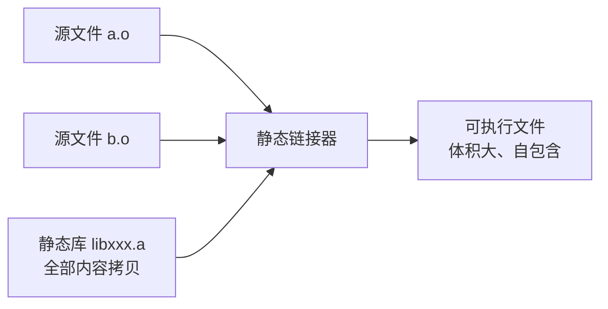
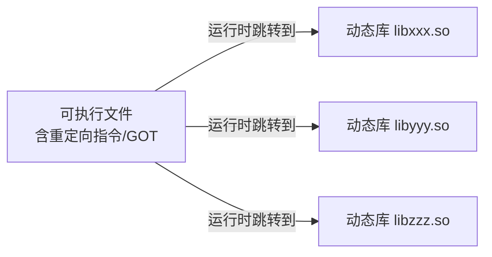

# 40. 后端校招面试直通车: 动态链接与静态链接的区别

## 纲要

- 库与链接库：库是可复用代码的集合；链接库是带标准加载接口的"共享库"
- 目标文件的典型结构：text（代码段）、data（已初始化全局变量）、bss（未初始化全局变量），以及运行期的堆、栈
- 静态链接：把静态库的全部内容拷贝进最终的可执行文件，体积大、编译慢、内存占用高
- 动态链接：可执行文件中只保留重定向指令（如 GOT），运行时再加载 .so / .dll
- 平台差异：Linux 下动态库为 `.so`、静态库为 `.a`；Windows 下动态库为 `.dll`、静态库为 `.lib`
- 对比维度：内存占用、编译时间、共享对象更新、灵活性、启动速度、寻址速度

## 📎 文本↔代码关联

- 讲稿：`work/source/8.mksz540-后端校招面试直通车，提前锁定大厂offer[完结]/{7}--第7章计算机系统之编程语言与运行原理/[7.5]--7-6请简述动态链接和静态链接的区别`
- 关联代码：清单 `code_refs` 指向 `code/recruitment/...` 下的 `L122.java`、`L198.java`、`Offer09.java`、`L55.java`、`L142.java`、`L206.java`、`L860.java`、`L141.java`，均为配套链表/数组类算法题解，与"动态链接/静态链接"主题无直接关联，本篇为概念解析，不嵌入代码。

## 库与链接库

日常写代码时，常把反复使用的函数或类封装成一个公共模块，这些"写好的、现成的、可复用的代码集合"就是**库**。每个程序都会依赖大量的底层库，没有人会从零实现所有功能，因此库的存在不可或缺。编写程序时依赖的往往是系统库或第三方库。

**链接库**是在库的基础上增加了"链接"这一动作：它被制作成通用格式，拥有标准、通用的加载接口，可以供同一平台下不同的程序使用。关键词是"共享"与"通用格式"。

动态链接与静态链接，指的正是链接库提供的两种不同**调用形式**，二者各有优劣。

## 目标文件的结构

源代码经过编译后产出的是**目标文件**。一个典型的目标文件包含以下几个段：

| 段 | 作用 |
| --- | --- |
| text 段（代码段） | 保存程序的机器指令 |
| data 段（数据段） | 保存已初始化的全局变量 |
| bss 段 | 保存未初始化的全局变量 |
| 堆 / 栈 | 目标文件加载到内存后，在进程空间里分配的动态内存结构 |

前三个段是目标文件一定存在的静态结构，而堆和栈是目标文件被装载进内存后才在地址空间上分配出来的两个区域。

## 静态链接

假设有三个输入文件，静态链接产出的输出文件会包含全部输入文件的信息——它把静态链接库里的所有内容**原样拷贝**进当前的目标文件，最终形成一个完整、自包含的可执行文件。

## 动态链接

动态链接与静态链接截然不同：它运行时不只依赖可执行文件，还需要提供动态链接库的地址或路径，并在运行期进行加载。可执行文件中只保留若干条**跳转指令**，分别指向不同的动态链接库；当程序执行到对应指令时，会跳出当前目标文件，跳转到动态链接库中去执行相关代码。这个"跳跃"本质上就是一次**地址重定位**。

## 动态链接与装载的关系

静态链接把全部库都打包进了目标文件，而动态链接在执行到相关指令时还需要跳到另外的动态库代码中去执行。因此，动态链接生成的可执行文件在运行时**不仅要加载可执行文件本身，还要额外加载它所依赖的动态链接库**。如果只加载了可执行文件、没有加载动态库，运行期就会因为无法重定位到具体函数地址而报错；静态链接则没有这个烦恼。

装载过程中需要特别留意的正是：动态链接需要额外加载动态库。

## 静态链接与动态链接的对比

| 对比维度 | 静态链接 | 动态链接 |
| --- | --- | --- |
| 最终文件体积 | 大（包含全部库内容） | 小（仅保留重定向指令） |
| 内存空间占用 | 浪费（每份进程各持一份库副本） | 节省（多进程共享同一份库） |
| 编译时间 | 长（需组装完整目标文件） | 短（库已编译好，只做重定位） |
| 共享对象更新 | 麻烦（需重新编译） | 便捷（替换动态库即可） |
| 灵活性 | 低 | 高 |
| 启动速度 | 快 | 慢（需准备并加载动态库） |
| 寻址速度 | 高（直接寻址） | 低（涉及重定向跳转） |

从内存空间的视角看，静态链接会把所有库内容都塞进目标文件，因此比动态链接更浪费内存；从编译时间看，动态库早已编译好、只需重定位，所以动态链接编译更快；从更新与灵活性看，动态链接只需替换动态库文件，而静态链接必须重新编译；从运行期表现看，动态链接因需要加载动态库且涉及重定向，启动更慢、寻址也更慢。

面试时，可以从"体积、内存、编译时间、更新、灵活性、启动速度、寻址速度"这几个角度来系统描述二者的区别。

