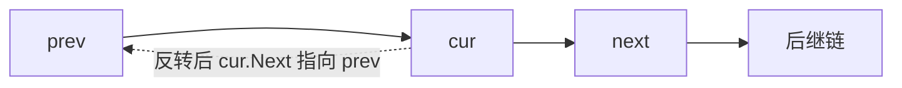

# 43. 后端校招面试直通车: 反转链表与区间反转的落地实现

## 纲要

- 反转链表的核心矛盾：改指针方向会丢失后继节点的引用
- 迭代解法：prev / cur / next 三个引用协同推进，最后一个节点必须补一次反转
- 从"只输出一个节点"的现场 bug 反推终止条件的边界
- LeetCode 92 区间反转：定位、切断、复用 206、重连五个步骤
- 虚拟头节点（dummy node）在区间反转中是不可省略的
- 递归解法与迭代解法的取舍

## 反转链表要解决的到底是什么问题

给定一个链表的头节点，要求反转整条链表并返回新的头节点。例如 `1 → 2 → 3 → 4 → 5` 反转后应当是 `5 → 4 → 3 → 2 → 1`。

反转的本质是把每个节点的 `Next` 引用掉头：节点 1 原本指向 2，反转后要指向空；节点 2 原本指向 3，反转后要指向 1，以此类推。

这里有一个绕不开的问题：一旦把当前节点的 `Next` 改指向前驱，原本通往后继的那条边就断掉了。如果事先没有保存后继的信息，链表剩余部分就彻底丢失了。

因此反转任意一个节点，必须同时握有三个引用：

| 引用 | 指向 | 作用 |
| --- | --- | --- |
| `cur` | 当前正在反转的节点 | 执行 `cur.Next = prev` |
| `prev` | 当前节点的前驱 | 提供反转的目标指向 |
| `next` | 当前节点的后继 | 保证反转之后还能继续向后推进 |

三个引用缺一不可。少 `prev` 无法完成反转，少 `next` 会丢掉整个链表尾部。



## 迭代反转的完整过程

初始状态下 `cur` 指向头节点 1，`prev` 与 `next` 均为空。整个推进过程可以按"保存后继 → 反转 → 三个引用各自前进一步"的节奏循环：

| 轮次 | 操作前 cur | prev | next | 操作结果 |
| --- | --- | --- | --- | --- |
| 1 | 1 | nil | 2 | 1.Next = nil，链表被切成 1 与 2→3→4→5 两段 |
| 2 | 2 | 1 | 3 | 2.Next = 1，前半段完成反转 |
| 3 | 3 | 2 | 4 | 3.Next = 2 |
| 4 | 4 | 3 | 5 | 4.Next = 3 |
| 5 | 5 | 4 | nil | 循环已退出，需要在循环外补一次 5.Next = 4 |

注意最后一轮：`next` 变成空时循环就结束了，而此时节点 5 的反转**还没有发生**。这正是这道题最容易踩的边界坑。

### 第一版实现：踩中边界

```go
func ReverseList(head *ListNode) *ListNode {
	if head == nil {
		return nil
	}
	var prev *ListNode
	cur := head
	next := cur.Next
	for next != nil { // next 为空时退出循环
		cur.Next = prev
		prev = cur
		cur = next
		next = next.Next
	}
	return cur // 此处少了最后一次反转
}
```

拿 `1 → 2 → 3 → 4 → 5` 跑一遍，输出只有 `[5]`。原因是节点 5 的 `Next` 仍然指向原来的 4 之前的 nil 值（从未被改写），它和已经反转好的 4、3、2、1 之间没有建立连接。

### 修正：补上循环外的最后一次反转

```go
func ReverseList(head *ListNode) *ListNode {
	if head == nil {
		return nil
	}
	var prev *ListNode
	cur := head
	next := cur.Next
	for next != nil {
		cur.Next = prev
		prev = cur
		cur = next
		next = next.Next
	}
	cur.Next = prev // 关键：处理尾节点的最后一次反转
	return cur
}
```

`next` 为空说明 `cur` 已经走到原链表的最后一个节点，它就是反转后的新头节点，返回 `cur` 即可。

### 更推荐的写法

把循环条件换成"当前节点不为空"，先保存后继再移动，就不需要在循环外打补丁，语义也更清晰（根据讲稿逻辑补充的等价写法）：

```go
func ReverseListCanonical(head *ListNode) *ListNode {
	var prev *ListNode
	cur := head
	for cur != nil {
		next := cur.Next // 1. 先保存后继，防止断链
		cur.Next = prev  // 2. 反转当前节点的指向
		prev = cur       // 3. prev 前进一步
		cur = next       // 4. cur 前进一步
	}
	return prev // cur 为空时，prev 即新头节点
}
```

两种写法的时间复杂度都是 O(n)，空间复杂度都是 O(1)。差别在于返回值与最后一步反转的处理位置：前者返回 `cur`，后者返回 `prev`。

### 递归写法

反转操作对每个节点独立进行，天然也适合递归表达：

```go
func ReverseListRecursive(head *ListNode) *ListNode {
	if head == nil || head.Next == nil {
		return head
	}
	newHead := ReverseListRecursive(head.Next) // 先反转后续链条
	head.Next.Next = head                      // 让后继节点指回自己
	head.Next = nil                            // 断开自己原来的后继边
	return newHead
}
```

递归写法的代码更短，但调用深度等于链表长度，链表很长时有栈溢出风险，工程上优先选择迭代版本。

## 区间反转：LeetCode 92

第 92 题要求只反转链表中的某一段：`1 → 2 → 3 → 4 → 5` 反转第 2 到第 4 个节点，结果是 `1 → 4 → 3 → 2 → 5`。

思路上不需要重新设计：待反转的子链表可以直接复用上一节的 `ReverseList`，剩下的问题变成"怎么把这一段摘出来、再接回去"，一共五个步骤。


### 定位：虚拟头节点的必要性

要摘出 `[left, right]` 这一段，需要拿到两个位置：`left` 的前驱节点（用于后续接回左半段）和 `right` 节点本身（用于保存右半段）。

`left` 有可能就是头节点，此时它压根没有前驱。为了让所有情况统一处理，先构造一个虚拟节点指向头节点，问题就退化成"虚拟节点就是那个前驱"：

```go
dummy := &ListNode{Next: head}
prev := dummy
for i := 0; i < left-1; i++ { // 题目中 left 从 1 开始计数
	prev = prev.Next
}
```

注意这里迭代 `left-1` 次而不是 `left` 次：题目要求的是第 `left` 个节点，而下标是从 1 开始数的。

### 定位 right：一个容易算错的迭代次数

找到 `prev` 之后，从 `prev` 出发再走 `right-left+1` 步就到达 `right` 节点：

```go
tail := prev
for i := 0; i < right-left+1; i++ {
	tail = tail.Next
}
```

如果误写成从 `left` 节点出发迭代同样的次数，指针就会多走一步，定位落在 `right` 的下一个节点上。边界ის 这类"差一步"的错误，靠打印中间结果能最快定位。

### 切断、反转、重连

```go
func ReverseBetween(head *ListNode, left, right int) *ListNode {
	dummy := &ListNode{Next: head}

	// 1. 定位 left 的前驱节点
	prev := dummy
	for i := 0; i < left-1; i++ {
		prev = prev.Next
	}

	// 2. 定位 right 节点
	tail := prev
	for i := 0; i < right-left+1; i++ {
		tail = tail.Next
	}

	// 3. 切断子链表
	leftNode := prev.Next // 反转后的新头部的前身，反转后它变成子链表的尾
	after := tail.Next    // 右半段的第一个节点
	prev.Next = nil
	tail.Next = nil

	// 4. 反转子链表
	newHead := ReverseList(leftNode)

	// 5. 重新连接左右两端
	prev.Next = newHead
	leftNode.Next = after

	return dummy.Next // 注意返回虚拟节点的下一个节点
}
```

最后一行返回 `dummy.Next` 而不是 `head`，正是因为 `left == 1` 时头节点本身也参与了反转，`head` 此时已经是反转后的尾节点。

### 边界用例

| 输入 | 调用 | 输出 |
| --- | --- | --- |
| 1→2→3→4→5 | ReverseBetween(head, 2, 4) | 1→4→3→2→5 |
| 1→2→3→4→5 | ReverseBetween(head, 1, 5) | 5→4→3→2→1 |
| 1 | ReverseBetween(head, 1, 1) | 1 |

区间等于整个链表的用例，正是检验"是否返回 `dummy.Next`"的最直接手段。

## Demo 示例

### 运行说明

代码为单个 `main.go`，直接执行即可：

```bash
go run main.go
```

### 代码说明

完整可运行示例如下，包含链表构造、字符串化打印，以及前文的全部函数：

```go
package main

import "fmt"

type ListNode struct {
	Val  int
	Next *ListNode
}

// Build 按切片顺序构造链表，便于测试
func Build(vals []int) *ListNode {
	dummy := &ListNode{}
	cur := dummy
	for _, v := range vals {
		cur.Next = &ListNode{Val: v}
		cur = cur.Next
	}
	return dummy.Next
}

// String 把链表格式化输出，方便打印每一步的中间结果
func (h *ListNode) String() string {
	out := []int{}
	for cur := h; cur != nil; cur = cur.Next {
		out = append(out, cur.Val)
	}
	return fmt.Sprint(out)
}

// ReverseList 反转整条链表：cur/prev/next 三指针迭代
func ReverseList(head *ListNode) *ListNode {
	if head == nil {
		return nil
	}
	var prev *ListNode
	cur := head
	next := cur.Next
	for next != nil {
		cur.Next = prev
		prev = cur
		cur = next
		next = next.Next
	}
	cur.Next = prev // 补上尾节点的最后一次反转
	return cur
}

// ReverseBetween 反转 [left, right] 区间的节点（1 起计数）
func ReverseBetween(head *ListNode, left, right int) *ListNode {
	dummy := &ListNode{Next: head}

	prev := dummy
	for i := 0; i < left-1; i++ {
		prev = prev.Next
	}

	tail := prev
	for i := 0; i < right-left+1; i++ {
		tail = tail.Next
	}

	leftNode := prev.Next
	after := tail.Next
	prev.Next = nil
	tail.Next = nil

	newHead := ReverseList(leftNode)
	prev.Next = newHead
	leftNode.Next = after

	return dummy.Next
}

func main() {
	fmt.Println("原链表:      ", Build([]int{1, 2, 3, 4, 5}))
	fmt.Println("206 迭代反转:", ReverseList(Build([]int{1, 2, 3, 4, 5})))
	fmt.Println("92 反转 2~4:", ReverseBetween(Build([]int{1, 2, 3, 4, 5}), 2, 4))
	fmt.Println("92 反转 1~5:", ReverseBetween(Build([]int{1, 2, 3, 4, 5}), 1, 5))
	fmt.Println("92 单节点:  ", ReverseBetween(Build([]int{1}), 1, 1))
}
```

预期输出：

```text
原链表:       [1 2 3 4 5]
206 迭代反转: [5 4 3 2 1]
92 反转 2~4: [1 4 3 2 5]
92 反转 1~5: [5 4 3 2 1]
92 单节点:   [1]
```

调试时建议在五步操作的每一步之后打印一次链表，先确认定位正确、再确认切断正确、最后确认重连正确。比起一次性写完再查错，逐步验证的效率高得多。

### 技术点总结

- 反转链表的第一原则是"改指针前先保存后继"，否则链表直接断掉
- 迭代版必须留意最后一个节点：循环条件用 `next != nil` 时，尾节点的反转要在循环外补做
- 用 `cur != nil` 作为循环条件的写法不需要打补丁，返回值用 `prev`
- 区间反转的关键是抽出子链表复用已有函数，难点在定位与重连，不在反转本身
- 只要 `left` 可能等于 1，就必须引入虚拟头节点，返回值也随之变成 `dummy.Next`
- 递归版代码简短但调用栈深度为 O(n)，长链表有溢出风险

## API 速览

| 函数 | 签名 | 参数说明 | 返回值 | 复杂度 |
| --- | --- | --- | --- | --- |
| `Build` | `Build(vals []int) *ListNode` | 按序構造链表 | 头节点指针 | 时间 O(n)，空间 O(n) |
| `ReverseList` | `ReverseList(head *ListNode) *ListNode` | 链表头节点 | 反转后的新头节点 | 时间 O(n)，空间 O(1) |
| `ReverseListCanonical` | 同上 | 同上 | 同上 | 时间 O(n)，空间 O(1) |
| `ReverseListRecursive` | 同上 | 同上 | 同上 | 时间 O(n)，空间 O(n) 递归栈 |
| `ReverseBetween` | `ReverseBetween(head *ListNode, left, right int) *ListNode` | 头节点、区间左右端点（1 起计数） | 完成区间反转后的链表头节点 | 时间 O(n)，空间 O(1) |

