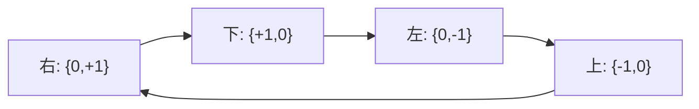
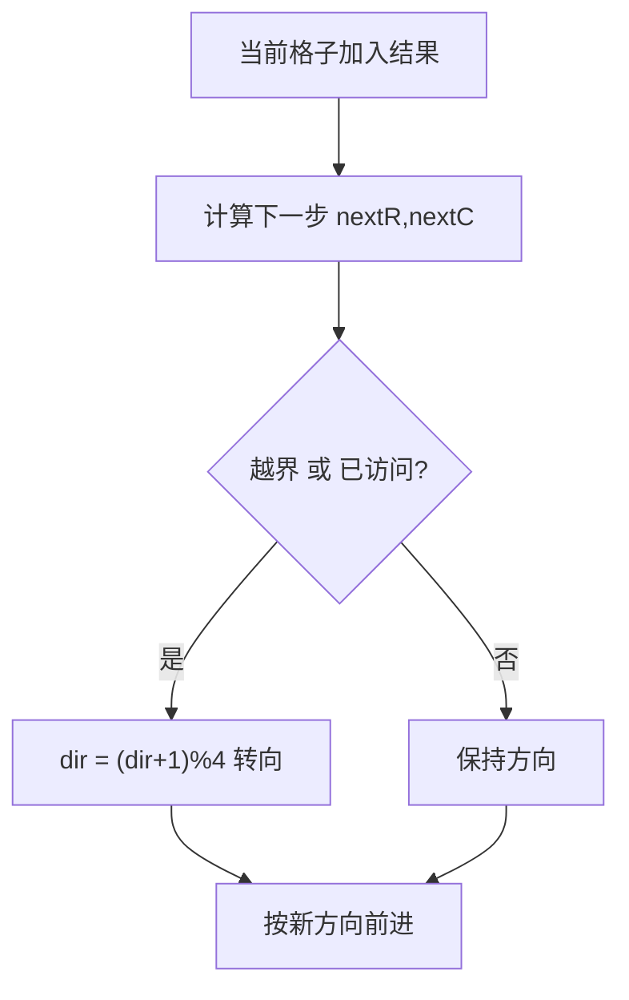

# 46. 后端校招面试直通车: 螺旋矩阵遍历的思路与边界处理

## 纲要

- LeetCode 54（螺旋矩阵）：按顺时针由外向内"蛇形/环形"遍历二维矩阵，输出一维结果
- 面试官在此类题中主要考察**边界条件的判断**与**代码熟练度**，而非算法难度
- 方向数组：用 `(行偏移, 列偏移)` 表达"右、下、左、上"四个顺时针方向
- 边界判定两类：越界（行/列超出矩阵）、以及**已访问**（转向时必须跳过已走过的格子）
- 常见陷阱：只判断越界、忘了判断"已访问"，会导致同一格子被重复访问、遍历顺序错误

## 📎 文本↔代码关联

- 讲稿：`work/source/8.mksz540-后端校招面试直通车，提前锁定大厂offer[完结]/{8}--第8章数据结构与算法之链表、栈、队列与二叉树iclass=new/[8.6]--8-7数组、栈、队列实战详解（一）`
- 关联代码：清单 `code_refs` 为空，本节聚焦**解题思路与边界条件**（不落代码）；完整可运行实现见 `47_螺旋矩阵代码实现.md`。

## 题目是什么

给定一个 `m × n` 的二维矩阵，要求按**顺时针、由外向内**的顺序把它"螺旋"遍历一遍，把经过的元素按先后次序放进一个一维数组返回。

例子一：`[[1,2,3],[4,5,6],[7,8,9]]` → 输出 `[1,2,3,6,9,8,7,4,5]`。

例子二：`[[1,2,3,4],[5,6,7,8],[9,10,11,12]]` → 输出 `[1,2,3,4,8,12,11,10,9,5,6,7]`。

这类题本身算法并不复杂，但极易在边界上出错，因此常被用来考察候选人对细节的把控与编码熟练度。

## 用方向数组表达"顺时针"

二维矩阵里移动有四种基本方向：右、下、左、上。可以把它们统一用"行偏移、列偏移"的二元组表示，并按顺时针顺序排成一个数组：

```text
directions = [
  {0,  +1},  // 右：行不变，列 +1
  {+1,  0},  // 下：行 +1，列不变
  {0,  -1},  // 左：行不变，列 -1
  {-1,  0},  // 上：行 -1，列不变
]
```

用一个整数 `dir` 记录当前方向（取值 0~3），每一步按 `directions[dir]` 走到下一个格子。因为方向只有四个且固定循环，转向时用取模即可：`dir = (dir + 1) % 4`。



## 边界条件：两类必须判断

设当前在 `(r, c)`，下一步预备走到 `(nextR, nextC) = (r + dr, c + dc)`。什么时候必须"转向"（换下一个方向）？有两类情况：

1. **越界**：`nextR < 0` 或 `nextR >= 行数`，或 `nextC < 0` 或 `nextC >= 列数`。
2. **已访问**：`(nextR, nextC)` 这个格子之前已经走过（被填进结果），说明撞上了内圈，必须转向。

只要命中任意一类，就 `dir = (dir + 1) % 4`，再基于新方向重新计算下一步。



## 为什么"已访问"这一步不能省

只判断越界会出错。以 `[[1,2,3],[4,5,6],[7,8,9]]` 为例：走到 `4`（索引 `[1][0]`）后若只判越界，下一步会被算成向上回到 `1`，于是 `1` 被**重复访问**，得到 `[1,2,3,6,9,8,7,4,1]`，而正确答案是 `[1,2,3,6,9,8,7,4,5]`。

解决办法是用一个 `visited` 二维标记记录已经走过的格子。当下一步"越界或已访问"时统一转向，就能自然绕过内圈、按螺旋顺序收尾。这正是一道看似简单的题里最容易被忽视、也最容易被追问的考点。

## 小结

螺旋矩阵题的难点不在算法，而在边界。核心套路是：用方向数组固化"右→下→左→上"的顺时针移动；每走一步都判断"是否越界 / 是否已访问"，任一成立就取模转向；用一个 `visited` 标记避免重复访问。把这套边界判断讲清楚，比背下最终代码更能在面试中拿分。完整可运行实现见 `47_螺旋矩阵代码实现.md`。

