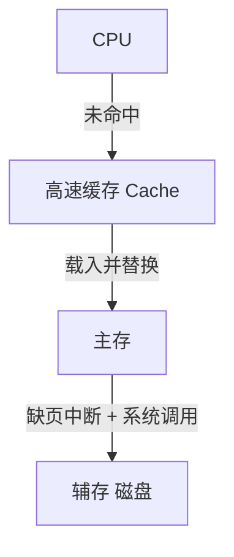

# 后端校招面试直通车: 虚拟内存与逻辑地址、物理地址

## 纲要

- 虚拟内存为什么存在：进程需求超出物理内存、多道程序加剧稀缺、物理内存无法无限扩张
- 虚拟内存的本质：把暂时不用的内存放到辅存
- 逻辑地址空间与物理地址空间的定义与区别
- 从编写、编译到加载运行：地址映射的完整链路
- 页面置换发生的两个时机与各自解决的问题
- 大程序如何在小内存机器上运行起来的经典案例

## 虚拟内存为什么存在

虚拟内存几乎是操作系统诞生后就一直存在的机制，原因有三：

- **单个进程需要的内存可能远超物理内存**。例如一个大型游戏进程可能需要使用几十 GB 的资源，而机器只有 8GB 物理内存；
- **多道程序设计加剧了内存稀缺**。主存需要同时存放多个进程的逻辑与数据，每个进程能分到的物理内存更加有限；
- **物理内存不可能无限扩张**。无论装多大，总有不够用的时候，靠堆硬件解决不了根本问题。

## 虚拟内存是什么

虚拟内存是操作系统内存管理的一项关键技术，它让"多道程序运行"和"大程序运行"成为现实。

其原理是：把程序所使用的内存进行划分，将**暂时不使用**的部分先放置在辅存中。这背后正是局部性原理——程序并不需要一次性读写全部数据，某一时刻真正活跃的只是其中一小部分。

因此，虚拟内存的本质是**通过软件的逻辑设计来解决物理内存不足的问题**。如果物理内存无限大，虚拟内存就没有存在的必要；而现实中物理内存必然有限。

一句话概括它的效果：**容量上远大于物理内存，速度上接近内存，成本上接近辅存**。

## 逻辑地址空间与物理地址空间

### 逻辑地址空间

逻辑地址空间是**进程可以使用的内存空间**，其大小仅受 CPU 地址长度的限制。常说的 32 位、64 位操作系统，指的就是 CPU 的地址长度。

```
32 位地址：2^32 = 4GB
```

所以 32 位系统上，每个进程最多可以使用 4GB 的寻址空间。逻辑地址空间指的是程序运行时，程序指令与程序数据可以使用的相对地址空间。

### 物理地址空间

物理地址空间是**物理内存的实际存储空间**。比如机器实际安装了 4GB 内存，这 4GB 就是物理地址空间；物理地址指向的就是这块真实的存储空间。

### 两者的关系

用一个具体例子串起来：


编写程序时，开发者不需要关心变量最终落在内存的哪个位置；编译之后，程序拥有了自己的一段逻辑地址空间，例如某个函数中定义的变量就有了相对固定的逻辑地址。

当程序真正加载运行时，它的指令与数据会被随机分配到物理内存的不同区域。此时**物理地址指向真实的物理存储单元，逻辑地址是程序视角的地址**，逻辑地址必须经过转换才能得到物理地址，进而完成读写。

值得强调的是：由于虚拟内存和局部性原理的存在，程序运行时**并不需要把全部数据一次性装入内存**，装入当前需要的部分即可。当访问的数据页不在内存时，就会触发缺页中断，进而发起页面置换。

## 页面置换的时机

置换发生在两个层次上，各自解决的问题不同：

| 层次 | 触发条件 | 解决的问题 |
| --- | --- | --- |
| 高速缓存—主存 | CPU 访问 Cache 未命中，需要从主存载入数据，从而替换 Cache 中的某一块 | 主存速度不足 |
| 主存—辅存 | 主存中没有所需数据，触发缺页中断，通过系统调用从辅存载入数据 | 主存容量不足 |



所有被置换的数据，本质上都属于进程的虚拟地址空间；置换之后，数据实际存放的位置是物理内存，需要通过物理地址来访问。

## 经典案例：几十 GB 的游戏如何在 8GB 内存的机器上运行

这是面试中非常常见的场景题，回答思路是：

- 进程拥有的是逻辑地址空间，其大小只受 CPU 地址长度限制，与物理内存大小无关。64 位系统下每个进程可拥有的地址空间极其巨大；
- 程序运行时不需要把几十 GB 的资源全部装进内存，只需要装入当前场景真正用到的那部分；
- 当访问的数据不在主存时触发缺页中断，操作系统通过系统调用从磁盘把所需的页调入内存，必要时先做一次页面置换；
- 用不到的资源继续留在磁盘上。局部性原理保证了"一段时间内活跃的只是很小一部分数据"。

所以，从用户层面看，程序拥有一个很大的地址空间（这就是虚拟内存）；从系统层面看，真正占用的物理内存只有活跃的那部分。

## 面试回答模板

问：请简述操作系统的虚拟内存。

> 虚拟内存是操作系统内存管理的关键技术，用于解决物理内存不足的问题：它把程序使用的内存进行划分，将暂时不用的部分放到辅存，只把当前活跃的部分留在主存，其依据是局部性原理。它使得多道程序运行和大程序运行成为现实，效果是容量远大于物理内存、速度接近内存、成本接近辅存。

问：逻辑地址空间和物理地址空间有什么区别？

> 逻辑地址空间是进程可以使用的内存空间，大小只受 CPU 地址长度限制，例如 32 位系统下为 4GB；物理地址空间是物理内存的实际存储空间，由机器实际安装的内存容量决定。程序编译后拥有自己的逻辑地址空间，加载运行时被随机分配到物理内存的不同位置，逻辑地址必须经过转换才能得到物理地址，进而完成真实的数据读写。

问：几十 GB 的大型游戏如何在 8GB 内存的机器上运行？

> 靠虚拟内存。进程使用的是逻辑地址空间，其大小只受 CPU 地址长度限制；运行时不需要把全部资源一次性装入内存，只装入当前活跃的部分，其余留在磁盘。访问的数据不在主存时触发缺页中断，操作系统通过系统调用把所需页面从磁盘调入内存，必要时先做页面置换。局部性原理保证了任一时刻活跃的数据只是很小一部分，因此小内存也能跑起大程序。

相关度：96%。是否需要继续：[否]。代码是否可运行：[否]。
