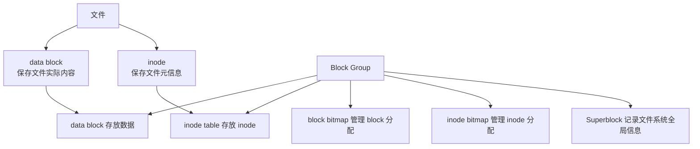
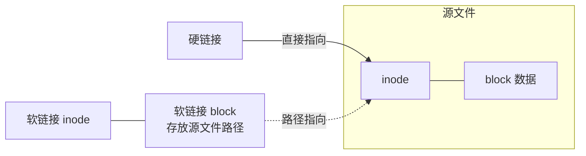

# 后端校招面试直通车: Linux 文件系统与软硬链接的区别

## 纲要

- 文件系统的本质：操作系统用于明确存储设备或分区上文件的**方法与数据结构**
- 常见文件系统：Windows 的 FAT、NTFS；Linux 的 EXT2/3/4
- FAT 的核心：一张盘块表 + 每个文件一条盘块链表
- EXT 文件系统的组成：Boot Sector、块组（Block Group），块组内含 Superblock、文件系统描述、inode bitmap、block bitmap、inode table、data block
- inode 保存文件元信息，**文件名不在文件自身的 inode 上，而在目录的 inode 上**
- 硬链接：直接指向源文件的 inode，同一 inode 号的文件互为硬链接
- 软链接：拥有自己的 inode 与 block，block 中存放源文件的路径，类似 Windows 快捷方式
- 删除行为差异：硬链接删除任意一方文件实体仍在；软链接删除源文件后链接仍存在但无法访问

## 什么是文件系统

文件系统是操作系统用于明确存储设备或分区上的文件的**方法和数据结构**，即在存储设备上组织文件的方法；操作系统中负责管理和存储文件信息的软件，就称为文件系统。不同操作系统有不同的文件系统。

| 系统 | 常见文件系统 |
| --- | --- |
| Windows | 早期 FAT，后来 NTFS |
| Linux | EXT2 / EXT3 / EXT4（EXT = Extended File System，数字表示第几代，最新常用第四代） |

## FAT 文件系统

FAT 全称 **File Allocation Table（文件分配表）**，是微软 DOS 与 Windows 早期使用的文件系统。因局限性较大现已基本不用，但它足够简单，很适合用来理解文件系统的本质。

FAT 用一张表保存盘块信息。假设某文件的数据分散存储在盘块 2、9、7、8、16 上：

```dir
盘块表：1  2  3 ... 9 ... 16 ... 20
某文件的链表：2 → 9 → 7 → 8 → 16
```

每个文件有一条独立的链表，记录它的所有盘块以及下一块的去向（例如物理块 2 的下一个盘块是 9，9 的下一个是 7），从而索引出该文件的完整信息。

NTFS（New Technology File System）是 Windows NT 环境使用的文件系统，Windows XP 之后基本都使用它，主要是对 FAT 的改进与替代。

## EXT 文件系统的结构

```dir
EXT 文件系统
├── Boot Sector        启动扇区，安装开机管理程序
└── Block Group 0..N   块组，存储数据文件的实际位置
    ├── Superblock         记录整个文件系统的相关信息
    ├── 文件系统描述        块组的描述信息
    ├── inode bitmap       记录已分配 / 未分配的 inode
    ├── block bitmap       记录已分配 / 未分配的 data block
    ├── inode table        存放所有 inode
    └── data block         存放文件实际内容
```

### inode

**inode** 是文件的索引节点，保存与文件相关的元信息：索引节点编号、文件类型、链接指针、文件权限、文件的物理地址、文件计数、文件长度、文件读写状态、访问计数等。

一个关键考点：**文件名并不存放在文件自身的 inode 上，而是存放在目录的 inode 上**。目录和文件都各有一个 inode。正因为如此，列出目录文件时**无需加载每个文件的 inode**，只要读取目录自身的 inode 就能把目录下所有文件名列出来。

### inode bitmap 与 block bitmap

两者都是位图（bitmap），用一位表示一个对象的分配状态：

```dir
inode:  1  2  3  4  5  6  7  8
状态:   0  0  0  1  1  0  0  0     （4、5 已分配，其余未分配）
```

- **inode bitmap**：记录哪些 inode 已分配、哪些未分配
- **block bitmap**：功能类似，记录 data block 的使用情况

### data block 与 Superblock

- **data block**：真正存放文件内容的地方，每个 block 有唯一编号，文件用到的 block 编号记录在该文件的 inode 上
- **Superblock**：记录整个文件系统的相关信息，包括 block 与 inode 的使用情况、时间信息、控制信息等

需要注意的是，除 data block 外，Superblock、文件系统描述、两个 bitmap、inode table 保存的都是**块组的元信息**。

### EXT 存放一个文件的完整路径



## 软链接与硬链接

Linux 中一个文件由 inode 和 block 两部分组成：**inode 保存元信息，block 保存数据**，两者是分开独立的。软硬链接的区别正是从这里产生的。



### 硬链接

- 硬链接是**源文件的一个别名**，直接指向源文件的 inode
- 具备**相同 inode 号**的文件互为硬链接文件

删除行为：删除硬链接文件，或删除源文件，任意一方被删，**文件实体都不会被真正删除**。因为 inode 记录了当前引用该文件的数量（链接计数），只有当引用计数归零时，文件实体才会被释放。

### 软链接

- 软链接是一个**完整独立的文件**，拥有自己的 inode 和 block
- 它的 block 中存储的是**源文件的完整路径**
- 类比 Windows 的**快捷方式**

删除行为：删除源文件后，软链接**依然存在**，但已经无法访问到源文件的内容——因为它保存的只是一段路径，无法保证目标一定存在。

### 对比汇总

| 对比项 | 硬链接 | 软链接 |
| --- | --- | --- |
| inode | 与源文件共用同一个 inode | 拥有自己的 inode |
| block | 无独立数据块 | 有独立 block，存源文件路径 |
| 本质 | 源文件的别名（目录项） | 指向源文件路径的独立文件 |
| 删除源文件 | 文件实体仍在（引用计数未归零） | 链接仍存在但无法访问内容 |
| 跨文件系统 | 不支持 | 支持 |
| 类比 | — | Windows 快捷方式 |

创建链接使用 `ln` 命令：硬链接用 `ln source.txt hard_link.txt`，软链接加 `-s` 选项，即 `ln -s source.txt soft_link.txt`。验证时用 `ls -i` 查看 inode 号，可以看到硬链接与源文件的 inode 号完全相同，而软链接拥有独立的 inode 号。

## 面试回答思路

被问到"软链接和硬链接有什么区别"或"谈谈对 inode 的理解"：

- 先讲 Linux 文件的组成：inode（元信息）+ block（数据），二者独立
- 补充 EXT 文件系统结构（Boot Sector、块组及其内部字段），并特别指出**文件名存放在目录的 inode 上**
- 讲硬链接：指向同一 inode，是别名；靠引用计数决定是否真正删除
- 讲软链接：独立 inode + block 存路径，类似快捷方式；删源文件后链接失效
- 用 `ls -i` 验证 inode 号是很好的收尾

相关度：95%。是否需要继续：[否]。代码是否可运行：[否]。
