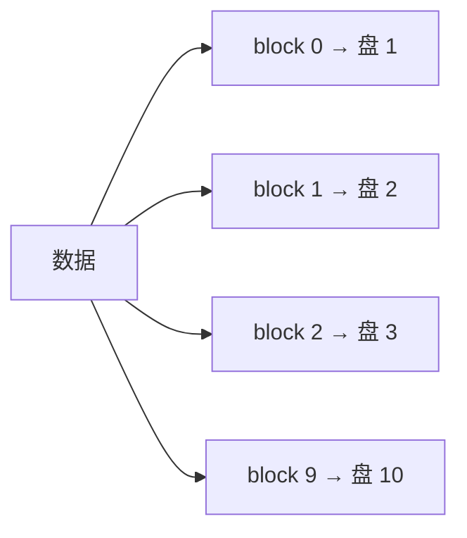
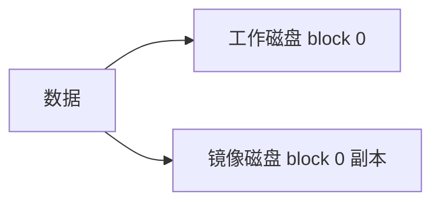
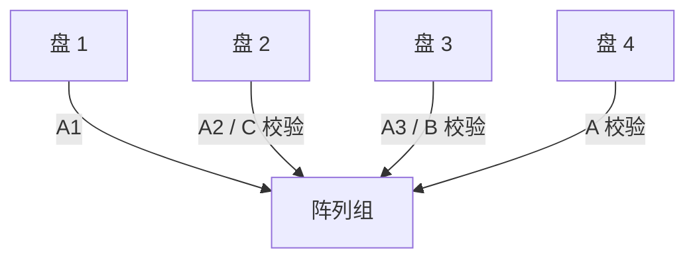
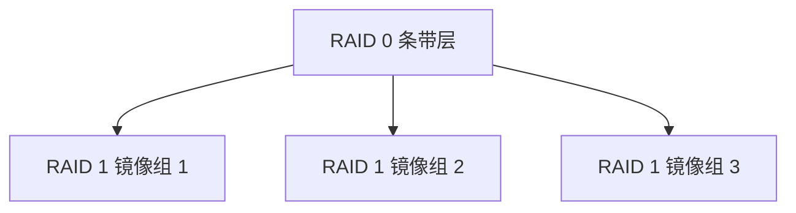

# 后端校招面试直通车: 服务器部署中的 RAID 磁盘冗余阵列

## 纲要

- RAID 的定义：用虚拟化存储技术把多块硬盘组合成阵列
- RAID 0：条带化，性能翻倍但无冗余
- RAID 1：镜像，可靠性高但容量利用率 50%
- RAID 5：分布式奇偶校验，容量与可靠性的折中
- RAID 10：RAID 1 + RAID 0 的组合
- 各级别在保护、读写效率、容量、适用场景上的横向对比

## RAID 是什么

RAID 全称 Redundant Array of Independent Disks，即独立磁盘冗余阵列。它利用虚拟化存储技术把多块物理硬盘组合成一个（或多个）硬盘阵列组，目的有三类：

- 提升存储性能；
- 提供数据冗余；
- 两者兼得。

在生产环境的服务器中，RAID 几乎是存储层的标配。家用的小型 RAID 与线上服务器的 RAID 在形态上不同，但原理一致。

## RAID 0：条带化

假设有 10 块磁盘组成一个大的阵列，数据按 block 依次落到各个磁盘上：block 0、1、2、…、9 分别落在 10 块盘上，彼此独立。

特点：

- 每块盘独立并行读写，理论性能是单块盘的 N 倍（10 块盘即 10 倍）；
- **不提供数据校验，也没有任何冗余**。任意一块盘故障，该盘上的数据直接丢失且无法恢复。

因此 RAID 0 一般不用于可靠性要求高的业务，只适合"可靠性要求不高、但读写性能要求高"的场景，例如临时缓存、可重建的中间数据。

## RAID 1：镜像

RAID 1 与 RAID 0 的布局类似，但数据做了完整冗余：每份数据无差别地双写到两块磁盘上，一块是**工作磁盘**，一块是**镜像磁盘**。

特点：

- 实际提供读写服务的只有一块盘，另一块仅作镜像备份，因此性能约为 RAID 0 的 1/2；
- 只要不是工作盘与镜像盘同时损坏，数据都可以恢复；
- 容量利用率 50%。

RAID 1 可以看作"为了数据可靠性而对性能做出的折中"，适合数据安全要求高、且希望快速恢复的场景。

## RAID 5：分布式奇偶校验

RAID 5 把数据分成 A1、A2、A3 等条带分散存储，并为每条带计算一份**校验码**（课程中称海明码，工程实现中多为 XOR 奇偶校验）。关键点在于：校验信息**分散存放在不同的磁盘上**，而不是固定在某一块专用校验盘。

特点：

- 校验码既能检出错误，也能在单盘故障时恢复数据；
- 容量利用率远高于 RAID 1，通常在 67% ~ 94% 之间，取决于阵列中磁盘的数量；
- 校验码分散存放，避免了单一校验盘的写瓶颈，写性能与可靠性都优于固定校验盘方案；
- 写入时需要同时计算校验码，因此写效率相对偏低。

RAID 5 是生产环境中最常见的等级之一，在容量、可靠性、成本之间取得了较好的平衡。

## RAID 10：先镜像再条带

RAID 10（常写作 RAID 1+0）是 RAID 0 与 RAID 1 的组合体：**底层以 RAID 1 做镜像，上层以 RAID 0 做条带**。

特点：

- 既保证数据冗余，又保证读写效率；
- 缺点同样明显：空间冗余浪费严重，容量利用率只有 50%，与 RAID 1 相同。

它兼顾了一定的经济性与数据安全，适用于对可靠性和随机写性能都有要求的数据库类场景。

## 各级别横向对比

| 级别 | 数据保护 | 写效率 | 读效率 | 容量利用率 | 典型应用 |
| --- | --- | --- | --- | --- | --- |
| RAID 0 | 无 | 高 | 高 | 100% | 可靠性要求低、读写性能要求高的场景 |
| RAID 1 | 有（镜像） | 适中 | 适中 | 50% | 数据安全要求高、要求易于恢复的场景 |
| RAID 5 | 有（校验码） | 偏低（需计算校验） | 高 | 67% ~ 94% | 兼顾容量与安全，最常用 |
| RAID 10 | 有（镜像） | 高 | 高 | 50% | 兼顾经济性与数据安全 |

除了上述几种，RAID 还有 2、3、4、6、7 等等级，校招面试中掌握 0、1、5、10 这四种并讲清它们的取舍逻辑即可。

## 面试回答模板

问：请简述你对服务器部署 RAID 的理解。

> RAID 是独立磁盘冗余阵列，利用虚拟化存储技术把多块硬盘组合成阵列组，目的是提升性能、提供冗余或两者兼得。常见的等级有 RAID 0、RAID 1、RAID 5 和 RAID 10。

问：RAID 0、RAID 1、RAID 5 有什么区别？

> RAID 0 是条带化，数据分散写到各盘，理论性能是单盘的 N 倍，但没有任何校验和冗余，坏一块盘数据就丢失，适合可靠性要求不高的高性能场景。RAID 1 是镜像，数据双写到工作盘和镜像盘，可靠性高，只要两块盘不同时损坏就能恢复，但容量利用率只有 50%，性能约为 RAID 0 的一半。RAID 5 引入校验码并把校验信息分散存放在不同磁盘上，既能在单盘故障时恢复数据，容量利用率又远高于 RAID 1，通常在 67% 到 94% 之间；代价是写入时需要计算校验码，写效率偏低。

相关度：95%。是否需要继续：[否]。代码是否可运行：[否]。
