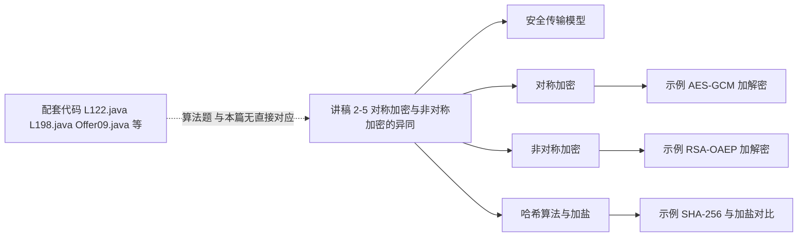
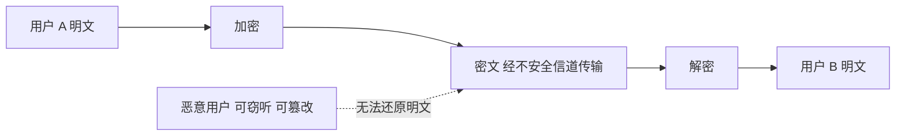

# 5. 后端校招面试直通车: 对称加密、非对称加密与哈希加盐

## 纲要

- 安全传输模型：在不安全信道上传输密文，发送前加密、读取前解密
- 密钥：明文与密文互相转换时算法所需的输入参数，分为对称密钥与密钥对
- 古典密码学：置换密码表与代换密码表，以及频率分析破译的原理
- 对称加密：加解密使用同一密钥，DES、3DES、AES，效率高但密钥分发困难
- 非对称加密：公钥加密、私钥解密，RSA、ECC、DH，安全性高但运算开销大
- 两类加密的对比：密钥形态、运算效率、安全性、管理成本
- 哈希算法：单向压缩成定长指纹，存在哈希碰撞，不是加密算法
- 加盐：抵御彩虹表撞库，是口令存储的必备动作

## 素材索引



- 讲稿：`work/source/8.mksz540-后端校招面试直通车，提前锁定大厂offer[完结]/{2}--第2章网络协议面试核心之HTTP、HTTPS、DNS协议/2-5 请简述对称加密、非对称加密的异同`
- 关联代码：本篇示例根据讲稿逻辑用 Go 补充（原课程算法题代码未随本课程体系分发）。

## 安全传输模型

用户 A 需要向用户 B 发送信息，而网络是一个并不安全的信道：恶意用户可以在信道上抓取传输内容、篡改之后再发给 B，也能直接窃取机密信息。

于是引入加密与解密：



- A 在发送数据之前通过一定手段把数据加密
- 加密后的数据即使落入恶意用户手中也无法解密
- B 收到数据后再解密，得到可理解的信息
- 理想情况下，不安全信道上传输的始终是密文

密钥指的是明文转换为密文、或密文转换为明文时算法运行所需要的输入参数。根据加密方式的不同，密钥分为对称密钥与非对称密钥（公钥与私钥）。

## 古典密码学与频率分析

古典密码学里有两种典型密码表：

- 置换密码表：把 a 到 z 按不同的轮替顺序替换，例如整体偏移两位，a 换成 c、b 换成 d
- 代换密码表：任意地把每个字符映射成另一个字符，例如密文中的 w 对应原文中的 a

这两种密码表有严重的安全问题：通过大量数据分析很容易破译。原理是频率分析——统计大量英文文章中每个字母出现的频率，e 出现的概率约为 13%，t 约为 8% 到 9%。只要把密文中各字符的出现频率排序，再与明文的频率分布一一对应，映射关系就基本被还原了。

这也是现代加密算法必须做到"密文的统计特征不泄露明文统计特征"的原因。

## 对称加密

对称加密中，加密与解密使用的是同一个密钥：用同一个密钥既可以加密信息，也可以解密信息。前面提到的置换密码表与代换密码表，在加密方和解密方各持一份，本质上就是对称加密的特例。

常见算法：

| 算法 | 说明 |
| --- | --- |
| DES | 早期标准，密钥长度偏短，已不安全 |
| 3DES | DES 的加强版本，三重加密，兼容性好但效率低 |
| AES | 高级加密标准，下一代加密算法标准，速度快、安全级别更高 |

特点：运算效率高，适合加密大量数据；缺点是密钥需要在通信双方之间共享，一旦泄露，整个通信就不再安全，密钥管理成本随通信对数增加而快速上升。

## 非对称加密

非对称加密使用的是一对密钥：公钥与私钥。它们不是同一个密钥，但之间存在数学关系。

- 私钥自己保存，不对外公开
- 公钥可以公开发给任何人
- 发送方用接收方的公钥加密，接收方用自己的私钥解密

具体到 RSA：它是目前最具影响力的公钥加密算法，数学基础是一个简单却棘手的数论问题——两个大素数相乘很容易，但对乘积做因式分解、找回原来的两个素数却极其困难，需要耗费巨大的算力。除 RSA 外，还有基于椭圆曲线的 ECC 和用于密钥交换的 DH。

特点：安全性更高，因为公私钥分开保存，不需要分发私钥；代价是运算涉及复杂数学运算，占用更多计算资源，效率明显低于对称加密，因此不适合直接加密大量数据。

## 两类加密对比

| 对比项 | 对称加密 | 非对称加密 |
| --- | --- | --- |
| 密钥形态 | 一串密钥 | 一组密钥：公钥与私钥 |
| 加解密密钥 | 相同 | 不同，公钥加密、私钥解密 |
| 运算效率 | 高，适合大数据量 | 低，只适合小数据量 |
| 安全性 | 依赖密钥不泄露 | 更高，私钥无需分发 |
| 管理成本 | 密钥分发与保管成本高，通信对数越多越复杂 | 管理成本低，公钥可公开 |
| 典型算法 | DES、3DES、AES | RSA、ECC、DH |
| 工程用法 | 加密业务数据 | 交换会话密钥、做签名与身份认证 |

工程上的通行做法是把两者结合：用非对称加密安全地协商出一把会话密钥，再用对称加密传输大量业务数据，同时用哈希算法校验完整性。TLS 握手采用的就是这个思路。

## 哈希算法与加盐

哈希（散列）算法可以理解为一种从任意数据中创建更小的数字"指纹"的方法：把消息和数据压缩成摘要，数据量变小、格式固定，且从结果中完全看不出原文的痕迹。

关键性质：

- 单向：明文可以计算出摘要，摘要无法还原成明文
- 定长：无论输入多长，输出长度固定
- 雪崩效应：原文微小变化会导致摘要面目全非
- 哈希碰撞：不同的原文可能得到相同的摘要，原文与摘要是多对一关系。因此"摘要不同则原文一定不同"，但"摘要相同不代表原文一定相同"

### 口令存储与撞库

口令在服务端必须以摘要形式保存，例如明文 `123456` 经哈希后变成一长串字符串，即使库被泄露，攻击者拿到的也只是摘要。

但这并不绝对安全。攻击者同时满足三个条件时就能反查明文：拿到了脱库的摘要数据、知道使用的哈希算法、自身拥有庞大的哈希结果库（彩虹表）。只要把拿到的摘要与自己的库做匹配，就能找出对应明文。

### 加盐

加盐的做法很简单：在计算摘要时，除了明文之外再拼接一段自定义的随机字符串（盐值）。

```text
hash(password + salt) -> 摘要
```

盐值不与摘要放在一起被攻击者获知，攻击者就无法用自己的彩虹表做匹配，破解难度大幅提升。工程上要求每个用户使用独立随机盐，并且口令哈希应使用 bcrypt、scrypt、Argon2 这类专门设计的慢哈希函数，而不是裸的 MD5 或 SHA。

### MD5 是加密算法吗

不是。从加密与解密的闭环看，明文可以转换成密文，密文也应该能通过解密还原成明文；而哈希散列不具备逆操作，无法从摘要还原原文。严格意义上讲，哈希算法是单向的散列算法，不是加密算法。

## API 速览

| API | 说明 |
| --- | --- |
| `aes.NewCipher(key []byte) (cipher.Block, error)` | 创建 AES 分组密码，key 长度 16/24/32 字节分别对应 AES-128/192/256 |
| `cipher.NewGCM(block cipher.Block) (cipher.AEAD, error)` | 创建 GCM 工作模式，同时提供加密与完整性校验 |
| `AEAD.Seal(dst, nonce, plaintext, additionalData []byte) []byte` | 加密并生成认证标签 |
| `AEAD.Open(dst, nonce, ciphertext, additionalData []byte) ([]byte, error)` | 解密并校验认证标签，校验失败返回 error |
| `rsa.GenerateKey(rand io.Reader, bits int) (*rsa.PrivateKey, error)` | 生成 RSA 密钥对，常用 2048 或 3072 位 |
| `rsa.EncryptOAEP(hash hash.Hash, random io.Reader, pub *rsa.PublicKey, msg, label []byte) ([]byte, error)` | 使用公钥做 OAEP 填充加密 |
| `rsa.DecryptOAEP(hash hash.Hash, random io.Reader, priv *rsa.PrivateKey, ciphertext, label []byte) ([]byte, error)` | 使用私钥解密 |
| `sha256.Sum256(data []byte) [32]byte` | 计算 SHA-256 摘要，输出 32 字节 |
| `crypto/rand.Read(b []byte) (int, error)` | 读取密码学安全的随机字节，用于生成密钥、nonce 与盐值 |

## Demo 示例

### 运行说明

```bash
mkdir -p crypto-demo && cd crypto-demo
go mod init crypto-demo
# 将代码保存为 main.go
go run main.go
```

### 代码

```go
package main

import (
	"crypto/aes"
	"crypto/cipher"
	"crypto/rand"
	"crypto/rsa"
	"crypto/sha256"
	"encoding/hex"
	"fmt"
)

func sha256Hex(s string) string {
	sum := sha256.Sum256([]byte(s))
	return hex.EncodeToString(sum[:])
}

// 对称加密：加解密使用同一把密钥
func aesGCMDemo() {
	fmt.Println("=== 对称加密 AES-256-GCM ===")

	key := make([]byte, 32) // AES-256 需要 32 字节密钥
	if _, err := rand.Read(key); err != nil {
		panic(err)
	}

	block, err := aes.NewCipher(key)
	if err != nil {
		panic(err)
	}
	gcm, err := cipher.NewGCM(block)
	if err != nil {
		panic(err)
	}

	plaintext := []byte("转账 100 元")

	// nonce 每次加密都必须不同，这里与密文一起存放
	nonce := make([]byte, gcm.NonceSize())
	if _, err := rand.Read(nonce); err != nil {
		panic(err)
	}
	ciphertext := gcm.Seal(nonce, nonce, plaintext, nil)
	fmt.Printf("明文: %s\n密文(hex): %x\n", plaintext, ciphertext)

	// 解密：取出前缀 nonce，用同一把密钥还原明文
	nonceSize := gcm.NonceSize()
	decrypted, err := gcm.Open(nil, ciphertext[:nonceSize], ciphertext[nonceSize:], nil)
	if err != nil {
		panic(err)
	}
	fmt.Printf("解密结果: %s\n", decrypted)

	// 篡改密文会被认证标签检出
	tampered := append([]byte(nil), ciphertext...)
	tampered[len(tampered)-1] ^= 0xff
	if _, err := gcm.Open(nil, tampered[:nonceSize], tampered[nonceSize:], nil); err != nil {
		fmt.Println("密文被篡改 -> 解密失败:", err)
	}
}

// 非对称加密：公钥加密，私钥解密
func rsaDemo() {
	fmt.Println("\n=== 非对称加密 RSA-2048-OAEP ===")

	priv, err := rsa.GenerateKey(rand.Reader, 2048)
	if err != nil {
		panic(err)
	}
	pub := &priv.PublicKey

	// 非对称加密只适合加密少量数据，典型用途是交换会话密钥
	sessionKey := []byte("SK-AES-256-8f3c1d...")
	ciphertext, err := rsa.EncryptOAEP(sha256.New(), rand.Reader, pub, sessionKey, nil)
	if err != nil {
		panic(err)
	}
	fmt.Printf("公钥加密后(hex 前 32 字节): %x...\n", ciphertext[:32])

	plaintext, err := rsa.DecryptOAEP(sha256.New(), rand.Reader, priv, ciphertext, nil)
	if err != nil {
		panic(err)
	}
	fmt.Printf("私钥解密结果: %s\n", plaintext)
	fmt.Println("私钥能否推导公钥: 能，公钥可由私钥导出；反之不行")
}

// 哈希与加盐
func hashSaltDemo() {
	fmt.Println("\n=== 哈希与加盐 ===")

	password := "123456"
	fmt.Println("明文口令:", password)
	fmt.Println("SHA-256:", sha256Hex(password))
	fmt.Println("摘要长度固定:", len(sha256Hex(password)), "个十六进制字符 = 32 字节")

	// 不加盐：同样的明文必然得到同样的摘要，可被彩虹表反查
	fmt.Println("相同明文两次摘要一致:", sha256Hex(password) == sha256Hex(password))

	// 加盐：每个用户使用独立随机盐
	saltA := "8f3c1d9a2b7e"
	saltB := "c41d7e0b93af"
	fmt.Println("用户 A 加盐摘要:", sha256Hex(password+saltA))
	fmt.Println("用户 B 加盐摘要:", sha256Hex(password+saltB))
	fmt.Println("同为 123456 但摘要不同:", sha256Hex(password+saltA) != sha256Hex(password+saltB))

	// 单向性：无法从摘要还原明文
	fmt.Println("单向性: 摘要无法还原明文，因此哈希不是加密算法")
}

func main() {
	aesGCMDemo()
	rsaDemo()
	hashSaltDemo()
}
```

预期输出（密钥与密文每次运行都不同）：

```text
=== 对称加密 AES-256-GCM ===
明文: 转账 100 元
密文(hex): 3a9f...（长度随明文与 nonce 变化）
解密结果: 转账 100 元
密文被篡改 -> 解密失败: cipher: message authentication failed

=== 非对称加密 RSA-2048-OAEP ===
公钥加密后(hex 前 32 字节): 7c1e...
私钥解密结果: SK-AES-256-8f3c1d...
私钥能否推导公钥: 能，公钥可由私钥导出；反之不行

=== 哈希与加盐 ===
明文口令: 123456
SHA-256: 8d969eef6ecad3c29a3a629280e686cf0c3f5d5a86aff3ca12020c923adc6c92
摘要长度固定: 64 个十六进制字符 = 32 字节
相同明文两次摘要一致: true
用户 A 加盐摘要: 6b0c...
用户 B 加盐摘要: 91af...
同为 123456 但摘要不同: true
单向性: 摘要无法还原明文，因此哈希不是加密算法
```

### 代码说明

- 对称加密部分用 AES-GCM：一把密钥既加密又解密。`nonce` 必须每次随机，示例中把 nonce 作为密文前缀一起存放，这是工程上的常见做法。
- `gcm.Open` 在解密时会校验认证标签，篡改任意一字节都会返回 `message authentication failed`，对应安全传输模型里"防止篡改"这一要求。
- 非对称加密部分用 RSA-OAEP：公钥加密、私钥解密。示例加密的是一把会话密钥，正对应"用非对称加密协商会话密钥、用对称加密传输数据"的实际用法。
- 哈希部分展示了三点：定长输出、相同明文摘要必然相同（因此可被彩虹表反查）、加盐后同明文得到不同摘要。
- 单向性无法通过代码"演示还原"，但 `sha256Hex` 的输入输出长度关系已经能说明它是压缩映射，不可逆。

### 技术点总结

- 对称加密一把密钥、效率高，适合大量数据；非对称加密一对密钥、安全性高但慢，适合密钥交换与签名
- 密钥是算法的输入参数，非对称密钥对之间存在数学关系，但无法从公钥推导私钥
- 哈希是单向、定长、压缩的指纹算法，存在碰撞，不是加密算法
- 口令存储必须加盐，并使用慢哈希函数
- 真实系统总是组合使用三类算法，而不是只用一种

## 面试要点速记

| 问题 | 答题要点 |
| --- | --- |
| 对称与非对称加密的区别 | 密钥形态（一串 vs 一对）、效率（高 vs 低）、安全性、管理成本与适用场景 |
| 非对称加密为什么安全 | 基于大数因式分解困难（RSA）或椭圆曲线离散对数困难（ECC），私钥不对外分发 |
| RSA 的数学基础 | 两个大素数相乘容易，对乘积做因式分解极其困难 |
| MD5 是加密算法吗 | 不是，哈希单向不可逆，缺少解密这一环 |
| 什么是加盐 | 计算摘要时拼接随机字符串，使相同明文得到不同摘要，抵御彩虹表撞库 |
| 哈希碰撞是什么 | 不同原文得到相同摘要，原文与摘要是多对一关系 |

