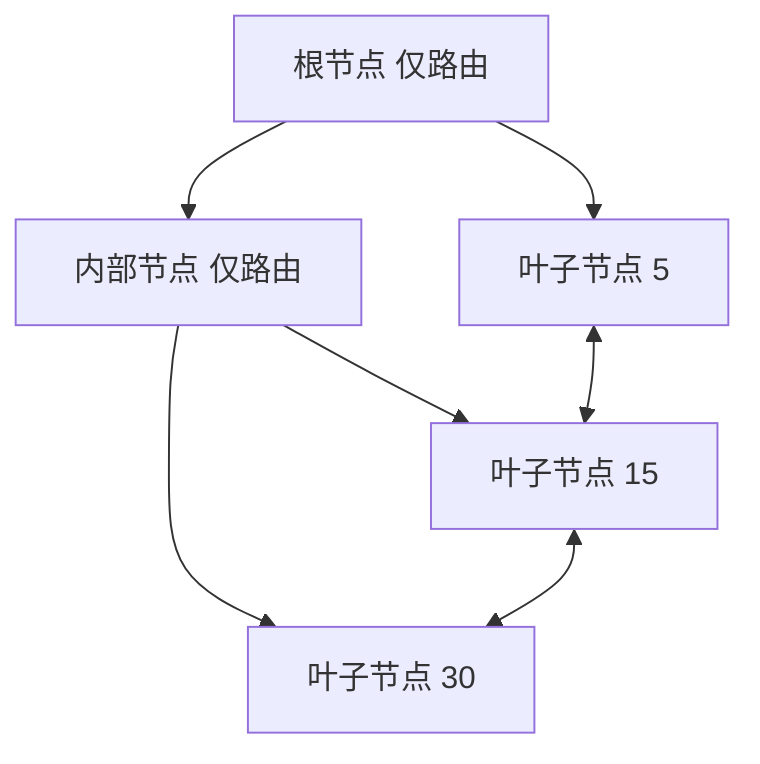

# 62. 后端校招面试直通车: 从数据结构演进看 MySQL 为什么选择 B+ 树做索引

## 纲要

- 数据库索引要同时服务两类查询：精确查询与范围查询，还要兼顾插入性能
- 线性结构（数组、链表）增删改查平均 O(N)，数据量到千万级完全不可用
- 二叉搜索树把复杂度降到 O(logN)，但范围查询退化成 N·logN
- 优化一：数据只存在叶子节点，叶子用双向链表串联 —— 范围查询变成"定位首条 + 顺序扫描"
- 优化二：二叉改多叉，降低树高 —— 树高直接决定磁盘 IO 次数
- B 树 vs B+ 树：节点是否存数据、叶子是否链表相连、范围查询性能差异

## 索引要解决的真实问题

数据库对外提供的是增删改查，落到性能上最关键的是两件事：**查询**与**插入**。

- 查询分为精确查询（`where id = 100`）与范围查询（`where id between 100 and 200`）
- 插入要同时考虑插入耗时，以及插入之后还能不能被快速查出来

另外有一个绕不开的前提：数据量超过内存时，部分数据必须暂存磁盘。因此衡量一个索引结构好坏的核心指标不是"比较了多少次"，而是**发生了多少次磁盘 IO**。

## 从线性结构到二叉搜索树

数组和链表的问题很直接：查询的平均复杂度是 O(N)。表里有千万行数据时，一次查询要扫描千万次，其中大部分还是随机磁盘 IO，完全不可接受。

于是自然想到二叉搜索树：

- 左子树所有节点值小于根节点值，右子树所有节点值大于根节点值
- 中序遍历即可得到有序序列：1、2、3、4、5、6、7、8、9
- 精确查询复杂度降到 O(logN)

但二叉搜索树对**范围查询极不友好**。因为根节点和叶子节点都保存数据，范围查询无法一次性取出连续区间，只能反复从根节点向下遍历，直到凑齐整个范围，复杂度约为 N·logN。

## 第一次优化：数据下沉到叶子并串联

针对范围查询的改造思路是：**非叶子节点不再保存数据，只承担路由职责；所有数据都放在叶子节点，并用双向链表把叶子节点串起来**。

改造之后：

- 精确查询：沿根节点路由一路向下，复杂度仍是 O(logN)
- 范围查询：先定位到区间的第一条记录，然后沿着叶子节点的双向链表顺序向后扫描即可，不再反复回到根节点

这一次改造，就是 B+ 树相对 B 树最本质的区别。

## 第二次优化：二叉改多叉，压低树高

二叉搜索树还有一个问题：**每个节点最多两个孩子，树太高**。

对磁盘型索引来说，树高就是 IO 次数。一个节点对应一次磁盘页读取，树高从 20 降到 4，意味着一次查询从 20 次 IO 降到 4 次。因此把二叉改成多叉，让每个节点容纳更多关键字与孩子指针，是降低树高最直接的办法。

多叉之后，同样的数据量下树高显著降低，这也就是 MySQL 索引最终采用的**多叉搜索树**形态。

推导链路可以完整串成一条线：

## B 树与 B+ 树的区别

| 对比项 | B 树 | B+ 树 |
| --- | --- | --- |
| 非叶子节点是否存数据 | 存，关键字与数据在一起 | 不存，只做路由 |
| 叶子节点 | 保存数据，彼此不相连 | 保存全部数据，双向链表相连 |
| 精确查询 | O(logN)，命中即可返回 | O(logN)，必须走到叶子 |
| 范围查询 | 需要反复从根遍历，性能差 | 定位首条后沿链表顺序扫描，性能好 |
| 单次查询 IO | 最好情况在根节点命中，IO 更少 | 稳定走到叶子，IO 次数固定 |
| 全表扫描 | 需要中序遍历整棵树 | 直接沿叶子链表线性扫描 |

结论很清晰：**精确查询两者性能相近，范围查询 B+ 树明显更优**，而范围查询在真实业务中（分页、时间区间、区间统计）出现频率极高，所以 MySQL 的 InnoDB 引擎选择 B+ 树作为索引结构。

另外两个附带优势：

- 非叶子节点不存数据，单个磁盘页能容纳更多关键字，扇出更大，树更矮
- 叶子链表让全表扫描与范围扫描都变成顺序 IO，对磁盘与预读友好

## 面试作答思路

- 先讲需求：精确查询、范围查询、插入性能，以及磁盘 IO 才是瓶颈
- 再讲演进：线性结构 O(N) → 二叉搜索树 O(logN) → 数据下沉 + 叶子链表 → 多叉降树高
- 最后对比 B 树与 B+ 树，落点在"非叶子不存数据 + 叶子双向链表 + 多叉降低树高"

