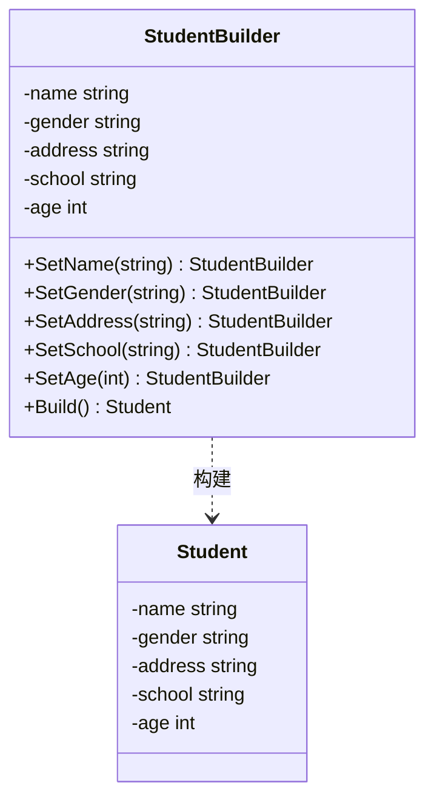

# 67. 后端校招面试直通车: 建造者模式与链式调用

## 纲要

- 为什么需要建造者：类的可选参数过多导致构造函数膨胀，调用方还要小心参数顺序
- 触发条件：构造参数超过四个且其中存在可选参数
- 实现要点：独立的 Builder 持有与产品相同的属性，每个设置方法返回自身，最后一个 `Build` 产出产品
- 链式调用的由来：设置方法返回 `this`（Go 中返回 Builder 指针）
- 优点：与产品解耦、易扩展、控制粒度细；缺点：需要多写一个类

## 为什么需要建造者模式

编写一个复杂类时，可选参数往往很多。以 `Student` 为例，它有姓名、性别、地址、学校、学号、年龄等属性，其中大部分是可选的。

如果全部用构造函数表达，就不得不提供一堆重载：

- 只有姓名
- 姓名 + 性别
- 姓名 + 性别 + 地址
- 姓名 + 性别 + 学校
- ......

这种类在实现和初始化两端都很痛苦：

- 类里要维护大量构造函数，每加一个属性就要再补一组
- 调用方必须精心挑选构造函数，稍不注意选错就初始化出错误对象
- 多个属性类型相同（比如全是 `string`）时，参数顺序写反也不会报错，属于典型的静默错误

经验法则是：**当一个类的构造参数超过四个，且其中存在可选参数时，就应该考虑建造者模式**。

## 实现思路



关键差异在设置方法的返回值上：

- 产品类 `Student` 的 `SetName` 返回空（void），只是单纯赋值
- 建造者 `StudentBuilder` 的 `SetName` 返回**自身**（`return this`），这是链式调用得以成立的原因

最后 `Build()` 方法把 Builder 上累积的属性一次性赋给 `Student`，并返回 `Student` 实例。

## 使用方式：链式调用

初始化时不再直接构造 `Student`，而是先造一个 `StudentBuilder`，依次设置需要的属性，最后 `Build`：

```go
stu := NewStudentBuilder().
    SetName("张三").
    SetAddress("深圳").
    SetAge(18).
    SetSchool("某大学").
    Build()
```

相比构造函数重载，这种方式的优势是：

- 属性名即方法名，不需要记忆参数顺序
- 只需要设置关心的属性，其余保持零值
- 想动态调整某个属性，改一行调用即可，**不需要新增构造函数，也不需要改动 `Student` 类本身**

## 优缺点

| 维度 | 说明 |
| --- | --- |
| 优点 | Builder 与产品相互独立，扩展属性不影响产品类 |
| 优点 | 控制粒度更细，可以设置校验、默认值、必填校验，便于风险控制 |
| 优点 | 调用方不必在众多构造函数中挑选，降低误用概率 |
| 缺点 | 需要额外编写 Builder，实现复杂度明显上升 |
| 缺点 | 属性变更时要同步改两处（产品与 Builder） |

缺点是否值得承受，取决于产品类的使用频率：如果一个类被频繁地以不同组合初始化，写一个 Builder 是一劳永逸的。

## Demo 示例

> 以下代码根据讲稿逻辑用 Go 语言补充，单文件可直接运行。

### 运行说明

```bash
mkdir builder-demo && cd builder-demo
go mod init builder-demo
# 将下方代码保存为 main.go
go run main.go
```

```go
package main

import "fmt"

// Student 产品类：可选属性较多
type Student struct {
	name    string
	gender  string
	address string
	school  string
	idCard  string
	age     int
}

// SetName 产品类自身的 setter 无返回值，仅做赋值
func (s *Student) SetName(name string) {
	s.name = name
}

// String 便于打印查看构建结果
func (s Student) String() string {
	return fmt.Sprintf("Student{name=%s, gender=%s, address=%s, school=%s, idCard=%s, age=%d}",
		s.name, s.gender, s.address, s.school, s.idCard, s.age)
}

// StudentBuilder 建造者：持有与 Student 一致的属性
type StudentBuilder struct {
	student Student
}

// NewStudentBuilder 创建建造者
func NewStudentBuilder() *StudentBuilder {
	return &StudentBuilder{}
}

// SetName 返回自身，支撑链式调用
func (b *StudentBuilder) SetName(name string) *StudentBuilder {
	b.student.name = name
	return b
}

func (b *StudentBuilder) SetGender(gender string) *StudentBuilder {
	b.student.gender = gender
	return b
}

func (b *StudentBuilder) SetAddress(address string) *StudentBuilder {
	b.student.address = address
	return b
}

func (b *StudentBuilder) SetSchool(school string) *StudentBuilder {
	b.student.school = school
	return b
}

func (b *StudentBuilder) SetIDCard(idCard string) *StudentBuilder {
	b.student.idCard = idCard
	return b
}

func (b *StudentBuilder) SetAge(age int) *StudentBuilder {
	b.student.age = age
	return b
}

// Build 校验必填项并返回最终产品
func (b *StudentBuilder) Build() (*Student, error) {
	if b.student.name == "" {
		return nil, fmt.Errorf("name is required")
	}
	stu := b.student
	return &stu, nil
}

func main() {
	// 链式调用：只设置关心的属性
	stu, err := NewStudentBuilder().
		SetName("张三").
		SetGender("男").
		SetAddress("深圳").
		SetSchool("某大学").
		SetAge(18).
		Build()
	if err != nil {
		fmt.Println("build failed:", err)
		return
	}
	fmt.Println(stu)

	// 动态调整属性：不需要新增构造函数
	stu.SetName("李四")
	fmt.Println("after rename:", stu.name)

	// 必填校验生效
	_, err = NewStudentBuilder().SetAge(20).Build()
	fmt.Println("expect error:", err)
}
```

预期输出：

```text
Student{name=张三, gender=男, address=深圳, school=某大学, idCard=, age=18}
after rename: 李四
expect error: name is required
```

### 代码说明

- `StudentBuilder` 内部直接嵌入一个 `Student`，避免属性重复声明，这是 Go 中的常见写法
- 每个 `SetXxx` 都返回 `*StudentBuilder`，因此调用可以一路串下去，这就是讲稿中说的"链式调用"
- `Build()` 返回产品实例，同时承担校验职责（这里校验 `name` 必填），这是建造者相对构造函数的一个额外收益
- 演示里调用了产品自身的 `SetName`，说明建造完成后仍可微调，产品类与建造者互不干扰

### 技术点总结

- 建造者适用于"参数多 + 可选参数多"的构造场景，阈值经验值是四个参数
- 链式调用的本质是设置方法返回自身
- Builder 与产品解耦，新增可选属性时只需加一个方法，调用方零改动
- Go 中另一种惯用解法是**函数式选项**（`type Option func(*T)`），语义更轻，适合参数不多但可选的场景；参数组合复杂、需要校验时建造者更清晰

## API 速览

| API | 签名 | 说明 |
| --- | --- | --- |
| `NewStudentBuilder` | `func NewStudentBuilder() *StudentBuilder` | 创建建造者实例 |
| `SetXxx` | `func (b *StudentBuilder) SetXxx(v T) *StudentBuilder` | 设置单个属性并返回自身 |
| `Build` | `func (b *StudentBuilder) Build() (*Student, error)` | 校验并产出产品 |
| `fmt.Sprintf` | `func Sprintf(format string, a ...any) string` | 格式化字符串，用于打印构建结果 |

