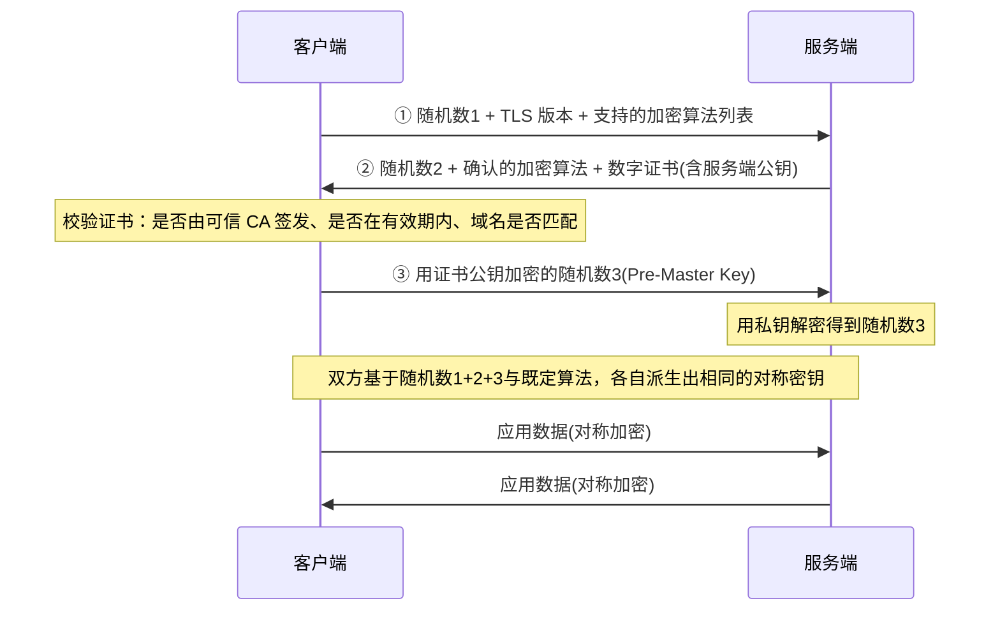

# 6. 后端校招面试直通车: HTTPS 加密认证过程与 TLS 握手原理

## 纲要

- HTTP 与 HTTPS 的定位差异：安全性、复杂度、效率、默认端口
- TLS 协议在协议栈中的位置：介于传输层与应用层之间的安全子层
- 数字证书：互联网通信中的"身份证"，包含哪些关键字段
- TLS 安全参数握手：三次交互如何协商出一把对称密钥
- 关键设计取舍：为什么最终用对称加密通信，而不是全程非对称加密

## HTTP 与 HTTPS 的差异

HTTPS（HyperText Transfer Protocol Secure）不是一种新的应用层协议，它本质上是 **HTTP over TLS**——在 HTTP 与 TCP 之间插入了一层安全协议，URL 中的 `https://` 前缀即表明该资源通过安全通道传输。

| 对比维度 | HTTP | HTTPS |
| --- | --- | --- |
| 安全性 | 明文传输，无身份认证、无完整性校验 | 加密传输，服务端身份可认证，数据带完整性校验 |
| 复杂度 | 协议简单，无密钥协商与证书校验逻辑 | 引入 TLS 握手、证书链校验、密钥派生，复杂度显著更高 |
| 效率 | 无加解密开销，首包延迟低 | 握手阶段有非对称运算开销，握手后为对称加解密，整体吞吐略低 |
| 默认端口 | 80 | 443 |
| 协议栈 | 应用层 → TCP | 应用层 → TLS → TCP |

理解 HTTPS 的关键，是先理解它依赖的 TLS（Transport Layer Security，传输层安全性协议）。

## TLS 协议的定位

TLS 位于传输层与应用层之间，是一个独立的安全子层。它对应用层交付的数据做三件事：

- **机密性**：对传输层数据加密后再交给 TCP 发送，中间人即使抓包也只能看到密文
- **完整性**：通过 MAC / AEAD 校验，数据被篡改可被接收方检测出来
- **身份认证**：借助数字证书与 CA 体系，确认"我正在通信的服务器就是它声称的那个域名所有者"

需要区分两个常被混用的名词：**SSL** 是 TLS 的前身，SSL 3.0 之后标准化为 TLS 1.0。日常口语里的"SSL 握手""SSL 证书"指的就是 TLS 的握手与证书，TLS 1.2 / 1.3 是当前的主流版本。

## 数字证书

互联网上的大部分通信是匿名的：任何人都能发布内容，接收方无从判断对端真实身份。数字证书解决的就是"如何证明你是你"的问题——它由**可信任组织（CA，证书授权机构）**颁发给特定对象，可以理解为线上服务的身份证。

一份 X.509 数字证书通常包含以下字段：

| 字段 | 含义 |
| --- | --- |
| 版本号 | 证书格式版本（如 X.509 v3） |
| 序列号 | CA 为该证书分配的唯一编号 |
| 签名算法 | CA 签发证书时使用的算法，如 SHA256-RSA |
| 有效期 | 起止时间，过期证书客户端会直接拒绝 |
| 主体名称 | 证书持有者的域名 / 组织信息 |
| 主体公开密钥 | **服务端的公钥**，也是 TLS 握手的关键输入 |

证书设计上使用了非对称加密的特性：证书里携带的是服务端公钥，与之配对的私钥由服务端私密保存。HTTPS 握手的本质，就是**用非对称加密算法安全地协商出一把对称密钥**，后续通信全部由这把对称密钥承担。

## TLS 安全参数握手

握手发生在 TCP 三次握手完成之后，在 443 端口建立的连接之上进行。整个过程可以拆成三步交互：

逐段拆解：

- **第一步（Client Hello）**：客户端生成随机数 1，连同自己支持的 TLS 版本与加密算法套件一并发送给服务端。这里的算法套件指的是后续用于通信的对称加密算法（如 AES-GCM）、密钥交换算法与摘要算法。
- **第二步（Server Hello + Certificate）**：服务端生成随机数 2，选定一套双方都支持的算法，并把数字证书与随机数 2 一起回给客户端。这一步结束时，双方都持有随机数 1 和随机数 2，且加密算法已经确定。
- **第三步（密钥交换）**：客户端先向 CA 侧校验证书——是否为可信机构签发、是否在有效期内、证书域名与访问域名是否一致；校验通过后生成随机数 3（即 Pre-Master Key），用证书中取出的服务端公钥加密后发送。服务端用自己的私钥解密拿到随机数 3。

至此，双方都掌握了随机数 1、2、3 与同一套算法，各自在本地派生出会话密钥。因为**密钥是各自在本地计算出来的，从未在网络上传输**，只要私钥不泄露，随机数 3 的密文就无法被破解，最终得到的对称密钥也就不会被窃取。随机数 3 之后的通信全部使用对称加密。

## 为什么不用非对称加密全程通信

这是面试官最爱追问的一问，答案有两层：

- **密钥分发成本高**：非对称加密要求通信双方各自持有对方的公钥。客户端要拿到服务端公钥容易（证书里就有），但要让服务端也拿到每个客户端的公钥，意味着要为海量客户端分发并管理密钥，成本不可接受。
- **运算量差距大**：非对称加解密涉及大数模幂运算，开销比对称加密（AES 等，且有硬件指令加速）高出数个数量级。用它承载全部业务数据，CPU 会成为瓶颈。

因此 TLS 的设计取舍非常清晰：**用非对称加密解决"如何在不安全信道上安全交换密钥"这一个问题，用对称加密解决"如何高效传输海量数据"这一个问题**。

## 面试答题要点

- HTTPS = HTTP + TLS，默认 443 端口，安全性换来了复杂度与性能的开销
- TLS 介于传输层与应用层之间，提供机密性、完整性、身份认证三件事
- 数字证书是可信机构颁发给特定对象的身份凭证，核心内容是服务端的公钥
- 握手三步走：客户端发随机数 1 + 算法列表 → 服务端回随机数 2 + 证书 → 客户端用公钥加密随机数 3 发回，双方各自派生对称密钥
- 最终通信使用对称加密，原因是密钥分发成本与非对称运算开销

