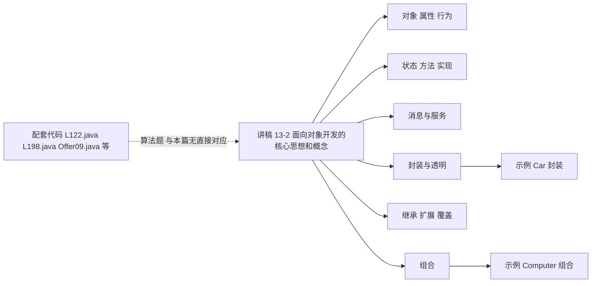

# 72. 后端校招面试直通车: 面向对象开发的核心思想和概念

## 纲要

- 对象：对真实世界实体的抽象，属性描述静态唯一性，行为描述动态唯一性
- 状态：某一时刻对象全部属性取值的快照，是最容易引发逻辑错误的地带
- 方法与实现：建模阶段只定义功能（输入与输出），实现阶段才落地具体动作
- 消息与服务：对象与子系统之间通过消息协作，函数调用是最轻量的消息
- 封装与透明：隐藏属性与实现细节，对外只提供最小且稳定的公共接口
- 继承、扩展与覆盖：都发生在父子类之间，代价是子类打破父类的封装
- 组合：用多个无共性的子系统组装复杂系统，是对继承最有力的补充

## 素材索引



- 讲稿：`work/source/8.mksz540-后端校招面试直通车，提前锁定大厂offer[完结]/第13章 程序设计之设计模式详解/13-2 面向对象开发的核心思想和概念`
- 关联代码：本篇为概念讲解，示例按讲稿逻辑用 Go 补充（原课程算法题代码未随本课程体系分发）。

## 对象：属性与行为

对象是对软件系统所模拟的真实世界的抽象。真实世界里的实体与概念，在程序中都可以抽象为对象：学校系统里的学生、成绩单、教师、课程、教室；生物领域里的肉食动物、草食动物、鸟类。类是对一类实体的抽象描述，通过实例化得到一个个具体的对象。

每个对象都是唯一的，这种唯一性来自它在真实世界中的唯一性。描述这种唯一性的东西分成两类：

- 属性：对象在系统中的数据呈现，描述对象的静态唯一性。学生的学号、年龄、成绩，都是属性。
- 行为：对象对外提供的功能，也就是对象的方法，描述对象的动态唯一性。属性在某一时刻是静止的，行为则让对象"动起来"，通过执行函数来达成某种操作或目的。

## 状态：最容易被忽视的维度

状态指的是对象在某一个瞬间，其全部属性的取值，可以理解为时间轴上某一时刻对象属性的一个镜像。行为会改变状态，所以对象在整个生命周期中状态是持续变化的。

学生认真学习，成绩这个属性就会提升；成绩在不同时间点取值不同，因此成绩可以描述学生的当前状态。

状态在系统中往往起决定性作用，很多逻辑错误都来源于状态的意外变更。建模时对状态敏感的对象要格外小心：

- 明确哪些行为会改变状态，尽量收窄可以修改状态的方法集合
- 状态变更要可观测、可回放，避免隐式修改
- 对共享对象，要同时考虑并发下的状态一致性

## 方法：功能与实现的分离

对象的行为包含两件事：它具备什么功能，以及这个功能具体如何实现。

在建立对象模型的阶段，只关注对象有什么功能，不考虑如何实现。抽象一个接口时，只根据未来实现这个接口的对象需要提供哪些功能来做设计；到了具体实现类，才必须给出能落地的实现，否则对象无法对外提供服务。

落到代码上就是：设计阶段关注方法的输入与输出（签名），实现阶段才决定方法内部要完成哪些动作。这种"先定契约、后填实现"的顺序，是接口思维的核心。

## 消息与服务

软件系统的复杂功能由多个对象协同完成，类与类之间是协作关系。设计时每个类的功能相对单一而固定，但类之间必须通信，这个通信行为就是协作。

- 类与类之间通过消息相互协作
- 子系统之间通过消息相互服务
- 系统对外通过消息提供服务

具体表现上，最轻量的是函数调用，函数的输入与输出就是消息的内容；系统之间则复杂得多，消息队列、RPC 远程调用本质上也都是消息的传递。

从服务的角度理解面向对象，比从语法的角度理解更接近本质：一个类对外提供的是一组可被消息触发的服务。

## 封装与透明

封装指的是隐藏对象的属性与实现细节，把抽象得到的数据和行为结合成一个有机整体，仅对外提供公共接口，并控制属性的读写权限。

以汽车为例：方向盘、车轮、油门、刹车、仪表盘、发动机是属性；驾驶、启动、智能辅助是行为，会改变汽车的状态。把这些属性和方法封装在一起，使用者只需要知道车怎么开，不需要了解油门如何联动发动机。方向盘、油门、刹车的安装与工作过程对使用者完全透明。

良好的封装带来四个直接收益：

| 收益 | 说明 |
| --- | --- |
| 便于正确使用 | 使用者只需理解接口，无法误改内部属性 |
| 降低耦合 | 系统之间保持松耦合，独立性提高 |
| 提高可重用性 | 封装良好的类是一个独立个体，可以整体搬到别的环境 |
| 降低大型系统风险 | 即使整体项目失败，个别子系统仍可复用 |

封装的实践准则：

- 尽可能多地把东西隐藏起来，对外提供尽可能简洁的接口
- 所有属性都隐藏，需要修改属性时通过行为（方法）来改
- 合理使用 `public` / `protected` / `private`
- 遵循最小用户窗口原则：使用者知道得越少越好

## 继承、扩展与覆盖

继承存在于父类与子类之间。子类继承父类的属性与方法，同时扩展父类没有的功能，这就是扩展；当父类的某个函数实现无法满足子类需求时，子类可以重写这个函数的实现，这就是覆盖。扩展与覆盖都发生在继承体系内部。

继承并不是万能的。频繁使用继承容易形成很长的继承链，带来理解成本、调试成本和扩展成本，因此非必要场景优先考虑组合。

## 组合：继承的补充

组合是用多个简单子系统组装成大型复杂系统的手段。计算机由键盘、主机、显示器、鼠标组成，主机又由 CPU、内存、硬盘、网卡组成，这就是组合关系。

在这个场景里使用继承显然不合适：键盘、主机、显示器、鼠标之间几乎没有共性，抽不出有意义的父类。判断标准很朴素——

- 多个部分之间没有共性时，用组合而不是继承
- 系统需要扩展功能、而继承树已经过深时，优先用组合
- 能用"包含"描述的关系（汽车包含发动机），比能用"是一种"描述的关系（狮子是一种动物）更适合组合

## 面试要点速记

| 概念 | 一句话要点 |
| --- | --- |
| 对象 | 真实世界实体的抽象，属性是静态唯一性，行为是动态唯一性 |
| 状态 | 某时刻全部属性取值的镜像，随行为变化，是 Bug 高发区 |
| 消息 | 对象协作的载体，函数调用、消息队列、RPC 都是消息传递 |
| 封装 | 隐藏属性与细节，只暴露最小公共接口，控制读写权限 |
| 继承 | 复用与扩展，但会打破父类封装 |
| 组合 | 无共性部件组装的首选手段，避免继承链过深 |

## Demo 示例

### 运行说明

```bash
mkdir -p oop-demo && cd oop-demo
go mod init oop-demo
# 将下方代码保存为 main.go
go run main.go
```

### 代码

```go
package main

import "fmt"

// Car 封装了汽车的内部属性，对外只暴露行为方法
type Car struct {
	steeringAngle int // 方向盘角度
	throttle      int // 油门开度
	brakeForce    int // 刹车力度
	speed         int // 状态：由行为持续改变
}

// NewCar 构造一辆油门开度 50、刹车力度 30 的汽车
func NewCar() *Car {
	return &Car{throttle: 50, brakeForce: 30}
}

// Turn 改变方向盘角度
func (c *Car) Turn(angle int) {
	c.steeringAngle += angle
}

// Accelerate 行为改变状态：速度随油门开度上升
func (c *Car) Accelerate() {
	c.speed += c.throttle / 10
}

// Brake 行为改变状态：速度下降且不小于 0
func (c *Car) Brake() {
	c.speed -= c.brakeForce
	if c.speed < 0 {
		c.speed = 0
	}
}

// Speed 只读暴露状态，调用方无法直接修改内部字段
func (c *Car) Speed() int {
	return c.speed
}

// ---- 组合：多个无共性的部件组装成复杂系统 ----

type Keyboard struct{ Layout string }
type Mouse struct{ DPI int }
type Monitor struct{ Size int }
type Host struct {
	CPU    string
	Memory string
}

// Computer 由彼此没有共性的部件组合而成，不适用继承
type Computer struct {
	Keyboard Keyboard
	Mouse    Mouse
	Monitor  Monitor
	Host     Host
}

// Boot 组合对象的服务由各部件协同提供
func (c Computer) Boot() string {
	return fmt.Sprintf("%s / %s 主机启动，接入 %d 寸显示器、%d DPI 鼠标、%s 键盘",
		c.Host.CPU, c.Host.Memory, c.Monitor.Size, c.Mouse.DPI, c.Keyboard.Layout)
}

func main() {
	car := NewCar()
	car.Turn(15)
	car.Accelerate()
	car.Accelerate()
	fmt.Println("加速后车速:", car.Speed())
	car.Brake()
	fmt.Println("刹车后车速:", car.Speed())

	pc := Computer{
		Keyboard: Keyboard{Layout: "US"},
		Mouse:    Mouse{DPI: 1600},
		Monitor:  Monitor{Size: 27},
		Host:     Host{CPU: "8C16T", Memory: "32G"},
	}
	fmt.Println(pc.Boot())
}
```

预期输出：

```text
加速后车速: 10
刹车后车速: 0
8C16T / 32G 主机启动，接入 27 寸显示器、1600 DPI 鼠标、US 键盘
```

### 代码说明

- `Car` 的四个字段全部小写，包外不可见，外部只能通过 `Turn`、`Accelerate`、`Brake` 三个行为改变状态，只能通过 `Speed` 读取状态，这正是"把所有属性隐藏起来、通过行为修改属性"。
- `speed` 是状态：每次 `Accelerate` / `Brake` 都改变它，且 `Brake` 内部做了下限保护，避免状态被改成非法值。
- `Computer` 完全由 `Keyboard`、`Mouse`、`Monitor`、`Host` 组合而成，这些部件彼此没有共性，抽不出公共父类，用组合才符合语义。`Boot` 这一服务由多个部件协同提供，对应"消息与服务"。

### 技术点总结

- 封装 = 隐藏字段 + 暴露行为 + 控制状态变更入口
- 状态是属性的时间切片，行为是状态变更的唯一合法途径
- 组合适用于"包含"关系；继承适用于"是一种"关系
- 优先组合、后考虑继承，可以有效避免继承链过深

