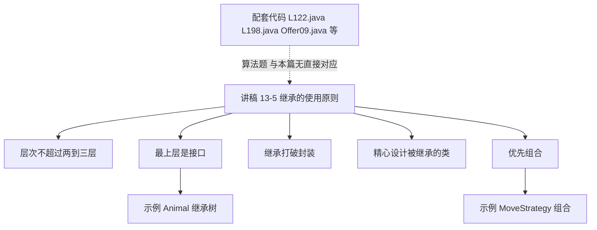

# 75. 后端校招面试直通车: 继承的使用原则与组合优先

## 纲要

- 继承的价值：提高代码可重用性与系统可扩展性；使用不当则适得其反
- 原则一：继承树层次控制在两到三层
- 原则二：继承树最上层应该是接口，而不是抽象类或具体类
- 原则三：继承会打破封装，这是它的根本缺陷
- 原则四：精心设计用于被继承的类，尽量通用、避免特有成员
- 原则五：非必要场景优先使用组合
- 判断标准：上下层之间是否存在"包含"关系

## 素材索引



- 讲稿：`work/source/8.mksz540-后端校招面试直通车，提前锁定大厂offer[完结]/第13章 程序设计之设计模式详解/13-5 面向对象编程——继承的使用原则`
- 关联代码：本篇示例根据讲稿逻辑补充（原课程算法题代码未随本课程体系分发）。

## 继承的两面性

继承是面向对象编程中提高代码可重用性和系统可扩展性的有效手段，但如果使用时不注意规范，反而会削弱系统的可扩展性与可维护性。下面五条原则是使用继承时最常被考察的约束。

## 继承树层次不要太深

继承树的层次一般保持在两到三层。层次过深会带来四类问题：

- 对象结构模型复杂，难以理解
- 调试、重构、排查问题时的难度成倍增加
- 子类继承来的属性很难定位到底定义在哪一层
- 方法覆盖与方法重载过多时，难以确定原始实现位于哪个类

更深一层的代价是扩展性下降：在继承树上新增一个类时，层次越多需要创建和牵连的类就越多。

## 最上层应该是接口

继承树的最上层应该是抽象层接口，而不是抽象类，更不应该是具体类。以动物为例，"动物"本身必须是抽象概念，不能有任何实现；一旦它有实现，就不符合最上层的要求。

这样做的收益是松耦合：当系统使用一棵继承树上的类时，直接引用上层的抽象模型即可。描述"进食"这个动作，不需要针对狮子、老虎、兔子、山羊各写一个调用，统一用"动物进食"表达即可——这就是向上转型带来的系统间松耦合，接口可以作为整棵继承树对外提供服务的统一入口。

## 继承打破了封装

封装指的是隐藏对象的属性与实现细节，仅对外提供公共接口。而继承恰恰做不到这一点：子类在继承父类时，必然已经使用或操作了父类的属性和行为，父类的属性、函数与实现细节就无法对子类完全透明。子类打破了父类本来的封装，这是继承最大的缺点。

由此得到的推论是：在非必要的场景下，尽可能考虑组合而不是继承。

## 精心设计被继承的类

如果一个类或接口注定要被继承，设计时应尽可能考虑通用性：

- 避免加入只有部分子类才用得到的特有方法
- 避免加入子类用不到、父类却在用的属性或行为
- 让继承树自上而下由抽象走向具体

以动物这棵树为例，一个好的设计是：最抽象的动物 → 稍具体的食肉动物、食草动物、杂食动物 → 具体的狮子、老虎、兔子、山羊。同时要注意类之间的关系应该是包含与被包含的关系：动物包含食肉动物、食草动物、杂食动物，食肉动物包含狮子和老虎。如果继承关系里找不到包含关系，就说明这个继承设计不友好，更应该改用组合。

## 优先使用组合

组合是对继承的强有力补充。当系统由多个部分组成、各部分之间没有共性时，或者系统需要扩展功能但继承树已经过深时，优先考虑组合。

组合的典型形态是把"可变化的行为"抽成独立对象，再作为成员注入宿主类：行为变化时替换成员即可，不必新增子类，也就不会让继承树继续加深。

## Demo 示例

### 运行说明

```bash
mkdir -p inherit-rule-demo && cd inherit-rule-demo
# 将代码保存为 Main.java
javac Main.java && java Main
```

### 代码

```java
import java.util.ArrayList;
import java.util.List;

// 继承树最上层：接口，不携带任何实现
interface Animal {
    void eat();
}

// 中间层：抽象类，下沉共性实现，层次控制在两到三层
abstract class Carnivore implements Animal {
    @Override
    public void eat() {
        System.out.println(name() + " 进食肉类");
    }

    protected abstract String name();
}

class Lion extends Carnivore {
    @Override
    protected String name() {
        return "狮子";
    }
}

class Tiger extends Carnivore {
    @Override
    protected String name() {
        return "老虎";
    }
}

// ---- 组合：把可变行为抽成独立对象，避免继续加深继承树 ----

interface MoveStrategy {
    void move();
}

class RunMove implements MoveStrategy {
    @Override
    public void move() {
        System.out.println("用四条腿奔跑");
    }
}

class FlyMove implements MoveStrategy {
    @Override
    public void move() {
        System.out.println("用机翼飞行");
    }
}

// 机器狗不是任何一种动物，用组合获得进食之外的运动能力
class RobotDog implements Animal {
    private final MoveStrategy moveStrategy;

    RobotDog(MoveStrategy moveStrategy) {
        this.moveStrategy = moveStrategy;
    }

    @Override
    public void eat() {
        System.out.println("机器狗补充电能");
    }

    public void move() {
        moveStrategy.move();
    }
}

public class Main {
    public static void main(String[] args) {
        // 面向上层抽象编程：调用方只依赖 Animal
        List<Animal> animals = new ArrayList<>();
        animals.add(new Lion());
        animals.add(new Tiger());
        animals.add(new RobotDog(new RunMove()));
        for (Animal animal : animals) {
            animal.eat();
        }

        System.out.println("-----");

        // 替换行为只需换一个策略对象，不需要新增子类
        RobotDog flyingDog = new RobotDog(new FlyMove());
        flyingDog.eat();
        flyingDog.move();
    }
}
```

预期输出：

```text
狮子 进食肉类
老虎 进食肉类
机器狗补充电能
-----
机器狗补充电能
用机翼飞行
```

### 代码说明

- `Animal` 是继承树的最上层，只有契约没有实现；`Carnivore` 是中间层抽象类，下沉 `eat` 的共性实现；`Lion`、`Tiger` 只提供 `name`，整棵树三层，符合"两到三层"的约束。
- 调用方只依赖 `List<Animal>`，新增动物时无需改动遍历逻辑，这就是引用上层模型带来的松耦合。
- `RobotDog` 与动物之间没有"是一种"关系，无法塞进动物继承树；通过组合 `MoveStrategy`，它在不新增子类的前提下获得了奔跑与飞行两种行为。
- 若改用继承实现飞行能力，就需要再派生出"会飞的机器狗"等类，继承树层次与类数量都会膨胀。

### Go 中的对应写法

Go 没有继承，天然就是组合优先，同样的结构可以写得更短：

```go
package main

import "fmt"

type Animal interface{ Eat() }

type Carnivore struct{ Name string }

func (c Carnivore) Eat() { fmt.Println(c.Name, "进食肉类") }

type MoveStrategy interface{ Move() }

type FlyMove struct{}

func (FlyMove) Move() { fmt.Println("用机翼飞行") }

type RobotDog struct {
	Carnivore
	MoveStrategy
}

func (r RobotDog) Eat() { fmt.Println("机器狗补充电能") }

func main() {
	animals := []Animal{
		Carnivore{Name: "狮子"},
		Carnivore{Name: "老虎"},
		RobotDog{Carnivore: Carnivore{Name: "机器狗"}, MoveStrategy: FlyMove{}},
	}
	for _, a := range animals {
		a.Eat()
	}
}
```

嵌入结构体完成了共性下沉，嵌入接口完成了行为注入，两者都是组合。

## 面试要点速记

| 问题 | 答题要点 |
| --- | --- |
| 继承树为什么控制在两到三层 | 层次过深导致结构难理解、属性与方法定位困难、调试重构成本高、扩展时新增类更多 |
| 最上层为什么用接口而不是抽象类 | 最上层必须是纯抽象概念；引用上层模型可以降低系统耦合，并作为整棵树对外的统一入口 |
| 继承最大的缺点 | 打破封装：子类必须依赖父类的属性与实现细节，父类无法对子类保持透明 |
| 什么时候用组合 | 各部分没有共性、没有"包含"关系、继承树已过深、行为需要运行期替换 |
| 如何判断继承设计是否良好 | 上下层之间是否存在"包含"关系，自顶向下是否由抽象走向具体 |

