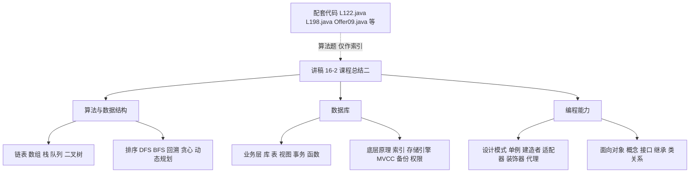

# 77. 后端校招面试直通车: 算法数据结构、数据库与编程能力知识地图

## 纲要

- 数据结构：链表（单向、双向、环形）、数组与栈队列、二叉树遍历
- 算法：排序、DFS、BFS、回溯、贪心、动态规划
- 数据库：业务层面（库、表、视图、事务、函数）与底层原理（索引、存储引擎、MVCC、备份恢复、权限）
- 编程能力：常见设计模式与面向对象编程，含类之间的五种关系
- 每种结构与算法都对应到具体题目，用于自查

## 素材索引

- 讲稿：`work/source/8.mksz540-后端校招面试直通车，提前锁定大厂offer[完结]/第16章 面试复盘-预祝大家斩获offer拿高薪/16-2 课程总结（二）`
- 关联代码：本篇只做知识地图梳理，不展开代码实现。

## 算法与数据结构

### 数据结构

| 结构 | 关键内容 | 对应题目 |
| --- | --- | --- |
| 单向链表 | 头结点与虚拟头结点、插入删除的指针操作、快慢指针 | 反转链表、链表判环、合并有序链表 |
| 双向链表 | 前驱指针维护、删除节点 O(1) | LRU 缓存的双向链表实现 |
| 环形链表 | 首尾相接、判环与环入口 | 环形链表检测 |
| 数组 | 随机访问、连续内存、扩容与拷贝 | 蛇形数组、三数之和 |
| 栈 | 后进先出、单调栈 | 有效的括号、用栈实现队列 |
| 队列 | 先进先出、循环队列、双端队列 | 用栈实现队列、滑动窗口最大值 |
| 二叉树 | 前序、中序、后序遍历的递归与迭代写法，层序 BFS | 二叉树遍历系列题 |

复杂度分析是所有题目都要先回答的前置问题：时间复杂度看最坏情况下的增长阶，空间复杂度包含递归栈与辅助结构。

### 算法

| 算法 | 关键内容 | 对应题目 |
| --- | --- | --- |
| 排序 | 快排、归并、堆排的复杂度与稳定性，以及工程中的混合排序 | 手写快排、归并 |
| DFS | 递归与回溯栈、访问标记、剪枝 | 岛屿数量、路径搜索 |
| BFS | 队列、层次遍历、最短路径 | 层序遍历、最短路径 |
| 回溯 | 选择、约束、结束条件三要素，标准模板 | 全排列、子集、N 皇后 |
| 贪心 | 贪心选择性质与最优子结构，需要证明 | 区间调度、零钱兑换的贪心版本 |
| 动态规划 | 状态定义、转移方程、初始值与边界、空间优化 | 背包、最长子序列、编辑距离 |

## 数据库

数据库专题分成业务层面与底层原理两个层面。

### 业务层面

| 知识点 | 关键内容 | 对应面试题 |
| --- | --- | --- |
| 数据库设计 | 库的设计、创建与维护，字符集与排序规则 | 数据库的设计、创建与维护 |
| 数据表设计 | 表的创建与维护、字段类型、范式、外键与约束 | 数据表的设计、创建与维护 |
| 字段属性 | `CHAR`、`VARCHAR`、`TEXT` 的差异与选取；JSON 类型 | `CHAR`、`VARCHAR`、`TEXT` 有什么区别 |
| 数值精度 | 金融数据用 `DECIMAL` 而非浮点，避免精度丢失 | 金融数据如何保证安全 |
| 视图 | 虚拟表、简化查询与权限隔离，更新限制 | 视图的作用与限制 |
| 事务 | 事务的使用、存储引擎差异、隔离级别 | 事务的应用场景与存储引擎 |
| ACID | 原子性、一致性、隔离性、持久性各自的实现依赖 | 请简述数据库的 ACID 属性 |
| 隔离级别 | 读未提交、读已提交、可重复读、串行化 | 脏读、不可重复读、幻读分别出现在什么场景 |

### 底层原理

| 知识点 | 关键内容 | 对应面试题 |
| --- | --- | --- |
| 索引结构 | 为什么用 B+ 树：树高低、叶子链表、范围查询友好 | 为什么使用 B+ 树做索引 |
| B 树与 B+ 树 | 数据是否存储在非叶子节点、叶子是否相连 | B 树与 B+ 树的区别 |
| 聚簇索引 | 聚簇索引与非聚簇索引的叶子内容差异、回表 | 请简述什么是聚簇索引 |
| 联合索引 | 最左前缀原则、索引下推、覆盖索引 | 请简述什么是联合索引 |
| MVCC | 并发控制粒度、undo log 版本链、Read View | MVCC 是怎么实现的 |
| 日志与恢复 | redo log、undo log、binlog 的作用与两阶段提交，基于日志的数据恢复 | 常见日志以及如何恢复数据 |
| 权限维护 | 权限粒度、用户与角色、授权与回收 | MySQL 权限维护 |

## 编程能力

### 设计模式

学习方式是"是什么、为什么、怎么实现"三步。重点掌握的五个模式：

| 模式 | 意图 | 典型场景 |
| --- | --- | --- |
| 单例模式 | 保证一个类只有一个实例 | 配置中心、连接池 |
| 建造者模式 | 分步骤构造复杂对象 | 多可选参数的构造函数 |
| 适配器模式 | 转换接口使不兼容的类协作 | 接入第三方 SDK |
| 装饰器模式 | 动态叠加职责 | IO 流、RPC 拦截器链 |
| 代理模式 | 控制访问与增强 | 事务代理、RPC 客户端桩 |

此外还需要掌握设计模式的七大原则：单一职责、开闭原则、里氏替换、依赖倒置、接口隔离、迪米特法则、合成复用原则。其中合成复用原则正是"优先组合而不是继承"的理论出处。

### 面向对象编程

| 知识点 | 关键内容 |
| --- | --- |
| 核心概念 | 对象、属性、行为、状态、方法与实现、消息与服务、封装与透明、继承、扩展与覆盖、组合 |
| 接口与实现 | 用抽象思维定义接口，先定契约再填实现 |
| 接口特征 | 成员变量默认 `public static final`，方法默认 `public abstract`，不能实例化，可 `extends` 多个接口 |
| 抽象类与接口 | 抽象类是中间层，承载共性实现；接口是最高层契约 |
| 继承原则 | 层次两到三层，最上层是接口，继承打破封装，优先组合 |
| 重载与覆盖 | 重载看参数且编译期决定，覆盖要求签名与返回类型一致且运行期决定 |
| `this` 与 `super` | 显式修正默认作用域，分别访问本类与父类成员 |
| 类的关系 | 关联、依赖、聚合（聚集）、实现、泛化（继承） |

## 复盘建议

- 算法按模板复习：每种算法背一份可复现的模板代码，再套三道变式题
- 数据库分两遍：业务层面背结论（类型选择、隔离级别现象），底层原理画结构（B+ 树、undo log 版本链）
- 设计模式结合源码记忆：把自己项目里用到的模式列出来，比背 UML 更有效
- 面向对象的问题多用对比表回答：重载 vs 覆盖、接口 vs 抽象类、继承 vs 组合

