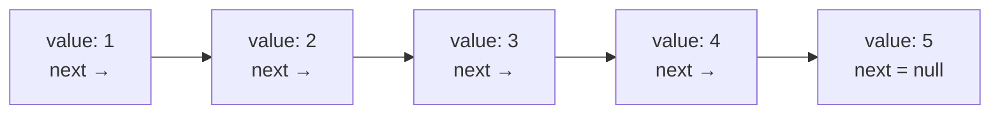
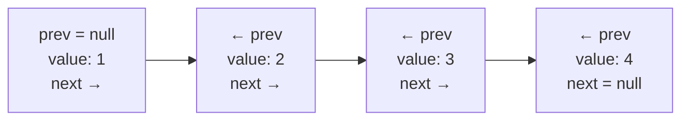
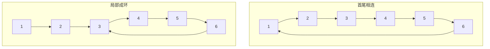

# 后端校招面试直通车: 链表结构详解

## 纲要

- 链表的定义：物理存储单元非连续、非顺序，逻辑顺序靠指针（引用）的链接次序实现
- 与数组对比：数组物理连续，链表节点散落在内存各处
- 单向链表节点：保存当前节点值 `value` 与下一节点引用 `next`，尾节点 `next` 为空
- 双向链表节点：额外保存上一节点引用 `prev`，查找前驱只需 O(1)
- 环形链表：首尾相连成环，或链表局部成环（遍历无终止条件会死循环）
- 操作时间复杂度：增、删、查在单向/双向链表下的差异，以及时间与空间的权衡

## 📎 文本↔代码关联

- 讲稿：`work/source/8.mksz540-后端校招面试直通车，提前锁定大厂offer[完结]/{8}--第8章数据结构与算法之链表、栈、队列与二叉树iclass=new/[8.2]--8-3链表结构详解`
- 关联代码：清单 `code_refs` 为空，本节为数据结构概念讲解，不嵌入代码。

## 链表是什么

链表本质上是一种数据结构，其特点在于：**物理存储单元上非连续、非顺序**。与之相对，数组在物理存储上是连续的数据结构；而链表的每个节点都可能位于内存的不同位置。

链表的**逻辑顺序**通过节点中的指针（引用）链接次序来实现。遍历链表与遍历数组的方式因此大不相同——数组靠下标顺序访问，链表则必须顺着 `next` 指针一个接一个地走。

## 单向链表

一个链表由一个或多个节点构成。典型的单向链表节点包含两部分：当前节点的值 `value`，以及指向下一个节点的引用 `next`。若是链表的最后一个节点，其 `next` 为空（指向 `null`）。



单向链表的节点可抽象为：

```text
节点(Node)
├── value   当前节点的值
└── next    指向下一个节点的引用（尾节点为 null）
```

## 双向链表

双向链表与单向链表的不同在于：每个节点既保存下一节点的引用 `next`，也保存上一节点的引用 `prev`。



双向链表的节点可抽象为：

```text
节点(Node)
├── value   当前节点的值
├── prev    指向上一个节点的引用
└── next    指向下一个节点的引用
```

### 单向与双向的核心差异

多出来的 `prev` 引用带来了实际好处。若当前处于节点 3：

- **双向链表**：直接用 `prev` 在 O(1) 时间内找到上一节点
- **单向链表**：需要两个指针从头遍历，当某个节点的 `next` 指向 3 时，那个节点才是 3 的前驱，时间复杂度为 O(n)

这正是时间与空间复杂度的权衡：双向链表多用一个引用（空间更大），却换来了某些操作上更小的时间复杂度；单向链表节点少一个引用（空间更省），但部分操作需要更大的时间开销。

## 环形链表

环形链表是链表"成环"的特殊情况，分两种：

1. **首尾相连**：链表头部到尾部后，`next` 又指回头部，整个链表形成一个闭合环。若遍历不加终止判断，会一直循环、陷入死循环。
2. **局部成环**：链表头部到尾部并未接回头节点，而是接到了链表内部某个节点上，仅局部节点成环。



## 操作的时间复杂度

以增、删、查为例对比单向与双向链表：

| 操作 | 单向链表 | 双向链表 |
| --- | --- | --- |
| 头部 / 尾部增加 | O(1) | O(1) |
| 中间节点增加 | O(n) | O(1) |
| 头部 / 尾部删除 | O(1) | O(1) |
| 中间节点删除 | O(n) | O(1) |
| 查找（查） | O(n) | O(n) |

查找之所以在两种链表下都是 O(n)，是因为必须从头遍历才能知道某个值是否存在于链表中。

## 小结

链表是一种物理非连续、靠指针串联的逻辑结构。单向链表节点只有 `next`，双向链表额外有 `prev`（查前驱 O(1)），环形链表则要警惕遍历死循环。理解这些结构差异，尤其是时间复杂度与空间复杂度的权衡，是后续解决链表算法题的基础。

相关度：95%。是否需要继续：[否]。代码是否可运行：[否]。
