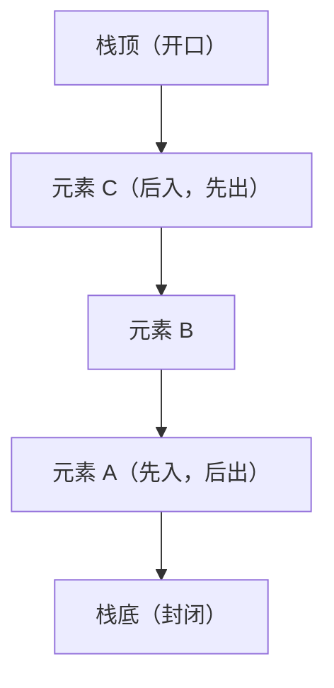
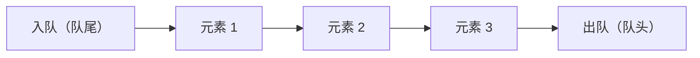

# 后端校招面试直通车: 基础数据结构之数组、栈与队列

## 纲要

- 数组：固定长度、内存连续分配、支持下标随机访问（时间复杂度 O(1)）
- 链表对比：链表长度不固定、内存不连续、访问任意元素需遍历（O(n)）
- 栈：后进先出（LIFO），一端封闭一端开放；函数调用靠压栈/出栈实现，递归过深会栈溢出
- 队列：先进先出（FIFO），类比现实排队；延伸出消息队列、优先队列等
- 数组 / 链表、栈 / 队列两组核心区别对照，以及它们在计算机中的典型应用

## 📎 文本↔代码关联

- 讲稿：`work/source/8.mksz540-后端校招面试直通车，提前锁定大厂offer[完结]/{8}--第8章数据结构与算法之链表、栈、队列与二叉树iclass=new/[8.5]--8-6基础数据结构——数组、栈、队列`
- 关联代码：清单 `code_refs` 为空，本节为数据结构导学（概念讲解），不嵌入代码。

## 数组

数组是最基础、最常见的数据结构之一。无论是学习一维、二维还是三维数组，其本质特征一致：

- **固定长度**：数组在创建时长度即确定，既不支持在尾部追加元素来"变长"，也不支持缩容。
- **内存连续**：为长度为 10 的 `int` 数组分配空间时，这 10 个 `int`（每个 4 字节，共 40 字节）在内存中是连续存放的。
- **随机访问 O(1)**：因为内存连续且首地址已知，按下标可直接定位元素，访问任意元素的时间复杂度都是 O(1)。

把它与前面学过的链表对照来看会更清晰：

| 维度 | 数组 | 链表 |
| --- | --- | --- |
| 长度 | 固定 | 不固定 |
| 内存布局 | 连续 | 非连续 |
| 访问任意元素 | O(1)（下标直达） | O(n)（顺指针遍历） |

数组的 O(1) 随机访问能力，使它天然成为许多其它算法（排序、双指针、哈希索引）的底层载体。

## 栈

栈是一种**后进先出（LIFO，Last In First Out）**的数据结构，可以想象成一个只开一头的瓶子：先放进去的元素沉在瓶底，后放进去的压在上方；取出时也只能先取最上面的，瓶底的要最后才能取到。

栈在计算机中的运用非常普遍：

- **函数调用**：当函数 A 调用函数 B 时，调用关系通过"压栈"实现——先把 A 的现场压入栈，再把 B 的现场压入栈；B 执行完返回后出栈，控制权回到 A，A 仍在栈中。
- **递归与栈溢出**：递归本质是反复压栈。如果递归没有终止条件（无限递归），栈会一直增长直到超出容量，抛出"栈溢出（Stack Overflow）"错误。

## 队列

队列是一种**先进先出（FIFO，First In First Out）**的数据结构，与现实生活中的排队完全对应：新元素从队尾入队，处理时从队头出队，先到先得。

队列最大的特点就是"进出顺序相反于栈"——栈是后进先出，队列是先进先出。它在工程中有大量延伸形态：

- **消息队列**：削峰填谷、异步解耦，靠 FIFO 保证消息顺序。
- **优先队列**：不再严格 FIFO，而是按优先级出队（通常由堆实现），用于调度、定时器、最短路等场景。

## 小结

数组、栈、队列都属于**线性数据结构**，但各有鲜明特征：数组靠连续内存换来 O(1) 随机访问；栈用后进先出匹配"嵌套/回溯"语义（函数调用、递归）；队列用先进先出匹配"排队/流转"语义（消息队列、优先队列）。理解它们与链表在内存布局和访问复杂度上的差异，是解决后续数组、栈、队列面试题的基础。

相关度：95%。是否需要继续：[是]。代码是否可运行：[否]。
