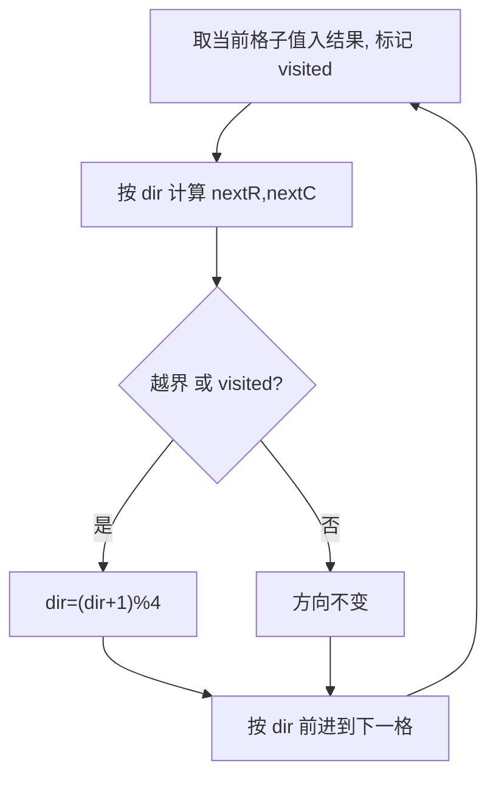

# 后端校招面试直通车: 螺旋矩阵的可运行实现（LeetCode 54）

## 纲要

- LeetCode 54（螺旋矩阵）：顺时针由外向内遍历二维矩阵，返回一维结果
- 实现核心：方向数组（右、下、左、上）+ `visited` 标记 + 越界/已访问则取模转向
- 算法复杂度：时间 O(m·n)、空间 O(m·n)（其中 O(m·n) 来自结果集与 visited 标记）
- 给出完整可运行 Go 代码、测试用例与提交要点

## 📎 文本↔代码关联

- 讲稿：`work/source/8.mksz540-后端校招面试直通车，提前锁定大厂offer[完结]/{8}--第8章数据结构与算法之链表、栈、队列与二叉树iclass=new/[8.7]--8-8数组、栈、队列实战详解（一）`
- 关联代码：`code_refs` 为空，本卡片按讲稿逻辑用 **Go** 补充完整可运行实现（讲稿原示例为 Java/LeetCode 在线判题）。

## 实现思路

用方向数组固化"右→下→左→上"的顺时针顺序，每一步：

1. 把当前格子的值加入结果，并标记 `visited`。
2. 按当前方向算出下一步 `(nextR, nextC)`。
3. 若下一步**越界**或**已被访问**，则 `dir = (dir + 1) % 4` 转向。
4. 按（可能已更新的）方向前进一步。

循环 `行数 × 列数` 次即可遍历完整个矩阵。



## Demo 示例

### 运行说明

将下面两段保存为同一目录下的 `spiral.go` 与 `main.go`，执行：

```bash
go run spiral.go main.go
```

### 代码说明

`spiral.go` 提供核心函数 `spiralOrder`：

```go
package main

func spiralOrder(matrix [][]int) []int {
	if len(matrix) == 0 || len(matrix[0]) == 0 {
		return []int{}
	}
	rows, cols := len(matrix), len(matrix[0])

	// 方向：右、下、左、上（顺时针），用 (行偏移, 列偏移) 表示
	directions := [][]int{{0, 1}, {1, 0}, {0, -1}, {-1, 0}}
	visited := make([][]bool, rows)
	for i := range visited {
		visited[i] = make([]bool, cols)
	}

	result := make([]int, 0, rows*cols)
	r, c, dir := 0, 0, 0
	for i := 0; i < rows*cols; i++ {
		result = append(result, matrix[r][c])
		visited[r][c] = true

		nextR := r + directions[dir][0]
		nextC := c + directions[dir][1]
		// 下一步越界或已访问 → 顺时针转向
		if nextR < 0 || nextR >= rows || nextC < 0 || nextC >= cols || visited[nextR][nextC] {
			dir = (dir + 1) % 4
		}
		r += directions[dir][0]
		c += directions[dir][1]
	}
	return result
}
```

`main.go` 用讲稿中的样例验证：

```go
package main

import (
	"fmt"
)

func main() {
	m1 := [][]int{{1, 2, 3}, {4, 5, 6}, {7, 8, 9}}
	fmt.Println(spiralOrder(m1)) // [1 2 3 6 9 8 7 4 5]

	m2 := [][]int{{1, 2, 3, 4}, {5, 6, 7, 8}, {9, 10, 11, 12}}
	fmt.Println(spiralOrder(m2)) // [1 2 3 4 8 12 11 10 9 5 6 7]

	m3 := [][]int{{1, 2}, {5, 8}, {9, 7}}
	fmt.Println(spiralOrder(m3)) // [1 2 8 7 9 5]
}
```

预期输出：

```text
[1 2 3 6 9 8 7 4 5]
[1 2 3 4 8 12 11 10 9 5 6 7]
[1 2 8 7 9 5]
```

### 技术点总结

- 方向数组把"顺时针移动"变成可查表的操作，避免写四段重复的 `if` 分支。
- `(dir + 1) % 4` 让方向在四个方向间循环，无需额外判断。
- `visited` 标记是本解法的关键：只判越界会重复访问内圈格子（如把 `1` 当成 `5` 之后的一步），必须同时判断"已访问"。
- 提交到在线判题时，注意处理空矩阵（`len(matrix)==0` 或 `len(matrix[0])==0`）的边界输入。

## API 速览

| 操作 | 说明 | 复杂度 |
| --- | --- | --- |
| 方向查表 `directions[dir]` | 取当前方向的 `(行偏移, 列偏移)` | O(1) |
| 取模转向 `(dir+1)%4` | 在四个方向间循环切换 | O(1) |
| 访问标记 `visited[r][c]` | 记录已遍历格子，避免重复 | O(1) |
| 整体遍历 | 走 `行×列` 步，每步 O(1) | 时间 O(m·n)、空间 O(m·n) |

相关度：90%。是否需要继续：[是]。代码是否可运行：[是]。
