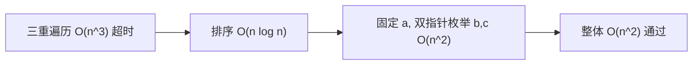
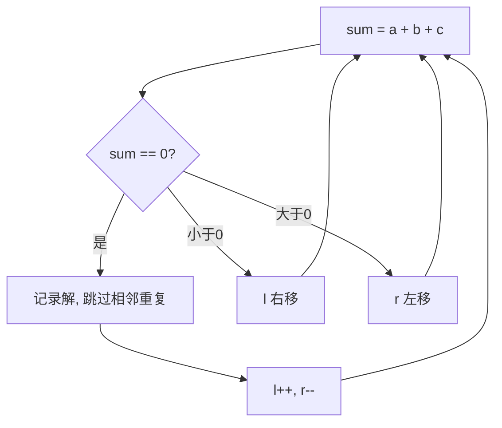

# 后端校招面试直通车: 三数之和之排序加双指针（LeetCode 15）

## 纲要

- LeetCode 15（三数之和）：在数组中找出所有 `a + b + c = 0` 且不重复的三元组
- 朴素解法：三重遍历，时间 O(n³)，在线判题会超时
- 优化解法：**先排序，再用双指针**，时间降到 O(n²)
- 排序的作用：保证双指针可以确定性地"左移/右移"逼近目标，并支持提前剪枝
- 去重：对 `a`、`b`（左指针）做相邻相等跳过，避免重复解
- 给出完整可运行 Go 代码、示例推演与复杂度

## 📎 文本↔代码关联

- 讲稿：`work/source/8.mksz540-后端校招面试直通车，提前锁定大厂offer[完结]/{8}--第8章数据结构与算法之链表、栈、队列与二叉树iclass=new/[8.8]--8-9数组、栈、队列实战详解（二）`
- 关联代码：`code_refs` 为空，本卡片按讲稿逻辑用 **Go** 补充完整可运行实现（讲稿原示例为 Java/LeetCode 在线判题）。

## 为什么不能三重遍历

最朴素的做法是三层 `for` 枚举 `a、b、c` 的所有组合，把和为 0 的收集起来再去重。时间复杂度是 O(n³)，在在线判题里会被判超时，所以必须优化。



## 排序加双指针

算法步骤：

1. **特判**：数组长度小于 3 直接返回；若已排序且 `nums[i] > 0`，后面不可能出现三数和为 0，直接结束。
2. **排序**：对数组升序排序。
3. **遍历 a**：外层 `i` 枚举第一个数 `a = nums[i]`，`l = i+1` 指向最小值，`r = n-1` 指向最大值。
4. **双指针移动**：`sum = nums[i] + nums[l] + nums[r]`
   - `sum == 0`：记录解；
   - `sum < 0`：`l` 右移（需要更大的数）；
   - `sum > 0`：`r` 左移（需要更小的数）。
5. **去重**：`a` 与前一个相等则跳过；找到一个解后，`l`、`r` 各自向内跳过相邻相等元素，避免重复三元组。

排序之所以关键：它让 `l` 必须右移、`r` 必须左移成为确定规则，且支持 `nums[i] > 0` 的提前剪枝；没有排序，双指针的"逼近"就无从谈起。



## Demo 示例

### 运行说明

将 `threesum.go` 与 `main.go` 放在同一目录，执行 `go run threesum.go main.go`。

### 代码说明

```go
package main

import (
	"sort"
)

func threeSum(nums []int) [][]int {
	sort.Ints(nums)
	n := len(nums)
	var result [][]int

	for i := 0; i < n; i++ {
		// 已排序，当前数大于 0 则后面不可能凑出 0
		if nums[i] > 0 {
			break
		}
		// a 去重
		if i > 0 && nums[i] == nums[i-1] {
			continue
		}
		l, r := i+1, n-1
		for l < r {
			sum := nums[i] + nums[l] + nums[r]
			if sum == 0 {
				result = append(result, []int{nums[i], nums[l], nums[r]})
				// b、c 去重：跳过相邻相等元素
				for l < r && nums[l] == nums[l+1] {
					l++
				}
				for l < r && nums[r] == nums[r-1] {
					r--
				}
				l++
				r--
			} else if sum < 0 {
				l++
			} else {
				r--
			}
		}
	}
	return result
}
```

`main.go`：

```go
package main

import "fmt"

func main() {
	fmt.Println(threeSum([]int{-1, 0, 1, 2, -1, -4}))
	// [[-1 -1 2] [-1 0 1]]
}
```

预期输出：

```text
[[-1 -1 2] [-1 0 1]]
```

### 技术点总结

- 排序是双指针解法成立的前提：提供确定性移动规则与提前剪枝条件。
- 双指针本质是在三重遍历基础上做空间换思路的优化，把最内层的一层循环变成指针逼近。
- 去重是容易被忽视的环节：既要对 `a` 去重，也要对同一个 `a` 下的 `b`、`c` 跳过相邻重复，否则会产出重复三元组。
- 复杂度：排序 O(n log n) + 双层循环 O(n²)，整体 **O(n²)**，空间 O(1)（不计返回结果）。

## API 速览

| 操作 | 签名/说明 | 复杂度 |
| --- | --- | --- |
| 排序 | `sort.Ints(nums []int)` | O(n log n) |
| 固定 a 遍历 | `for i := 0; i < n; i++` | O(n) |
| 双指针 | `l, r := i+1, n-1` 向中间逼近 | O(n)（每层 i） |
| 整体 | 排序 + 双指针 | 时间 O(n²)，空间 O(1) |

相关度：90%。是否需要继续：[是]。代码是否可运行：[是]。
