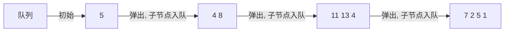
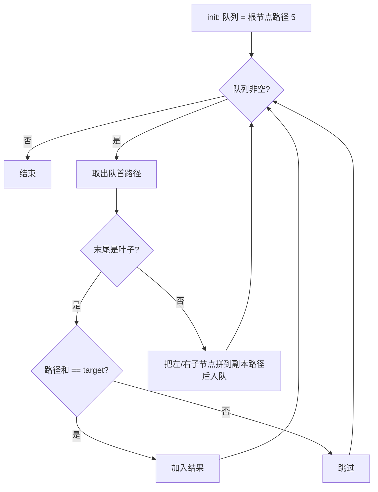

# 后端校招面试直通车: 广度优先搜索 BFS 实战详解

## 纲要

- 广度优先遍历（层序遍历）与深度优先遍历的形态差异：按层扩散 vs 先触达叶子
- 层序遍历借助**队列**实现先进先出，弹出当前节点时把子节点入队
- LeetCode 113 路径总和用 BFS：队列中每个元素是一条"路径"，逐层扩展
- BFS 的重要特性：**第一次触达目标时，走过的一定是最短路径**
- 最短路径对比：DFS 需找全所有路径再比长度，BFS 触达即最短（迷宫最近出口 LeetCode 1926）
- 完整可运行 Go 示例：层序遍历、BFS 路径总和

## 广度优先遍历与队列

以根节点为 5 的二叉树为例，其层次为：第一层 5，第二层 4、8，第三层 11、13、4，第四层 7、2、5、1。广度优先遍历的结果就是按层依次得到 `[5] [4 8] [11 13 4] [7 2 5 1]`。

核心问题是：访问当前层时，如何找到下一层的所有节点？答案是**队列（Queue）**。



算法步骤：

1. 将根节点入队（队列为空则直接返回）；
2. 当队列不为空时，取出队首节点，记录其值；
3. 将其左右子节点（非空）依次入队；
4. 队列为空时，遍历完成。

队列保证了"先进先出"：先处理完当前层的所有节点，才会处理它们引出的下一层节点，这正是"按层扩散"的来源。

## 实战：路径总和（LeetCode 113）用 BFS

题目要求找出所有根到叶子、路径和等于目标的路径。用 BFS 时，队列里存放的不是单个节点，而是**一条完整的路径**。



注意两个细节：

- 队列元素必须是"节点路径"，而不能只存值——值无法还原节点之间的父子关系；
- 扩展子节点时要对当前路径做**深拷贝**（`newPath = append([]int{}, path...)`），再分别拼上左、右子节点的值入队，否则多条路径会共享同一底层数组。

## BFS 的核心优势：第一次触达即最短

BFS 与 DFS 能解决很多同一类问题，但场景不同，效果差异明显。考虑"迷宫离入口最近的出口"（LeetCode 1926）：给你 `m×n` 的迷宫，空格可走、墙不可走，每步上下左右移动一格，求到边界空格（出口）的最短步数。

- **DFS**：必须找出**所有**可达出口的路径，再比较长度，才能得到最短路径；
- **BFS**：按层向外扩散，**第一次走出迷宫到达出口时，走过的路径一定是最短路径**。

这一点由 BFS"逐层扩展"的特性决定：它先走 1 步能到的所有格子，再走 2 步能到的所有格子……所以第一个满足条件的格子，距离必然最小。二叉树里同理：BFS 第三层第一次出现"根到叶子"的路径，那条就是最短路径。

因此在"求最短 / 最近"类问题中，BFS 通常比 DFS 更直接、更快。

## 完整可运行示例（Go）

以下示例根据讲稿中描述的 BFS 逻辑补充实现，包含层序遍历与 BFS 路径总和。

### 运行说明

```bash
mkdir bfs-demo && cd bfs-demo
go mod init bfs-demo
# 将下方代码保存为 main.go
go run main.go
```

Go 1.18+ 即可运行，无第三方依赖。

### 完整代码

```go
package main

import "fmt"

// ============ 一、二叉树与层序遍历（BFS） ============

type TreeNode struct {
	Val   int
	Left  *TreeNode
	Right *TreeNode
}

// buildTree 构造讲稿中的示例树
//        5
//       / \
//      4   8
//     /   / \
//    11  13  4
//   / \      / \
//  7   2    5   1
func buildTree() *TreeNode {
	n := func(v int) *TreeNode { return &TreeNode{Val: v} }
	root := n(5)
	root.Left = n(4)
	root.Right = n(8)
	root.Left.Left = n(11)
	root.Right.Left = n(13)
	root.Right.Right = n(4)
	root.Left.Left.Left = n(7)
	root.Left.Left.Right = n(2)
	root.Right.Right.Left = n(5)
	root.Right.Right.Right = n(1)
	return root
}

// LevelOrder 层序遍历：借助队列按层返回节点值
func LevelOrder(root *TreeNode) [][]int {
	if root == nil {
		return nil
	}
	var res [][]int
	queue := []*TreeNode{root}
	for len(queue) > 0 {
		levelSize := len(queue)
		level := make([]int, 0, levelSize)
		for i := 0; i < levelSize; i++ {
			cur := queue[0]
			queue = queue[1:]
			level = append(level, cur.Val)
			if cur.Left != nil {
				queue = append(queue, cur.Left)
			}
			if cur.Right != nil {
				queue = append(queue, cur.Right)
			}
		}
		res = append(res, level)
	}
	return res
}

// ============ 二、BFS 求解路径总和（LeetCode 113） ============

// PathSumBFS 队列中保存完整路径，逐层扩展，找出所有根到叶子且和为 target 的路径
func PathSumBFS(root *TreeNode, target int) [][]int {
	var res [][]int
	if root == nil {
		return res
	}
	type item struct {
		node *TreeNode
		path []int
	}
	queue := []item{{root, []int{root.Val}}}
	for len(queue) > 0 {
		cur := queue[0]
		queue = queue[1:]
		node, path := cur.node, cur.path

		if node.Left == nil && node.Right == nil { // 叶子节点
			sum := 0
			for _, v := range path {
				sum += v
			}
			if sum == target {
				res = append(res, path)
			}
			continue
		}
		// 扩展子节点：对当前路径做深拷贝再拼接
		if node.Left != nil {
			newPath := append([]int{}, path...)
			newPath = append(newPath, node.Left.Val)
			queue = append(queue, item{node.Left, newPath})
		}
		if node.Right != nil {
			newPath := append([]int{}, path...)
			newPath = append(newPath, node.Right.Val)
			queue = append(queue, item{node.Right, newPath})
		}
	}
	return res
}

// ============ 三、演示 ============

func main() {
	root := buildTree()
	fmt.Println("层序遍历:", LevelOrder(root))
	// target = 22，期望路径: 5-4-11-2 与 5-8-4-5
	fmt.Println("路径和为22:", PathSumBFS(root, 22))
}
```

预期输出：

```
层序遍历: [[5] [4 8] [11 13 4] [7 2 5 1]]
路径和为22: [[5 4 11 2] [5 8 4 5]]
```

### 代码说明

- `LevelOrder` 用切片模拟队列：每轮先记录当前层大小 `levelSize`，只处理这一层的节点，并把它们的子节点入队，从而天然地"按层"输出。
- `PathSumBFS` 的队列元素是 `item{node, path}`：既保存节点（用于判断是否叶子、能否继续扩展），也保存从根到该节点的完整路径（用于算和）。
- 关键陷阱是路径共享：扩展时必须 `append([]int{}, path...)` 先拷贝再追加，否则左右子树会修改同一条底层数组，互相污染。
- 与 DFS 相比，BFS 这里不需要回溯，因为每条路径独立存在于队列中。

### 技术点总结

| 维度 | BFS | DFS（对照） |
| --- | --- | --- |
| 数据结构 | 队列（FIFO） | 递归栈 / 显式栈 |
| 扩展顺序 | 按层扩散 | 一条路走到叶子再回溯 |
| 最短路径 | 首次触达即最短 | 需遍历全部再比较 |
| 路径类问题 | 队列存完整路径 + 深拷贝 | 回溯恢复 path |

## 面试答题要点

- 先讲层序遍历与队列的关系：弹出节点时把子节点入队，保证先进先出、按层扩散。
- 路径总和用 BFS：强调队列元素是"路径"而非"节点"，扩展时必须深拷贝路径。
- 主动对比：求最短 / 最近类问题（迷宫出口、最短路径），BFS 第一次触达即最优，比 DFS 更高效。
- 一句话总结：BFS 适合"由近及远、逐层铺开"的搜索，尤其擅长最短路径。

相关度：95%。是否需要继续：[否]。代码是否可运行：[是]。
