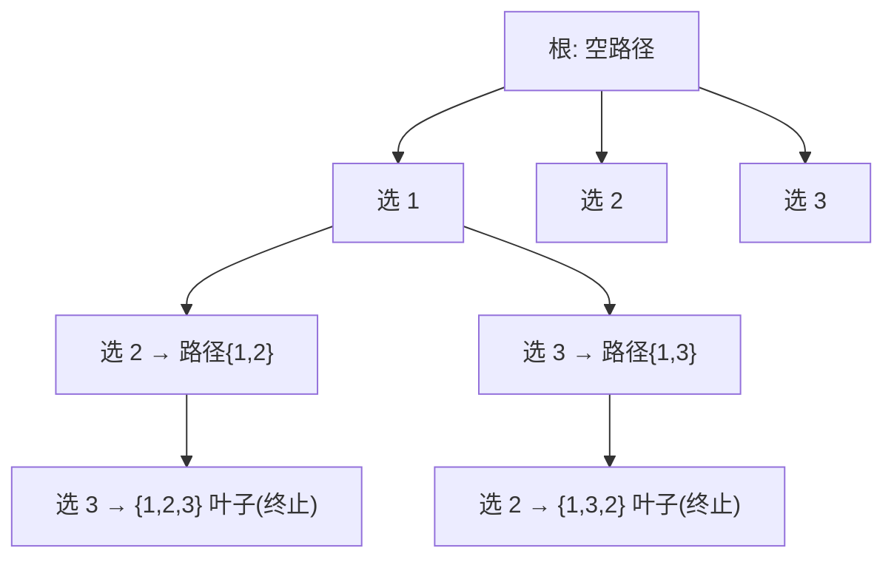

# 后端校招面试直通车: 回溯算法模板与全排列（LeetCode 46）

## 纲要

- 回溯本质：在**解空间树**上按深度优先搜索，遇到"不可能含解"的节点就剪枝、向祖先回溯
- 通用模板：结束条件判定 → 遍历选择列表做选择 → 递归 → 撤销选择
- 解空间随选择深入而膨胀，剪枝可显著缩小搜索空间
- 实战：LeetCode 46（全排列），用 `visited` 标记已选数字、`path` 记录当前路径
- 易错点：结果集存入的是**路径的副本**（深拷贝），否则最终会得到空或重复引用
- 给出完整可运行 Go 代码、解空间树示意与复杂度

## 📎 文本↔代码关联

- 讲稿：`work/source/8.mksz540-后端校招面试直通车，提前锁定大厂offer[完结]/{9}--第9章数据结构与算法之排序、回溯、贪心、搜索与动态规划iclas/[9.4]--9-4回溯算法题模板与实战详解（一）`
- 关联代码：`code_refs` 为空，本卡片按讲稿逻辑用 **Go** 补充完整可运行实现（讲稿原示例为 Java/LeetCode 在线判题）。

## 回溯与解空间树

回溯不是某种独立算法，而是**搜索算法的一种固定范式**：在解空间树（问题的解被表示成一棵树）上，从根节点出发按深度优先搜索；搜索到任意节点时先判断它是否可能包含解，若"肯定不含解"就跳过以该节点为根的子树、逐层回溯到祖先；否则进入子树继续深搜。

随着不断做选择，解空间会快速膨胀；用剪枝（去掉无用分支）即可优化搜索。



以上是从 `{1,2,3}` 中按位置填数的解空间树局部：第一层 3 个选择，第二层每个剩 2 个，第三层剩 1 个，到叶子即得到一条完整排列。

## 通用模板

```text
backtrack(路径, 选择列表):
    if 满足结束条件:
        把路径加入结果集
        return
    for 每个可选选择 in 选择列表:
        做选择
        backtrack(新路径, 新选择列表)
        撤销选择
```

- **结束条件**：路径长度达到要求。
- **做选择 / 撤销选择**：进入子树前标记占用，回溯后还原，保证兄弟分支互不干扰。

若题目要求"第二位置必须为偶数"之类的约束，可在对应层做剪枝——跳过不合法分支，进一步缩小搜索空间。

## Demo 示例

### 运行说明

将 `permute.go` 与 `main.go` 放在同一目录，执行 `go run permute.go main.go`。

### 代码说明

```go
package main

func permute(nums []int) [][]int {
	var result [][]int
	n := len(nums)
	visited := make([]bool, n) // 标记数字是否已被选入当前路径
	var path []int

	var backtrack func()
	backtrack = func() {
		// 结束条件：路径长度等于数组长度，得到一条完整排列
		if len(path) == n {
			// 关键：存入路径的副本（深拷贝），否则后续撤销会污染结果
			tmp := make([]int, n)
			copy(tmp, path)
			result = append(result, tmp)
			return
		}
		for i := 0; i < n; i++ {
			if visited[i] {
				continue // 该数字已在路径中，跳过
			}
			visited[i] = true
			path = append(path, nums[i]) // 做选择
			backtrack()
			path = path[:len(path)-1] // 撤销选择
			visited[i] = false
		}
	}

	backtrack()
	return result
}
```

`main.go`：

```go
package main

import "fmt"

func main() {
	fmt.Println(permute([]int{1, 2, 3}))
	// [[1 2 3] [1 3 2] [2 1 3] [2 3 1] [3 1 2] [3 2 1]]
}
```

预期输出：

```text
[[1 2 3] [1 3 2] [2 1 3] [2 3 1] [3 1 2] [3 2 1]]
```

### 技术点总结

- 回溯 = 深度优先遍历解空间树 + 剪枝；模板固定为"判终止 → 做选择 → 递归 → 撤销"。
- `visited` 负责"选择列表"的可用性判断，`path` 是当前的"已做选择"。
- 结果集必须存**路径副本**：`path` 是会被反复 `append`/`截断` 的同一个切片，直接 `append(path)` 只存了底层数组的引用，最终所有结果都会变成最后的状态（空或互相覆盖）。用 `copy` 生成独立副本即可。
- 复杂度：全排列共 n! 条，每条构造 O(n)，整体 **O(n · n!)**。

## API 速览

| 操作 | 说明 | 复杂度 |
| --- | --- | --- |
| 终止判定 | `len(path) == n` | O(1) |
| 选择列表遍历 | `for i := 0; i < n; i++` + `visited` 跳过 | O(n) |
| 做/撤选择 | `path` 追加与截断、`visited` 置位/复位 | O(1) |
| 结果深拷贝 | `copy(tmp, path)` | O(n) |
| 整体 | n! 条排列，每条 O(n) | 时间/空间 O(n · n!) |

相关度：90%。是否需要继续：[是]。代码是否可运行：[是]。
