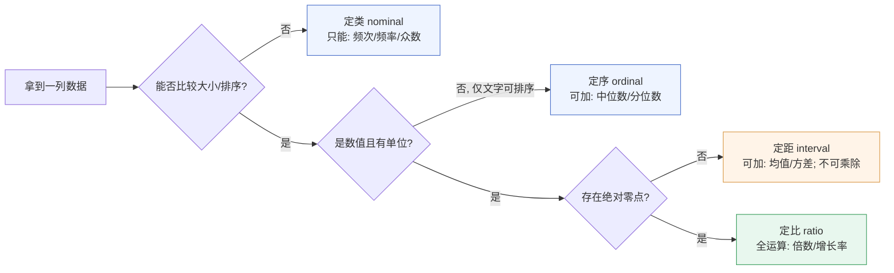

拿到一张表就急着算平均值，是新手最常踩的坑：**把「颜色」求平均、把「温度」相乘、把「学历编码」当数值做回归**，结果全是无效的。这一节解决一件事——先判断每一列属于哪种计量层次，再决定它能做哪些运算、该用哪类统计指标。

## 纲要

- **计量层次**是「这列数据能被运算到什么程度」，从低到高分四级：定类、定序、定距、定比
- 四级之间不是并列关系，而是**能力递增**：能分类 → 能排序 → 能加减 → 能乘除
- 区分定距与定比的唯一判据是**有没有绝对零点**；温度 0 度不是「没有温度」，所以温度只能加减不能乘除
- 前两级统称**定性数据**（文字表述），后两级统称**定量数据**（数值可测量）
- 多列按统一标准拼起来就是**数据矩阵**：行叫观测/记录，列叫属性/维度/字段
- 落到 pandas 里，`dtype` 不等于计量层次——`int` 编码的学历仍是定序，必须靠业务语义标注

## 读前须知（名词与环境）

| 名词 | 在这篇里指什么 |
| --- | --- |
| pandas | Python 的数据处理库，把表格读成二维对象再做运算 |
| DataFrame | pandas 里的二维表格对象：有行、有列、每列有类型 |
| dtype | 列在程序里的存储类型，例如整数、文本、日期 |
| SQL | 数据库查询语言，用来从表里取数、筛选、汇总 |

> **运行环境**：Python 3 + pandas（数据处理库）；安装命令 `pip install pandas`。代码块各自自包含，可单独复制运行。表格里的全大写词是 Excel 或 SQL 的函数名，紧随其后都给了中文用途。
>
> **材料来源**：本文依据一套数据分析课程讲义整理，文中「讲义」指课程原文，「口述」指讲师在课上口头给出的数字。讲义说法与软件实际行为不一致时，本文按可复算的结果或软件官方语义改写，并在正文注明。

## 一、为什么先判类型，而不是先算指标

统计指标不是随便挑的。定类列没有大小概念，只能数**频次与频率**；定序列能排先后，可以取**中位数**但不宜求均值；定距、定比才谈得上均值、方差、增长率。

一句话结论：**计量层次决定了合法的运算集合，运算集合决定了可用的指标集合。** 逆着来，数字算得再漂亮也没有业务含义。



## 二、四个计量层次逐层拆解

| 层次 | 英文名 | 典型例子 | 能否排序 | 能否加减 | 能否乘除 | 合法指标 |
| --- | --- | --- | --- | --- | --- | --- |
| 定类 | nominal | 颜色、性别、职位、渠道 | ✗ | ✗ | ✗ | 频次、频率、众数 |
| 定序 | ordinal | 学历、季度、评级（合格/良好/优秀） | ✓ | ✗ | ✗ | 中位数、分位数、秩 |
| 定距 | interval | 温度（℃）、考试分数、年份 | ✓ | ✓ | ✗ | 均值、方差、标准差 |
| 定比 | ratio | 销售额、薪酬、用户数、时长 | ✓ | ✓ | ✓ | 上述全部 + 倍数、增长率 |

**定类**：类别之间是平等并列关系。「红色是否优于白色」这种问题没有意义，所以只统计每个类别出现了多少次。

**定序**：可以排序，但**相邻两级之间的间距没有数值含义**。小学→初中→高中可以编码成 1/2/3 方便排序，但 `3 - 2` 不代表「多受了多少教育」，更不能说「编码 3 是编码 1 的三倍」。

**定距**：有单位、有实际测量值，可以加减。今天比昨天高 20℃ 是合法表述，但「20℃ 是 10℃ 的两倍热」不成立——因为 0℃ 只是一个刻度，不是「没有温度」。

**定比**：存在**绝对零点**，0 表示「没有」。销售额 0 元就是没成交，所以 8000 元是 4000 元的两倍、增长率也才有意义。

> 判断口诀：**问一句「0 是不是表示没有」** —— 是，定比；否，定距。

## 三、定性 vs 定量：能力边界一览

| 大类 | 包含层次 | 数据形态 | 能做的运算 | 典型图表 |
| --- | --- | --- | --- | --- |
| 定性（qualitative） | 定类、定序 | 文字表述 | 分类计数、排序 | 条形图、饼图、堆叠柱 |
| 定量（quantitative） | 定距、定比 | 数值、可测量 | 加减（定距）/ 全运算（定比） | 直方图、折线图、箱线图、散点图 |

## 四、数据矩阵：行是观测，列是维度

把多列按统一标准组合起来，就是日常接触的**二维数据表**（数据矩阵）。一份最小可读的分析表长这样：

```text
work/target/data-analysis/
├── _INDEX.md                  # 素材清单（208 篇 / 16 周）
├── _PROGRESS.md               # 断点进度表（39 组）
├── raw/
│   └── orders.csv             # 原始二维数据表
└── notebook/
    ├── 01_类型标注.py          # 给每列标注计量层次
    └── 02_描述统计.py          # 按层次选择合法指标
```

在这张表里：**行 = 观测值 / 记录**（一个用户、一笔订单），**首行列名 = 数据属性 / 维度 / 字段**。后面所有 SQL 的 `SELECT`、pandas 的列选择、BI 工具的维度与度量拆分，都建立在这个约定上。

## 能力速览（要做什么 → 用哪个函数或写法）

| 能力 | pandas 做法 | SQL 做法 |
| --- | --- | --- |
| 统计定类的频次 | `s.value_counts()` | `GROUP BY col, COUNT(*)` |
| 统计定类的频率 | `s.value_counts(normalize=True)` | `COUNT(*) * 1.0 / SUM(COUNT(*)) OVER ()` |
| 定序取中位水平 | `s.astype('category').cat.codes.median()` | 需先建编码映射表 |
| 定量求均值/离散 | `s.mean()` / `s.std(ddof=0)` | `AVG(col)` / 手工展开 `SQRT(AVG(x*x)-AVG(x)^2)` |
| 定比求倍数/增长 | `s / s.shift(1) - 1` | `col / LAG(col) OVER (...) - 1` |
| 快速看每列 dtype | `df.dtypes` | `PRAGMA table_info(t)` |

> **坑**：`df.dtypes` 只能告诉你存储类型，不能告诉你计量层次。**编码成 1/2/3 的学历是 `int64`，但它是定序**；类型标注必须单独维护一份元数据。

## 可运行示例

下面两段代码可以原样运行。第一段用 pandas 给每列标注层次并**按层次决定合法运算**，第二段用标准库 `sqlite3` 跑一段真实的分组频次统计（不依赖任何外部数据库）。

```python
from __future__ import annotations

import pandas as pd

# 一张混合了四种计量层次的最小样本表
orders = pd.DataFrame({
    "channel":   ["自然流量", "广告", "自然流量", "转介绍", "广告"],
    "edu_level": ["本科", "硕士", "本科", "博士", "本科"],
    "temp_c":    [18.5, 21.0, 19.5, 23.0, 20.0],
    "revenue":   [1200.0, 3600.0, 800.0, 2400.0, 1800.0],
})

# 计量层次是业务语义，不能由 dtype 推断 —— 显式声明元数据
LEVELS: dict[str, str] = {
    "channel": "定类", "edu_level": "定序",
    "temp_c": "定距", "revenue": "定比",
}
LEGAL_OPS: dict[str, str] = {
    "定类": "频次/频率/众数",
    "定序": "+ 中位数/分位数",
    "定距": "+ 均值/方差/标准差（不可乘除）",
    "定比": "+ 倍数/增长率/占比",
}

for col, level in LEVELS.items():
    print(f"{col:10s} {level}  合法运算: {LEGAL_OPS[level]}")

# 定类列：只能数频次
freq = orders["channel"].value_counts()
ratio = orders["channel"].value_counts(normalize=True)
print("\n渠道频次:\n", freq.to_string())
print("\n渠道频率:\n", ratio.round(3).to_string())

# 定比列：倍数与环比才有意义
growth = orders["revenue"] / orders["revenue"].shift(1) - 1
print("\n收入环比:", growth.round(3).tolist())

# 反例守护：对定类列求均值会直接报错，正好说明类型约束的价值
try:
    orders["channel"].mean()
except TypeError as exc:
    print("\n定类列求均值被拒绝:", type(exc).__name__)
```

```python
from __future__ import annotations

import sqlite3

# 同一张表落到关系库：定类列用 GROUP BY 做频次统计
conn = sqlite3.connect(":memory:")
conn.execute("CREATE TABLE orders (channel TEXT, revenue REAL)")
conn.executemany(
    "INSERT INTO orders VALUES (?, ?)",
    [("自然流量", 1200.0), ("广告", 3600.0), ("自然流量", 800.0),
     ("转介绍", 2400.0), ("广告", 1800.0)],
)

sql = """
SELECT channel,
       COUNT(*)                AS cnt,
       ROUND(AVG(revenue), 2)  AS avg_revenue
FROM orders
GROUP BY channel
ORDER BY cnt DESC, channel
"""
for row in conn.execute(sql):
    print(row)
conn.close()
```

对应的 SQL 语义（可直接贴进 MySQL / PostgreSQL，窗口函数部分按需改写）：

```sql
SELECT channel,
       COUNT(*)               AS cnt,
       AVG(revenue)           AS avg_revenue
FROM orders
GROUP BY channel
ORDER BY cnt DESC;
```

## 📎 文本↔代码关联

| 文中结论 | 代码位置 | 怎么看 |
| --- | --- | --- |
| 定类只能数频次 | 第一段 `value_counts()` | 输出三个渠道的计数与频率，无均值 |
| 定比可算环比 | 第一段 `shift(1)` | 输出 4 个环比值（首行 NaN） |
| 类型约束真实存在 | 第一段 `try/except` | 对文本列 `.mean()` 抛 `TypeError` |
| 行=观测、列=维度 | 第二段 `CREATE TABLE` | 5 行观测、2 个字段 |
| 分组频次落地 | 第二段 `GROUP BY` | 输出按渠道聚合的结果 |

## 常见坑

- **把编码当数值**：学历/星级/等级编码成 1~5 后直接求均值，得到「平均学历 2.7」这种无效结论。
- **对定距做乘除**：「今天 20℃ 是昨天 10℃ 的两倍热」——摄氏温度没有绝对零点，倍数无意义（开尔文温度才有）。
- **忽略绝对零点**：判断定距/定比时不要看单位，看 0 是不是「没有」。
- **靠 dtype 猜层次**：`int64` 可能是定序编码，`object` 也可能是日期字符串。层次必须显式标注。

## 面试官会问什么

> 按「概念 → 口径 → 工程落地」递进。回答要点可以直接口述，最后一列是面试官最常接的那一句追问。

| # | 面试官会问 | 回答要点（可直接口述） | 常见追问 |
| --- | --- | --- | --- |
| 1 | 定类、定序、定距、定比四级怎么区分？各举一个业务例子。 | 三步判：能否排序、能否加减、有没有绝对零点。性别只能分类，学历能排序不能运算，温度能加减不能乘除，销售额四则运算都合法。 | 温度 20℃ 是 10℃ 的两倍吗？ |
| 2 | 把学历编码成 1、2、3 之后求平均值，错在哪？ | 编码只是标签，等级之间的间距没有数值含义；求出来的均值没有业务解释。数据类型是存储概念，计量层次是业务语义，两者不等价。 | 数据库里存成整数，怎么防止有人误用？ |
| 3 | 数据矩阵里行和列分别是什么？ | 行是一条观测或记录，列是属性、维度或字段。后面所有查询、分组、维度与度量拆分都建立在这个约定上。 | 宽表和拆成多张表，怎么选？ |
| 4 | 拿到一张没见过的表，你怎么决定每列能算什么？ | 先逐列标注计量层次，再由层次推出合法运算集合，最后由运算集合决定可用指标，逆着做数字再漂亮也没有业务含义。 | 业务方坚持要对定序列求均值，你怎么处理？ |
| 5 | pandas 的 dtype 能不能直接当计量层次用？ | 不能。整数列可能是定序编码，文本列也可能是日期字符串。正确做法是单独维护一份层次元数据，并在计算前拦截非法运算。 | 这份元数据落在哪里比较合适？ |

**红旗答案**（说出来基本就停在这一档）：

- 「能存成数字就能做加减乘除」——把存储类型和计量层次混为一谈。
- 「温度可以相乘，因为它也是数值」——忽略绝对零点这一判据。
- 「dtype 就是数据的计量层次」——学历编码是最直接的反例。

**加分点**：

- 能给出可运行的校验：对定类列调用求均值时由元数据直接拒绝，而不是等结果算出来再发现。
- 把「绝对零点」说成定距与定比的**唯一**判据，并用温度与销售额对照说明。

## 总结

- 计量层次分**定类 / 定序 / 定距 / 定比**四级，能力逐级递增。
- 区分定距与定比只看**绝对零点**；这一条决定了倍数与增长率是否合法。
- 定性数据走频次/频率/众数，定量数据才可求均值、方差等数字特征。
- 数据矩阵里**行是观测、列是维度**，这是后续 SQL 与 pandas 操作的共同前提。
- 在 pandas 中**显式维护层次元数据**，别让 `dtype` 替你做业务判断。