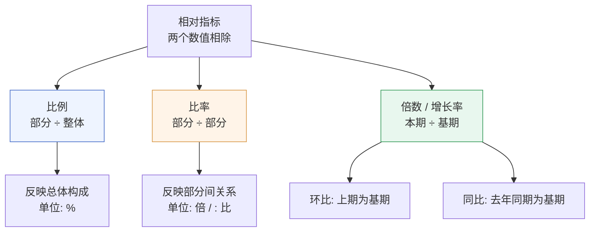

「今年销售总额多少」「每月占比多少」「平均每月多少」「12 月比 11 月涨了多少」——四个问题对应四类指标，混用就会答错。这一节把统计指标拆成**总量 / 相对 / 平均**三大类，重点讲清环比与同比的分母该取谁。

## 纲要

- 统计指标 = **体现总体数量特征的概念和数据**，随分析目的变化，不是固定一张表
- **总量指标**是累加和，描述规模；**相对指标**是两个有联系数值相除，描述关系；**平均指标**用一个数描述一般水平
- 相对指标再分三层：**比例**（部分÷整体）、**比率**（部分÷部分）、**倍数**（本期÷基期）
- **环比 = (本期 − 上期) ÷ 上期**，看短期；**同比 = (本期 − 同期) ÷ 同期**，看长期，能消掉季节性
- 分母永远取「被比较的那个基期」，不是本期、也不是总量——这是环比同比最高频的错
- 增长率有正负、有百分比单位；基数极小时（新业务上线首月）要单独标注，别硬算

## 读前须知（名词与环境）

| 名词 | 在这篇里指什么 |
| --- | --- |
| pandas | Python 的数据处理库，把表格读成二维对象再做运算 |
| DataFrame | pandas 里的二维表格对象：有行、有列、每列有类型 |
| SQL | 数据库查询语言，用来从表里取数、筛选、汇总 |

> **运行环境**：Python 3 + pandas（数据处理库）；安装命令 `pip install pandas`。代码块各自自包含，可单独复制运行。表格里的全大写词是 Excel 或 SQL 的函数名，紧随其后都给了中文用途。
>
> **材料来源**：本文依据一套数据分析课程讲义整理，文中「讲义」指课程原文，「口述」指讲师在课上口头给出的数字。讲义说法与软件实际行为不一致时，本文按可复算的结果或软件官方语义改写，并在正文注明。

## 一、三类基础统计指标

| 类别 | 回答什么问题 | 定义 | 例子 |
| --- | --- | --- | --- |
| 总量指标 | 规模有多大 | 各数据项累加和 | 年销售总额 78,000、总人口、GDP |
| 相对指标 | 关系是怎样的 | 两个有联系数值之比 | 12 月占全年 15.4%、渠道 A:B = 3:1 |
| 平均指标 | 一般水平在哪 | 一个数字概括样本 | 月均销售额 6,500、平均薪酬 |

**总量指标**是最基本的一种，后面所有占比、增长率都以它为分母或参照。**平均指标**也叫集中趋势指标（均值、中位数、众数）；这三者的对比属于描述统计，本篇只用到它的定义。

## 二、相对指标的三种形态



- **比例**：各月销售额 ÷ 全年总额 × 100%，所有月份加起来恒等于 100%。反映「部分与整体」。
- **比率**：把各月销售额都除以同一个公约数（如 1000），得到 3 : 3.5 : 4 …，反映「部分与部分」。
- **倍数 / 增长率**：年末 ÷ 年初得到倍数；`(本期 − 上期) ÷ 上期` 得到增长率。

## 三、环比 vs 同比：分母决定结论

| 维度 | 环比（MoM / QoQ） | 同比（YoY） |
| --- | --- | --- |
| 公式 | `(本期 − 上期) / 上期` | `(本期 − 去年同期) / 去年同期` |
| 基期 | 紧邻的上一周期 | 去年的同一个周期 |
| 看什么 | 短期涨跌、最近一个周期的动量 | 长期趋势、剔除季节性 |
| 典型陷阱 | 受节假日/大促干扰，波动大 | 业务结构变了就不可比 |
| 讲义例子 | 12 月 12,000 / 11 月 11,000 → **+9.09%** | 3,450 / 2,300 → **+50%** |

用 12 个月销售额串起来看，全年 78,000，11 月 11,000、12 月 12,000：12 月占全年 `12,000 / 78,000 = 15.38%`（比例），环比 `(12,000 − 11,000) / 11,000 = 9.09%`（增长率）。**同一个 12,000，问法不同、分母不同、答案也不同。**

## 四、一份分析里指标怎么摆

```text
work/target/data-analysis/
├── _PROGRESS.md
├── metrics/
│   ├── 01_总量与占比.py        # sum / 比例 / 比率
│   ├── 02_环比同比.py          # shift(1) / shift(12)
│   └── 03_sql_window.sql      # LAG() 窗口函数版本
└── output/
    ├── monthly_summary.csv    # 月 × 销售额 × 占比 × 环比
    └── yoy_report.md          # 同比结论与业务归因
```

## 能力速览（要做什么 → 用哪个函数或写法）

| 能力 | pandas | SQL |
| --- | --- | --- |
| 总量 | `df['amt'].sum()` | `SUM(amt)` |
| 占比 | `df['amt'] / df['amt'].sum()` | `amt / SUM(amt) OVER ()` |
| 环比 | `df['amt'].pct_change()` | `amt / LAG(amt) OVER (ORDER BY mon) - 1` |
| 同比（月度） | `df['amt'].pct_change(12)` | `amt / LAG(amt, 12) OVER (ORDER BY mon) - 1` |
| 倍数 | `df['amt'] / df['amt'].iloc[0]` | `amt / FIRST_VALUE(amt) OVER (...)` |
| 频率 | `s.value_counts(normalize=True)` | `COUNT(*) * 1.0 / SUM(COUNT(*)) OVER ()` |

## 可运行示例

两段代码可直接运行。第一段用 pandas 复算讲义里的 78,000 / 9.09% / 15.38%，第二段用 SQLite 窗口函数实现同样的环比。

```python
from __future__ import annotations

import pandas as pd

# 12 个月销售额：总和 78,000，11 月 11,000，12 月 12,000（可自行核对）
amt = [3000, 3500, 4000, 4500, 5000, 5500, 6000, 6500, 8000, 9000, 11000, 12000]
df = pd.DataFrame({"month": range(1, 13), "amt": amt})

total = df["amt"].sum()
df["share"] = df["amt"] / total              # 比例：部分 ÷ 整体
df["mom"] = df["amt"].pct_change()           # 环比：以上期为分母
df["multiple"] = df["amt"] / df["amt"].iloc[0]  # 倍数：以 1 月为基期

assert total == 78_000, total
print("全年总额:", total)
print("12 月占比:", f"{df.loc[11, 'share']:.2%}")
print("12 月环比:", f"{df.loc[11, 'mom']:.2%}")
print("占比合计:", f"{df['share'].sum():.4f}")

# 同比：需要至少两个年度的同月数据（讲义 3,450 / 2,300 → +50%）
yoy = pd.DataFrame({"month": [12], "this_year": [3450], "last_year": [2300]})
yoy["yoy"] = (yoy["this_year"] - yoy["last_year"]) / yoy["last_year"]
print("12 月同比:", f"{yoy.loc[0, 'yoy']:.2%}")

# 增长率对极小基数敏感：新业务首月基数 1，第二月 50 → 4900%
edge = pd.Series([1, 50])
print("极小基数环比:", f"{edge.pct_change().iloc[1]:.0%}", "(需单独标注, 不可与常规月并列)")
```

```python
from __future__ import annotations

import sqlite3

conn = sqlite3.connect(":memory:")
conn.execute("CREATE TABLE sales (mon INTEGER PRIMARY KEY, amt REAL)")
conn.executemany(
    "INSERT INTO sales VALUES (?, ?)",
    list(enumerate([3000, 3500, 4000, 4500, 5000, 5500,
                    6000, 6500, 8000, 9000, 11000, 12000], start=1)),
)
sql = """
SELECT mon,
       amt,
       ROUND(amt * 1.0 / SUM(amt) OVER (), 4)                       AS share,
       ROUND((amt * 1.0 / LAG(amt) OVER (ORDER BY mon) - 1), 4)     AS mom
FROM sales
ORDER BY mon DESC
LIMIT 3
"""
for row in conn.execute(sql):
    print(row)
conn.close()
```

窗口函数版本（MySQL 8+ / PostgreSQL / SQLite 3.25+ 通用）：

```sql
SELECT mon,
       amt,
       amt * 1.0 / SUM(amt) OVER ()                    AS share,
       amt * 1.0 / LAG(amt) OVER (ORDER BY mon) - 1   AS mom
FROM sales
ORDER BY mon;
```

## 📎 文本↔代码关联

| 文中结论 | 代码位置 | 怎么看 |
| --- | --- | --- |
| 全年总额 78,000 | 第一段 `assert total == 78_000` | 断言通过即复算一致 |
| 12 月占比 15.38% | 第一段 `df['share']` | 比例以总量为分母 |
| 环比 9.09% | 第一段 `pct_change()` | 分母是 11 月的 11,000 |
| 同比 50% | 第一段 `yoy` DataFrame | 分母是去年同月 2,300 |
| 占比恒等于 1 | 第一段 `df['share'].sum()` | 输出 `1.0000` |
| 极小基数陷阱 | 第一段 `edge` | 输出 `4900%` |
| SQL 版环比 | 第二段 `LAG(amt)` | 输出 12/11/10 月三行 |

## 常见坑

- **分母取错**：把环比写成 `(本期 − 上期) / 本期`，涨幅会被系统性低估。
- **同比拿错基期**：拿「上月」当「去年同期」，季节性行业（旅游、空调、教培）结论会反。
- **基数极小不标注**：新业务从 1 单到 50 单是 +4900%，写进周报会严重误导，应改看绝对增量。
- **占比与增长率混写**：15.38% 是占比、9.09% 是增长率，单位都是 `%` 但含义完全不同。
- **结构变化后硬比同比**：产品线重组、口径调整后，去年同期的数已不可比，需重述口径。

## 面试官会问什么

> 这一组题几乎全是分母口径。面试官真正想听的是「你拿谁作基期」，不是能不能背出公式。

| # | 面试官会问 | 回答要点（可直接口述） | 常见追问 |
| --- | --- | --- | --- |
| 1 | 总量、相对、平均三类指标分别回答什么问题？ | 总量描述规模，相对描述两个有联系数值的关系，平均用一个数概括一般水平。后两类的分母都依赖总量。 | 相对指标内部还能再分吗？ |
| 2 | 环比和同比的分母分别取谁？ | 环比用上期，同比用去年同期，分母永远是被比较的基期，不是本期也不是总量。同比能消掉季节性，环比看短期变化。 | 为什么同比能消掉季节性？ |
| 3 | 比例、比率、倍数怎么区分？ | 比例是部分除以整体，比率是部分除以部分，倍数是本期除以基期。三者都属于相对指标。 | 渠道 A 比 B 等于 3 比 1，属于哪一种？ |
| 4 | 12 月 12,000、11 月 11,000，环比增长率是多少？ | 9.09%，分母取 11,000。增长率带正负和百分比单位，基数极小时要单独标注，不硬算。 | 新业务上线首月环比怎么报？ |
| 5 | 增长率为负说明什么，报告里要写清哪些东西？ | 说明本期低于基期；必须写清比较的是哪个基期、单位是不是百分比、以及基期数值大小。 | 同期值缺失怎么处理？ |

**红旗答案**（说出来基本就停在这一档）：

- 把分母取成本期或总量——这是环比同比最高频的错误。
- 把同比说成「比上个月」，混淆了时间基准。
- 比例、比率、倍数混用，导致占比能超过 100% 却没人发现。

**加分点**：

- 用 SQL 窗口函数 LAG 复算环比，并说明首行没有上期值时如何处理空值。
- 指出小基数场景应改报绝对增量或单独标注，而不是硬报百分比。

## 总结

- 三类基础指标：**总量**看规模、**相对**看关系、**平均**看一般水平。
- 相对指标分**比例 / 比率 / 倍数（增长率）**，区别全在分母取谁。
- **环比**以上期为基期看短期，**同比**以去年同期为基期看长期并削掉季节性。
- pandas 用 `pct_change()` 与 `pct_change(12)`，SQL 用 `LAG(...) OVER (ORDER BY ...)`。
- 极小基数和口径变更必须显式标注，否则增长率会讲错故事。