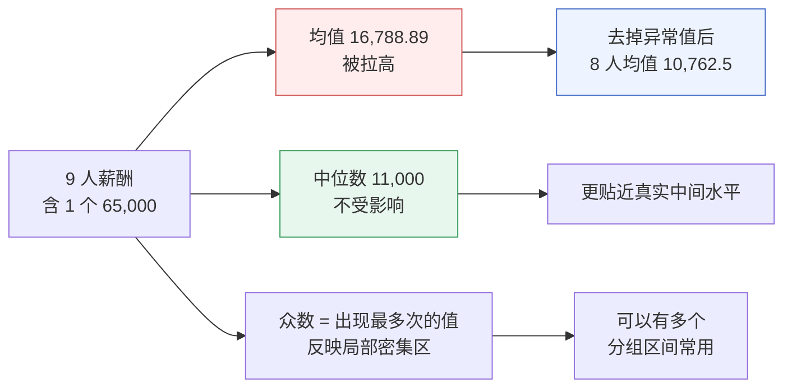
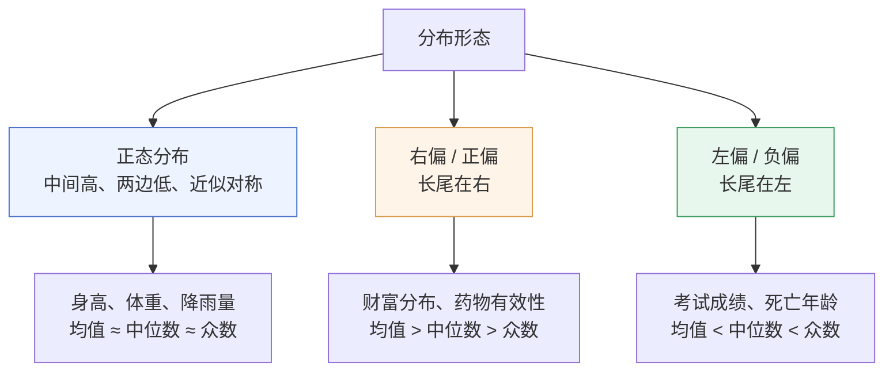

一个 65,000 的异常薪酬，能把 9 人团队的平均薪酬从 10,762 拉到 16,789——**只看均值就会得出「这支团队待遇很好」的错误结论**。这一节把描述统计拆成三层：数据集中在哪、内部差多大、整体长什么样，并给出可复算的代码。

## 纲要

- **集中趋势**回答「一般水平在哪」：均值、中位数、众数；均值对异常值敏感，中位数稳健
- **离散趋势**回答「内部差异多大」：极差、平均差、标准差；**标准差通过平方放大了偏离**，对异常更敏感
- **分布形态**回答「画出来长什么样」：正态、左偏、右偏；**高度对应一般水平，宽度对应离散程度**
- 偏态下三者位置固定：右偏 `均值 > 中位数 > 众数`，左偏反过来
- 总体标准差除以 `n`（`ddof=0`），样本标准差除以 `n-1`（`ddof=1`）；**口径不说清楚，数字对不上**
- 极差只看两个端点，**不能代表内部真实离散度**——这是最容易被忽视的一条

## 读前须知（名词与环境）

| 名词 | 在这篇里指什么 |
| --- | --- |
| pandas | Python 的数据处理库，把表格读成二维对象再做运算 |
| numpy | Python 的数值计算库，提供数学函数与数组运算 |
| dtype | 列在程序里的存储类型，例如整数、文本、日期 |

> **运行环境**：Python 3 + pandas（数据处理库） + numpy（数值计算库）；安装命令 `pip install pandas numpy`。代码块各自自包含，可单独复制运行。表格里的全大写词是 Excel 或 SQL 的函数名，紧随其后都给了中文用途。
>
> **材料来源**：本文依据一套数据分析课程讲义整理，文中「讲义」指课程原文，「口述」指讲师在课上口头给出的数字。讲义说法与软件实际行为不一致时，本文按可复算的结果或软件官方语义改写，并在正文注明。

## 一、集中趋势：三个数，三种「一般水平」



| 指标 | 定义 | 对异常值 | 适用层次 | 典型用途 |
| --- | --- | --- | --- | --- |
| 均值 | 总和 ÷ 个数 | **极敏感** | 定距、定比 | 客单价、平均响应时长 |
| 中位数 | 排序后居中的值（偶数取中间两数均值） | 稳健 | 定序及以上 | 薪酬、房价、收入报告 |
| 众数 | 出现频次最高的值（可多个） | 稳健 | 定类及以上 | 最热商品、最集中薪酬区间 |

讲义里的那个例子可以完整复算：`[7500, 8000, 9000, 10000, 11000, 12000, 13000, 15600, 65000]` 总和 151,100，均值 16,788.89；去掉 65,000 后 8 人总和 86,100、均值 10,762.5，**差 6,026.39**；中位数恒为 11,000。看到「均值明显高于中位数」，就该条件反射地怀疑存在右侧异常值。

## 二、离散趋势：从极差到标准差

| 指标 | 公式 | 反映 | 局限 |
| --- | --- | --- | --- |
| 极差 | `max − min` | 最大差异 | 只看两个端点，中间怎么分布完全不知道 |
| 平均差 | `Σ\|xᵢ − x̄\| / n` | 平均偏离 | 对大偏离放大不足 |
| 标准差（总体） | `√(Σ(xᵢ − x̄)² / n)` | 放大后的离散度 | 需说明 `ddof`，单位是原单位 |

**为什么标准差比平均差更能体现差异？** 因为先平方再开方，远离均值的点被放大。讲义用 `3 / 9 / 27`（均值 13）验证：平均差 `(10+4+14)/3 = 9.33`，标准差 `√((100+16+196)/3) = √104 = 10.19`。

再看股价：9 个交易日收盘价均值 10.59，平均差约 0.31、总体标准差 **0.436**；把 11.67 那个异常日抹平后两者都会下降，但**标准差的下降倍数更大**，说明它对异常更敏感。金融风控用标准差衡量波动率，正是这个性质。

> **口径坑**：上面用的是**总体标准差**（除以 `n`，numpy `ddof=0`）。若按**样本标准差**（除以 `n-1`），`3/9/27` 会得到 `√156 = 12.49` 而不是 10.19。写报告必须标注口径。

## 三、分布形态：高度看水平，宽度看差异

把一组数值按区间画成直方图／折线图，得到的形状就是分布形态。



- **高度**＝一般水平（均值 / 中位数 / 众数，峰值处即众数）。
- **宽度**＝离散程度（极差 / 平均差 / 标准差）。经验要求集中在「1~3 年」的岗位，图形细长紧凑；应届和 10 年以上都要的岗位，图形宽且可能出现双峰。
- 现实数据常不完美贴合三种形态（多峰、锯齿），分布形态是**快速理解样本的图表化手段**，不是硬套模板。

## 四、指标怎么落到工程里

```text
work/target/data-analysis/
├── _PROGRESS.md
├── stats/
│   ├── 01_集中趋势.py         # mean / median / mode，含异常值对照
│   ├── 02_离散趋势.py         # 极差 / 平均差 / 标准差，ddof 对照
│   └── 03_分布形态.py         # 偏度与直方图分箱
└── output/
    ├── salary_summary.csv     # 9 人薪酬 × 三类指标
    └── price_volatility.csv   # 9 日收盘价 × 波动指标
```

## 能力速览（要做什么 → 用哪个函数或写法）

| 能力 | pandas / numpy | 说明 |
| --- | --- | --- |
| 均值 / 中位数 / 众数 | `s.mean()` / `s.median()` / `s.mode()` | `mode()` 返回 Series，可能多行 |
| 极差 | `s.max() - s.min()` | 只看端点 |
| 平均差 | `(s - s.mean()).abs().mean()` | 绝对值平均 |
| 总体标准差 | `np.std(s, ddof=0)` 或 `s.std(ddof=0)` | 除以 n |
| 样本标准差 | `s.std(ddof=1)` | pandas 默认 ddof=1 |
| 偏度 | `s.skew()` | >0 右偏，<0 左偏 |
| 分箱看形态 | `pd.cut(s, bins=...).value_counts().sort_index()` | 配合直方图 |
| 一次性概览 | `s.describe()` | count/mean/std/min/四分位/max |

## 可运行示例

三段代码均可原样运行。前两段分别复算讲义的薪酬与股价数字，第三段演示 `ddof` 与偏度。

```python
from __future__ import annotations

import pandas as pd

salary = pd.Series(
    [7500, 8000, 9000, 10000, 11000, 12000, 13000, 15600, 65000],
    name="salary",
)
clean = salary[salary < 65000]

print("总和:", salary.sum(), "| 均值:", round(salary.mean(), 2))
print("中位数:", salary.median(), "| 众数个数:", len(salary.mode()))
print("去异常后 8 人均值:", clean.mean())
print("均值差:", round(salary.mean() - clean.mean(), 2))
assert salary.sum() == 151_100
assert clean.mean() == 10_762.5
assert abs((salary.mean() - clean.mean()) - 6_026.39) < 0.01

# 均值 > 中位数 是右偏 / 存在右侧异常值的信号
print("均值 / 中位数 =", round(salary.mean() / salary.median(), 2), "(>1 需警惕)")
```

```python
from __future__ import annotations

import numpy as np
import pandas as pd

price = pd.Series([10.12, 10.22, 10.30, 10.40, 10.50,
                   10.60, 10.70, 10.80, 11.67], name="close")
mean = price.mean()
mad = (price - mean).abs().mean()
sd = np.std(price.to_numpy(), ddof=0)

print("收盘价均值:", round(mean, 2))
print("平均差:", round(mad, 3), "| 总体标准差:", round(sd, 3))
print("极差:", round(price.max() - price.min(), 2))
assert abs(mean - 10.59) < 1e-9
assert abs(sd - 0.436) < 0.001

# 抹平异常日：把 11.67 换成前一交易日 10.80
flat = price.copy()
flat.iloc[-1] = flat.iloc[-2]
mad_f = (flat - flat.mean()).abs().mean()
sd_f = np.std(flat.to_numpy(), ddof=0)
print("抹平后 平均差:", round(mad_f, 3), "| 标准差:", round(sd_f, 3))
print("差异倍数 平均差:", round(mad / mad_f, 2), " 标准差:", round(sd / sd_f, 2))
assert sd / sd_f > mad / mad_f, "标准差应比平均差更放大异常影响"
```

```python
from __future__ import annotations

import pandas as pd

x = pd.Series([3, 9, 27], dtype=float)
print("3/9/27 均值:", x.mean())
print("平均差:", round((x - x.mean()).abs().mean(), 2))
print("总体标准差 ddof=0:", round(x.std(ddof=0), 2))
print("样本标准差 ddof=1:", round(x.std(ddof=1), 2), "(口径不同，报告须标注)")

right_skew = pd.Series([1] * 80 + [2] * 12 + [3] * 5 + [20, 30, 50])
print("右偏样本偏度:", round(right_skew.skew(), 2),
      "| 均值>中位数:", right_skew.mean() > right_skew.median())
```

## 📎 文本↔代码关联

| 文中结论 | 代码位置 | 怎么看 |
| --- | --- | --- |
| 均值 16,788.89 / 中位数 11,000 | 第一段 `salary` | 三个 `assert` 全通过即复算一致 |
| 去异常后 10,762.5、差 6,026.39 | 第一段 `clean` | 断言精确匹配 |
| 收盘价均值 10.59、标准差 0.436 | 第二段 `price` | 断言精确匹配 |
| 标准差对异常更敏感 | 第二段 `assert sd/sd_f > mad/mad_f` | 断言通过 |
| ddof 口径差异 | 第三段 `x.std(ddof=0/1)` | 输出 10.19 与 12.49 |
| 右偏时均值 > 中位数 | 第三段 `right_skew` | 偏度 > 0 且比较为 True |

## 常见坑

- **只报均值不报中位数**：薪酬、房价这类右偏数据，均值会被少数极值带偏，必须成对给。
- **极差当离散度**：A 组极差 100 万、B 组 200 万，不能推出 B 内部更分散——中间分布可能完全相反。
- **ddof 不说清**：pandas `s.std()` 默认 `ddof=1`，numpy `np.std()` 默认 `ddof=0`，两个人算同一批数会差出一截。
- **把偏态方向记反**：看**长尾**在哪边，不是看峰值在哪边；右偏的尾巴拖向大值一侧。
- **异常值一律删掉**：真实但极端的值可能是关键事件（分红、大促），删之前先看业务含义。

## 面试官会问什么

> 这一组围绕「一个异常值能把结论带偏多少」。能报出可复算的数字，比背定义更能拉开分档。

| # | 面试官会问 | 回答要点（可直接口述） | 常见追问 |
| --- | --- | --- | --- |
| 1 | 均值、中位数、众数各适用什么场景？ | 对称分布用均值，偏态或有极值用中位数，分类数据与分组区间看众数。均值对每个值等权，所以对极值敏感。 | 众数可以有多个吗？ |
| 2 | 为什么一个 65,000 能把 9 人均值从 10,762.5 拉到 16,788.89？ | 极值进入分子且只增一个样本，差值 6,026.39 几乎全由这一个值贡献；中位数只看排序位置，所以不受影响。 | 如果换成取对数或者截尾均值呢？ |
| 3 | 极差、平均差、标准差的区别是什么？ | 极差只看两个端点，平均差取绝对偏差的均值，标准差通过平方放大了偏离，所以对极端值更敏感、数值更大。 | 为什么标准差一定大于平均差？ |
| 4 | 总体标准差和样本标准差的分母差在哪？ | 总体除以 n，样本除以 n−1。口径不说清楚，两个人算出来的数字对不上；pandas 默认是样本口径。 | ddof 参数该设成几？ |
| 5 | 右偏分布下均值、中位数、众数的位置关系？ | 均值大于中位数大于众数，左偏反过来。原因是长尾把均值往右拉。 | 那报告里该报哪一个？ |

**红旗答案**（说出来基本就停在这一档）：

- 「标准差一定比平均差小」——平方放大偏离，方向说反了。
- 「极差能代表内部离散度」——它只看两个端点，中间怎么分布完全不知道。
- 报标准差不说明是总体还是样本口径。

**加分点**：

- 用一组可复算的 9 人薪酬数据同时验证总和、均值、中位数、众数、极差、平均差、标准差七个口径。
- 指出报告里应同时给出均值与中位数，让读者自己看出偏态。

## 总结

- 集中趋势三指标：**均值敏感、中位数稳健、众数反映局部密集**，右偏数据要成对报。
- 离散趋势从**极差 → 平均差 → 标准差**，标准差因平方运算对大偏离更敏感，是风控首选。
- 分布形态里**高度＝一般水平、宽度＝离散程度**；右偏 `均值 > 中位数 > 众数`。
- `ddof=0` 是总体、`ddof=1` 是样本，报告必须标注口径。
- 所有结论都用可运行代码复算过，别照抄口述数字。