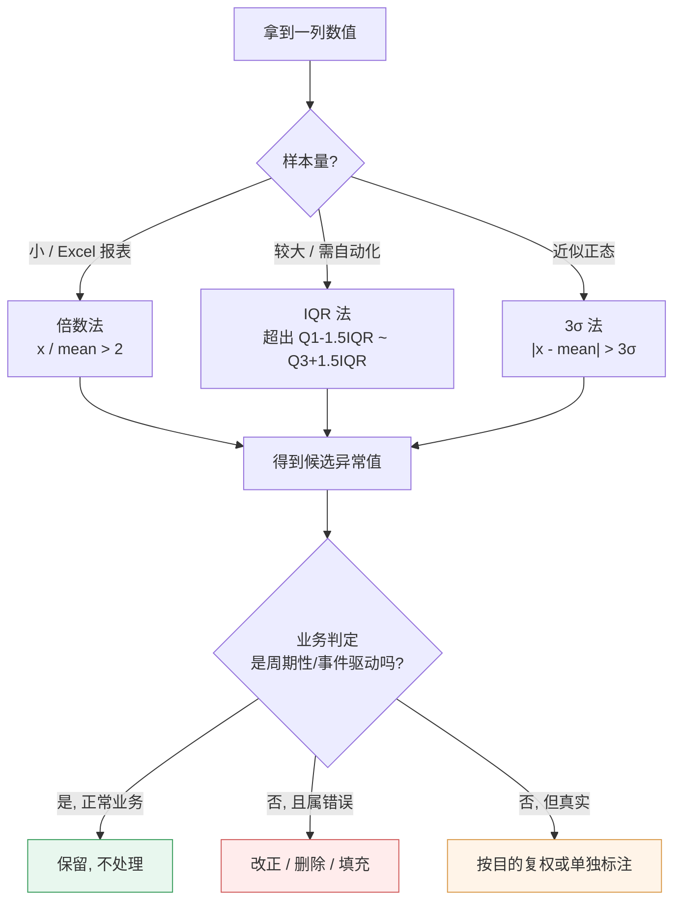

基金净值某天跌了 12%，看起来是严重异常——查公告发现是**分红派息**，投资者一分钱没损失，价格下跌只是把现金从基金里拿了出来。**异常值是信号，不是垃圾**。这一节把「识别 → 判定 → 处理」三步拆开，给出可运行的检测与调整代码。

## 纲要

- 异常值（离群点）= 与整体规律偏差极大的观测；经验阈值是**偏离均值 2 倍以上**，但阈值必须服从业务
- 识别核心是**观测值与总体的差异度**：小样本用倍数法，大样本用 IQR / 3σ / 散点图
- **周期性行业的高峰不是异常**：旅游暑期交易额是平时的 2~3 倍，属正常业务数据
- 三类成因分开处理：**错误记录**（改正）、**错误添加**（删除）、**真实且正确**（按分析目的决定是否调整）
- 处理手段：置空 / 删除 / 填样本均值 / **按事件复权**（乘以 `1 + 影响比例`）
- 异常值有**附加价值**：数据背后是事件，把因果搞懂，结论才从「跌了 12%」升级到「分红导致，无实际损失」

## 读前须知（名词与环境）

| 名词 | 在这篇里指什么 |
| --- | --- |
| pandas | Python 的数据处理库，把表格读成二维对象再做运算 |
| numpy | Python 的数值计算库，提供数学函数与数组运算 |
| dtype | 列在程序里的存储类型，例如整数、文本、日期 |
| IQR | 四分位距，用上四分位数减下四分位数，衡量数据的离散范围 |

> **运行环境**：Python 3 + pandas（数据处理库） + numpy（数值计算库）；安装命令 `pip install pandas numpy`。代码块各自自包含，可单独复制运行。表格里的全大写词是 Excel 或 SQL 的函数名，紧随其后都给了中文用途。
>
> **材料来源**：本文依据一套数据分析课程讲义整理，文中「讲义」指课程原文，「口述」指讲师在课上口头给出的数字。讲义说法与软件实际行为不一致时，本文按可复算的结果或软件官方语义改写，并在正文注明。

## 一、识别：三种方法，适用不同样本量



| 方法 | 判据 | 优点 | 局限 |
| --- | --- | --- | --- |
| 倍数法 | `x / mean > 2`（或 `< 0.5`） | Excel 一列公式搞定，小样本够用 | 均值本身被异常值拉高，可能漏检 |
| IQR 法 | `x < Q1 − 1.5·IQR` 或 `x > Q3 + 1.5·IQR` | 基于分位数，**不受极值影响**，更稳健 | 需要足够样本；强偏态数据会多标 |
| 3σ 法 | `\|x − x̄\| > 3σ` | 正态分布下有明确概率含义 | 均值/标准差都被异常值污染；非正态不适用 |
| 散点图 | 肉眼找偏离趋势的点 | 能看出结构、聚类、时间位置 | 不可自动化，大数据量不适用 |

讲义里的那个 9 人薪酬案例：均值 16,788.89，65,000 除以均值 **= 3.87 倍**，其余多数落在 0.4~1.0 倍区间，倍数法一眼就能挑出来。

> **关键坑**：倍数法的分母是含异常值的均值，异常值越极端越把自己「藏」起来（均值被拉高后倍数变小）。样本稍大就该换 IQR。

## 二、判定：先问业务，再动手

| 场景 | 典型表现 | 是否处理 | 处理方式 |
| --- | --- | --- | --- |
| 周期性正常峰值 | 旅游暑期、双 11 大促、春节返乡 | **不处理** | 保留；建模时用同比或季节项 |
| 事件驱动但真实 | 基金分红派息导致净值下跌 | 看分析目的 | 画原样折线→不处理；算波动率/风险→复权 |
| 录入错误 | 薪酬多了个 0、多写负号 | 处理 | 改正为正确值 |
| 混入异类数据 | 薪酬表里混进年龄 | 处理 | 直接删除该记录 |
| 预处理缺失 | 字段为空、非法值 | 处理 | 置空 / 填样本均值 / 删除 |

讲义讲得很直白：**「如果我单纯想用价格体现折线图，不需要处理，我得真实反映分红导致的下跌；如果我要抓价格数据做量化策略、判断风险程度，就需要调整。」** 同一个数，目的不同，处理相反。

## 三、处理：四种手段与复权公式

- **置空 / 删除**：错误添加的数据，或后续统计能容忍缺失时使用。
- **填样本均值**：让该条不参与均值/平均差/标准差的偏移计算；注意会**人为压低方差**。
- **按事件复权**：分红导致当日及之后价格下跌 `r`，则统一乘以 `1 + r` 还原到未受影响的水平。讲义例子 `r = 0.08` → 系数 `1.08`。

```text
work/target/data-analysis/
├── _PROGRESS.md
├── cleaning/
│   ├── 01_detect.py          # 倍数法 / IQR / 3σ 三种检测对照
│   ├── 02_classify.py        # 按成因打标: 错误 / 异类 / 真实事件
│   └── 03_adjust.py          # 置空 / 均值填充 / 复权
└── output/
    ├── outliers.csv          # 候选异常值 + 判定标签
    └── price_adjusted.csv    # 复权后价格序列
```

## 能力速览（要做什么 → 用哪个函数或写法）

| 能力 | pandas / numpy 做法 | 说明 |
| --- | --- | --- |
| 倍数法 | `s / s.mean()` | 取 `> 2` 或 `< 0.5` |
| IQR 上下界 | `q1, q3 = s.quantile([.25,.75]); iqr=q3-q1` | 界外即候选 |
| 3σ | `(s - s.mean()).abs() > 3*s.std(ddof=0)` | 需先确认近似正态 |
| 置空 | `s.mask(mask)` | 后续 `.mean()` 自动跳过 NaN |
| 均值填充 | `s.mask(mask, s[~mask].mean())` | 用**未污染**子集算均值 |
| 复权 | `s.loc[date:] *= (1 + r)` | 只对受影响区间 |
| 重复/空白/无效 | `s.duplicated()` / `s.isna()` / 自定义规则 | 清洗四类问题 |

## 可运行示例

三段代码可直接运行：第一段对照三种检测法，第二段演示四种处理手段，第三段做分红复权。

```python
from __future__ import annotations

import pandas as pd

salary = pd.Series([7500, 8000, 9000, 10000, 11000,
                    12000, 13000, 15600, 65000], name="salary")

# 1) 倍数法（讲义口径）
ratio = salary / salary.mean()
print("倍数法 >2:", salary[ratio > 2].tolist(),
      "| 65000 的倍数:", round(ratio.iloc[-1], 2))
assert abs(ratio.iloc[-1] - 3.87) < 0.01

# 2) IQR 法（更稳健）
q1, q3 = salary.quantile([0.25, 0.75])
iqr = q3 - q1
lo, hi = q1 - 1.5 * iqr, q3 + 1.5 * iqr
print(f"IQR 界: [{lo}, {hi}] | 界外:", salary[(salary < lo) | (salary > hi)].tolist())

# 3) 3σ 法：本例均值/σ 被极值污染，反而检不出 —— 正是它的局限
sigma = salary.std(ddof=0)
three = (salary - salary.mean()).abs() > 3 * sigma
print("3σ 检出:", salary[three].tolist(), "(本例为空, 说明该法不适用于小样本含极值)")
```

```python
from __future__ import annotations

import pandas as pd

s = pd.Series([7500, 8000, 9000, 10000, 11000,
               12000, 13000, 15600, 65000], dtype=float)
mask = s > 30000                      # 已判定为「错误添加」
clean_mean = s[~mask].mean()

dropped = s[~mask]                    # 删除
nulled = s.mask(mask)                 # 置空
filled = s.mask(mask, clean_mean)     # 用未污染子集均值填充

print("原均值:", round(s.mean(), 2))
print("删除后:", round(dropped.mean(), 2), "| 置空后:", round(nulled.mean(), 2))
print("填充后:", round(filled.mean(), 2), "| 填充值:", clean_mean)
print("填充后标准差:", round(filled.std(ddof=0), 2),
      "(人为压低, 报告中须注明)")
assert dropped.mean() == nulled.mean() == filled.mean() == 10_762.5
```

```python
from __future__ import annotations

import pandas as pd

# 分红派息导致第 6 天起净值整体下移 8%，做风险计算前需复权
nav = pd.Series([1.00, 1.02, 1.01, 1.03, 1.04, 0.957, 0.962, 0.970], name="nav")
r = 0.08
adjusted = nav.copy()
adjusted.iloc[5:] *= (1 + r)          # 只调整受影响区间

print("原始 第5→6 日跌幅:", f"{nav.iloc[5] / nav.iloc[4] - 1:.2%}")
print("复权 第5→6 日跌幅:", f"{adjusted.iloc[5] / adjusted.iloc[4] - 1:.2%}")
print("原始波动率 σ:", round(nav.std(ddof=0), 4))
print("复权波动率 σ:", round(adjusted.std(ddof=0), 4))
assert adjusted.std(ddof=0) < nav.std(ddof=0), "复权后风险指标应回落"
```

## 📎 文本↔代码关联

| 文中结论 | 代码位置 | 怎么看 |
| --- | --- | --- |
| 65,000 是 3.87 倍 | 第一段 `ratio` | `assert` 精确匹配讲义 |
| IQR 比倍数法稳健 | 第一段 `q1/q3` | 同样检出 65,000 |
| 3σ 在小样本会漏检 | 第一段 `three` | 输出空列表 |
| 均值填充压低方差 | 第二段 `filled.std()` | 数值明显小于原序列 |
| 复权消除分红假跌 | 第三段 `adjusted` | 跌幅收敛、σ 下降 |

## 常见坑

- **把周期性峰值当异常**：旅游、空调、教培的旺季数据删掉，模型就学不到季节性。
- **把真实事件一删了之**：分红、大促、政策变动是**信息**，删掉等于丢掉最有价值的因果线索。
- **用被污染的均值做阈值**：倍数法与 3σ 的分母/σ 都含异常值，极端异常反而可能漏检，优先 IQR。
- **均值填充不标注**：会压低方差、伪造样本量，报告里必须写明填充条数与方式。
- **复权范围搞错**：只改当天不改之后，或把分红前的历史也乘了系数，都会造出新的假数据。

## 面试官会问什么

> 面试官在这节最想区分「会调包」和「知道什么时候不该处理」。判定先于处理是主线。

| # | 面试官会问 | 回答要点（可直接口述） | 常见追问 |
| --- | --- | --- | --- |
| 1 | 异常值识别有哪几种方法，各自适用什么条件？ | 小样本用倍数法，较大样本用四分位距法，近似正态用三倍标准差法，散点图用来看结构和时间位置。阈值必须服从业务。 | 为什么倍数法可能漏检？ |
| 2 | 三倍标准差法在小样本含极值时为什么反而检不出？ | 均值和标准差都被这个极值污染了，阈值被一起抬高。这正是它不适用于含极值小样本的原因，应该换四分位距法。 | 四分位距法有什么代价？ |
| 3 | 基金分红导致净值跌 12%，这一条该删吗？ | 不该删。它是真实事件，投资者没有实际损失。画价格折线就保留，算波动率或风险就按事件复权，目的不同处理相反。 | 旅游暑期交易额是平时三倍，算异常吗？ |
| 4 | 复权公式怎么写，作用范围是哪些行？ | 受影响区间从事件发生日起统一乘以一加影响比例。只改当天不改之后，或把事件之前的历史也乘了，都会造出新的假数据。 | 比例取错会怎样？ |
| 5 | 用均值填充异常值有什么副作用？ | 会人为压低方差、伪造样本量。必须在报告里写明填充条数、填充值和方式，最好用未污染子集算均值。 | 置空和删除又各有什么代价？ |

**红旗答案**（说出来基本就停在这一档）：

- 见到异常就删——把信息当成垃圾丢掉。
- 把周期性峰值当异常处理，模型就学不到季节性。
- 用被污染的均值做阈值，却不说明它可能漏检。

**加分点**：

- 给出分红复权前后波动率下降的可运行验证，而不是只写公式。
- 把异常值挂回业务事件，结论从「跌了 12%」升级到「分红导致，无实际损失」。

## 总结

- 识别看**差异度**：小样本倍数法、大样本 IQR、近似正态用 3σ，散点图辅助定位。
- **判定先于处理**：周期性峰值与事件驱动的极值都要保留，除非分析目的（如风险计算）明确要求还原。
- 三类成因：**错误记录→改正、错误添加→删除、真实事件→按目的复权或标注**。
- 复权公式是受影响区间统一乘 `1 + r`；填充均值会压低方差，必须留痕。
- 异常值的附加价值在于**把数据挂回事件**，这一步决定报告有没有洞察。