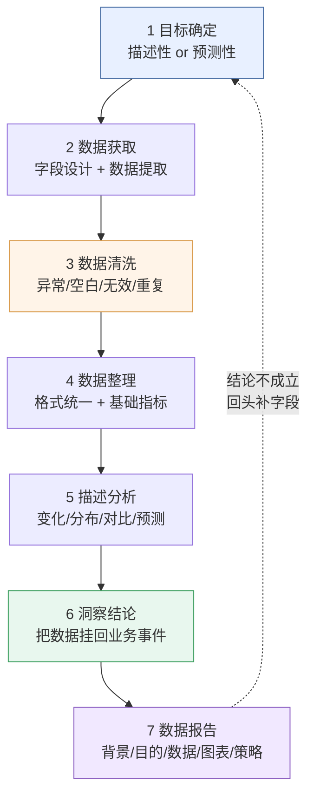

「帮我看看这批数据能得出什么结论」——这是最容易翻车的开局。**没有目标，就没有字段设计；没有字段设计，后面七步全是白做**。这一节把完整流程拆成目标确定 → 数据获取 → 数据清洗 → 数据整理 → 描述分析 → 洞察结论 → 数据报告，并给出一条可运行的端到端示例。

## 纲要

- 七步是一条**有依赖的链**：前一步的输出是后一步的输入，跳步会在最后以「结论站不住」的形式暴露
- **目标确定**先分流：描述性分析回答「现在怎样」，预测性分析回答「将来怎样」，后者对统计与业务知识要求更高
- **数据获取**分两件事：字段设计（指标型数据要拆回基础数据）与数据提取（线下导出 / 线上 SQL）
- **数据清洗**针对四类：异常值、空白值、无效值、重复值；**数据整理**负责格式统一与基础指标计算，两步别混
- **描述分析**有四个固定视角：变化、分布、对比、预测；**洞察结论**才把数据挂回业务事件
- **数据报告**五段式：背景、目的、数据基本情况、可视化图表、策略选择
- 讲义把「撰写报告」说成了「第六步」，实际是**第七步**（洞察结论才是第六步），本文按七步校正

## 读前须知（名词与环境）

| 名词 | 在这篇里指什么 |
| --- | --- |
| pandas | Python 的数据处理库，把表格读成二维对象再做运算 |
| DataFrame | pandas 里的二维表格对象：有行、有列、每列有类型 |
| dtype | 列在程序里的存储类型，例如整数、文本、日期 |
| SQL | 数据库查询语言，用来从表里取数、筛选、汇总 |
| IQR | 四分位距，用上四分位数减下四分位数，衡量数据的离散范围 |

> **运行环境**：Python 3 + pandas（数据处理库）；安装命令 `pip install pandas`。代码块各自自包含，可单独复制运行。表格里的全大写词是 Excel 或 SQL 的函数名，紧随其后都给了中文用途。
>
> **材料来源**：本文依据一套数据分析课程讲义整理，文中「讲义」指课程原文，「口述」指讲师在课上口头给出的数字。讲义说法与软件实际行为不一致时，本文按可复算的结果或软件官方语义改写，并在正文注明。

## 一、先分清：什么叫「互联网数据分析」

| 概念 | 含义 | 例子 |
| --- | --- | --- |
| 互联网 | 线上、电子化的信息传输载体 | 数字货币 vs 纸币：等值，但一个线上一个实物 |
| 数据分析 | 总结数据规律，用来支撑决策 | 统计岗位数、对比同类岗位，判断需求是否旺盛 |
| 互联网数据分析 | 分析对象**基于线上产生** | 从招聘站抓取的岗位数据 ✓；线下用户问卷 ✗ |

区别只在**数据获取场景**。随着渠道整体迁到线上，现在谈数据分析，默认就是基于线上数据；数据是最原始的生产材料。

## 二、七步全景



**反馈箭头是这套流程的关键**：报告写到「策略选择」时发现结论没有数据支撑，要回到第一步重新界定目标，而不是硬凑一个结论。

## 三、逐步拆解，每步的关注点

### 第一步：目标确定

| 类型 | 回答什么 | 典型做法 | 门槛 |
| --- | --- | --- | --- |
| 描述性分析 | 现状如何 | 汇总指数点位、涨跌点数、涨跌幅；做统计、比较、图表 | 基础，占日常工作大部分 |
| 预测性分析 | 将来如何 | 用历史数据回测买卖策略、预测销售额 | 统计学 + 业务知识要求更高 |

以证券数据为例：每日/每周/每月汇总指数名称与涨跌幅是**描述性**；在此基础上找「什么时候买、什么时候卖能赚钱」并用历史回测验证，就是**预测性**。

### 第二步：数据获取

- **字段设计**：想分析销售额，需要平均销售额、销售总额、增减幅度，但这些**指标型数据在库里通常不存在**。要往下拆到库里真实存在的**基础数据**：订单号、交易日期、交易金额，再由它们计算得到指标。
- **数据提取**：传统企业靠销售管理软件录入，导入导出即可；互联网业务全在线上完成，数据直接落在数据库里，一般用 **SQL** 提取。产品/运营常填「数据需求单」，把字段、分析目的、特殊格式与计算口径写给数据管理员。

> **字段设计的本质是从「想要的指标」反推「能拿到的原始列」**。反推不出来，说明这个指标在当前数据下算不了，要尽早回去改目标，别等到写报告。

### 第三步：数据清洗

四类问题，处理方式不同：

| 问题 | 表现 | 常见处理 |
| --- | --- | --- |
| 异常值 | 与整体规律偏差极大 | 先识别、再业务判定，最后改正/删除/复权/标注 |
| 空白值 | 字段为空 | 填补（均值等）或删除 |
| 无效值 | 非法格式、越界值、类型不符 | 修正或删除 |
| 重复值 | 同一条记录出现多次 | 去重 |

异常值的识别与判定需要单独一套方法，本篇只把它当作流程中的一步；空白、无效、重复一般用**修正 / 平均值填补 / 删除**三招。清洗不做，后面所有计算统计都可能是错的。

### 第四步：数据整理

- **格式统一**：确认日期是不是同一种写法（如 `2026-10-19` 与 `2026/10/20` 混用），统一后既美观又方便计算，最终形成一张**二维表**。
- **基础指标计算**：算平均值、总额、频数、频率等一级指标，为第五步铺路。

清洗和整理的分界：**清洗管「对不对」，整理管「齐不齐、能不能算」**。

### 第五步：描述分析

分两块：**数据的描述**（总条数、时间跨度、数据来源）与**指标统计的描述**（结合业务明确涉及哪些指标，如网站流量的跳转率、登录率、注册率、转化率、购买率、活跃率）。

四个固定视角：

| 视角 | 回答什么 | 例子 |
| --- | --- | --- |
| 变化 | 随时间增减幅度如何 | 近期销售额表现 |
| 分布 | 部分与整体、不同层次的表现 | 地域分布、人群分布、内容分布、点击量分布 |
| 对比 | 数据项之间的差异 | 产品线各环节对比、用户数对比 |
| 预测 | 由现有表现/变量关系推未来 | 由增减幅度外推下期数值 |

### 第六步：洞察结论

同一张图，不同人读出的东西完全不同。以上证指数为例：2018 年 6—12 月整体向下、2019 年 1 月起向上。入门分析师只能写出「2018 年跌了多少、2019 年涨了多少」；有业务认知的人会把每月跌幅与当时的**贸易摩擦事件、相关产业影响**挂起钩来解释原因。

结论是报告的核心，体现的是**数据理解 × 业务理解 × 两者挂钩关系**这三件事。

> **口述编号校正**：讲义在复习时把「汇总成数据报告」又说成「第六步」，与前面的洞察结论编号重复。按七步结构，洞察结论是第六步，**报告撰写是第七步**。

### 第七步：数据报告

| 段落 | 写什么 | 对应例子 |
| --- | --- | --- |
| 报告背景 | 要描述的业务现状 | 近期销售额不如预期 |
| 报告目的 | 要解决的问题 | 想要提升销售额 |
| 数据基本情况 | 体现**数据可信度** | 数据来源、维度、是否完整、是否正确 |
| 可视化图表 | 增强读者的理解程度 | 计算与可视化后的图表 |
| 策略选择 | 解决方案或未来走势 | 基于图表与结论给出建议 |

报告通常是给上级或团队看的，用于支撑策略调整。前四段都在铺可信度，最后一段才是价值落点。

```text
work/target/data-analysis/
├── _PROGRESS.md                  # 断点表：一行 = 一篇产出
├── pipeline/
│   ├── 01_goal.py                # 目标分流：描述性 / 预测性
│   ├── 02_acquire.py             # 字段设计 + SQL 提取
│   ├── 03_clean.py               # 异常/空白/无效/重复 四类
│   ├── 04_tidy.py                # 日期格式统一 + 基础指标
│   ├── 05_describe.py            # 变化/分布/对比/预测 四视角
│   └── 06_report.py              # 五段式报告骨架
└── output/
    ├── tidy.csv                  # 整理后的二维表
    └── report.md                 # 数据报告
```

## 能力速览（要做什么 → 用哪个函数或写法）

| 能力 | pandas / SQL 做法 | 说明 |
| --- | --- | --- |
| 字段设计 | `SELECT order_id, trade_date, amount FROM orders` | 先取基础数据，指标由计算得出 |
| 去重 | `df.drop_duplicates()` | 对应「重复值」 |
| 空白值 | `df["amount"].isna()` / `.fillna(v)` | 填补或删除，须留痕 |
| 无效值 | `df[df["amount"] > 0]` | 按业务规则过滤 |
| 异常值 | `q1,q3=df.amount.quantile([.25,.75])` 后 IQR 判定 | 判定先于处理 |
| 日期统一 | `pd.to_datetime(df["date"], format="mixed")` | 混用格式一次归一 |
| 变化 | `.resample("W").sum().pct_change()` | 周环比 |
| 分布 | `.groupby("category").sum()` / 占比 | 部分与整体 |
| 对比 | `.groupby(...).agg(["sum","mean","count"])` | 多口径并列 |
| 预测 | `np.polyfit(x, y, 1)` | 线性外推，仅作基线 |
| 基础指标 | `.agg(["sum","mean","count"])` | 总额/均值/频数 |

## 可运行示例

用讲义留下的练习——「分析自己过去四周的支出」——把七步跑通。三段代码各自可独立运行。

```python
from __future__ import annotations

import pandas as pd

# 第 1 步：目标确定（描述性分析：过去四周支出结构与变化）
GOAL = "describe"   # 若要预测下月支出，改为 "predict"

# 第 2 步：数据获取 —— 字段设计反推到基础数据：日期 / 类别 / 金额
raw = pd.DataFrame([
    ("2026-10-19", "餐饮", 68.0),
    ("2026/10/21", "交通", 12.0),
    ("2026-10-24", "餐饮", 88.0),
    ("2026-10-24", "餐饮", 88.0),      # 重复值
    ("2026-10-27", "购物", None),       # 空白值
    ("2026-10-29", "交通", -30.0),      # 无效值（金额为负）
    ("2026-11-02", "餐饮", 72.0),
    ("2026-11-05", "购物", 259.0),
    ("2026-11-08", "娱乐", 8000.0),     # 异常值（真实大额消费，需业务判定）
    ("2026-11-11", "餐饮", 65.0),
    ("2026-11-14", "交通", 15.0),
], columns=["date", "category", "amount"])

print("目标:", GOAL, "| 原始行数:", len(raw))
print("基础字段:", list(raw.columns), "-> 指标字段: 周总额 / 周均值 / 环比 / 类别占比")
```

```python
from __future__ import annotations

import pandas as pd

raw = pd.DataFrame([
    ("2026-10-19", "餐饮", 68.0), ("2026/10/21", "交通", 12.0),
    ("2026-10-24", "餐饮", 88.0), ("2026-10-24", "餐饮", 88.0),
    ("2026-10-27", "购物", None), ("2026-10-29", "交通", -30.0),
    ("2026-11-02", "餐饮", 72.0), ("2026-11-05", "购物", 259.0),
    ("2026-11-08", "娱乐", 8000.0), ("2026-11-11", "餐饮", 65.0),
    ("2026-11-14", "交通", 15.0),
], columns=["date", "category", "amount"])

# 第 3 步：清洗 —— 四类问题逐个处理
df = raw.drop_duplicates()                       # 重复值
df = df[df["amount"].notna()]                    # 空白值：本例删除
df = df[df["amount"] > 0]                        # 无效值：金额必须为正
q1, q3 = df["amount"].quantile([0.25, 0.75])
hi = q3 + 1.5 * (q3 - q1)
outliers = df[df["amount"] > hi]
print("IQR 候选异常值:", outliers["amount"].tolist(), "(真实消费 -> 保留并标注, 不删除)")

# 第 4 步：整理 —— 格式统一 + 基础指标
df = df.copy()
df["date"] = pd.to_datetime(df["date"], format="mixed")
df["week"] = df["date"].dt.to_period("W").astype(str)
tidy = df[["date", "week", "category", "amount"]].sort_values("date")
print("整理后二维表:")
print(tidy.to_string(index=False))
print("基础指标 -> 总额:", round(tidy.amount.sum(), 2),
      "| 均值:", round(tidy.amount.mean(), 2), "| 频数:", len(tidy))
assert tidy["date"].dtype.kind == "M", "日期必须已统一为 datetime"
assert len(tidy) == 8, "去重/去空白/去无效后应剩 8 行"
```

```python
from __future__ import annotations

import pandas as pd

tidy = pd.DataFrame([
    ("2026-10-19", "W1", "餐饮", 68.0), ("2026-10-21", "W1", "交通", 12.0),
    ("2026-10-24", "W1", "餐饮", 88.0), ("2026-11-02", "W2", "餐饮", 72.0),
    ("2026-11-05", "W2", "购物", 259.0), ("2026-11-08", "W2", "娱乐", 8000.0),
    ("2026-11-11", "W3", "餐饮", 65.0), ("2026-11-14", "W3", "交通", 15.0),
], columns=["date", "week", "category", "amount"])

# 第 5 步：描述分析 —— 变化 / 分布 / 对比 / 预测
weekly = tidy.groupby("week")["amount"].sum()
print("[变化] 周总额与环比:")
print(pd.DataFrame({"总额": weekly, "环比": weekly.pct_change()}).round(3).to_string())

share = tidy.groupby("category")["amount"].sum() / tidy["amount"].sum()
print("\n[分布] 类别占比:"); print(share.round(3).to_string())

compare = tidy.groupby("category")["amount"].agg(["sum", "mean", "count"])
print("\n[对比] 各类别多口径:"); print(compare.round(2).to_string())

# 第 6 步：洞察结论 —— 把异常挂回业务事件
big = tidy.loc[tidy["amount"].idxmax()]
conclusion = f"第 {big.week} 周总额跳升由单笔 {big.category} {big.amount:.0f} 元驱动, 属真实事件, 非日常支出"
print("\n[洞察]", conclusion)
clean_weekly = tidy[tidy["amount"] < 1000].groupby("week")["amount"].sum()
print("[剔除大额事件后的日常支出]:"); print(clean_weekly.to_string())

# 第 7 步：报告五段式骨架
report = ["报告背景: 过去四周支出波动明显",
          "报告目的: 判断日常支出是否可控",
          "数据基本情况: 8 条 / 3 周 / 来源=个人账单 / 已清洗 3 条",
          "可视化图表: 周趋势折线 + 类别占比饼图",
          "策略选择: 大额事件单列, 日常支出按周设上限"]
print("\n[报告]"); print("\n".join(f"  {i}. {s}" for i, s in enumerate(report, 1)))
assert len(report) == 5
```

## 📎 文本↔代码关联

| 文中结论 | 代码位置 | 怎么看 |
| --- | --- | --- |
| 指标要拆回基础数据 | 第一段字段设计 | `columns` 只有日期/类别/金额，周总额全靠后续计算 |
| 清洗四类各管一件事 | 第二段四行过滤 | 断言 `len(tidy)==8` 精确对上 11→8 的处理结果 |
| 清洗管对错、整理管格式 | 第二段 `pd.to_datetime` | `dtype.kind == "M"` 断言格式已归一 |
| 异常值先看业务再决定 | 第二段 `outliers` | 小样本下 IQR 把 **259 与 8,000** 都标成候选，业务判定后均**保留** |
| 描述分析四视角 | 第三段四段输出 | 变化/分布/对比各自成表，预测需要建模，本篇只列框架 |
| 同一张图结论可以完全不同 | 第三段 `clean_weekly` | 剔除单笔事件后，周趋势从「暴涨」变成「平稳」 |
| 报告五段式 | 第三段 `report` | `assert len(report)==5` |

## 常见坑

- **先拿数据后定目标**：字段是别人给的，写报告时才发现关键指标算不出来，只能回头补数据需求单。
- **把清洗和整理混成一步**：日期没统一就直接 `groupby`，同一天会被拆成两行，环比全是错的。
- **见到异常值就删**：8,000 那笔是真实消费，删掉会得出「支出很平稳」的假结论；正确做法是标注 + 分口径呈现。
- **照搬 IQR 结论当业务结论**：示例里 8 行数据，IQR 上界只有几百元，连 259 元的正常购物都被标成候选。**统计判据只负责出候选，判定权在业务**，小样本尤其明显。
- **描述分析只做「变化」**：漏掉分布与对比，报告就只剩一条折线，支撑不了策略选择。
- **洞察结论停留在复述数字**：「本周比上周涨了 800%」不是结论，「由单笔真实大额消费驱动、日常支出未变」才是。
- **报告缺「数据基本情况」**：不写来源、维度、完整性，读者无法判断结论可信度，前四段的铺垫就白费了。

## 面试官会问什么

> 这节考的是流程观。面试官通常会用一个「结论站不住」的场景，看你会不会回退到第一步。

| # | 面试官会问 | 回答要点（可直接口述） | 常见追问 |
| --- | --- | --- | --- |
| 1 | 描述性分析和预测性分析有什么区别？ | 前者回答现状如何，做汇总、比较、可视化；后者回答将来如何，需要回测与建模，对统计学和业务知识要求更高。 | 日常工作中哪一类占比更高？ |
| 2 | 字段设计为什么要从想要的指标反推基础数据？ | 平均销售额、销售总额、增减幅度这类指标库里通常没有，能拿到的是订单号、交易日期、交易金额，指标必须由基础数据计算得到。 | 反推不出来说明什么？ |
| 3 | 数据清洗和数据整理的分界在哪？ | 清洗管数据对不对，处理异常、空白、无效、重复四类；整理管格式齐不齐、能不能算，统一日期格式并计算一级指标，最终形成二维表。 | 日期格式混用会引发什么问题？ |
| 4 | 描述分析有哪四个固定视角？ | 变化看随时间增减，分布看部分与整体，对比看数据项之间差异，预测由现有表现外推未来。 | 只做变化会漏掉什么？ |
| 5 | 数据报告五段式里，哪一段体现可信度？ | 数据基本情况：来源、维度、完整性、正确性。背景、目的、可视化图表、策略选择其余四段都建立在这段之上。 | 结论不成立时该改哪一步？ |

**红旗答案**（说出来基本就停在这一档）：

- 先拿数据后定目标，写报告时才发现关键指标算不出来。
- 把洞察结论写成复述数字，没有把数据挂回业务事件。
- 报告缺「数据基本情况」，读者无法判断结论可信度。

**加分点**：

- 明确说出「允许从报告回退到目标重新界定」，而不是硬凑一个结论。
- 能把七步讲成一条有依赖的链，并说清报告写到「策略选择」却发现结论无支撑时，应回退到目标确定重新界定，而不是继续往下写。

## 总结

- 七步是**目标确定 → 数据获取 → 数据清洗 → 数据整理 → 描述分析 → 洞察结论 → 数据报告**，一步依赖一步，允许从报告回退到目标。
- **目标先分流**：描述性看现状、预测性看未来；后者要补统计学与业务知识。
- **字段设计是指标反推基础数据**，提取方式由业务线上线下形态决定（导出 vs SQL）。
- 清洗四类：异常值、空白值、无效值、重复值；整理负责格式统一与一级指标。
- 描述分析四视角：变化、分布、对比、预测；洞察要**把数据挂回事件**。
- 报告五段式：背景、目的、数据基本情况、可视化图表、策略选择。