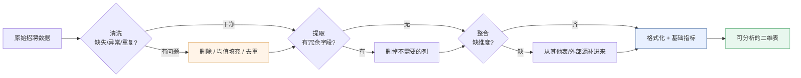

拿到一份招聘数据表，先别急着做图表。**真实分析里，清洗、格式化、去重、排序、基础指标计算要占掉一半以上的时间**，而且这一步做错，后面的统计和结论全是错的。这一节用「数据分析岗位招聘信息」做样本，把 Excel 的功能版图、文本函数三板斧和数学函数三类用法一次讲透，并给出 pandas 等价实现。

## 纲要

- 数据预处理分三件事：**清洗**（缺失/异常/重复）、**提取**（删掉不需要的字段）、**整合**（把别的表或外部数据源补进来）
- Excel 七个功能栏里，**公式**与**数据**是数据分析的核心板块，其余五个偏排版、协作与阅读
- 函数是「输入 → 输出关系的封装」；**文本函数管清洗与格式化，数学函数管统计与计算**
- 文本三板斧：**MID 提取**、**SUBSTITUTE 替换**、**FIND + ISNUMBER 验证**
- 数学函数三类：**基本换算**（SQRT/POWER）、**统计指标**（SUM/AVERAGE/MEDIAN/MODE/MAX/MIN/AVEDEV/STDEV）、**类型转换**（INT/EVEN）
- 集中趋势 = 均值/中位数/众数，离散趋势 = 极差/平均差/标准差；**标准差通过平方放大偏离，比平均差更敏感**
- Excel 下标从 **1** 开始、Python 从 **0** 开始，跨工具复刻 `MID` 时最容易差一位

## 读前须知（名词与环境）

| 名词 | 在这篇里指什么 |
| --- | --- |
| Python | 示例代码使用的编程语言，本文按 Python 3 运行 |
| pandas | Python 的数据处理库，把表格读成二维对象再做运算 |
| DataFrame | pandas 里的二维表格对象：有行、有列、每列有类型 |
| SQL | 数据库查询语言，用来从表里取数、筛选、汇总 |
| CSV | 逗号分隔的纯文本表格文件，常用作数据交换格式 |
| Excel 内置函数 | 全大写英文词都是 Excel 的函数名，正文表格里逐条给了中文用途 |

> **运行环境**：Python 3 + pandas（数据处理库）；安装命令 `pip install pandas`。代码块各自自包含，可单独复制运行。表格里的全大写词是 Excel 或 SQL 的函数名，紧随其后都给了中文用途。
>
> **材料来源**：本文依据一套数据分析课程讲义整理，文中「讲义」指课程原文，「口述」指讲师在课上口头给出的数字。讲义说法与软件实际行为不一致时，本文按可复算的结果或软件官方语义改写，并在正文注明。

## 一、功能版图：七个菜单栏谁干什么

| 功能栏 | 主要用途 | 数据分析相关度 |
| --- | --- | --- |
| 开始 | 字体/字号/颜色、数字格式、表格样式、增删改查、撤回 | 中：条件格式在这里 |
| 插入 | 数据透视表、图片/形状/图表、批注、文本框 | 中：图表与透视表入口 |
| 页面布局 | 主题、页边距、横向/纵向、纸张规格、打印区域 | 低 |
| **公式** | 全部计算函数，按处理对象分类（财务、文本、逻辑、数学…），可自定义函数 | **高：最核心** |
| **数据** | 导入外部数据（CSV / HTML / 文本 / 数据库连接）、排序、筛选、分列、去重、基础统计 | **高：最核心** |
| 审阅 | 批注、多人协作、第三方可读/可写权限 | 低 |
| 视图 | 单页/多页呈现、冻结首行首列、自定义视图、录制宏 | 中：大表必备 |

> 重复性的日常操作可以**录制宏**打包成快捷键，和 `Ctrl+C` / `Ctrl+B` 一样复用。

后续要掌握的就是这条链：文本函数、重复数据处理、拆分列、排序筛选 → 逻辑/条件聚合/引用函数 → 数据透视表 → 可视化图表。这些都是最基础也最常用的操作，掌握后能举一反三。

## 二、预处理到底在做什么



**为什么值得花时间**：后续统计和图表基本都有现成工具，唯独预处理必须自己判断口径。数据准确性没保证，统计结果与结论就没有意义。

## 三、文本函数：三个真实清洗任务

招聘表常见字段：招聘单位、薪资区间、招聘岗位、工作地点、经验要求、学历要求、岗位属性、技能类别、发布时间、职位福利描述、工作地址。这一节解决三个问题。

| 任务 | 函数 | 参数与要点 |
| --- | --- | --- |
| 去掉「经验」前缀 | `MID(text, start_num, num_chars)` | `text`=同行单元格；「经验」占前 2 字，故 `start_num=3`；长度取 6 以覆盖两位数年限 |
| 把学历列的 `1` 还原 | `SUBSTITUTE(text, old_text, new_text, [instance_num])` | `old_text=1`、`new_text=本科及以上`；**第四参数省略则全部替换**，指定后只替换第 N 次出现 |
| 验证技能类别是否含「数据分析」 | `FIND` + `ISNUMBER` | `FIND(find_text, within_text, [start_num])` 返回**起始位置数字**，找不到返回 `#VALUE!`；外面套 `ISNUMBER` 统一成 `TRUE/FALSE` |

讲义里的「经验 1-3 年」「经验不限」都是同一类冗余前缀；职位描述的「职位描述:」「岗位职责:」「任职要求:」「工作职责:」同理，清洗时统一去掉前缀但**保留后面全部文本**。

> **公式生成器比死记语法靠谱**：在公式栏点选函数，右侧会逐个列出参数名与含义，按提示点选单元格即可。写完一个单元格，把鼠标移到右下角绿色方块变成黑色十字后**双击**，自动填充整列。

```text
work/target/data-analysis/
├── _PROGRESS.md
├── cleaning/
│   ├── 01_text_funcs.py        # MID / SUBSTITUTE / FIND+ISNUMBER 的 pandas 等价实现
│   ├── 02_math_funcs.py        # SQRT / POWER / INT / EVEN / SUM / AVERAGE
│   └── 03_dispersion.py        # 均值/中位数/众数/极差/平均差/标准差 复算
└── output/
    ├── jobs_clean.csv          # 清洗后的招聘二维表
    └── skill_tags.txt          # 拆分去重后的技能标签
```

## 四、数学函数：三类能力

「数学和三角函数」里约一半是三角函数（SIN/COS/TAN/ACOS/ACOT…），数据分析真正用到的分三类：

| 类别 | 函数 | 示例 | 结果 |
| --- | --- | --- | --- |
| 基本换算 | `SQRT` | `=SQRT(4)` | 2 |
| 基本换算 | `POWER` | `=POWER(2,3)` | 8 |
| 统计指标 | `SUM` | `=SUM(H3:H14)` | 区域求和 |
| 统计指标 | `AVERAGE` | `=AVERAGE(1,2,3,4,5)` | 3 |
| 统计指标 | `MEDIAN` / `MODE` | 选中薪酬区域 | 中位数 / 众数 |
| 统计指标 | `MAX` − `MIN` | 组合出极差 | 无现成极差函数 |
| 统计指标 | `AVEDEV` / `STDEV.S` | 选中薪酬区域 | 平均差 / 样本标准差 |
| 类型转换 | `INT` | `=INT(1.234)` | 1 |
| 类型转换 | `EVEN` | `=EVEN(7.78)` | 8 |

**`SUM` 的参数既可以是散值**（`1,2,3,4`）**也可以是区域**（`H3:H14`）；`AVERAGE` 同理。参数形式灵活是这类聚合函数的共性。

> Excel 到今天已有三十多年积累，日常工作要用的公式基本都内置了。**不必背全量函数**，知道要实现什么效果，搜到关键字再在单元格里输 `=关键字` 选中最匹配的即可。

## 五、用数学函数复算集中趋势与离散趋势

讲义用 12 条薪酬数据算了六个指标，只给了口述结果、没公开原始数值。按这六个口径可以**反推重建一组等价样本**：

`[6880, 7900, 8200, 9000, 9000, 9500, 11000, 11800, 12200, 14500, 16000, 23000]`

| 指标 | 类别 | 重建样本复算 | 讲义口述 | 说明 |
| --- | --- | --- | --- | --- |
| 平均值 `AVERAGE` | 集中趋势 | 11,581.67 | 11,581 | 138,980 ÷ 12 |
| 中位数 `MEDIAN` | 集中趋势 | 10,250 | 10,250 | 第 6/7 位 9,500 与 11,000 取中 |
| 众数 `MODE` | 集中趋势 | 9,000 | 9,000 | 唯一出现两次的值 |
| 极差 `MAX−MIN` | 离散趋势 | 16,120 | 16,120 | 23,000 − 6,880 |
| 平均差 `AVEDEV` | 离散趋势 | 3,265.28 | 3,265 | 各值与均值绝对偏差的平均 |
| 样本标准差 `STDEV.S` | 离散趋势 | 4,512.05 | 4,513 | 差 0.95，属样本重建误差 |

**标准差是优化过的平均差**：平方放大了偏离，所以对极端值更敏感，数值明显大于平均差（4,512 vs 3,265）。这和前面「描述统计三件套」的结论一致。

> 这组数据是**按口径重建的等价样本，不是讲义原始数据**，用于让六个指标都能被读者自己复算验证；原始样本未公开，不冒充。

## 能力速览（要做什么 → 用哪个函数或写法）

| 能力 | Excel | pandas / Python | 说明 |
| --- | --- | --- | --- |
| 定长截取 | `MID(t,3,6)` | `s.str[2:8]` | **Excel 1-based，Python 0-based** |
| 全部替换 | `SUBSTITUTE(t,old,new)` | `s.str.replace(old,new,regex=False)` | 指定第 N 次用 `instance_num` |
| 只替换第 N 次 | `SUBSTITUTE(t,old,new,2)` | `s.str.replace(old,new,n=1)` 需先定位 | 语义不完全等价 |
| 查找位置 | `FIND(k,t)` | `s.str.find(k)` | 找不到：Excel `#VALUE!`，pandas `-1` |
| 是否为数值 | `ISNUMBER(x)` | `pd.to_numeric(...,errors="coerce").notna()` | 统一成布尔 |
| 文本合并 | `CONCATENATE(a,b)` | `a + b` 或 `.str.cat()` | — |
| 平方根 / 幂 | `SQRT` / `POWER` | `math.sqrt` / `**` | — |
| 求和 / 均值 | `SUM` / `AVERAGE` | `.sum()` / `.mean()` | — |
| 中位数 / 众数 | `MEDIAN` / `MODE` | `.median()` / `.mode()` | — |
| 极差 | `MAX()−MIN()` | `.max()−.min()` | 无现成函数 |
| 平均差 | `AVEDEV` | `(s−s.mean()).abs().mean()` | — |
| 样本标准差 | `STDEV.S` | `.std(ddof=1)` | pandas 默认 `ddof=1` |
| 截断小数 | `TRUNC` / `INT` | `math.trunc` / `math.floor` | 见「常见坑」 |
| 最近偶数 | `EVEN` | `2*math.ceil(x/2)` | 正数方向 |

## 可运行示例

三段代码各自独立可运行。第一段复刻文本三板斧，第二段演示三类数学函数，第三段复算六个统计指标。

```python
from __future__ import annotations

import pandas as pd

# 文本函数：三个真实清洗任务（讲义招聘表字段的子集）
df = pd.DataFrame({
    "经验要求": ["经验1-3年", "经验5-10年", "经验不限", "经验应届毕业生"],
    "学历要求": ["1", "本科", "1", "硕士"],
    "技能类别": ["Python|SQL|数据分析", "Java|Hadoop", "数据分析|可视化", "风控|建模"],
})

# MID(text, 3, 6) -> 「经验」占 2 字，从第 3 位起截取
df["经验_clean"] = df["经验要求"].str[2:8]
# SUBSTITUTE(text, "1", "本科及以上")，省略第四参数 = 全部替换
df["学历_clean"] = df["学历要求"].str.replace("1", "本科及以上", regex=False)
# FIND + ISNUMBER：找到返回位置(>=0)，找不到返回 -1
pos = df["技能类别"].str.find("数据分析")
df["含数据分析"] = pos.ge(0)

print(df.to_string(index=False))
assert df.loc[0, "经验_clean"] == "1-3年"
assert df.loc[1, "学历_clean"] == "本科"
assert df["含数据分析"].tolist() == [True, False, True, False]
print("MID 起始位从 1 开始 -> pandas 切片从 0 开始, 故 str[2:8] 对应 MID(t,3,6)")
```

```python
from __future__ import annotations

import math

import pandas as pd

# 基本换算
print("SQRT(4) =", math.sqrt(4), "| POWER(2,3) =", 2 ** 3)
# 类型转换（讲义只演示了正数）
print("INT(1.234) =", math.trunc(1.234), "| EVEN(7.78) =", 2 * math.ceil(7.78 / 2))
# Excel 的 INT 对负数是「向下取整」，TRUNC 才是无条件截断
print("负数差异: Excel INT(-1.2) = -2, TRUNC(-1.2) =", math.trunc(-1.2))

salary = pd.Series([6880, 7900, 8200, 9000, 9000, 9500, 11000,
                    11800, 12200, 14500, 16000, 23000], name="salary")
print("SUM =", salary.sum(), "| AVERAGE =", round(salary.mean(), 2))
print("AVERAGE(1,2,3,4,5) =", pd.Series([1, 2, 3, 4, 5]).mean())
assert salary.sum() == 138980
assert math.trunc(1.234) == 1 and 2 * math.ceil(7.78 / 2) == 8
```

```python
from __future__ import annotations

import pandas as pd

# 按讲义六个口径重建的等价样本（非原始招聘数据），用于复算验证
s = pd.Series([6880, 7900, 8200, 9000, 9000, 9500, 11000,
               11800, 12200, 14500, 16000, 23000], name="salary")
m = s.mean()
adev = (s - m).abs().mean()          # AVEDEV
sd = s.std(ddof=1)                   # STDEV.S（pandas 默认 ddof=1）

print("集中趋势 -> 均值:", round(m, 2),
      "| 中位数:", s.median(), "| 众数:", s.mode().tolist())
print("离散趋势 -> 极差:", s.max() - s.min(),
      "| 平均差:", round(adev, 2), "| 样本标准差:", round(sd, 2))
print("标准差 / 平均差 =", round(sd / adev, 3), "(平方放大偏离, 故 >1)")
print("唯一重复值:", s[s.duplicated(keep=False)].unique().tolist())

assert s.sum() == 138980 and s.median() == 10250
assert s.mode().tolist() == [9000] and s.max() - s.min() == 16120
assert abs(adev - 3265) < 1 and abs(sd - 4513) < 2
assert sd > adev, "标准差必须大于平均差"
```

## 📎 文本↔代码关联

| 文中结论 | 代码位置 | 怎么看 |
| --- | --- | --- |
| `MID(t,3,6)` 去掉「经验」前缀 | 第一段 `.str[2:8]` | 断言第 0 行得到 `1-3年` |
| `SUBSTITUTE` 省略第四参数全替换 | 第一段 `str.replace` | 第 0/2 行 `1` → `本科及以上` |
| `FIND` 找不到会报错，需 `ISNUMBER` 兜底 | 第一段 `pos.ge(0)` | 输出 `[True, False, True, False]` |
| Excel 1-based vs Python 0-based | 第一段末行打印 | 切片起点 2 对应参数 3 |
| `INT` 是截断不是四舍五入 | 第二段 `math.trunc` | `1.234 → 1`；负数差异单独打印 |
| 六口径全部对上 | 第三段 5 个 `assert` | 138,980 / 10,250 / 9,000 / 16,120 / 3,265±1 / 4,513±2 |
| 标准差比平均差敏感 | 第三段 `sd/adev` | 比值 >1 且被断言 |

## 常见坑

- **`MID` 下标差一位**：Excel 从 1 数、Python 从 0 数，把 `MID(t,3,6)` 直译成 `str[3:9]` 会丢掉年限首位。
- **`FIND` 的 `#VALUE!` 直接参与统计**：先用 `ISNUMBER` 包成布尔再筛选，否则整列公式结果会被错误值污染；`FIND` 还**区分大小写**，不区分要用 `SEARCH`。
- **`SUBSTITUTE` 忘了第四参数**：默认替换全部出现，只想替换第 2 次时必须显式给 `instance_num`。
- **把 `INT` 当四舍五入**：讲义用 1.234 演示说「直接去掉小数」，但 Excel `INT` 对负数是**向下取整**（`INT(-1.2) = -2`），真正无条件截断的是 `TRUNC`；`EVEN` 也是沿绝对值增大方向取偶数。
- **拿 `AVEDEV` 当标准差**：两者口径不同，报告里不写清用的是哪个，数字就对不上；`STDEV.S`（样本，除以 n−1）与 `STDEV.P`（总体，除以 n）也不能混。
- **用私有样本的数字硬凑结论**：讲义只给口述结果，本文明确标注「按口径重建的等价样本」，复算用于验证概念，不冒充原始数据。
- **清洗后没留痕**：删了多少重复、填了多少空值都要记录，否则报告里「数据基本情况」这一段没有可信度。

## 面试官会问什么

> 这节的函数名很容易背混，面试官更在意跨工具迁移时下标、取整、标准差口径这些细节。

| # | 面试官会问 | 回答要点（可直接口述） | 常见追问 |
| --- | --- | --- | --- |
| 1 | Excel 七个功能栏里哪两个是数据分析的核心？ | 公式和数据。公式提供全部计算函数并按处理对象分类，数据负责导入外部数据、排序筛选、分列去重和基础统计。 | 重复操作怎么自动化？ |
| 2 | MID、SUBSTITUTE、FIND 分别解决什么问题？ | MID 按位置截取文本，SUBSTITUTE 替换指定文本，FIND 返回关键字起始位置。找不到时 FIND 报错，外面套 ISNUMBER 统一成布尔值。 | FIND 区分大小写吗？ |
| 3 | Excel 和 Python 的下标差在哪？ | Excel 从 1 开始数，Python 从 0 开始；把 MID 的第三位起始直译成切片下标 3 会丢掉首位字符。 | 截取长度参数又怎么对应？ |
| 4 | INT 和 TRUNC 在负数上的区别？ | INT 是向下取整，负数会得到更小的整数；TRUNC 才是无条件截断小数。讲义只用正数演示，容易误记成四舍五入。 | EVEN 对负数呢？ |
| 5 | STDEV.S 和 AVEDEV 为什么数值差这么多？ | 平均差取绝对偏差的均值，标准差通过平方放大了偏离，所以对极端值更敏感。还要说清样本口径除以 n−1。 | STDEV.P 又是什么？ |

**红旗答案**（说出来基本就停在这一档）：

- 把 INT 当成四舍五入，或对负数行为答不上来。
- 把平均差当成标准差，报告里不写口径。
- 拿私有样本的数字硬凑结论，却不说明样本来源。

**加分点**：

- 给出按讲义六个指标口径反推重建的 12 条薪酬样本，并复算全部指标，明示这是等价样本而非原始数据。
- 指出跨工具复刻时下标基准不同，用断言把差异固定下来。

## 总结

- 预处理 = **清洗 + 提取 + 整合**，占真实分析一半以上时间，决定后面所有结论的可信度。
- 七个功能栏里**公式**与**数据**是核心；公式生成器 + 双击自动填充，比背语法更实用。
- 文本三板斧：**MID 提取、SUBSTITUTE 替换、FIND+ISNUMBER 验证**；跨工具复刻务必处理 1-based / 0-based 差异。
- 数学函数三类：**基本换算、统计指标、类型转换**；`INT`/`TRUNC`、`STDEV.S`/`STDEV.P` 口径必须写清。
- 集中趋势看均值/中位数/众数，离散趋势看极差/平均差/标准差；**标准差平方放大偏离，对极端值更敏感**。
- 六个统计口径都能用重建样本复算验证，写报告时把样本来源与计算口径一并交代。