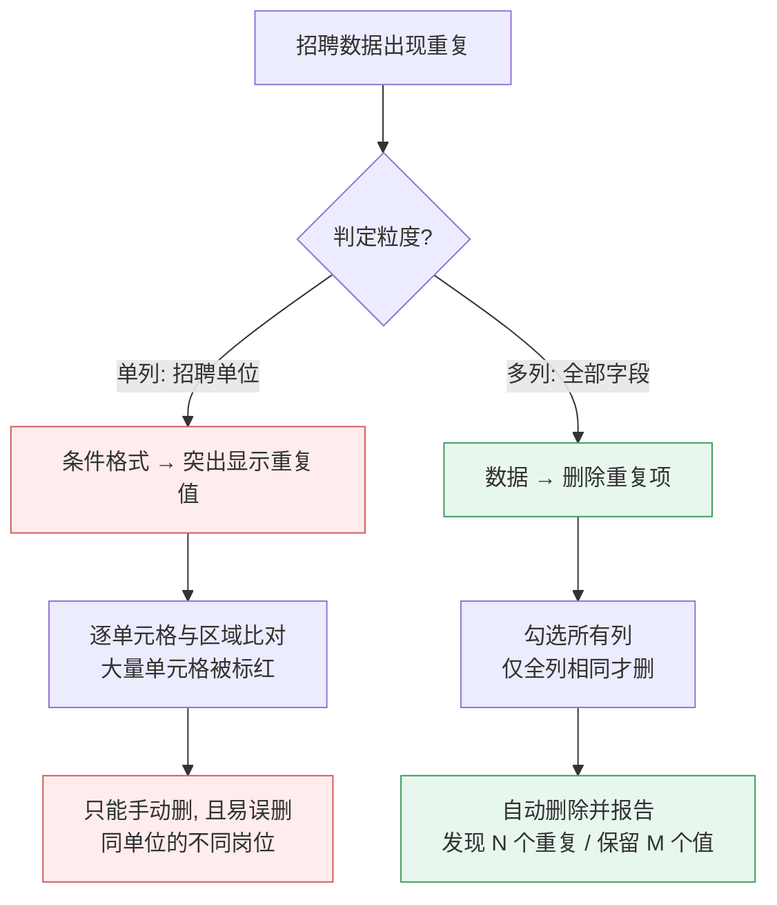

同一家公司在同一分钟发了两条一模一样的招聘信息，该删吗？该。但「同一家公司出现过两次」就删，会把它发布的其他岗位一起误杀。**去重、分列、排序筛选这三步看似是点几下菜单，真正难的是判断「以什么为粒度」**。这一节把三个操作各自的判定边界和可运行对照代码讲清楚。

## 纲要

- 预处理 = 清洗、格式化、去重、排序、基础指标计算，真实项目里占**一半以上**时间，且只多不少
- **条件格式标红是逐单元格比对**，只适合单列定位；全选区域会大面积误标，不适合多列重复判定
- **删除重复项可勾选多列**，只有选中列全部相同才删，才是「整行重复」的正确工具
- **分列**把 `\|` 分隔的标签拆成独立列，再「逐列去重 → 合并 → 再去重」得到全局唯一标签集
- CSV 是纯文本、逗号分隔、体积小的通用交换格式；导入乱码的根源是**编码选错**，优先 UTF-8 与 GB18030
- 排序必须选**扩展选定区域**，否则只有排序列动、其余列原地不动，**整行数据被打散且不可察觉**
- 文本排序按字典序，需先把「一年以下 / 应届毕业生」规范成可比较的写法；筛选搜索框是**包含**匹配，精确匹配要选「等于」
- 筛选只隐藏行、**不改动原始数据**；计数记得减掉标题栏那一行

## 读前须知（名词与环境）

| 名词 | 在这篇里指什么 |
| --- | --- |
| Python | 示例代码使用的编程语言，本文按 Python 3 运行 |
| pandas | Python 的数据处理库，把表格读成二维对象再做运算 |
| DataFrame | pandas 里的二维表格对象：有行、有列、每列有类型 |
| SQL | 数据库查询语言，用来从表里取数、筛选、汇总 |
| CSV | 逗号分隔的纯文本表格文件，常用作数据交换格式 |

> **运行环境**：Python 3 + pandas（数据处理库）；安装命令 `pip install pandas`。代码块各自自包含，可单独复制运行。表格里的全大写词是 Excel 或 SQL 的函数名，紧随其后都给了中文用途。
>
> **材料来源**：本文依据一套数据分析课程讲义整理，文中「讲义」指课程原文，「口述」指讲师在课上口头给出的数字。讲义说法与软件实际行为不一致时，本文按可复算的结果或软件官方语义改写，并在正文注明。

## 一、重复值：两种定位方式的本质差别



| 方式 | 比对对象 | 能否多列 | 是否自动删 | 风险 |
| --- | --- | --- | --- | --- |
| 条件格式「重复值」 | **每个单元格**与选区内其他单元格 | ❌ 仅单列可用 | ❌ 需手动 | 全选区域会把大量无关单元格标红，难以辨认哪两行真重复 |
| 「删除重复项」 | **整行**在勾选列上的组合 | ✅ 逐列勾选 | ✅ | 勾少了会把同单位不同岗位一起删掉 |

**为什么条件格式会误标**：它对当前选中单元格，去比对选区内是否存在与之一致的**任意**单元格，一旦一致就标红。所以「只要每个字段单独看有重复」就全红，而我们要的是「所有字段合起来完全相同」。

> 判断口径应当由业务决定：一个招聘单位完全可以发布多个不同岗位、不同要求。**默认口径是「所有列都相同才删」**；若业务明确只要「招聘单位+薪资区间+招聘岗位+工作地点+经验要求」五列相同即视为重复，就在弹框里只勾这五列。

## 二、分列：把标签拆开才能统计频次

技能类别这类维度，一个单元格里塞着多个标签（技能关键词、行业关键词），用 `|` 分隔。想统计「哪些标签被提及最多」，就必须先拆成一列一个标签。

| 分列方式 | 适用场景 | 讲义例子 |
| --- | --- | --- |
| 按分隔符号 | 有统一分隔符的文本 | 勾「其他」填 `\|` |
| 按固定宽度 | 每段长度固定的文本 | 按单元格宽度硬切 |

拆分后的标准动作：**逐列去重 → 合并到同一列 → 再对合并列去重 → 得到全局唯一标签集 → 按聚合函数统计频次**。讲义那份招聘数据最终得到 **81 个**被提及的标签。

> **预览只有两个标签？** 那说明选区只点了单个单元格，不是整列。取消后选整列再执行分列，预览里应能看到完整样本（如 `Java|Hadoop` 这类多项）。

## 三、CSV 导入：乱码是编码问题，不是数据问题

CSV 以纯文本存储、数据项用逗号分隔，兼顾可读性与便利性，是网页爬取后最常用的落地格式之一，体积也小。导入时文本导入向导分三步：确认分隔形式与**文件原始格式（编码）**、选择分隔符、确认起始单元格。

```text
work/target/data-analysis/
├── _PROGRESS.md
├── cleaning/
│   ├── 01_dedupe.py              # 单列误删 vs 多列正确去重 对照
│   ├── 02_split_tags.py          # 竖线分列 → 逐列去重 → 合并 → 全局去重 → 频次
│   └── 03_sort_filter.py         # 扩展排序 / 文本规范化 / 包含 vs 等于 / CSV 编码
└── output/
    ├── jobs_dedup.csv
    ├── tags_unique.txt
    └── jobs_filtered.csv
```

中文乱码的根因：**爬取系统与 Excel 的编码不一致**，电脑判不准字节属于哪种字符集就显示乱码。数据当初以 UTF-8 存的，导入时就要选 UTF-8；不确定时在 **UTF-8 与 GB18030** 之间试，基本能覆盖中文场景。

## 四、排序与筛选：三个高危细节

**① 扩展选定区域**。点「排序」后会问是「扩展选定区域」还是「以当前选定区域排序」。后者只对工作经验这一列排序、其他列不动——**一行数据就此被拆散**，而且表面看不出来。必须选前者，让整行作为一个单位一起移动。

**② 文本排序按字典序**。讲义按「经验要求」升序时得到：1-3 年、1 年以下、3-5 年、5-10 年、经验不限、经验应届毕业生。按业务常识，「应届毕业生」没有经验应排最前，其次「一年以下」。解决办法是**先规范文本再排序**：

| 原文本 | 规范化后 | 业务含义 |
| --- | --- | --- |
| 经验应届毕业生 | 经验 0 应届毕业生 | 无经验，最靠前 |
| 经验一年以下 | 经验 0 到 1 年 | < 1 年 |
| 经验 1-3 年 | 经验 1 到 3 年 | — |

**③ 包含 ≠ 等于**。筛选框里输入「数据分析」，命中的是所有**包含**这五个字的值，会把「数据分析开发」「风控数据分析」「高级数据分析」「数据分析实习」「数据分析专家」一起带进来；只要「数据分析师」，必须把条件切到「等于」。

> **计数口径**：选中列看下方计数，要减掉标题栏 1 行。讲义精确匹配「数据分析师」得到 118 − 1 = **117 条**。
> 另一处「筛选数据分析相关岗位」的条数，讲师口头给出的数字同时出现「一百三十八条」和「三十八条」且自相矛盾，**该数字不采信**，本文不据此下结论。

## 能力速览（要做什么 → 用哪个函数或写法）

| 能力 | Excel | pandas / Python | 说明 |
| --- | --- | --- | --- |
| 标出重复单元格 | 条件格式 → 重复值 | `df.apply(lambda c: c.duplicated(keep=False))` | 逐列独立判定，非整行 |
| 单列去重 | 删除重复项只勾 1 列 | `df.drop_duplicates(subset=["单位"])` | **高风险**：误删同单位其他岗位 |
| 多列去重 | 勾选全部列 | `df.drop_duplicates(subset=cols)` | 默认 `keep="first"` |
| 定位重复行 | 色块标红 | `df.duplicated(subset=cols, keep=False)` | 返回布尔掩码 |
| 按分隔符分列 | 数据 → 分列 → 其他 `\|` | `s.str.split("\|", expand=True)` | — |
| 全局唯一标签 | 逐列去重后合并再去重 | `.stack().dropna().unique()` | — |
| 标签频次 | 条件聚合函数 | `.value_counts()` | — |
| 读 CSV（含编码） | 文本导入向导 | `pd.read_csv(..., encoding="utf-8")` | 乱码换 `gb18030` |
| 整行排序 | 排序 + 扩展选定区域 | `df.sort_values("经验要求")` | **整行一起动** |
| 只排一列（错误示范） | 以当前选定区域排序 | `df["经验要求"].sort_values()` | 行被打散 |
| 包含匹配 | 筛选搜索框 | `s.str.contains("数据分析")` | 会带进衍生岗位 |
| 精确匹配 | 条件选「等于」 | `df[df["岗位"] == "数据分析师"]` | — |
| 筛选不影响原表 | 筛选仅隐藏行 | `df[mask]` 返回视图/副本 | 原 `df` 不变 |

## 可运行示例

三段各自可独立运行。第一段对照单列与多列去重，第二段跑通分列到频次，第三段复现排序陷阱、包含/等于差异与 CSV 乱码。

```python
from __future__ import annotations

import pandas as pd

df = pd.DataFrame([
    ("轻松集团", "10-15k", "数据分析师", "北京", "1-3年"),
    ("轻松集团", "10-15k", "数据分析师", "北京", "1-3年"),   # 完全重复
    ("轻松集团", "20-30k", "数据开发",   "北京", "3-5年"),   # 同单位、不同岗位
    ("星海科技", "10-15k", "数据分析师", "上海", "1-3年"),
    ("星海科技", "12-18k", "产品经理",   "上海", "3-5年"),
    ("云图信息", "8-12k",  "数据分析师", "上海", "1年以下"),
], columns=["单位", "薪资区间", "岗位", "地点", "经验"])

all_cols = list(df.columns)
mask = df.duplicated(subset=all_cols, keep=False)
print("多列判定为重复的行:"); print(df[mask].to_string(index=False))

wrong = df.drop_duplicates(subset=["单位"])       # 单列去重（错误示范）
right = df.drop_duplicates(subset=all_cols)       # 多列去重（正确）
print(f"\n原始 {len(df)} 行 | 单列去重剩 {len(wrong)} 行 | 多列去重剩 {len(right)} 行")
print("单列去重误删的岗位:", sorted(set(df["岗位"]) - set(wrong["岗位"])))
assert len(right) == 5, "只应删掉 1 条完全重复"
assert "数据开发" not in set(wrong["岗位"]), "单列去重会误杀同单位的其他岗位"
```

```python
from __future__ import annotations

import pandas as pd

jobs = pd.DataFrame({
    "岗位": ["数据分析师", "数据开发", "商业分析", "算法工程师"],
    "技能类别": ["Python|SQL|数据分析|Tableau",
                 "Java|Hadoop|SQL",
                 "SQL|数据分析|业务建模",
                 "Python|机器学习|SQL"],
})

# 数据 → 分列 → 分隔符号「|」
split = jobs["技能类别"].str.split("|", expand=True)
print("分列结果:"); print(split.to_string(index=False))

# 逐列去重 → 合并到同一列 → 全局去重 → 频次统计
tags = split.stack().str.strip().replace("", pd.NA).dropna()
unique = pd.unique(tags)
freq = tags.value_counts()
print("\n全局唯一标签:", sorted(unique.tolist()))
print("\n标签频次:"); print(freq.to_string())
print(f"\n标签总数 {len(tags)} / 去重后 {len(unique)}（讲义真实招聘样本去重后为 81 个）")
assert "数据分析" in unique and freq["SQL"] == 4, "SQL 在 4 条岗位里各出现 1 次"
```

```python
from __future__ import annotations

import io

import pandas as pd

df = pd.DataFrame({
    "岗位": ["数据分析师", "数据分析开发", "风控数据分析", "高级数据分析", "数据分析实习"],
    "经验要求": ["经验1-3年", "经验3-5年", "经验一年以下", "经验应届毕业生", "经验不限"],
})

# ① 排序陷阱：只排一列会打散行
broken = df["经验要求"].sort_values().reset_index(drop=True)
print("[错误] 只排一列的经验列:", broken.tolist())
print("       此时把它配回原岗位列 -> 岗位与经验错位")
print("[正确] 整行排序:"); print(df.sort_values("经验要求").to_string(index=False))

# ② 文本规范化后再排序，业务顺序才对
norm = df.copy()
norm["经验_sort"] = norm["经验要求"].replace({
    "经验应届毕业生": "经验0 应届毕业生",
    "经验一年以下": "经验0 到 1 年",
    "经验1-3年": "经验1 到 3 年",
})
print("\n[规范化后排序]"); print(norm.sort_values("经验_sort")["经验_sort"].tolist())

# ③ 包含 vs 等于
contains = df[df["岗位"].str.contains("数据分析")]
equals = df[df["岗位"] == "数据分析师"]
print(f"\n包含匹配 {len(contains)} 条 | 精确等于 {len(equals)} 条")
print("包含带进来的非目标岗位:", contains.loc[contains["岗位"] != "数据分析师", "岗位"].tolist())

# ④ CSV 编码：同一份 UTF-8 字节，解码选错就乱码
raw = "岗位,技能\n数据分析师,Python|SQL\n".encode("utf-8")
print("\n误按 GB18030 解码:", repr(raw.decode("gb18030", errors="replace").splitlines()[1]))
print("按 UTF-8 解码:     ", repr(raw.decode("utf-8").splitlines()[1]))
restored = pd.read_csv(io.StringIO(raw.decode("utf-8")))
assert restored.loc[0, "岗位"] == "数据分析师"
assert len(contains) == 5 and len(equals) == 1, "包含应命中 5 条、等于只命中 1 条"
```

## 📎 文本↔代码关联

| 文中结论 | 代码位置 | 怎么看 |
| --- | --- | --- |
| 条件格式逐单元格判定 | 第一段 `duplicated(subset=all_cols, keep=False)` | 只标出 2 条**全列相同**的行，同单位不同岗位未被标 |
| 单列去重误杀岗位 | 第一段 `wrong` | 断言「数据开发」被误删，6→4 行而非 6→5 |
| 多列去重才正确 | 第一段 `right` | `len(right)==5`，只删 1 条完全重复 |
| 分列 → 合并 → 全局去重 | 第二段 `split.stack().dropna()` | 13 个标签去重成 8 个，`SQL` 出现 4 次被断言 |
| 预览只有两项 = 只选了单格 | 第二段 `expand=True` | 拆出 4 列，说明选区是整列而非单格 |
| 排序未扩展会打散行 | 第三段 `broken` | 单独排序的列与原岗位列已无法配对 |
| 文本需规范化 | 第三段 `norm` | 「应届毕业生」「一年以下」被改写成可比较的 `经验0…` |
| 包含 ≠ 等于 | 第三段 `contains` / `equals` | 包含 5 条、等于 1 条，多出的 4 条被列出 |
| 乱码源于编码选错 | 第三段 `raw.decode(...)` | 同一份字节，两种解码结果直接对照 |

## 常见坑

- **全选区域后用条件格式查重**：逐单元格比对导致大面积标红，看不出哪两行是真重复，还可能据此手动删错行。
- **按单列删除重复项**：同一单位的不同岗位被一起删掉，岗位需求量统计直接失真。
- **分列只选了单个单元格**：预览里只出现两个标签就点完成，绝大部分标签没被拆出来。
- **CSV 中文乱码当成数据损坏**：改导入编码即可，不要去「修」原始文件；UTF-8 / GB18030 覆盖绝大多数中文场景。
- **排序选了「以当前选定区域排序」**：这是本节最危险的一条——只排一列、其余列不动，行被打散且没有报错，后续所有统计全错。
- **直接对业务文本做字典序排序**：「一年以下」「应届毕业生」会排到末尾，必须先把文本规范成可比较形式。
- **筛选框输入关键词当精确匹配**：默认「包含」，会把开发、风控、高级、实习、专家类岗位一起算进目标样本。
- **看计数忘了减标题栏**：Excel 下方计数含表头，写报告时条数会多 1。
- **以为筛选删了数据**：筛选只隐藏行，原表未变；真正删除要显式操作，别在汇报时说「已剔除」。

## 面试官会问什么

> 这节几乎全是「操作没报错但结果已经错了」的场景，面试官用它判断你有没有数据完整性意识。

| # | 面试官会问 | 回答要点（可直接口述） | 常见追问 |
| --- | --- | --- | --- |
| 1 | 条件格式标红和「删除重复项」的本质区别？ | 前者逐单元格与选区内其他单元格比对，只适合单列定位；后者按勾选的多列组合判定整行，只有所有列都相同才删，且自动执行。 | 全选区域后标红一片，为什么看不出哪两行真重复？ |
| 2 | 为什么按单列去重会误删数据？ | 同一个招聘单位可以发布多个不同岗位、不同要求。按单位名去重会把这些岗位一起删掉，需求量统计直接失真。 | 那什么时候单列去重才是合理的？ |
| 3 | 排序时选「以当前选定区域排序」会发生什么？ | 只有排序列动、其余列原地不动，一行数据被打散，而且表面看不出异常，后续所有统计全错。必须选扩展选定区域。 | 怎么快速发现这类错误？ |
| 4 | CSV 导入中文乱码的根因是什么？ | 爬取系统与导入端的编码不一致，电脑判不准字节属于哪种字符集。选 UTF-8，不确定时在 UTF-8 与 GB18030 之间试。 | 乱码要不要去修原始文件？ |
| 5 | 筛选框输入关键词是包含还是精确匹配？ | 默认是包含，会带进开发、风控、高级、实习等衍生岗位；要精确匹配得把条件切到「等于」。计数还要减掉标题栏一行。 | 筛选会不会改动原表？ |

**红旗答案**（说出来基本就停在这一档）：

- 全选区域后用条件格式查重并手动删行。
- 看计数忘了减标题栏，条数多报 1。
- 以为筛选删掉了数据，汇报时说「已剔除」。

**加分点**：

- 用排序前后对照证明按坐标求和会静默偏离，而按条件匹配不受影响。
- 把标签「逐列去重 → 合并 → 全局去重 → 频次统计」的链路说全，并说明预览不全时要检查选区。

## 总结

- 预处理占真实分析一半以上时间，其中**判定粒度**（按哪些列算重复）比操作步骤更关键。
- 条件格式适合**单列定位且手动处理**；「删除重复项」勾选多列才是整行去重的正确工具。
- 分列后按「逐列去重 → 合并 → 全局去重 → 频次统计」处理标签；预览不全先检查选区是不是整列。
- CSV 中文乱码优先试 **UTF-8 / GB18030**，属于编码问题而非数据问题。
- 排序**必选扩展选定区域**，文本排序先规范化，筛选区分**包含与等于**，计数减掉标题栏。
- 口述自相矛盾的条数不采信；结论只建立在能复算的数字上。